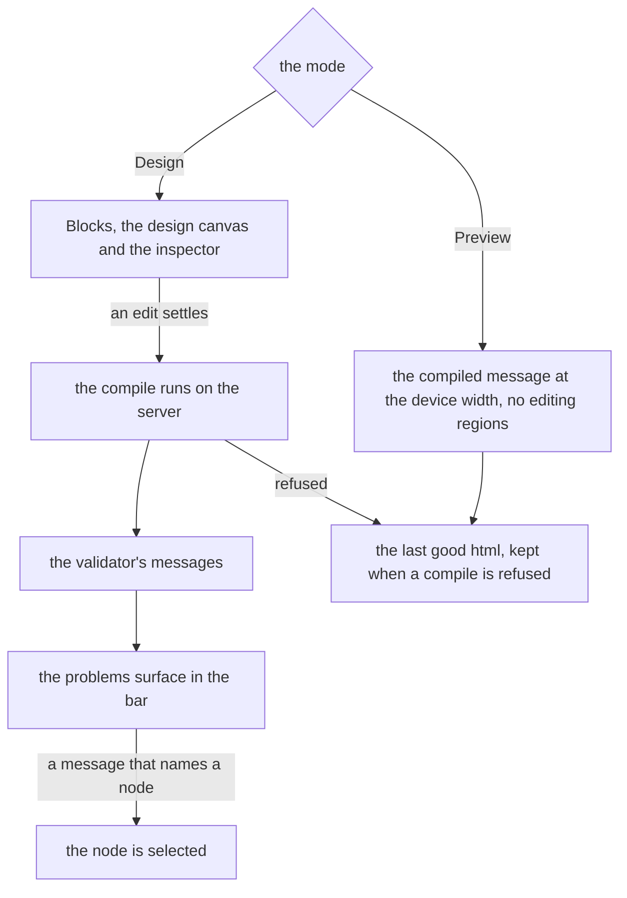

# Email layout

The email editor's arrangement on the [editor shell](../editor-shell/spec.md): the bar over the canvas, the blocks and the inspector beside it, and Design and Preview as the two modes of one editor. It sets where things are drawn and what each mode shows, not the email editor's document, its MJML blocks, its compile or its preview text, which the [email editor](../page-builder/email/design.md) owns.

The email differs from the webpage in what it must tell the reader. A webpage is drawn by the reader's own browser, and an email is read by a mail client that draws only what its table-based markup allows. The editor therefore has two views of one document, the design the author edits and the compiled message a client receives, and the compile can refuse or warn.

## How it works

| Region    | Edge        | Opens        | Modes  | Holds                                                                                                   |
| :-------- | :---------- | :----------- | :----- | :------------------------------------------------------------------------------------------------------ |
| Bar       | top, docked | always       | both   | the mode switch, the dataset picker, the preview text field, the device toggle and the problems surface |
| Blocks    | start       | on demand    | Design | tabs Blocks and Structure: the palette, with its Merge fields category, and the layers tree             |
| Inspector | end         | with content | Design | the selection's tabs, below                                                                             |
| Canvas    | the rest    | always       | both   | the design canvas in Design, the compiled message in Preview                                            |

The inspector has two selection kinds. With nothing selected it asks the author to select a block, since the email has no document settings of its own: its preview text is the bar's, and its root form holds no field. With a node selected it shows two tabs, Content and Style, which are the content and the MJML attribute fields the page builder draws. The email has no Theme tab and no per-breakpoint style tab, since it has no theme and no breakpoints.

**The compile's messages are findings.** The preview compiles the open document on the server and keeps the last good message when a compile is refused. Its validation messages are findings in the problems surface, in both modes, so an author in Design sees that an edit broke the markup without switching to Preview. A message that names a node selects it. A refused compile is listed as an error finding, and the preview still draws its last good html.

**The bar holds what the email needs at a glance.** The dataset picker and the preview text, which a recipient's inbox shows beside the subject, are fields of the email and stay one press away. The device toggle sits in the bar and applies to both modes, since the design canvas and the preview both draw at the chosen width. Import MJML is occasional and sits in the bar's overflow menu.

**Structure stays a tab.** The layers tree is the keyboard path to every move, the single-pointer alternative a drag needs, so it is kept as a tab beside Blocks rather than removed because the email nests shallowly. MJML's rules put a section above its columns and a column above its content, so the canvas already shows the structure as bands and columns, and the tree is the way to it without a pointer.

**A compact window** keeps the canvas in view and opens Blocks and the inspector as sheets from their buttons in the strip below the canvas.

## Decisions

- **Preview is a mode that removes the editing regions.** The compiled message is what a client receives, so a preview drawn beside the editing panes is drawn at the wrong width. Rejected: a split view with Preview beside the design, which halves both.
- **The compile's messages are listed in the problems surface.** An alert above the preview is seen only in Preview, after the edit. Rejected: an alert above the preview, which tells the author in the one mode they are not editing in.
- **The device toggle is in the bar for both modes.** The width is a property of how the message is viewed, not of one mode. Rejected: the toggle above the canvas only in Design, which leaves Preview with its own.
- **No Theme tab and no per-breakpoint tab.** The email has no theme and no breakpoints, and a tab with nothing to show is one the editor does not draw. Rejected: keeping the page builder's tabs for uniformity.
- **Structure is kept for the keyboard.** See above. Rejected: dropping the layers tree, because no email builder read in full documents one, since those builders are pointer tools and the repo holds a keyboard path for every move.
- **The bar is one fixed row that scrolls sideways.** The preview text field stacks a label, an input and a counter, so the row is as tall as that field, and its height is the constant `BAR_SIZE` in `apps/web/app/services/emailEditor/emailLayout.ts`. A narrow window scrolls the row rather than wrapping it. Rejected: a bar that wraps, whose controls land below the bar on a phone until a reader drags it taller, and a bar that folds its controls into the overflow menu, which would hide the dataset and the preview text the author edits.
- **The email has its own editor type.** The webpage and the email have different regions, so one reader state under a shared key would hold both layouts' sizes, and an id they share would take the other's size. Rejected: one page builder member for both layouts, which keeps the two sizes in one record.
- **A region with several panels draws tabs.** The inspector's Content and Style and the blocks' Blocks and Structure are one region each, and the reader chooses between them. The shell draws a tab strip for any region holding several present panels, labelled by `panelNameMap`, which names every panel the way `regionNameMap` names every region. Rejected: a second region for each tab, which would dock two panels where one fits, and a tab strip in each registry entry, which would hold the reader's choice outside the layout's state.
- **The registry binds each component to the blade's state.** The palette, the canvas's drag and the key commands are the blade's own composition, which no store holds, and the repo bans `provide` and `inject`. So each registry entry is a function that renders its component with the state the blade holds, which the shell draws with no props. Rejected: a store for the drag, which would outlive the open document it belongs to.
- **Preview compiles in Design too, so its messages reach the bar.** The preview is mounted beneath Design, so its findings are the compile's whatever the mode, and the compile runs once per settled edit in both modes. Rejected: compiling on entering Design alone, which would miss an edit made there before a switch.
- **The root form holds no field, so nothing selected asks for a selection.** The preview text is the bar's, so a settings panel would draw a blank column on every open of an email. A region with no present panel is not drawn, but an inspector that appears on selection narrows the canvas and moves a centred email, which the [editor shell](../editor-shell/spec.md)'s rule that a selection never moves what the canvas shows forbids. The inspector stays and holds a prompt. Rejected: an empty settings panel kept for the head's default attributes, which is blank, and no inspector until a node is selected, which reflows the canvas. A settings panel is added when the root holds a prop that earns one.

## Not built

- **Email client and dark-mode previews.** See the [deferred idea](../../../deferred/resource/email-client-and-dark-previews/design.md).
- **New email checks.** The problems surface lists the validator's messages and no others: contrast, links and alternative text are not checked over an email.
- **Sending, a subject line and a plain-text version.** Sending is its own [deferred idea](../../../deferred/resource/email-sending/design.md). The email has no subject line and no plain-text version. Stripo documents a subject and a preheader in a message-settings form and Klaviyo documents a plain-text version in a separate editor, so both are known shapes that no page here designs.

## Key files

| File                                                                     | Role                                                                                                                |
| :----------------------------------------------------------------------- | :------------------------------------------------------------------------------------------------------------------ |
| `apps/web/app/components/Resource/Email/Editor.vue`                      | the blade on the editor shell: the layout, the registry and the compile's findings                                  |
| `apps/web/app/components/PageBuilder/Email/Bar.vue`                      | the bar: the mode switch, the dataset, the preview text, the device toggle, the problems and the menu               |
| `apps/web/app/components/Editor/Shell.vue`                               | the editor shell, which draws the resolved layout's regions, tab strips and sheets                                  |
| `apps/web/app/components/Editor/Problems.vue`                            | the problems surface the bar mounts, which lists the findings and selects the node a finding names                  |
| `packages/vue-editor-layout-headless/src/composables/useEditorLayout.ts` | the headless composable the shell calls: the layout resolved for the context, the size class and the reader's state |
| `apps/web/app/services/emailEditor/emailLayout.ts`                       | the email's layout, its panels and the names the shell draws its regions and tabs under                             |
| `apps/web/app/composables/pageBuilder/usePageBuilderEditor.ts`           | the page builder's editing composition, which the blade and the webpage both call                                   |
| `apps/web/app/components/PageBuilder/Editor.vue`                         | the webpage's host, drawn on the shell with the webpage's layout                                                    |
| `apps/web/app/components/PageBuilder/Palette.vue`                        | the palette, registered as the Blocks tab                                                                           |
| `apps/web/app/components/PageBuilder/Layers.vue`                         | the layers tree, registered as the Structure tab                                                                    |
| `apps/web/app/components/PageBuilder/Canvas/DeviceToggle.vue`            | the device toggle, which the bar mounts and the webpage's arrangement still mounts                                  |
| `openspec/specs/resource/page-builder/email/design.md`                   | the email editor's document, blocks, compile and preview, whose arrangement this page holds                         |
| `openspec/specs/resource/email-preview-text/design.md`                   | the preview text the bar's field binds                                                                              |

## Sources

- [MJML's documentation](https://documentation.mjml.io/): sections hold columns and columns hold content, which the document's accepted types already hold and the insertion menu mirrors.
- [Stripo's editor guide](https://support.stripo.email/en/articles/6448082-new-editor-how-does-stripo-editor-work) (fetched): blocks and structures in panels on the left, a settings panel, and a switch between the desktop and mobile versions in the top toolbar.
- [Klaviyo's guide to its template editor](https://help.klaviyo.com/hc/en-us/articles/4407911841435) (fetched): a preview that checks the desktop and mobile layouts, and a test send from the preview sidebar.
- [Stripo's built-in dark mode](https://stripo.email/en/blog/built-in-dark-mode-in-stripo-how-stripo-helps-you-test-emails-faster) (fetched): a dark preview in the editor labelled indicative, which the deferred idea records.
- [Beefree's configuration parameters](https://docs.beefree.io/beefree-sdk/readme/installation/configuration-parameters): a mobile design width and merge tags as configured parts of an email editor, which the device toggle and the dataset picker are.
- [Mailchimp's new builder](https://mailchimp.com/help/design-an-email-new-builder/): content blocks, layouts and a desktop and mobile switch in one editor.
