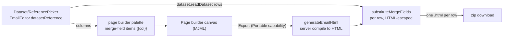

# Email Personalization

The email editor joins the data flow: merge fields bound to a `DatasetReference`, survey invite buttons, and per-row personalized HTML export — applying the [datasets standard](../../architecture/dataset/design.md) to the email product. Actually sending email is deferred ([email sending](../../../deferred/resource/email-sending/design.md)).

## How it works

An email optionally binds one dataset (`EmailEditor.datasetReference`, stored inside the content blob, which every page builder save writes whole, so the binding survives each edit). The bound dataset's columns appear in the page builder's palette as merge-field nodes (`{{columnName}}`), and a survey invite node (`shared/services/pageBuilder/email/emailSurveyInviteType.ts`) links to a survey by its id. Export compiles the stored document to HTML once on the server (`generateEmailHtml`, over `server/services/emailEditor/compileEmailContent.ts`), then the browser zips one personalized `.html` per dataset row with merge fields substituted.

## Key files

| File                                                       | Role                                                                                            |
| ---------------------------------------------------------- | ----------------------------------------------------------------------------------------------- |
| `app/services/emailEditor/toMergeField.ts`                 | canonical `{{columnName}}` token                                                                |
| `app/services/pageBuilder/email/createMergeFieldNode.ts`   | bound column → a text node carrying the escaped token                                           |
| `app/services/pageBuilder/MergeFieldExtension.ts`          | the two-brace suggestion over the bound dataset's columns                                       |
| `app/composables/pageBuilder/useMergeFieldColumns.ts`      | the bound dataset's columns, provided by the shell                                              |
| `app/services/emailEditor/substituteMergeFields.ts`        | per-row substitution, HTML-escaped                                                              |
| `server/services/emailEditor/compileEmailContent.ts`       | the one compile of the stored document, shared with the [web view](../email-web-view/design.md) |
| `app/services/emailEditor/exportPersonalizedHtml.ts`       | personalized HTML files → one zip, shared with the program's invites                            |
| `app/components/Resource/Email/Editor.vue`                 | the email's page builder, mounted by the resource routes over the email store                   |
| `app/components/Resource/Email/ExportTruncationDialog.vue` | the confirm a capped dataset read routes through before exporting                               |

## Notes

- Export surfaces through the **Portable** capability (`PortableFormatMap[Email]` personalized-HTML `export()`), rendered as Import/Export entries in the resource command bar — the email's page builder is mounted over the email store, so the command-bar export compiles the stored document.
- Merge-field palette entries read the bound dataset's columns on render, so no per-item re-sync is kept. The survey invite is bound from a picker of the owner's published surveys, the one the [webpage survey invite](../webpage-survey-invite-blocks/design.md) uses.
- Substituted values are HTML-escaped: merge fields personalize text, never inject markup. Tokens are inserted escaped and substitution matches both raw and escaped token forms, since the canvas entity-encodes special characters (e.g. a "P&L" column) on serialization.
- Export is one download, so no directory permission prompt stands between the sender and the artifact.
- Exported files keep app-origin asset urls (`/api/resource-assets/…`), which resolve only for a request carrying the owner's session cookie — images are blank in a file opened straight off disk. Durable public asset urls come with [email sending](../../../deferred/resource/email-sending/design.md).
- The `EmailEditor` content class name is frozen (registered in `JSONClassMap` — renaming breaks superjson deserialization of persisted blobs).
