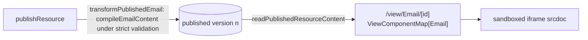

# Email Web View

Email opts into the **Publishable** capability, so a compiled email has a public URL: `/view/Email/[id]`. That is the industry-standard "view this email in your browser" artifact, a review link to hand a colleague before a send, and the natural merge target for a web-version link when [email sending](../../../deferred/resource/email-sending/design.md) un-defers.

The published copy is the **unpersonalized template**: merge-field tokens render as authored, which is exactly right for a browser or review copy — a per-recipient web version is deliberately out (see Notes).

## How it works

The server compiles the email at publish, so the snapshot's HTML is derived from the document the page builder saved rather than captured from an editor. A compile that MJML would refuse under strict validation refuses the publish, with the validator's own message, and the last published version stands. The working copy holds no HTML of its own.

- **Content schema** — `EmailEditor` carries the compiled `html` of a published snapshot, which the server writes at publish.
- **Capability** — `publishable: true` on Email in `ResourceDefinitionMap`. The derived union then _requires_ a `ViewComponentMap[Email]` entry (a compile error until it exists) and _grants_ the publish procedures — zero bespoke endpoints, which is the whole point of the capability model. Publish and Unpublish appear in the command bar automatically through the existing capability gate.
- **View component** — serves the snapshot's `html` through a sandboxed iframe `srcdoc`, identically to the Webpage view: scripts run, but `allow-same-origin` is withheld, so a published email cannot touch a viewer's session. OG meta tags come with the existing view-page behaviour.

## Key files

| File                                                              | Role                                        |
| ----------------------------------------------------------------- | ------------------------------------------- |
| `apps/web/shared/models/emailEditor/data/EmailEditor.ts`          | compiled `html` on the content schema       |
| `apps/web/server/services/emailEditor/compileEmailContent.ts`     | the one MJML compile, shared with export    |
| `apps/web/server/services/emailEditor/transformPublishedEmail.ts` | the publish compile under strict validation |
| `apps/web/app/components/Resource/Email/View.vue`                 | `ViewComponentMap[Email]` renderer          |
| `apps/web/shared/services/resource/ResourceDefinitionMap.ts`      | `publishable: true` on Email                |

## Notes

- A personalized web version per recipient (resolving merge fields server-side per invite token) is deliberately out: it would make the public view do per-request dataset reads, which is exactly what publishing exists to avoid. The published copy is one static artifact.
- Hosted images inside the published copy come from [resource file assets](../resource-file-assets/design.md); external-URL images work unchanged.
