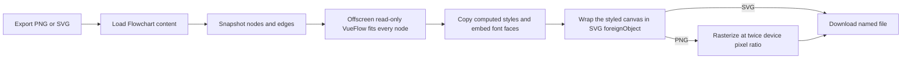

# Flowchart image export

The resource menu exports a Flowchart as a PNG or SVG named after the resource. The whole diagram is captured, even when the editor is closed or its viewport is zoomed into one corner.

## How it works

- **The editor stays untouched.** Export snapshots the graph, renders it in a separate read-only canvas, and fits that canvas to every node. It works from the Overview blade and never moves the editor's pan or zoom.
- **SVG keeps text as embedded HTML.** The SVG wraps the styled canvas in a `foreignObject`, copies computed styles, and embeds page font faces. PNG rasterizes that same SVG at twice the device pixel ratio.
- **The export surface is lazy.** Flowchart's dialog component loads only for a Flowchart resource. The export canvas statically imports the capture service, so the capture service loads with the Flowchart dialogs, and other resource pages do not load it.
- **The page supplies the background.** The export canvas uses the current theme's background and omits the dot grid.

## Key files

| File                                                            | Role                                                     |
| :-------------------------------------------------------------- | :------------------------------------------------------- |
| `apps/web/shared/services/resource/ResourceDefinitionMap.ts`    | Flowchart opts into the Portable capability              |
| `apps/web/app/services/resource/PortableFormatMap.ts`           | PNG and SVG export menu entries                          |
| `apps/web/app/services/resource/ResourceDialogsComponentMap.ts` | Lazily loads the Flowchart export surface                |
| `apps/web/app/store/flowchartEditor/export.ts`                  | Holds the graph snapshot while the export canvas renders |
| `apps/web/app/components/Resource/Flowchart/ExportCanvas.vue`   | Fits and downloads the offscreen read-only canvas        |
| `apps/web/app/services/resource/flowchart/captureFlowchart.ts`  | Captures SVG and rasterizes PNG                          |

## Notes

- Exports contain the complete diagram, including nodes outside the editor's current viewport.
- There is no import path because an image cannot restore the diagram's node and edge model.
