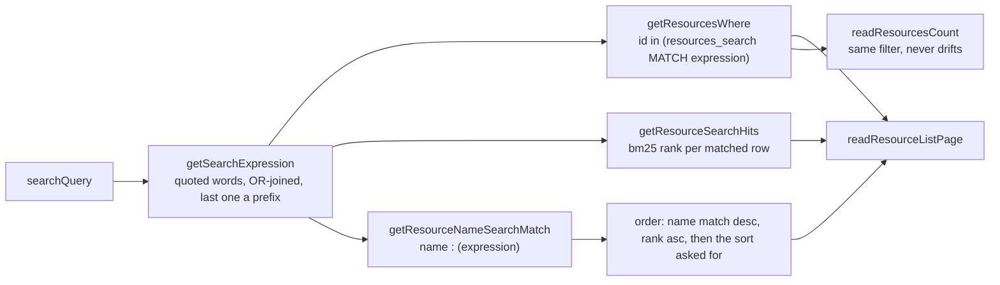

# Global Search Relevance

[Global search](../global-search/design.md) finds a resource by the words of its name and its tags and ranks a name match above a tag-only one. It runs on SQLite's FTS5 full-text index, which D1 ships, so it needs no extension and no second service.

## How it works

The user's text becomes one FTS5 `MATCH` expression. Each word is a quoted phrase with any embedded `"` doubled, so `OR`, `NEAR`, `*`, `:` and `-` are words to find rather than operators. The words are OR-joined, and the last word carries a prefix `*`, so a word still being typed finds its completions. No words is no expression at all.

The expression reaches three places, and each is built from the same string:

The filter is the owner's: `getResourcesWhere` narrows the index hits to the caller's rows that are not soft-deleted, so the index itself never decides visibility. `readResourceList` orders by the name arm first, because a `bm25` rank alone cannot keep a tag-only row below a name row. The weights are name 10 and tags 1, so among the rows that match, a name that holds the word ranks above one whose tag does.

## Data model

The index is one FTS5 virtual table beside `resources`, kept by three triggers in the migration that creates it:

- `resources_search(name, tags, id UNINDEXED)`, tokenized `unicode61 remove_diacritics 2`.
- `tags` is the stored JSON flattened to `key value` pairs with `json_each`, so a tag's key and its value are both words.
- An insert adds the row, an update of `name` or `tags` deletes and re-adds it, and a delete removes it.

drizzle-kit does not see virtual tables, so the table is declared in the migration only. The messages index is the same arrangement.

Matching is by word, not by substring. A fragment inside a word does not match, and a misspelled word matches nothing. The trigram similarity that gave typo tolerance on Postgres does not carry over: FTS5 has no similarity function, and D1 loads no extensions. Typo tolerance is therefore given up, not emulated.

The index is keyed by `id`, not by `rowid`, so a rename, a tag edit or a hard delete finds its row by scanning the index. Each such write costs in proportion to the index, not the row. Mapping the resource's `rowid` onto the index would make those writes direct; it is the fix if write cost shows up.

## Key files

| File                                                                         | Role                                                  |
| ---------------------------------------------------------------------------- | ----------------------------------------------------- |
| `server/services/search/getSearchExpression.ts`                              | The query's words as one quoted, OR-joined expression |
| `server/services/resource/getResourceSearchMatch.ts`                         | The index arm of the owner's filter                   |
| `server/services/resource/getResourceNameSearchMatch.ts`                     | The name-only arm that orders name matches first      |
| `server/services/resource/getResourceSearchHits.ts`                          | The index rows and their `bm25` rank                  |
| `server/services/resource/readResourceList.ts`                               | The ranking ladder                                    |
| `server/services/resource/readResourceListPage.ts`                           | Joins the hits and pages the result                   |
| `server/services/resource/getResourcesWhere.ts`                              | The filter the list and the count share               |
| `server/services/resource/readResourceTagCounts.ts`                          | The Tags breakdown over the expanded tag keys         |
| `server/db/migrations/core/` (the migration that creates `resources_search`) | The virtual table and its three triggers              |

## Notes

- Azure AI Search stays [deferred](../../../deferred/resource/azure-ai-search/design.md). Nothing at this scale needs it, and the full-text index is the cheap part of what it would buy.
- A tag filter is an exact key and value match, a different read from search. The [tags](../tags/design.md) design owns it.
- Searching content is a different feature with a different index.
