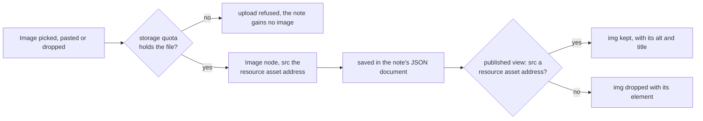

# Note images

A note holds images as well as text. An image is added from the note's menu, by paste or by drop, and carries alt text. The note itself is the [note resource](../note-resource/design.md); the files behind each image are the [resource file assets](../resource-file-assets/design.md) capability's, which every type holding pictures already uses.

## How it works

An image enters a note three ways, each through `useInsertNoteImages`, which uploads it through the shared upload path before anything joins the document: an **Image** button in the menu bar that opens a file picker, a paste, and a drop. A paste and a drop run through `@tiptap/extension-file-handler`, which the message composer also uses. The upload returns a stable `/api/resource-assets/…` address, and the editor inserts an Image node holding that address at the caret, or where the file was dropped. The node holds the address and never the bytes, so the document stays small and the image still shows after the note is saved and reopened. A refused upload shows an error and adds nothing, and the other images in the same pick still go in.

The owner's storage quota decides the upload, and a refusal leaves the note without the image ([storage quotas](../storage-quotas/design.md)). Unpublishing releases the publication's copies of the file, as it does for every file asset.

Alt text is set from a popover opened on a selected image, shaped like the link popover. The Image node joins the note's shared extension set, so the editor, the `generateHTML` render and the note validator read the same node. An image renders at its natural size, capped at the column width by the rich-text typography.

The published view shows an image only when its source is a resource asset address. `renderNoteHtml` hands the sanitizer one allowance for a note: an `img` whose `src` matches the resource asset address pattern, keeping `alt` and `title`. Any other image is dropped with its element, which keeps tracking pixels and hotlinks out of a published page. The page builder's text and an email's rich text render through the same function, so a resource image shows in them too, and any other is dropped there as well.

## Notes

- **No image from a url.** Notion embeds a link, but an external `src` is the one form the sanitizer drops. Owning the bytes keeps a published page working after the source moves.
- **No resize handles or captions.** They are Notion's ceiling, and an image renders at its natural size, capped at the column width.
- **No image in the message composer.** The composer's attachments are files on their own path ([file uploads](../../architecture/file-uploads/design.md)), and the sanitizer's image allowance stays out of the composer.
- **The column cap has no test.** The cap is the image rule in the rich-text typography, and happy-dom lays out no box, so a layout claim about the app's own components waits until their code is extracted into a package that has one (`.agents/skills/testing/references/test-environment.md`).

## Key files

| File                                                            | Role                                                                 |
| --------------------------------------------------------------- | -------------------------------------------------------------------- |
| `apps/web/shared/services/resource/ResourceDefinitionMap.ts`    | Note declares `fileAssets: true`                                     |
| `apps/web/shared/services/resource/note/getNoteExtensions.ts`   | the Image node, shared by the editor, the render and the validator   |
| `apps/web/app/components/Resource/Note/Editor.vue`              | the file handler that takes a pasted or dropped image                |
| `apps/web/app/components/Resource/Note/EditorMenuBar.vue`       | the Image button                                                     |
| `apps/web/app/components/Resource/Note/AltTextMenuButton.vue`   | the alt text popover on a selected image                             |
| `apps/web/app/composables/resource/note/useInsertNoteImages.ts` | uploads the picked, pasted or dropped images and inserts their nodes |
| `apps/web/shared/services/resource/note/renderNoteHtml.ts`      | passes the note's one image allowance to the sanitizer               |
| `packages/shared/src/services/sanitizeHtml/sanitizeTextHtml.ts` | takes that allowance, which the message composer does not receive    |
| `apps/web/app/assets/css/globals.css`                           | the image rule that caps an image at the column width                |
| `apps/web/package.json`                                         | depends on `@tiptap/extension-image` from the catalog                |
| `pnpm-workspace.yaml`                                           | the catalog entry for `@tiptap/extension-image`                      |

## Sources

- [Notion — images, files and media](https://www.notion.com/help/images-files-and-media) — adding an image from the block menu or by drag and drop, and alt text under `•••`.
- [Tiptap — Image extension](https://tiptap.dev/docs/editor/extensions/nodes/image) — the `@tiptap/extension-image` package and its `src`, `alt` and `title` attributes. The page also says it only displays images and leaves the upload to the FileHandler extension.
