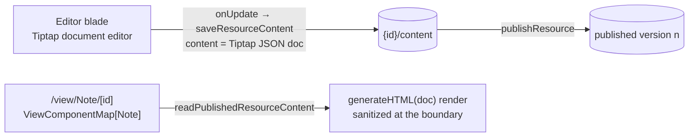

# Note resource

A Note is the platform's plain **document**: meeting notes, a spec, a README-style page — authored in Tiptap (already a dependency, powering the messaging editor) and shareable through the standard publish flow. It fills the gap between the spreadsheet (Sheet), the form (Survey), the site builder (Webpage), the BI canvas (Dashboard), the diagram (Flowchart), and the email — the everyday page of formatted text none of those were for.

## How it works

- **Content schema** — `{ doc: <Tiptap JSON document> }`. The ProseMirror JSON document, not HTML, is the source of truth at rest (structured, diffable later, no sanitization ambiguity when stored). The doc is validated as an open-ended recursive object per the resource content-schema standard, so any node a future Tiptap extension emits still round-trips.
- **Editor blade** — a Tiptap instance with headings, bullet and ordered lists, task lists, simple tables, bold, italic, inline code, blockquote, and links. A Table button inserts a 3 × 3 table with a header row; while the caret is in a table, Table actions offers row and column insertion/deletion, header row/column toggles, and table deletion. The menu stays available to keyboard and touch users. This is a superset of the messaging composer's marks; the two share the StarterKit list and mark buttons but stay separate editors — the messaging editor is a one-line composer with mentions, emoji, and a file handler, and forcing one shared editor would violate same-level abstraction. Edits autosave through `saveResourceContent` on the shared resource autosave cadence.
- **Task lists** — Tiptap's `TaskList` and `TaskItem` (`@tiptap/extension-list`, which StarterKit already depends on). `[ ]` or `[x]` and a space at the start of a line starts one, as Notion's to-do block does, and so do the menu bar's **Task list** button, which is the Note's own and not in the composer's shared list buttons, and Ctrl+Shift+9. A task holds sub-tasks, since `TaskItem` is `nested`. Ticking a task in the editor is an ordinary document edit and autosaves like one. The checkbox sits beside the text in place of a bullet, and a ticked task's own lines are muted and struck through, leaving its open sub-tasks readable. The rules are in the rich-text typography, which the editor and the published view both wear.
- **Published view** — Note is `publishable`. The public `/view/Note/[id]` page reads the published snapshot and renders `generateHTML(doc, extensions)` output with app typography. `generateHTML` comes from `@tiptap/html`, which serializes without a browser DOM, so the render is SSR-safe and SEO-friendly, and its HTML is sanitized with `sanitizeTextHtml` at the render boundary — the one place HTML ever exists for a Note. The sanitizer keeps a task list's markup and its one input, which it always rewrites to a disabled checkbox that keeps only its ticked state, so a visitor sees the ticks and cannot change them.
- **Tables** — simple tables contain text only. The existing sanitizer preserves their table tags, and shared rich-text styles draw them in the editor and published view. Merged cells, resizing, colours, sorting, formulas, and typed values are outside the Note writing kit. A data table that needs those features is a Sheet.
- **Create form** is name-only. Everything else — explorer listing, create tile, blades, command bar, publish, search — arrives from the resource shell for free.

## Data model

Note owns no tables. It is one `ResourceType` enum value (`Note`, added to the `resource_type` Postgres enum by migration `20260717000000_add_note_resource_type`) and one `ResourceDefinitionMap` entry (`icon`, `title`, `contentSchema`, `capabilities: { publishable: true }`). Its working copy lives at `{id}/content` in the shared `ResourceAssets` blob container and its published versions in the [version store](../resource-version-store/design.md), exactly like every other resource — see [resources](../../architecture/resource/design.md).

## Key files

| File                                                                   | Role                                                                 |
| ---------------------------------------------------------------------- | -------------------------------------------------------------------- |
| `packages/db-schema/src/models/resource/ResourceType.ts`               | `Note` enum value                                                    |
| `apps/web/server/db/migrations/20260717000000_add_note_resource_type/` | pg enum `ADD VALUE 'Note'` migration                                 |
| `apps/web/shared/models/resource/note/NoteResource.ts`                 | `{ doc }` content schema                                             |
| `apps/web/shared/services/resource/constants.ts`                       | `EMPTY_NOTE_DOC`, the empty-document default                         |
| `apps/web/shared/services/resource/ResourceDefinitionMap.ts`           | Note definition entry                                                |
| `apps/web/shared/services/resource/note/getNoteExtensions.ts`          | shared Tiptap extension set (editor + published render + validation) |
| `apps/web/app/components/Resource/Note/Editor.vue`                     | Tiptap editor blade                                                  |
| `apps/web/app/components/Resource/Note/EditorMenuBar.vue`              | writing-kit toolbar                                                  |
| `apps/web/app/components/Resource/Note/TableMenuButton.vue`            | active-table row, column, header, and delete commands                |
| `apps/web/app/components/Resource/Note/View.vue`                       | published `generateHTML` render                                      |
| `packages/shared/src/services/sanitizeHtml/sanitizeTextHtml.ts`        | keeps a task item's checkbox, disabled                               |
| `apps/web/app/assets/css/globals.css`                                  | task-list and table rules in the rich-text typography                |
| `apps/web/app/store/resource/note/index.ts`                            | blade-scoped load/save store                                         |
| `apps/web/server/trpc/routers/note.ts`                                 | `createResourceProcedures(Note)` router                              |

## Notes

- **Naming is Note, never Document.** "Document" reads as an umbrella over every editor resource rather than this one type, which is exactly the ambiguity consolidating them removed. The identifier is singular like every `ResourceType` value; a pluralized display title is a UX decision deferred to `ResourceDefinitionMap` across all types at once, never an identifier change.
- **JSON at rest, HTML only at render.** The editor stores `editor.getJSON()`; the view is the sole place HTML is produced, and it is sanitized there. No sanitization happens on the save path because nothing HTML is ever stored.
- **Extensibility cost.** "One `ResourceType` plus one `ResourceDefinitionMap` entry" understates what a new type costs. Beyond the enum value, the definition entry, the editor component and the view component, it needs a per-type tRPC router (`note.ts`) registered in the root router, and a `[ResourceType.Note]: []` entry in the exhaustive `ResourceBladeDefinitionMap`; making it creatable from the explorer adds `CreatableResourceTypes` and `ResourceTypeDescriptionMap`. None of that is the definition map — it is the router-per-type topology, and it is the honest friction of adding a type. Dispatch is the half that is derived rather than listed: `useCreateResource` reaches the type's `createResource` through `useResourceRouter` and the type's own name, so no list of create procedures exists to keep in step.
- Collaboration and comments remain platform-wide deferrals ([collaboration](../../../deferred/resource/document-collaboration/design.md), [comments](../../../deferred/resource/resource-comments/design.md)), and version history is platform-wide ([resource snapshots](../resource-snapshots/design.md)); Note rides what the platform does. Markdown export (the Portable capability) is a natural follow-on, not bundled.

## Sources

- [Tiptap — TaskList extension](https://tiptap.dev/docs/editor/extensions/nodes/task-list) — the package, the `TaskItem` requirement, the `[ ]` input rule and the Ctrl+Shift+9 toggle.
- [Tiptap — Table extension](https://tiptap.dev/docs/editor/extensions/nodes/table) — `TableKit` and the row, column, header and delete commands.
- [Notion — columns, headings and dividers](https://www.notion.com/help/columns-headings-and-dividers) — simple table blocks, header rows and columns.
- [Notion — keyboard shortcuts](https://www.notion.com/help/keyboard-shortcuts) — `[]` then space starting a to-do block, the reference writing shortcut.
