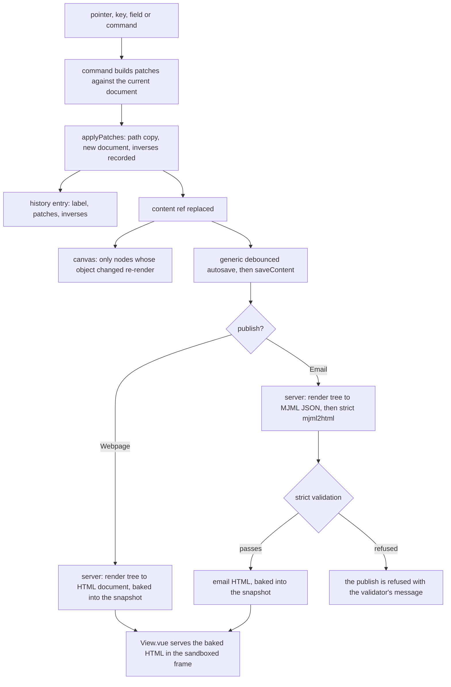

# Document model

The webpage and email editors' documents: the node types each editor registers over the [headless core](../../../headless-block-editor/editor-core/design.md)'s tree, and how a finished document becomes the page or the email a reader gets. The webpage's types are the app's own. The email's types are the [MJML blocks](../../../mjml-blocks/README.md) package's, with the app's survey invite added. The documents sit beside the GrapesJS editors, which still mount and save their own shape until the [cutover](../../../../changes/resource-page-builder-cutover/design.md) binds these in their place.

## The document shape

The universal model for block editing is a typed ordered tree: every node a type tag selecting a schema, and its props; a container is a node one of whose props holds a list of nodes. No one standard is shared across builders. What they share is that tree, and the open specifications differ only in where they put the id and the children:

- **Puck** stores `{ root: { props }, content }`, where `content` and every slot prop hold `ComponentData` (`{ type, props }`, with the id required inside `props`). Slots, a prop holding a node array, replaced its earlier flat `zones` map, and `migrate()` moves old data across. A node is two fields, and children are a kind of prop, so a type can have any number of named regions.
- **BlockNote** stores `{ id, type, props, content, children }`: one fixed children list, inline content beside it, and props limited to scalars. It is a ProseMirror document, and its multi-column package is licensed GPL-3.0 or commercially.
- **Portable Text** is rich text: a flat array of `_type`/`_key` blocks with spans and mark definitions, nested only by list level. It is a text model, not a layout model.
- **The Block Protocol** is a protocol between an embeddable block and the application embedding it. Our blocks never leave our editor, so its messaging layer would be cost with no second party.

Puck's is the minimal of these, so the document takes its shape rather than inventing one. The headless core builds it as:

```ts
// A node: its type names an entry of the registry, and its props hold its id, its own fields and each slot's children
interface BlockNode {
  props: Record<string, unknown>;
  type: string;
}
// A document: its content, and its root's props, typed by the registry's root schema once parsed
interface BlockDocument<TRootProps> {
  content: BlockNode[];
  root: { props: TRootProps };
}
```

The two editors' documents are these, each with its root's props typed by its registry: `WebpageDocument` is `BlockDocument<WebpageRootProps>`, and an email is `MjmlDocument`, the MJML blocks' `BlockDocument<MjmlRootProps>`, which the email uses without an alias of its own.

## Schemas

Each editor's document schema is the core's `createBlockDocumentSchema` over that editor's registry. The node's shape and the root's props, parsed by the root's own schema, come first. Then a refinement walks the tree and checks each node's type against the registry and its slot, its props against its type's schema, that ids are unique within the document, and that the node count stays within a named limit the editor passes in: `MAX_WEBPAGE_NODES` (2000) for the webpage and `MAX_EMAIL_NODES` (1000) for the email. A refusal names the slot or the field that refused.

An id is short, unique within its document and minted by one helper, since it also names the node's class in the emitted CSS. The text inside a text node is the ProseMirror JSON the Note stores, validated by the Note's own document schema, which the webpage's text node and the email's rich text both read. Portable Text was weighed for the text node and lost: it would need an editor of its own, since Portable Text's is React, or a converter each way, against a format the app already stores, edits and renders on the server.

## Two registries

A registry is the core's `BlockRegistry`: the types its content accepts at the top of a document, the root's props schema, and each type's definition. The two editors' registries are built differently because the two types of node are different.

- **The webpage registry** (`webpageRegistry`) takes every placeable type at the root and a `lang` as its root's props. Its types are collected in `webpageNodeTypeDefinitionMap`, a `Record` over the `WebpageNodeType` enum, so a type missing from either half of the map fails the typecheck. A Column is held only by Columns and a Tab only by Tabs, so neither is placeable at the root.
- **The email registry** (`emailRegistry`) is the MJML blocks' `createMjmlRegistry`, given the app's survey invite as its one leaf type and the Note's writing kit as its rich text. The root takes only what MJML's body takes, and the head is the root's props.

A webpage registration has two halves, because two runtimes read it: the server renders a type when it publishes, and only the editor draws one. The shared half is the `NodeTypeDefinition` the server and editor both import, which extends the core's `BlockTypeDefinition` with the type's structural CSS, its form schema, its pure `render` and an optional script. The editor's half, the palette entry and the canvas component, belongs to the [canvas](../../../../changes/resource-page-builder-canvas/design.md), and the style fields belong to the [style panel](../../../../changes/resource-page-builder-style-panel/design.md).

A cross-resource reference is a prop declared with `createResourceLinkSchema`, so `ResourceTypeGetLinkTargetsMap` indexes it with no code of the type's own. A survey invite in a webpage or an email becomes a `resourceLinks` row, and the [delete reference warning](../../delete-reference-warning/design.md) names it when the survey is deleted.

## Webpage node types

| Category | Types                                                                                                         |
| -------- | ------------------------------------------------------------------------------------------------------------- |
| Layout   | Section (a semantic tag of header, main, section, footer or div), Columns of Column                           |
| Content  | Text, Button (a link drawn as a button), Image, Video (an uploaded file), Custom HTML                         |
| Extra    | Countdown, Tabs of Tab, Tooltip, Typed text                                                                   |
| Survey   | Survey invite, a link to a published survey, whose survey prop is declared through `createResourceLinkSchema` |

Each type's contract makes its published output accessible by construction rather than by review. An Image requires its `alt` or an explicit decorative flag, which publishes as an empty `alt` with `role="presentation"`. A Video requires a title as its accessible name. Tabs publish with the tablist pattern and the arrow keys in their script. Typed text keeps its whole text in the accessible name and stands still under reduced motion. A Countdown is a timer whose live region stays off, and a Button is a real link.

Every URL prop passes `checkIsAllowedUrl` in its schema, so a `javascript:` address is refused at save, including behind a leading space or another case. Custom HTML is cleaned by `sanitizeHtml` both when it is stored and again when it is published. Custom HTML is the one type whose stored markup is raw, so the sanitiser runs over it at both ends.

## Rendering

`render` returns a small element tree, a tag, typed attributes and children, or raw HTML the serialiser writes as it is. One serialiser, `serializeHtml`, turns a tree into HTML and escapes every text node and attribute value through the shared sanitiser's `escapeText` and `escapeAttribute`. Attribute names come from a typed set with no event handler in it. A render's context is the site's origin, which the survey invite's link to the published survey is written against.

Two types hand the serialiser HTML rather than a tree. Text's HTML is the Note's rich text rendered by `renderNoteHtml`, which is `sanitizeTextHtml` over `generateHTML` with the Note's writing kit, and so is the email's rich text, and the Note's own view renders through the same function. Custom HTML's HTML is the sanitised raw markup.

A webpage renders to one document through `renderWebpageDocument`, a pure function that the browser's export can run as well as the server. The document opens with `<html lang>` from the root, then one stylesheet of each present type's structural CSS, then the body, and each present type's script once.

An email renders through the MJML blocks' `renderMjmlDocument` to MJML's JSON form, with the head from the root's props and the body from its content. The survey invite's render is an `mj-button` whose href is the survey's absolute link, and it escapes its attribute and its label the way the package's own types do.

The server's compile service is `compileEmailDocument`. It renders the email to MJML's JSON form, then hands that to `mjml2html` under strict validation, so an email whose markup MJML would reject is refused with the validator's own message rather than sent. Its result is the email's HTML.



The document store, `usePageBuilderDocumentStore`, holds each open document under its resource in a `documentMap`. A document is loaded and saved through the functions its caller passes, and each open webpage keeps its own, so editing one leaves the other unchanged. The store reads and writes nothing the GrapesJS editors read.

## Key files

| File                                                                       | Role                                                    |
| -------------------------------------------------------------------------- | ------------------------------------------------------- |
| `apps/web/shared/models/resource/note/NoteDocument.ts`                     | the Note's ProseMirror document schema, the text node's |
| `apps/web/shared/models/pageBuilder/WebpageDocument.ts`                    | the webpage document, the core's document over its root |
| `apps/web/shared/models/pageBuilder/NodeTypeDefinition.ts`                 | the shared half of a webpage node type                  |
| `apps/web/shared/services/pageBuilder/webpageRegistry.ts`                  | the webpage registry                                    |
| `apps/web/shared/services/pageBuilder/webpageDocumentSchema.ts`            | the webpage's document schema                           |
| `apps/web/shared/services/pageBuilder/renderWebpageDocument.ts`            | the webpage renderer                                    |
| `apps/web/shared/services/pageBuilder/serializeHtml.ts`                    | the serialiser every render goes through                |
| `apps/web/shared/services/pageBuilder/email/emailRegistry.ts`              | the email registry                                      |
| `apps/web/shared/services/pageBuilder/email/emailDocumentSchema.ts`        | the email's document schema                             |
| `apps/web/shared/services/pageBuilder/email/emailSurveyInviteType.ts`      | the survey invite as an MJML button                     |
| `apps/web/shared/services/pageBuilder/email/noteRichText.ts`               | the Note's writing kit as the email's rich text         |
| `apps/web/shared/services/resource/note/renderNoteHtml.ts`                 | the sanitised HTML of a note document                   |
| `apps/web/server/services/emailEditor/compileEmailDocument.ts`             | the server's strict MJML compile                        |
| `apps/web/app/store/pageBuilder/document.ts`                               | the open documents, keyed by resource                   |
| `packages/headless-block-editor/src/services/createBlockDocumentSchema.ts` | each editor's document schema, over its registry        |
| `packages/mjml-blocks/src/services/renderMjmlDocument.ts`                  | the email's render to MJML's JSON form                  |
| `packages/shared/src/services/sanitizeHtml/escapeText.ts`                  | escapes every text node the serialiser writes           |
| `packages/shared/src/services/sanitizeHtml/escapeAttribute.ts`             | escapes every attribute value the serialiser writes     |
| `packages/shared/src/services/sanitizeHtml/checkIsAllowedUrl.ts`           | the check every URL prop's schema runs                  |
| `packages/shared/src/services/sanitizeHtml/sanitizeHtml.ts`                | what the raw-HTML type stores and publishes             |

## Sources

- [MJML documentation: Using MJML in JSON](https://documentation.mjml.io/#using-mjml-in-json), the object form the compile service hands `mjml2html`.
- [Puck: Data](https://puckeditor.com/docs/api-reference/data), [ComponentData](https://puckeditor.com/docs/api-reference/data-model/component-data), [the slot field](https://puckeditor.com/docs/api-reference/fields/slot) and [migrate](https://puckeditor.com/docs/api-reference/functions/migrate), the document's shape weighed above.
- [BlockNote: Document structure](https://www.blocknotejs.org/docs/foundations/document-structure), the `{ id, type, props, content, children }` block weighed against Puck's.
- [Portable Text: Specification](https://portabletext.org/specification/), a text model weighed for the text node's content.
- [The Block Protocol: Specification](https://blockprotocol.org/docs/spec), weighed and not needed with one embedder.
- [WAI-ARIA Authoring Practices: Tabs](https://www.w3.org/WAI/ARIA/apg/patterns/tabs/), the Tabs type's roles and keys.
