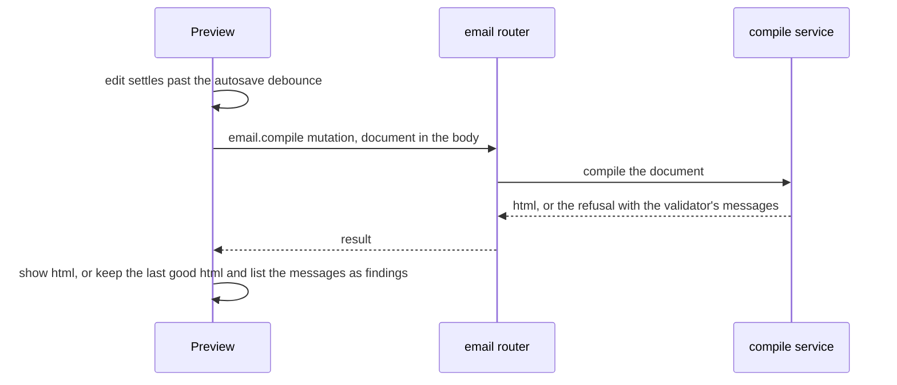

# Email

The email editor, built over the node types and the renderer contract the [document model](../document-model/design.md) defines, inside the frame and shell the [canvas](../canvas/design.md) draws, with the field components the [style panel](../style-panel/design.md) builds.

## Email

MJML stays the engine, and the email's node types are its components from the [MJML blocks](../../../mjml-blocks/README.md) package: their attributes, MJML's defaults, their nesting and the head as the root's props. This page is what the editor draws over it, plus the one type the app adds, the survey invite, an `mj-button` whose survey link prop indexes the invite as the webpage's does.

The preview text is a root prop, which the editor bar's field binds through a patch like any other edit, and it is written to the head as `mj-preview` as the [email preview text](../../email-preview-text/design.md) page describes. A merge field is an inline node in the text, inserted by typing `{{` — the mention suggestion the composer already uses, offering the bound dataset's columns — or by dragging a column from the Merge fields category; it renders as the `{{column}}` token `toMergeField` writes.

**The design canvas** draws each email type with its own drawing, the one the email's drawing map names for the type, so a type with no drawing fails the typecheck:

- a section as a band in its background colour and padding, its columns side by side in a row;
- its columns side by side, as MJML lays them on a desktop client, and stacked below MJML's 480-pixel breakpoint in the mobile width;
- a hero as a band around its content, whose height is the least the band is tall, as the table cell MJML writes makes it, so its words stay inside the band;
- each part with its own content: a button and an accordion title as their words, a text as its formatted note, a navbar's links as their words in a row, a raw block and a table as the HTML they hold, and a spacer as the gap it names. A social row and a picture keep a labelled box, since the canvas does not load their pictures, so the starter email's social row is the one part drawn that way;
- each leaf with what the MJML blocks' cascade resolves for it. The cascade is the node's own attributes, then the root's `mj-attributes`, then MJML's defaults, which the package holds equal to the installed release. A new text therefore shows in Ubuntu, Helvetica, Arial at 13 pixels with 10 by 25 of padding, and a button in #414141 with a 3-pixel radius, as `createMjmlTextType.ts` and `mjButton.ts` declare them, until the author or the root says otherwise.

**Style fields.** An email node has no breakpoints and no states: email clients honour media queries unevenly, so MJML's own column stacking is the responsive model. Its style fields are its MJML attributes, such as padding, colours, font, alignment, border and background image. Each control is chosen from the package's field descriptor for the attribute: an enum is a select of its options, a colour a colour field, a boolean a switch, and the other kinds a text field. Each is stored as a prop. A field the author has not set shows the cascade's value, and clearing it, or the field's reset once the node sets it, removes the prop, so the root's `mj-attributes` apply again.

**Import MJML** is the one import the editor offers. Because the types are MJML's own components, MJML source from another tool reads back faithfully through the package's `parseMjmlDocument`, unlike the HTML import the [program](../../../../changes/archive/2026-11-05-resource-page-builder-program/design.md) leaves out. The command opens a code field. An accepted import replaces the document as one history entry. A refused one leaves the document as it was and names the tag or attribute that did not fit.

**The bar** is the top region of the email editor's [editor shell](../../editor-shell/design.md), beside the blocks and the inspector. It holds the Design / Preview switch, the dataset picker, the preview text, the device toggle and the problems surface, and Import MJML in its overflow menu. The bar is one fixed row that scrolls sideways on a narrow window, so no control wraps below it. The layout is the [email layout](../../email-layout/design.md), which names the regions and the conditions each panel is shown under.

**Preview** is the truth: Preview removes the blocks and the inspector and draws the compiled message in the canvas's place, at the width the bar's device toggle sets for both modes. Preview shows the open document compiled by the server, through a mutation that carries the document in its request body to the document model's compile service, debounced like the autosave so Preview shows an edit before it is saved. The compile runs in Design too, so its messages reach the problems surface wherever the author is. A refused compile keeps the last good html, and its messages are error findings: each validator message, or the refusal itself when the validator names none. The design stays mounted beneath Preview, so an edit and a selection survive the toggle. The design canvas is where an email is edited and Preview is what a client receives, because email-client HTML — nested tables and conditional comments — is output to inspect, not a surface to edit in place.

The compile runs in the app server, on MJML's Node package.

## The shell's document kind

The shell is one set of components and composables for both documents, so the email is not a second editor. What differs between the two is the document kind, one object per kind, which the document store records beside each open document. The kind holds the parts the shell reads and no more: the document's schema, its block registry and children port, the defaults a new node of each type is inserted with, the titles its node types show, the palette's categories and the root form's schema. A composable reads the kind of the resource it edits, the same resource id it already takes, so no composable imports a kind's constants.

Two parts are not data, so each editor draws its own: the canvas, which draws a webpage in its frame and an email in the design canvas, and the settings tab's style panel, which draws a webpage's breakpoints and states and an email's attribute fields. Each editor names its canvas and style panel as its layout's registry entries. Everything else in the shell is shared, so the webpage's behaviour is the one behaviour both documents keep.

The kind's document type is the union of the two node types the registry holds, with the webpage and email each narrowed where a composable reads its own type's props. The store keeps the document under the union, and a kind's functions take the narrowed type, so a composable that reads a webpage's `style` never reads it from an email. The email editor mounts the [editor shell](../../editor-shell/design.md) with its own layout rather than the page builder's arrangement, and the page builder's arrangement still serves the webpage. The composables and children typed to a webpage are the store union's owed work, listed with the other owed items in the email page builder change's tasks.

## Key files

| File                                                                             | Role                                                                                                     |
| -------------------------------------------------------------------------------- | -------------------------------------------------------------------------------------------------------- |
| `apps/web/server/trpc/routers/email.ts`                                          | the mutation compiling an open email document for Preview, with the validator's messages                 |
| `apps/web/app/components/PageBuilder/Email/Preview.vue`                          | Preview, the compiled email in a sandboxed frame at the bar's device width, with its findings            |
| `apps/web/app/components/PageBuilder/Email/Bar.vue`                              | the editor bar: the Design / Preview switch, the dataset, the preview text, the device and the problems  |
| `apps/web/app/services/emailEditor/emailLayout.ts`                               | the email's layout: its regions, its panels under their conditions, and the names each is drawn under    |
| `apps/web/app/components/Resource/Email/Editor.vue`                              | the email editor blade: the layout on the editor shell, its registry and the compile's findings          |
| `apps/web/app/composables/pageBuilder/usePageBuilderEditor.ts`                   | the page builder's editing composition the blade calls: announcements, keys, history, style and the drag |
| `apps/web/app/services/pageBuilder/email/renderEmailCanvasVNodes.ts`             | the design canvas's render callback, which draws each node through the drawing map from the MJML cascade |
| `apps/web/app/services/pageBuilder/email/canvasDrawing/EmailCanvasDrawingMap.ts` | the drawing map, keyed by email node type, naming the drawing each type is drawn with                    |
| `apps/web/app/components/PageBuilder/Email/StyleField.vue`                       | one style field: the control its attribute's kind draws, and its reset                                   |
| `apps/web/app/composables/pageBuilder/useEmailStyle.ts`                          | the selected node's style fields and the edit that sets or clears one                                    |
| `apps/web/app/composables/pageBuilder/usePageBuilderDrag.ts`                     | a palette block or a merge field dragged to a slot or onto a text                                        |
| `apps/web/app/services/pageBuilder/insertMergeFieldAt.ts`                        | the one edit a merge field's drop makes: the text under the point, its token appended                    |
| `apps/web/app/services/pageBuilder/getTextNodeIdAt.ts`                           | the text under a drop point, the only node a merge field drops into                                      |
| `apps/web/app/services/pageBuilder/email/appendMergeFieldToText.ts`              | a text's rich text with a merge field's token appended                                                   |
| `apps/web/app/services/emailEditor/toMergeField.ts`                              | the `{{column}}` token a merge field renders as                                                          |
| `apps/web/app/services/emailEditor/substituteMergeFields.ts`                     | the one form of a merge token the compiled html is substituted at                                        |
| `apps/web/app/models/richTextEditor/RichTextSuggestion.ts`                       | the mention suggestion typing two braces opens                                                           |
| `apps/web/shared/services/pageBuilder/email/emailRootFormSchema.ts`              | the root form, which holds no field, since the preview text is the bar's                                 |

## Decisions

The owed items and their reasons are in the email page builder change's tasks.

- **One merge-field form.** The compile writes a merge token's `&`, `<` and `>` escaped and leaves quotes as they are, so substitution matches that text escape alone. ([`substituteMergeFields.ts`](../../../../../apps/web/app/services/emailEditor/substituteMergeFields.ts)).
- **Length hint.** The preview text's limit is `MAX_EMAIL_PREVIEW_LENGTH`, which is the schema's maximum. The bar's text field draws it beside the field as a count, so the hint and the enforced limit come from one constant.
- **Preview placement.** Preview is reachable without leaving the editor, so the toggle the Preview paragraph places stays in the bar.
- **The document rides the request body, not the URL.** Preview's compile is a mutation, because a realistic email's document outgrows the request-header limit the server accepts, which would answer 431 and leave Preview blank were it a query. The alternative was compiling the saved copy on the server: it sends no document, but Preview would then lag the owner's edits by the autosave debounce and could not show an edit that is not yet saved, which Preview promises it does.
- **A dropped compile is not retried automatically.** A mutation is not retried on its own, so a dropped compile waits for the next settled edit or for Preview's retry control. The compile is a pure function of the document it is sent, so a retry is always safe to make.
- **The long-email scenario is proven by a proxy.** The mock server enforces no request-header limit, so no test can receive the 431 the scenario describes. `apps/web/app/components/PageBuilder/Email/Preview.test.ts` asserts the cause instead: one POST to the procedure's path with no query string, for a document whose encoded form is longer than Node's request-header limit.
- **FileAssets.** Email keeps `fileAssets` on its resource definition, since its images are hosted by us. Its image field uploads through the same round trip, so Email is an adopter of [resource-file-assets](../../resource-file-assets/design.md).
- **The export staging store stays.** `apps/web/app/store/emailEditor/exportDialog.ts` is the singleton target the personalised export's truncation confirm is staged in. It is not a bridge to a live editor, so it stays beside the blade that draws the decision.

## Sources

- [MJML documentation](https://documentation.mjml.io/) — `mj-column`'s stacking below the body breakpoint and the default attributes the canvas draws with until a node sets its own.
- [MJML 5.0.0 release](https://github.com/mjmlio/mjml/releases/tag/v5.0.0) — the major the server compiles on (the version the workspace catalog pins), its new minifiers, and the browser build's size.
