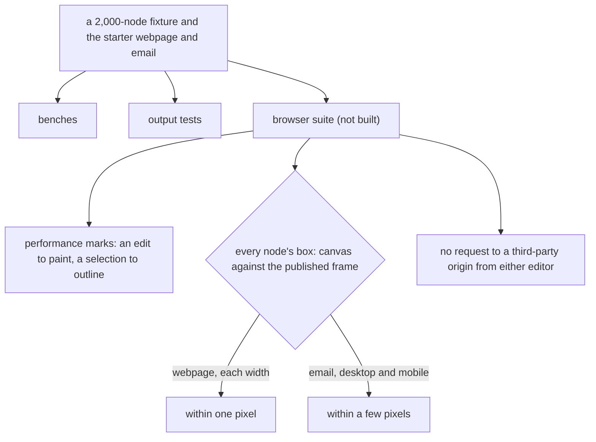

# Performance and proof

The targets the page builder's editors hold, and the proof of their output. The benches and output tests run. The browser proofs that compare the canvas with the published page are not proven by a test today; they are recorded as a deferred idea in the [deferred browser suite for the resource editors](../../../../deferred/resource/editor-browser-suite/design.md).

The benches and the output proof run over the [canvas](../canvas/design.md) and the email editor's canvas, on the [document model](../document-model/design.md)'s nodes and the [undo layer](../undo-as-patches/design.md)'s patches. The editors' script ceiling is held by the cutover's build check.

## Performance

| Target                                                     | Number                                                                                     | Held by                                      |
| ---------------------------------------------------------- | ------------------------------------------------------------------------------------------ | -------------------------------------------- |
| Requests the editor itself makes to a third-party origin   | none; only content the author adds, such as an embed or MJML's social icons, loads its own | not proven by a test                         |
| Render a 2,000-node document to HTML                       | under 5 seconds                                                                            | a committed bench, reported and not asserted |
| Apply one patch to a 2,000-node document, inverse recorded | under 20 ms at the 95th percentile                                                         | a committed bench, reported and not asserted |
| A prop or style edit, input to paint, 2,000 nodes          | under 50 ms at the 95th percentile                                                         | not proven by a test                         |
| A selection change, input to outline                       | within one animation frame                                                                 | not proven by a test                         |
| Server compile of the starter email                        | under 250 ms at the 95th percentile                                                        | a committed bench, reported and not asserted |

## Proof

There is nothing saved to hold the new editors to, so parity is proved against the published output and against the canvas itself:

- **Every type's output** is asserted whole with `toStrictEqual`: its HTML or MJML for a fixture of each prop's edge values, its accessible attributes, and the sanitiser's vectors on the raw-HTML types.
- **Every patch round-trips:** applying an edit and then its inverse returns a document equal to the original.
- **The canvas is the page.** Not proven by a test today. The starter webpage is not compared in a browser between the canvas and the published view's frame at each device width, so no node's box is held within one pixel across the two, and the published page's own scripts are not checked under the policy the published view's frame inherits from the app.
- **The email canvas is close to the email.** Not proven by a test today. The starter email is not compared in a browser between the email canvas and the compiled email, at desktop and mobile width, so the few-pixel closeness per section, column and leaf is not measured.
- **Editor interactions** have component tests under happy-dom, as the library's do. The browser interactions, a drag across the frame boundary, Alt-arrow moves, Move to and focus into a text node, are not proven by a test today.

## Key files

| File                                                                   | Role                                                                 |
| ---------------------------------------------------------------------- | -------------------------------------------------------------------- |
| `apps/web/shared/services/pageBuilder/renderWebpageDocument.bench.ts`  | the render bench, reporting a 2,000-node render's time               |
| `apps/web/shared/services/pageBuilder/applyWebpageEdit.bench.ts`       | the patch bench, reporting one edit's time with its inverse recorded |
| `apps/web/server/services/emailEditor/compileEmailDocument.bench.ts`   | the compile bench, reporting the starter email's server compile      |
| `packages/configuration/src/services/getVitestBrowserConfiguration.ts` | the browser configuration the frame package's browser suite runs on  |
| `apps/web/app/components/Resource/SrcdocIframe.vue`                    | the published view's frame the canvas is held against                |
| `apps/web/configuration/security.ts`                                   | the policy a published page's own scripts run under                  |

## Notes

- An inserted image or video loads the app's own placeholder, `apps/web/public/page-builder/placeholder.svg`, rather than a third-party host. That is what the origin row depends on, and no browser compares it today.
