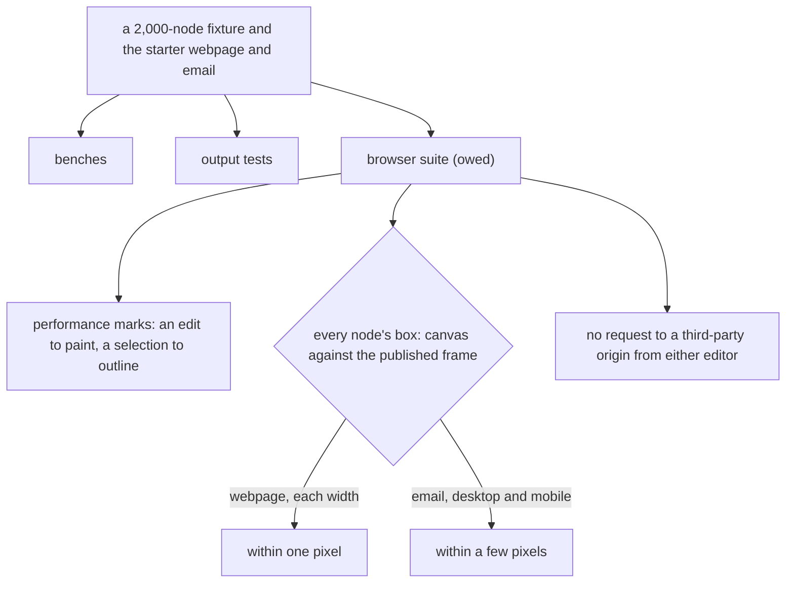

# Performance and proof

The targets the page builder's editors hold, and the proof of their output. The benches and output tests run; the browser proofs that compare the canvas with the published page are owed, and each is marked where it is named.

The benches and the output proof run over the [canvas](../canvas/design.md) and the email editor's canvas, on the [document model](../document-model/design.md)'s nodes and the [undo layer](../undo-as-patches/design.md)'s patches. The editors' script ceiling is held by the [cutover](../../../../changes/archive/2026-10-25-resource-page-builder-cutover/design.md)'s build check.

## Performance

| Target                                                     | Number                                                                                     | Held by                                               |
| ---------------------------------------------------------- | ------------------------------------------------------------------------------------------ | ----------------------------------------------------- |
| Requests the editor itself makes to a third-party origin   | none; only content the author adds, such as an embed or MJML's social icons, loads its own | a browser test over each editor's own requests (owed) |
| Render a 2,000-node document to HTML                       | under 5 seconds                                                                            | a committed bench, reported and not asserted          |
| Apply one patch to a 2,000-node document, inverse recorded | under 20 ms at the 95th percentile                                                         | a committed bench, reported and not asserted          |
| A prop or style edit, input to paint, 2,000 nodes          | under 50 ms at the 95th percentile                                                         | performance marks, reported and not asserted (owed)   |
| A selection change, input to outline                       | within one animation frame                                                                 | the same (owed)                                       |
| Server compile of the starter email                        | under 250 ms at the 95th percentile                                                        | a committed bench, reported and not asserted          |

## Proof

There is nothing saved to hold the new editors to, so parity is proved against the published output and against the canvas itself:

- **Every type's output** is asserted whole with `toStrictEqual`: its HTML or MJML for a fixture of each prop's edge values, its accessible attributes, and the sanitiser's vectors on the raw-HTML types.
- **Every patch round-trips:** applying an edit and then its inverse returns a document equal to the original.
- **The canvas is the page (owed).** A browser test would render the starter webpage in the canvas and in the published view's frame at each device width, and hold every node's box within one pixel across the two, and check that the published page's own scripts run under the policy its frame inherits from the app.
- **The email canvas is close to the email (owed).** The same comparison for the starter email, at desktop and mobile width, within a few pixels per section, column and leaf.
- **Editor interactions** have component tests under happy-dom, as the library's do. The browser interactions, a drag across the frame boundary, Alt-arrow moves, Move to and focus into a text node, are owed to the frame package's browser suite.

## Key files

| File                                                                   | Role                                                                 |
| ---------------------------------------------------------------------- | -------------------------------------------------------------------- |
| `apps/web/shared/services/pageBuilder/renderWebpageDocument.bench.ts`  | the render bench, reporting a 2,000-node render's time               |
| `apps/web/shared/services/pageBuilder/applyWebpageEdit.bench.ts`       | the patch bench, reporting one edit's time with its inverse recorded |
| `apps/web/server/services/emailEditor/compileEmailDocument.bench.ts`   | the compile bench, reporting the starter email's server compile      |
| `packages/configuration/src/services/getVitestBrowserConfiguration.ts` | the browser configuration the frame package's browser suite runs on  |
| `apps/web/app/components/Resource/SrcdocIframe.vue`                    | the published view's frame the canvas is held against                |
| `apps/web/configuration/security.ts`                                   | the policy a published page's own scripts run under                  |

## Notes

- An inserted image or video loads the app's own placeholder, `apps/web/public/page-builder/placeholder.svg`, rather than a third-party host, which is what the origin row's test would check.
