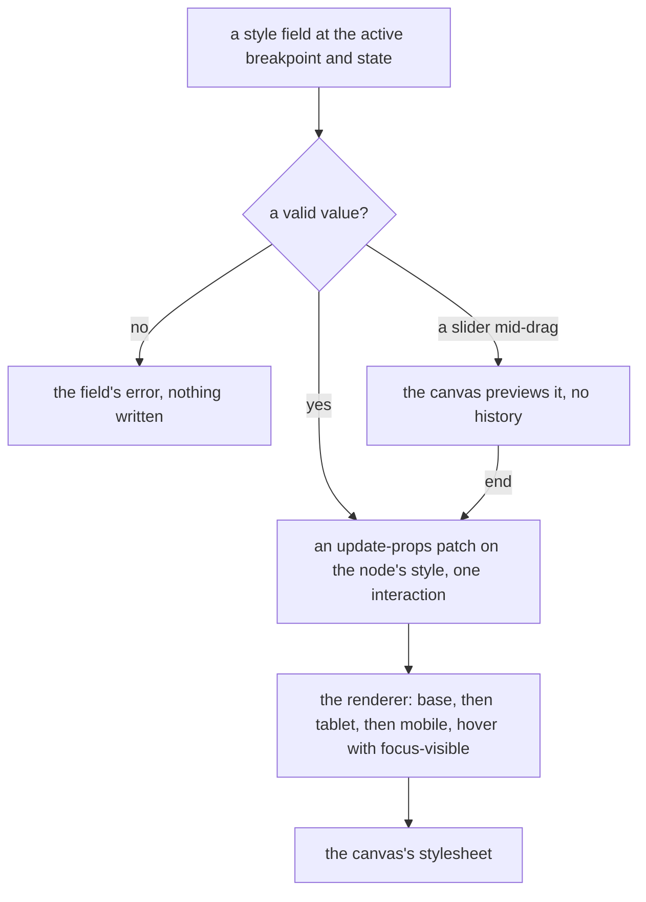

# Style panel

The webpage editor's Style and Theme panels, built on the [canvas](../canvas/design.md), which draws the page and its tabs, and on [undo as patches](../undo-as-patches/design.md), which records each edit.

## The style panel

A style belongs to the node it styles. Each webpage node carries a `style` prop: for each breakpoint, for each state, a map from a property the panel offers to a CSS value. The renderer gives a styled node a class from its id and emits its rules after the theme's tokens and each type's structural CSS: base first, then the tablet and the mobile media queries, a state after its default within each, so a later breakpoint overrides an earlier one, desktop-first. There is no free stylesheet, no selector the author writes, and no class shared between nodes, so a style reaches only the node it was set on.

- **Breakpoints** are three, after Webflow's: base, tablet at `TABLET_BREAKPOINT_WIDTH` and below, mobile at `MOBILE_BREAKPOINT_WIDTH` and below, read from the module the canvas names its device widths in. The device toggle is the active breakpoint: editing at tablet writes the tablet override. Base is desktop and names no width, so the canvas's desktop frame shows it.
- **States** are default and hover. Hover on a type a reader can focus emits for `:focus-visible` too, so no hover-only affordance ships.
- **Tokens** are the page's own, on the root: named colours and font stacks, emitted as custom properties and edited in the Theme panel. A colour field lists the colours as swatches first and a free colour second, and picking one stores `var(--color-name)`, so editing the token recolours everything that uses it. A font stack is named `font-` and checked as a `font-family` value; the typography sector's font family offers the stacks as a choice, which stores `var(--font-name)`, and an emptied stack is not saved. These are the page's tokens, not the app's palette: the app's tokens theme the editor around the canvas, while a published page has one look of its author's.
- **Values** are free CSS within the property, checked with `CSS.supports` as they are typed; an invalid value stays in its field with the field's error and writes nothing. At the schema, a value is length-limited and excludes `<`, `{` and `}`, as [the canvas](../canvas/design.md) section says, and `/*` and `*/`.

The panel is grouped in the sectors `STYLE_SECTORS` declares, each a `UiCollapsible` titled with its name: layout and flex, spacing as its eight margin and padding fields, size, position, typography, background, border, and effects. Background is a colour and a list of image and gradient layers. Each layer is a text field checked as a `background-image` value, and the list joins its layers with commas into the one `background-image` value, so a gradient's own commas stay inside its layer. Add a layer adds an empty one, which is not written until it holds a value, and Remove drops a layer. Each field shows the value at the active breakpoint and state, or the inherited one as a placeholder saying where it comes from ("from Desktop"), with a reset that removes the override. The controls are the library's: `UiTextField` with a unit `UiSelect` for a length, where the arrows step the number and keep the unit, Shift by ten, and a border's width leaves the percentage out of its units, since a border is never a share of its box; `UiToggleGroup` for alignment and direction, icon-only with their titles as their names; `UiColorField` with the token swatches; `UiSlider` for opacity. A drag on a slider previews in the canvas without writing history and commits one entry when it settles, which the slider's `end` already reports for a key too. Copy style and Paste style are commands, the reuse a shared class would otherwise give.

The field components take a value and its inherited placeholder, with no breakpoint of their own, so the [email editor](../email/design.md) draws its attribute fields with them.



## Key files

| File                                                                  | Role                                                                              |
| --------------------------------------------------------------------- | --------------------------------------------------------------------------------- |
| `apps/web/app/components/PageBuilder/StylePanel/Index.vue`            | the sectors, the Default and Hover state toggle, and the Reset button             |
| `apps/web/app/components/PageBuilder/StylePanel/Field.vue`            | a length field: its number, its unit and the arrow and Shift steps                |
| `apps/web/app/components/PageBuilder/StylePanel/BackgroundLayers.vue` | the background's layer list, joined into one `background-image`                   |
| `apps/web/app/components/Ui/ColorField.vue`                           | the page's token swatches before a free colour                                    |
| `apps/web/app/components/Ui/Slider.vue`                               | its `end` commits a drag's one history entry                                      |
| `apps/web/app/services/pageBuilder/constants.ts`                      | `STYLE_SECTORS`, `STYLE_COLOR_PROPERTIES` and `STYLE_CHOICES`, the panel's fields |
| `apps/web/shared/models/webpageEditor/data/WebpageEditor.ts`          | the root's tokens beside the content                                              |

New code lands here:

```text
apps/web/shared/models/pageBuilder/                  a node's style per breakpoint and state, the page's tokens
apps/web/shared/services/pageBuilder/                each styled node's rules in the renderer's stylesheet
apps/web/app/store/pageBuilder/                      the active breakpoint and state, and the copied style
apps/web/app/components/PageBuilder/StylePanel/      the sectors and their fields
apps/web/app/components/PageBuilder/ThemePanel/      the page's colours and font stacks
```

## Sources

- [Webflow — Design for even larger screens with 3 new breakpoints](https://webflow.com/updates/design-for-even-larger-screens-with-3-new-breakpoints) — a desktop base that applies everywhere unless overridden, tablet at 991 pixels and below and mobile portrait at 478 and below, the cascade and breakpoints the style panel takes.
