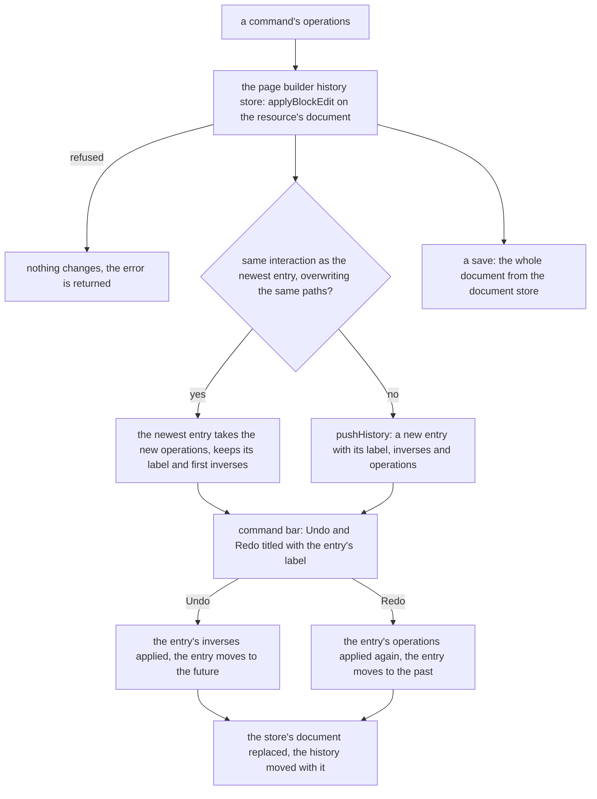

# Undo as patches

The page builder's undo and redo: each open resource's document is held in the page builder's document store, and every edit to it is a list of [JSON Patch](https://www.rfc-editor.org/rfc/rfc6902.html) operations applied through the [headless core](../../../headless-block-editor/editor-core/design.md)'s block edit, with the inverses that undo it kept beside the operations that redo it. The [document model](../document-model/design.md) holds the documents this runs over.

## Undo and redo as patches

An edit is a list of operations in JSON Patch's add, remove and replace, each addressed by a JSON Pointer from the document root. `applyPatches`, the one JSON Patch applier, which the [agent content tools](../../../architecture/agent-content-tools/design.md) also apply on the server, lives in `@esposter/shared` and copies the path to each changed node, so the new document shares every untouched subtree with the old one. As it applies each operation it records the inverse, and the inverses come back in the order that undoes the whole patch: undo applies them as returned, and redo applies the forward list again. A move is a remove and an add.

`applyBlockEdit` applies an edit whole, so an edit whose operations cannot all apply changes nothing. The bounded history in `@esposter/shared` moves its entries as [its own design](../../../shared/bounded-history/design.md) states. The page builder's store owns the rest: one history per open resource, the labels the command bar shows, the rule for what one interaction is, and the merge within one interaction.

- **One history per open resource**, in the page builder's store `usePageBuilderHistoryStore`, keyed by the resource's id. Each resource holds its past and its future, bounded by `MAX_PAGE_BUILDER_HISTORY_SIZE`, and the labels the command bar reads. The sheet's history is one unkeyed store, so the keying is this store's own rule.
- **An interaction** is the edits that share one interaction id, which the surface that opens the interaction passes: a slider, a held key or a text session. An edit joins the newest entry instead of starting one only when the two share the id, set the same set of paths, and each only overwrote values the document already held, which every inverse of both being a replacement shows. A prop update is an add in the core, so a value changed in ten steps during one drag is one entry: the merged entry keeps its label and the inverses of its first edit, and takes the newest operations. Both entries' inverses are read because the merged entry keeps the first one's: an insert followed by a replace of the inserted node would merge into an entry whose redo replaces a node it never inserted. An edit that sets another path, that inserts a node into an array (an add whose inverse removes it, since the nodes after it shift), or that removes or moves a node, starts a new entry even inside the same interaction. An empty operation list records nothing.
- **Undo and redo move the history with the document.** Each applies its entry's inverses or operations to the document held, and the new document and the moved history are set together. When those operations cannot apply, neither moves and the error is logged.
- **The command bar** offers Undo and Redo through `usePageBuilderHistoryCommands`, in the page builder's palette group, with the sheet's shortcuts (`cmd+z`, `cmd+shift+z` and `cmd+y` for redo) so the two editors read the same. Each title names the edit it would act on, such as `Undo Move block`, and falls back to the bare verb when there is nothing to act on.
- **Clearing empties the history.** The store's `clearHistory` empties one resource's history, since after a reload its entries describe a document that is gone. Registering it on the content store's reload hook belongs to the [cutover](../../../../changes/resource-page-builder-cutover/design.md), which binds the editor to its resource types.
- **The editor's patches never leave the browser.** A save stores the whole document held by the document store, through the one door that [delta content saves](../../delta-content-saves/design.md) make cheap. [JSON Patch content saves](../../../../rejected/resource/json-patch-content-saves/design.md) stay rejected.

## Decisions

- **The bounded history lives in `@esposter/shared`.** The page builder's history is generic over its entry, and the sheet's command objects are its second consumer, so the stack sits in the shared utilities and both stores build on it. Rejected: the stack in `headless-block-editor`, which would make a sheet's undo depend on a block editor, and which the [core's own decision](../../../headless-block-editor/editor-core/design.md) to keep no history already refuses.
- **The sheet keeps its commands.** Its entries stay command objects with their own `execute` and `undo`, since a sheet edit is not a patch over a document tree; only the stack under them is shared. Rewriting them as patches was rejected: it would change every sheet command for no behaviour a reader sees.
- **The merge is decided by the store, not the core.** The core applies an edit whole and leaves coalescing to the first consumer that needs it. The page builder's store is that consumer, because the interaction is the surface's, and the core cannot know which edits belong to one drag.

## Key files

| File                                                                    | Role                                                                                 |
| ----------------------------------------------------------------------- | ------------------------------------------------------------------------------------ |
| `apps/web/app/store/pageBuilder/history.ts`                             | each open resource's history: apply an edit, record it, undo, redo, labels, clearing |
| `apps/web/app/store/pageBuilder/document.ts`                            | the documents the history applies its edits to, and the save of the whole document   |
| `apps/web/app/services/pageBuilder/getRecordedHistory.ts`               | the history an edit leaves: a new entry, or the merge into the newest one            |
| `apps/web/app/services/pageBuilder/checkIsSamePaths.ts`                 | whether two edits set the same paths                                                 |
| `apps/web/app/services/pageBuilder/constants.ts`                        | the history's bound and the command group                                            |
| `apps/web/app/models/pageBuilder/PageBuilderHistoryEntry.ts`            | one entry: its operations, inverses, label and interaction id                        |
| `apps/web/app/composables/pageBuilder/usePageBuilderHistoryCommands.ts` | Undo and Redo registered as commands named by the entry's label                      |
| `packages/shared/src/services/history/pushHistory.ts`                   | the bounded history, shared by the page builder's store and the sheet                |
| `packages/shared/src/services/jsonPatch/applyPatches.ts`                | the JSON Patch applier that records the inverses                                     |
| `packages/headless-block-editor/src/services/applyBlockEdit.ts`         | an edit applied whole, refused as a unit                                             |
| `apps/web/app/store/resource/sheet/history/index.ts`                    | the sheet's history over the shared bounded history, its commands as entries         |

## Sources

- [RFC 6902 — JSON Patch](https://www.rfc-editor.org/rfc/rfc6902.html) and [RFC 6901 — JSON Pointer](https://www.rfc-editor.org/rfc/rfc6901.html) — the operations and paths an edit is written in.
