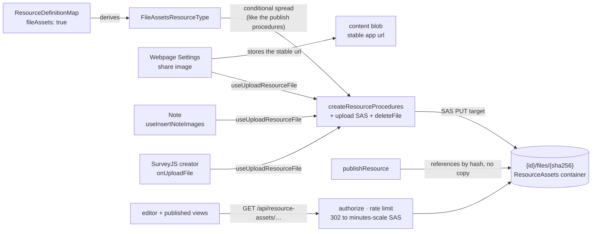

# Resource File Assets

The **FileAssets capability**: hosted binary assets for the resource types that need them. A type declaring `fileAssets: true` gets owner-only procedures for uploading and removing blobs under its own `{id}/files/…` directory, and the webpage's Settings blade uploads its share image through them — so an image a resource carries is a hosted URL, never a base64 blob inlined into the content.

Adopters: Survey (SurveyJS image questions, logos, theme backgrounds), Note (inline images), Webpage (share image). The listed adopters clear the capability admission rule of two or more ([resources](../../architecture/resource/design.md)). Email also declares `fileAssets` for the page builder's image style fields, but has no upload path, so it is not counted as an adopter.

## How it works

Content embeds a **stable, relative app url** — `/api/resource-assets/{blobName}` — never a signed Azure url. The serving endpoint authorizes the caller and 302-redirects to a freshly signed minutes-scale SAS on every request, so nothing in stored content can expire and a leaked SAS dies in minutes. The app url itself carries whatever grant the authorization gives it: working-copy urls answer only to the owner, while published urls are intentionally anonymous-capable for as long as the publication row exists and its current version names the file — unpublish is what revokes them. What an editor does with an asset url stays type-specific — SurveyJS puts it on an image question, and the webpage's Settings blade puts its share image on the webpage's content — which keeps the capability at the same altitude as Portable: the mechanism is declared centrally, the semantics stay with the type.

- **Declaration** — `fileAssets: true` in `ResourceDefinitionMap`; `FileAssetsResourceType` is derived through the existing `CapabilityResourceType` mapped type. The procedures are spread into the router conditionally, exactly like the publish procedures, so a non-declaring type has no asset endpoints at the type level.
- **Upload** — the standard two-step SAS flow ([file uploads](../../architecture/file-uploads/design.md)), addressed by content: the client hashes the file, and the server either returns the address as already held, with no PUT, or signs a create-only PUT target scoped to `{id}/files/{hash}`. The client builds the stable url from that address with no second round trip. `useUploadResourceFile(type, id)` owns this once for every consumer. The address and its dedupe are [content-addressed assets](../content-addressed-assets/design.md).
- **Serving** — `GET /api/resource-assets/{encodedPath}`: parse and validate (`parseResourceAssetPath`), rate limit, authorize, then 302 to a short-lived read SAS with `Cache-Control: private, max-age` just under `RESOURCE_ASSET_SAS_DURATION_MS` so a browser-cached redirect can never outlive its signature. No existence probe — Azure itself 404s a missing blob.
- **Publish** — nothing is copied and no url is rewritten. The published version's reference rows name the hashes its content embeds, so the published page serves the working copy's own files, and a file the owner later deletes stays for as long as the publication names it. Survey and Webpage have no publish transform; Email keeps its compiled-html check and its dataset strip ([publishing](../../architecture/publishing/design.md)).
- **Duplicate** — `duplicateResource` runs `cloneContentAssets` against `{newId}`: every referenced file the caller can read is copied to the copy's own `{newId}/files/{hash}`, so the copy is fully self-contained — its editor can delete files, and deleting or unpublishing the original never strands it. A file the copy already holds under the same hash is not copied again. The clone drops the source resource id from the destination path, which is also why the rewrite is a per-url map, never a prefix replace — content can legitimately carry foreign-id urls (duplicated or blueprint-deployed content).
- **Teardown** — assets need no per-asset teardown, but it is **purge** that provides it, not delete. `deleteResource` only stamps `deletedAt`, so every `{id}/files/…` blob survives the whole [Recycle bin](../recycle-bin/design.md) window — which is exactly what lets a restore hand back a resource with its images intact — and `purgeResource` is what takes the `{id}/` directory wholesale ([blob lifecycle](../../architecture/blob-lifecycle/design.md)). What the delay costs is storage, not exposure: `readResourceAccess` matches only a resource row with a null `deletedAt`, and `softDeleteResources` drops the publication row in the same transaction, so both the owner-only path and the anonymous published path stop answering the moment the resource is deleted. A new asset-bearing capability under `{id}/` therefore needs no delete-time cleanup, but anything it puts outside that directory does. `deleteFile` exists for removing one asset while the resource lives on (SurveyJS deleting an image question); it hands that one address to the release, which keeps the file while any version names it. The client recovers the blob path from the stable url and ignores anything outside this resource's files directory.

## Authorization matrix

| Path shape          | Who                                                                               | Why                                                                                                                |
| ------------------- | --------------------------------------------------------------------------------- | ------------------------------------------------------------------------------------------------------------------ |
| `{id}/files/{hash}` | session owner of the resource                                                     | working-copy assets render only inside the owner's editor (same-origin, cookies present), and version previews too |
| `{id}/files/{hash}` | anyone while the resource is published and its current published version names it | published views render in a sandboxed `srcdoc` iframe whose opaque origin sends no cookies                         |

**The duplicate clone asks the same question, and `checkIsResourceAssetReadable` is the one definition both ask.** The read path alone is not enough: `cloneContentAssets` copies whatever url the caller's content names, so a check living only on the serving endpoint would let anyone holding a url they cannot open — a personalized export mails absolute ones out — paste it into their own resource, duplicate that resource, and have the copy re-serve the owner's private file. A url the caller may not read is data, not an error: the clone carries it verbatim, exactly like a dangling or unparseable one, so blueprint-deployed content keeps rendering for whoever can already see its assets. The endpoint keeps only the status mapping. An anonymous refusal is `401` whether or not the resource is published, so the status reveals nothing about the publication; a signed-in refusal is `404`.

CSP needs no special-casing: `img-src` carries `'self'` (the relative url) and `https:`, which covers the Azure redirect target (CSP checks redirect targets).

## Matching a stable url

The url is emitted only by `getResourceAssetUrl`, whose per-segment encoding (`encodeURIComponent` plus percent-encoding `!'()*`) closes the charset to `[\w.~%-]` by construction — the **token we control** case of [content token rewriting](../../architecture/content-token-rewriting/design.md). `RESOURCE_ASSET_URL_REGEX` is therefore a prefix-anchored positive-charset match with no opener analysis. **Anchored to a url boundary, not just to the prefix**: authored content may embed a foreign absolute url whose own path happens to carry this prefix, and matching that tail rewrites someone else's image to a local blob on duplicate and splices a second url into the middle of it on export — so a lookbehind requires that no url character precede the match. And `parseResourceAssetPath` is the single decoder/validator: url segments map one-to-one onto blob-name segments, so rejecting any decoded segment that could re-introduce a separator makes traversal impossible by construction.

The parser accepts one shape, `{resourceId}/files/{hash}`, with a uuid resource id and a lowercase SHA-256 hash, and nothing else. A url that fails to parse is data, not an error — the duplicate clone carries it verbatim and the endpoint 400s it.

## Procedures

| Procedure                       | Auth  | Purpose                              |
| ------------------------------- | ----- | ------------------------------------ |
| `generateUploadFileSasEntities` | owner | SAS PUT targets under `{id}/files/…` |
| `deleteFile`                    | owner | remove one asset blob                |

Reads have no procedure — they go through the `/api/resource-assets` endpoint.

## Key files

| File                                                                  | Role                                                             |
| --------------------------------------------------------------------- | ---------------------------------------------------------------- |
| `apps/web/shared/services/resource/getResourceAssetUrl.ts`            | blob name → stable url (closed charset)                          |
| `apps/web/shared/services/resource/parseResourceAssetPath.ts`         | the single decoder/validator                                     |
| `apps/web/server/api/resource-assets/[...path].get.ts`                | authorize + 302 to a minutes-scale SAS                           |
| `apps/web/server/services/resource/cloneContentAssets.ts`             | duplicate's copy of referenced files + url rewrite               |
| `apps/web/server/services/resource/checkIsResourceAssetReadable.ts`   | may this caller read this asset path                             |
| `apps/web/server/services/resource/readResourceAccess.ts`             | the resource's ownership and publication, read once per resource |
| `apps/web/shared/services/resource/ResourceDefinitionMap.ts`          | `fileAssets` declarations                                        |
| `apps/web/server/trpc/procedure/resource/createResourceProcedures.ts` | conditionally spread asset procedures                            |
| `apps/web/shared/services/resource/getFilesDirectoryName.ts`          | where the `{id}/files` prefix is spelled                         |
| `apps/web/app/composables/resource/useUploadResourceFile.ts`          | upload round-trip, returns the stable url                        |
| `apps/web/app/composables/resource/useDeleteResourceFile.ts`          | stable url to blob path, then `deleteFile`                       |

## Notes

- Content that predates the stable url bakes a signed Azure url in and expects it re-signed on every read. It is neither read, converged nor migrated — latest-shape-only applies ([persisted data — latest shape only](../../architecture/persisted-data-latest-shape-only/design.md)), so such a draft renders its assets broken until they are re-added in the editor, and that is accepted. [converge-on-read](../../architecture/content-token-rewriting/design.md) governs future changes to the stable url's own form.
- A standalone Asset or Image-library resource type was rejected: assets are meaningless outside their owning resource, die with it, and need no name, list or blades — an identity row per image is pure overhead. Cross-resource asset reuse has no demonstrated need; revisit only with a [brand kit](../../../deferred/resource/brand-kit-resource/design.md).
- A **downloaded artifact** (Email's personalized HTML export) absolutizes its stable urls against the app origin, so its images render only for viewers with an owner session. Durable public asset urls are the [email sending](../../../deferred/resource/email-sending/design.md) follow-on.
- Blueprint capture/deploy carries asset urls untouched (only whole-string resource ids are aliased), so deployed content references the _source_ resource's blobs; deleting a captured source strands those references — accepted, identical to deleting any referenced resource.
- Asset uploads count against the owner's [storage quota](../storage-quotas/design.md): the upload procedure's input carries a `size` per file, which holds space before the SAS is returned, and Storage's own `BlobCreated` event is what charges the real size. A held address reserves nothing. Duplicate's copies are the exception to the reserve: they are written server-side, and each is charged to the copying owner before it is made.
- Three shapes of the duplicate clone and the serving path read as waste and are kept deliberately. **The clone walks the content three times** (relativize, collect, rewrite) rather than folding the strip into the single final replace: the relativized value is what both later passes must agree on, and the walks are cheap next to the storage round trip per asset that follows them. **`cloneAsset` probes `exists()` before every copy**, doubling the requests per asset, because a dangling reference must be treated as data rather than as an error, and distinguishing a missing source from a genuine copy failure by `RestError` status is a guess about the service where the probe is a fact. **The asset endpoint spells out the rate-limit block** that `getRateLimitedMiddleware` spells out for tRPC, because it consumes a different limiter under a different key (see `assetRateLimiter`) and a shared helper would have to be parameterised by both plus the transport's own error shape; the consequence is that a change to bypass or 429 behaviour has to be made in both places, and nothing enforces it.
