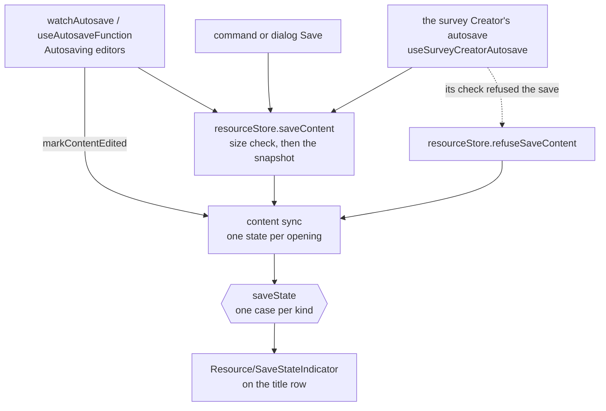

# Resource save state

Nothing in the product has a Save command for a resource's content. An edit becomes durable on its own: some types debounce a watched content ref, some persist on the command that made the change, and the survey's Creator autosaves its document on the shared cadence. That is the right behaviour and the wrong silence — an owner who cannot see it happening looks for the button that makes it happen, and any button offered in that gap gets read as the thing that makes their work real.

So the resource's title row carries a **save state** instead: one line beside the resource's commands saying whether what is on screen has reached the server, and when.

## Why there is no per-type registry

The types differ in how an edit is _triggered_, and not at all in how it is _written_. `useResourceStore().saveContent` is the single door — the debounced watcher, the Sheet toolbar command, the TodoList dialog's Save and the survey Creator's autosave all call it — and behind it one [content sync](../../architecture/content-sync/design.md) machine per opening owns the dirty check, the one save in flight, the `contentVersion` clock and the conflict handling for every one of them.

A map from `ResourceType` to a save mode would therefore describe a difference that stops at the trigger. It would also be the over-generalization the [capability admission rule](../../architecture/resource/design.md) forbids: a branch with indirection between it and its reader, added for a variation the mechanism below it has already erased. The state is derived from the machine instead, once, for every type.

The autosaving editors are the Dashboard, Note, Program, Sheet, Email, Webpage and Whiteboard editors.

## The four states

`saveState` is one switch over the kind of the opening on screen, so every kind maps to exactly one state and a kind added to the machine fails the typecheck until it is mapped.

| State    | Shown as          | Kinds                   | What the owner does                       |
| -------- | ----------------- | ----------------------- | ----------------------------------------- |
| `Stale`  | Out of date       | Conflict                | take the other version, or keep their own |
| `Saving` | Saving…           | Dirty, Saving, Adopting | nothing                                   |
| `Failed` | Not saved         | Failed                  | edit again, which asks for a save again   |
| `Saved`  | Saved, and _when_ | Synced, Unread          | nothing                                   |

**An edit the debounce is holding counts as saving.** The debounce re-arms on every keystroke, so nothing is in flight for as long as the owner keeps typing — a state read from the write alone would call a tab full of unwritten edits `Saved`, for however long the typing lasts. So the debounce tells the machine of the edit itself with `markContentEdited`, which makes the opening Dirty, or marks the save in flight as followed by an edit. Folding it into `Saving` rather than giving unwritten edits a state of their own keeps a word off the screen that would appear and vanish between keystrokes.

**Leaving writes a held edit.** An edit the debounce holds is written when its editor's scope ends with its resource still open, and before the route changes for any navigation, so the write names the resource the edit was made on. Nothing is confirmed with the owner. A save in flight when the blade moves on keeps its opening's machine until it answers, so its answer lands on the resource it was made on and never on the one on screen.

**Only the opening on screen is read.** A save issued before the blade moved on belongs to the opening that issued it, so the resource on screen never reports `Saving` for work that belongs to another, and never settles to `Saved` at a moment that says nothing about it.

**A refused save keeps its change on screen.** A save is an overlay write whose entry only reads the resource's row, so a refusal restores nothing: the content the editor holds stays as the owner left it, and the state reads `Failed` until an edit asks for a save that lands.

**`Saved` carries the time.** The word on its own is a claim the owner has to take on trust, which is exactly the trust they did not have when they went looking for a Save button. `updatedAt` is what the row already tracks, so the resting state is `Saved` plus a relative time, with the absolute one on hover.

**`Stale` outranks everything** because it is the only state where the remedy is not "wait". An unsaved edit that meets another writer's save, and a save the server refused because another writer moved the version on, both leave the opening in Conflict, and nothing is written until the owner takes the other version or keeps their own in the notice. The indicator keeps saying so after the notification that raised it has been dismissed. A save refused as stale for a resource the blade has already moved on from has no notice to show, so a warning names the resource and says the last edit to it was not saved.

`Failed` exists for the same reason: a notification is a one-shot the owner dismisses, and the fact that their work is not durable outlives it.

**A refused save is `Failed` too.** An editor's own check can refuse a save before it reaches the door, as the survey's does for a document its check rejects. `refuseSaveContent` is the door's second entry point, and the machine takes it as a refusal: the opening is Failed until a save that lands. A save of content the server already holds writes nothing and settles the opening, so an edit reverted to what was saved reads `Saved` again.

**A save's waiter resumes after its outcome is recorded.** `whenContentSaved` settles once the opening is no longer Saving, so a caller that awaits the save and then reads the state (the email export's gate) reads the outcome, never a `Saved` that came before it.

**A document too large to hold is refused before it is sent.** `saveContent` sizes the serialization it makes for the snapshot, and one over `MAX_RESOURCE_CONTENT_SIZE` raises an error notification naming its size and the limit and refuses the save, with no request made — the server would refuse it only after the whole upload. So the resource reads `Not saved` until a save that fits lands, which is the owner's cue to cut the document down. A document under that limit but too large for one request body is still saved: as a delta against the stored bytes when this client holds them, and staged through R2 otherwise ([file uploads](../../architecture/file-uploads/design.md)).

## Where it sits

On the page header's title row, beside the resource's commands rather than inside any one blade — content saves belong to the resource, and every blade of it writes through the same door. Each state has a pixel glyph of its own, so none is told apart by colour alone. A narrow row keeps the glyph and drops the words, which the tooltip still spells out with the exact time, and a screen reader still hears, since the readout is a status that announces each change.

The indicator is a readout, never a control. Pending state that gates a _trigger_ is a different mechanism and stays where it is — `isPending` bound as `is-pending` on the button that fired the write ([client data](../../architecture/client-data/design.md#in-flight-guarding)).

## Key files

| File                                                                | Role                                                             |
| ------------------------------------------------------------------- | ---------------------------------------------------------------- |
| `apps/web/app/store/resource/index.ts`                              | `saveContent`, the opening's machine and the derived `saveState` |
| `apps/web/app/composables/resource/autosave/useAutosaveFunction.ts` | the shared debounce, and the edit signal that makes it visible   |
| `apps/web/app/models/resource/ResourceSaveState.ts`                 | the four states                                                  |
| `apps/web/app/services/resource/ResourceSaveStateDefinitionMap.ts`  | what each one looks like                                         |
| `apps/web/app/components/Resource/SaveStateIndicator.vue`           | the title row's readout                                          |

## Notes

- The colour rides the icon rather than the text, as a whole class in each state's definition: a UnoCSS class built from a state name is a class the scanner never sees.
- A save reports the resource that issued it. A save's rejection notification is not scoped to the resource on screen: the write failed for the owner either way.
- Recovery points are [resource snapshots](../resource-snapshots/design.md), a separate mechanism on a separate clock. This page answers "did my edit land"; that one answers "can I go back".
