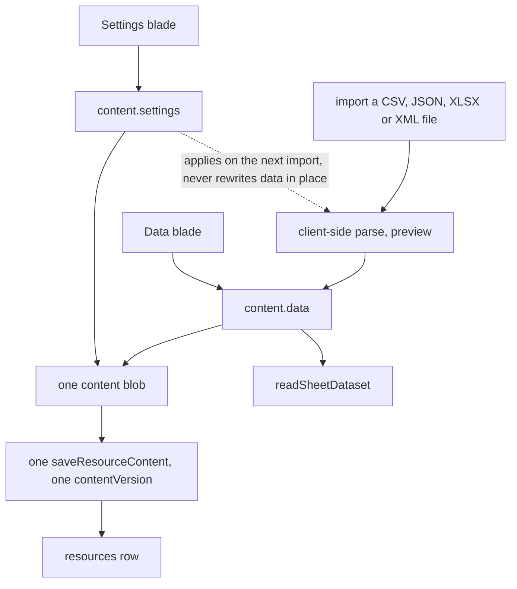

# Sheet Resource

Each imported file (CSV/JSON/XLSX/XML) is its own resource, and the three concerns it carries each live somewhere different:

| Concern                                     | Home                                   |
| ------------------------------------------- | -------------------------------------- |
| Identity (name, id)                         | `resources` row                        |
| Settings (`DataSourceType` + configuration) | `settings` section of the content blob |
| Data (columns/rows/metadata)                | `data` section of the content blob     |

The split is not three storage systems — it is one row and one blob, with the blob sectioned so the two blades never write the same keys:



## Data model

```ts
// apps/web/shared/models/resource/sheet/SheetResource.ts — interface-first
export const sheetResourceSchema = z.object({
  data: dataSourceSchema, // columns, rows, metadata
  settings: sheetSettingsSchema, // discriminatedUnion("type"): Csv | Json | Xlsx | Xml file settings
}) satisfies z.ZodType<ToData<SheetResource>>;
```

A Sheet resource always has a `data` section (empty `DataSource` on create) — there is no `dataSource: null` state. "Not yet imported" is `rows.length === 0`, rendered as `UiEmptyState` pointing at the Import command. The `Column` family and the per-format configurations live in `shared/models/resource/sheet/`; `DataSource`, `DataSourceType` and the transformations sit under its `datasource/` subfolder.

## Capabilities

- **DatasetProvider** — `readSheetDataset` reads `content.data` via `dataSourceToDataset`. A `DatasetReference` is just the resource id — a resource _is_ the item, so there is no sub-item selector.
- **Portable** — `PortableFormatMap[ResourceType.Sheet]` carries a format per `DataSourceType` (accept/mimeType/serialize/deserialize); both Import and Export commands appear in the command bar. Import is a client-side parse (no upload) with a `SHEET_IMPORT_PREVIEW_ROW_COUNT`-row preview. The imported document is then saved like any other, so its ceiling is `MAX_RESOURCE_CONTENT_SIZE`, the content limit every resource shares: a Sheet under it saves, and one over it is refused on the client with a notification ([file uploads](../../architecture/file-uploads/design.md)). An import replaces the data through `useSetDataSource`, which first hands the replaced sheet's identities to the imported one with `reconcileDataSource` — a column by its source header, a row by its position — so importing the same file again stores the same bytes, which the version store keeps once ([large documents](../../architecture/large-documents/design.md)). The xlsx codecs `await import` their workbook libraries inside `serializeXlsx`/`deserializeXlsx` rather than at module scope: the command bar renders on every resource page, so a static import would ship a parser to every type that can neither import nor export. The xml codec reads with the browser's `DOMParser` and writes its text by hand, so it needs no library and no lazy import: it is imported statically beside the csv and json codecs.

## Blades

- **Data** — the entire grid editor: inline editing, computed columns, statistics, clipboard, find/replace, undo/redo. Components live under `Resource/Sheet/*`; the grid's feature set and its view state are documented in the [sheet editor](../sheet/README.md) area. A filter is read back only for a column the sheet has.
- **Settings** — the file type, choosing which swaps in that format's defaults, beside that format's own parse options (delimiter etc.), editing `content.settings`; changing settings re-parses on next import, never silently rewrites data.

Both blades edit sections of one blob and save through one `saveResourceContent` with one `contentVersion`.

## Key files

| File                                            | Role                                                |
| ----------------------------------------------- | --------------------------------------------------- |
| `shared/models/resource/sheet/SheetResource.ts` | content blob schema (`data` + `settings`)           |
| `app/components/Resource/Sheet/Data.vue`        | Data blade (grid editor)                            |
| `app/components/Resource/Sheet/Settings.vue`    | Settings blade (file type beside its options form)  |
| `app/store/resource/sheet/`                     | grid state + command/undo stack over `content.data` |
| `app/services/resource/PortableFormatMap.ts`    | CSV/JSON/XLSX/XML import/export formats             |

## Notes

- **Settings live in the content blob, not a column.** Rejected alternatives: a `settings` jsonb column on `resources` (untyped at the DB boundary — per-type settings schemas can't be one column schema; splits one artifact across two write paths with two version races) and a separate `{id}/settings` blob (doubles round-trips, needs its own version field for one consumer).
- **XML is rows of cells, read by element name.** The row element is the root's first repeated child, a cell an element named as its column or a `cell` element's `name` attribute, and a row's attributes read as cells after its elements. Every cell is text, so the shared type inference decides what a column is. An export writes a name that is not a valid XML name as that `cell` form, drops the control characters XML 1.0 cannot hold and writes a carriage return as its reference, so what it writes imports back, the two noncharacters ending the plane included. A malformed document, a doctype (its entities can expand a small file into a large one) and a cell holding child elements are refused, each naming the file. The codec has limits it does not hide: a sheet with columns and no rows exports no columns, since XML names a column only inside a row, a root with a single row whose first child is a title reads the title as the row, and the file is read as UTF-8 whatever encoding its declaration names. Rejected: a library for XML (the browser parses and the codec writes), nested elements flattened into columns (a second model to document), and an XML form for the other resources.
- **A resource's several formats open under one Import and one Export command** in the overflow menu, a lone format being the command itself (`createPortableFormatItems`). Rejected: a flat row per format and a flyout submenu (`ui-library` skill, menus).
- The command/undo stack (`useSheetHistoryStore`, holding `ADataSourceCommand` instances) operates on a single `DataSource` — exactly one Sheet resource's `content.data`; it initializes from `useResourceStore` content.
- **Row, column and byte counts are derived, not stored.** `computeDataSourceStatistics` reads them off `columns` and `rows` when the status bar renders. Persisting them meant every command re-syncing a copy that could only ever restate the blob it sits in, or drift from it.
- A sibling resource type for the Vuetify component demos was [rejected](../../../rejected/resource/vuetify-component-resource/design.md).
