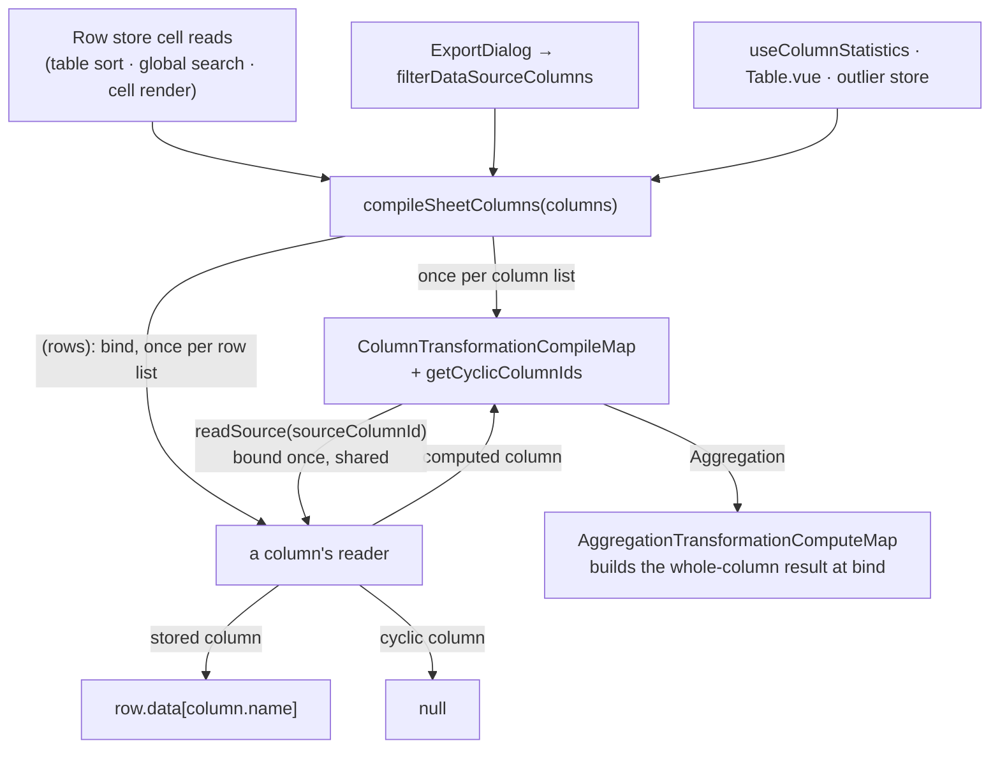

# Computed Columns

Computed columns derive their values from other columns instead of storing data — a `ComputedColumn` carries a `transformation` describing how to compute each cell from its source column(s), and the sheet compiles those transformations once per column list and binds them once per row list, so a read is a lookup.

## How it works

A `ComputedColumn` is an ordinary column (`ColumnType.Computed`) whose `transformation` field is a discriminated union keyed by `ColumnTransformationType`: `Aggregation`, `ConvertTo`, `DatePart`, `Math`, `RegexMatch`, `String`, `StringPattern`, or `StringSplit`. Values are never written to `row.data` — computed columns are read-only. Every cell write of a row already in the sheet goes through `writeCellValue`, which drops a write to a computed column; a new row — an empty one, or one made from a pasted line (`createPastedRowData`) — carries no key for one; and `alignRowDataToColumns`, which rebuilds rows after a column is moved, renamed or retyped, keeps only stored columns' keys, so a column turned computed loses its values and one turned stored starts empty. The cell-scoped commands walk cells through `collectAffectedCells`, which skips a computed column whatever it is handed; `NullStrategy.DropRow` works on whole rows through `getNullAffectedRows` instead, which leaves computed columns out on its own, so a null an older row still carries under one never drops that row.

Every read goes through one pipeline, `compileSheetColumns(columns)(rows)(row, column, rowIndex?)`, in three steps:

- **Compile** — once per column list. Each computed column's transformation is turned into a binder by `ColumnTransformationCompileMap[transformation.type]`: a math expression is parsed and compiled once, a regex is built once, and a DatePart checks once that its source is a `Date` column. A transformation that cannot compile — a formula the parser refuses, a pattern that is no regular expression — binds to a reader that answers `null`. The source ids of every computed column are gathered (`ColumnTransformationSourceIdsMap`), and a Tarjan strongly-connected-components pass (`getCyclicColumnIds`) finds every column on a cycle up front.
- **Bind** — once per row list, by the caller's `rows`. A column's reader is built from its binder: a binder reads its sources through `readSource`, which resolves each source's reader the same way, so a source two columns share is bound once. An aggregation builds its whole-column result (the total, the descending ranks, the running sums) at this point. A cyclic column binds to a reader that answers `null`, so a cycle never recurses.
- **Read** — per cell. A stored column's reader is `row.data[column.name]`; a computed column's reader looks up what its binding already built. An aggregation answers by `rowIndex`, so a read with no row index answers `null`.

Each caller binds the rows it reads from, and nothing is cached across row lists: a binding lives as long as the caller that made it.

The read sites are: the row store's cell reads (`getCellValue`, which the table's sorting, global search and cell renderer all go through, so `UiDataTable` operates on computed values — the binding is held in a `computed`, so Vue tracks the source cells an aggregation read at bind time), export and range copy (`filterDataSourceColumns` binds every row once and materializes the computed values into plain row data before the serializers or the clipboard run, so exported CSV/JSON and a copied range include them — [copy computed values](../copy-computed-values/design.md)), and statistics (`computeColumnStatisticsForColumn` takes the column's values, which the caller reads once from one binding, plus the outlier store reading the same binding per cell).

Computed columns are created and edited through the same [schema form](../../../architecture/schema-forms/design.md) column dialog as every other column type — `computedColumnFormSchema` renders the transformation as a form, with per-transformation Zod validation surfacing errors before save.

Each transformation declares its output type via `getComputedColumnEffectiveType`: `Aggregation`, `DatePart`, and `Math` produce numbers; `RegexMatch`, `String`, `StringPattern`, and `StringSplit` produce strings; `ConvertTo` outputs its runtime `targetType`. The effective type drives filters, statistics, and charts for the computed column — `computeColumnStatisticsForColumn` reports it as the statistics row's `columnType`, which is what lets the chart map and the outlier sweep treat a number-producing computed column as a number column.

## Transformation categories

Single-source transformations carry `sourceColumnId`; `StringPattern` carries `sourceColumnIds` (multi-source); `Math` binds sources through its `variables` list.

### Math

An expression in the [math expression language](../../../math-expression-compiler/language/design.md), which the [math-expression-compiler](../../../../../packages/math-expression-compiler/README.md) package compiles over plain numbers, with column values bound as variables:

- `expression` — e.g. `col0 * (1 - col1)`; mathjs's operators and precedence, comparisons yielding `1` or `0`, and its numeric functions over numbers and flat lists (`abs`, `round`, `sqrt`, `sum([col0, col1])`, …).
- `variables` — an ordered list of `{ name, sourceColumnId }` bindings. Names are auto-generated `col0`, `col1`, … — valid names in the language that never collide with its functions or constants; users insert them via the form rather than typing them.

`compileMathTransformation` parses and compiles the expression once into a function of the variables' values, which runs per row. Evaluation coerces `null` source values to `0` and returns `null` for non-finite results (`NaN`, `Infinity`). The stored schema checks only the expression's size, because it runs on every read and patch of a sheet: a stored expression the parser refuses leaves its column empty rather than stopping the sheet opening. The edit form's schema parses the expression in a `superRefine` and refuses a name the formula reads before anything binds it, so the parser's positioned message (e.g. "Unexpected end of expression (char 4)") or `Unknown variable "b"` surfaces as the form error.

### String operations

Three string-producing variants:

- **String** — a basic single-column operation selected by `StringTransformationType`: `LowerCase`, `TitleCase`, `Trim`, or `UpperCase`. The source value is stringified first.
- **StringSplit** — splits the source string on a `delimiter` (default `,`) and returns the segment at `segmentIndex`; out-of-range segments yield `null`. Restricted to string source columns.
- **StringPattern** — multi-column templating: a `pattern` like `{0} {1}` substitutes positional `{N}` tokens with the values of `sourceColumnIds[N]` (e.g. first name + last name → full name). The schema rejects any `{N}` index outside the source list's bounds.

### Conversion and dates

- **ConvertTo** — coerces the source value to a `targetType` of `String`, `Number`, `Boolean`, or `Date` using the same `coerceValue` rules as manual type recasts.
- **DatePart** — extracts a calendar field (`DatePartType`: `Year`, `Month`, `Day`, `Weekday`, `Hour`, `Minute`) from a date source. The source must be a `Date` column; its `format` field is used to parse the stored value, so no separate input-format setting exists on the transformation.

### RegexMatch

Extracts a capture group from a string source: `pattern` plus `groupIndex` (e.g. `@(.+)` with group 1 pulls the domain out of an email column). The pattern is built once; a non-string value reads `null`.

### Aggregation

Dataset-level aggregates — the only category that consumes the whole row set. `compileAggregationTransformation` reads the numeric values of the source column across every row at bind time, then `AggregationTransformationComputeMap` does the type's whole-column work once (the total, the descending ranks, the running sums) and returns the reader that answers each row by its `rowIndex`. An aggregation with no source column in the sheet binds to a reader that answers `null`.

| Type               | Result per row                                          |
| ------------------ | ------------------------------------------------------- |
| `Average`          | Mean of all non-null source values (same for every row) |
| `Count`            | Count of rows with a non-null source value              |
| `Maximum`          | Largest source value                                    |
| `Minimum`          | Smallest source value                                   |
| `PercentOfTotal`   | This row's value ÷ column total × 100                   |
| `Rank`             | 1-based position of this row's value, sorted descending |
| `RunningSummation` | Cumulative sum of source values from row 0 to this row  |

Non-numeric and `null` source cells are ignored; an all-null column yields `null`.

## Key files

Paths relative to `apps/web`.

| File                                                                                          | Role                                                                                      |
| --------------------------------------------------------------------------------------------- | ----------------------------------------------------------------------------------------- |
| `shared/models/resource/sheet/column/ComputedColumn.ts`                                       | Column class + Zod schema                                                                 |
| `shared/models/resource/sheet/column/transformation/ColumnTransformation.ts`                  | Discriminated union of all transformation variants                                        |
| `shared/models/resource/sheet/column/transformation/ColumnTransformationType.ts`              | Discriminant enum                                                                         |
| `shared/services/resource/sheet/column/compileSheetColumns.ts`                                | Compile once per column list, bind per row list, read per cell                            |
| `shared/services/resource/sheet/column/getCyclicColumnIds.ts`                                 | Tarjan strongly-connected components over source ids: the cycle set                       |
| `app/services/resource/sheet/column/computeColumnStatisticsForColumn.ts`                      | Per-column statistics over the column's read values                                       |
| `shared/services/resource/sheet/column/transformation/ColumnTransformationCompileMap.ts`      | Dispatch map: transformation type → compiler                                              |
| `shared/services/resource/sheet/column/transformation/compileAggregationTransformation.ts`    | Aggregation compiler (source resolution + numeric filtering at bind)                      |
| `shared/services/resource/sheet/column/transformation/AggregationTransformationComputeMap.ts` | Per-aggregation-type whole-column computers                                               |
| `shared/services/resource/sheet/column/transformation/compileMathTransformation.ts`           | Parse and compile once, run per row over the variables' values                            |
| `app/models/resource/sheet/column/transformation/ColumnTransformationForm.ts`                 | Edit form schemas: the math expression's parse and unbound-name check                     |
| `shared/services/resource/sheet/column/getComputedColumnEffectiveType.ts`                     | Transformation type → output `ColumnType`                                                 |
| `shared/services/resource/sheet/dataSourceToDataset.ts`                                       | Serves computed columns in the Sheet's dataset                                            |
| `app/services/resource/sheet/dataSource/filterDataSourceColumns.ts`                           | Materializes computed values for export                                                   |
| `app/store/resource/sheet/row.ts`                                                             | The grid's compiled columns as a computed value, and the reader bound to the rows in view |
| `app/models/resource/sheet/commands/CreateComputedColumnCommand.ts`                           | Undoable create command                                                                   |

## Datasets

A Sheet's [dataset](../../../architecture/dataset/design.md) serves its computed columns like any other, so a Dashboard can bind and chart them. The compile lives in `shared/`, so the server runs the same `compileSheetColumns` the grid does: `dataSourceToDataset` types each computed column by `getEffectiveColumnType`, binds every row of the Sheet once, then reads and serves the first rows up to the dataset cap. An aggregation therefore reads the whole Sheet, where the grid reads the rows its filters leave.

## Notes

- Nothing is cached across row lists. Each caller binds the rows it reads, so a binding is rebuilt when the caller binds again with new rows, and recomputing is cheap next to the walks a cache would need to invalidate ([computed-value cache](../../../../deferred/resource/sheet/computed-value-cache/design.md)).
- Cycles are found up front by the Tarjan pass over source ids, not guarded on each read. Every column on a cycle reads empty instead of an error, and a column that reads one reads an empty source, which a math column takes as zero like any other.
- The rejected direction was a per-read guard: a `visited` set that short-circuited a revisited column to `null` on each read. It let a cycle show a number instead of empty — `a = b + 1` and `b = a + 1` each read as 2 — and an aggregation re-walked every row for each cell it was read from, so a grid pass over `n` rows cost `n` walks. Binding once per row list removes both, and the cycle set is decided before any read.
