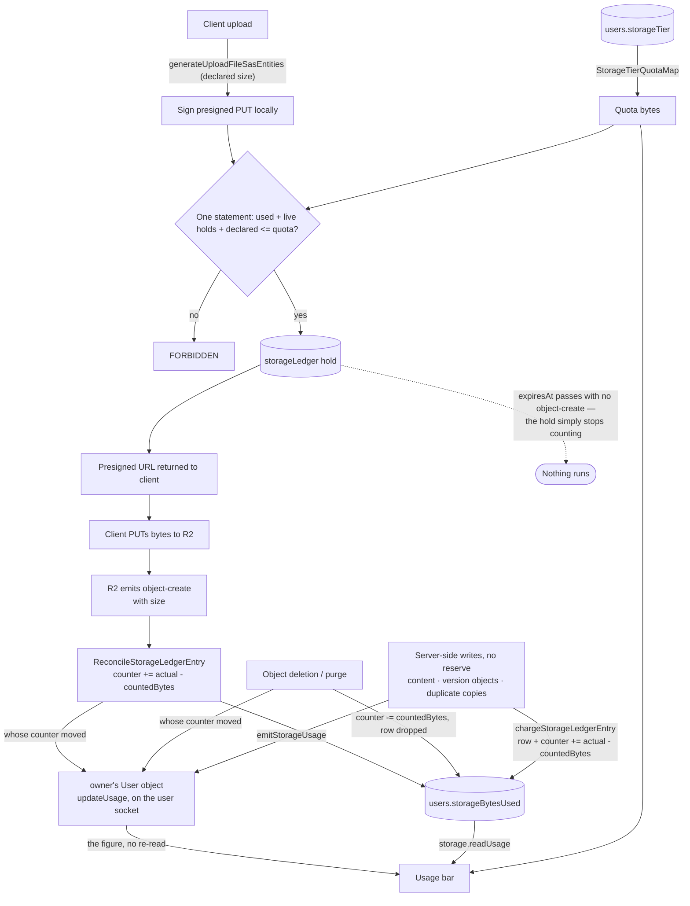

# Storage quotas

Every user has a bounded, tier-derived allowance for the files they keep in their own resources — the Free entry of `StorageTierQuotaMap` — that they genuinely cannot exceed by hammering uploads, shown back to them as a "X of Y used" meter in the [Resource Explorer](../explorer/design.md)'s header. The bar and the limit ship together: a usage number nobody can act on is no use on its own.

Nothing is scheduled to settle a hold. The counter moves only on a write it is told about — the server charging bytes it wrote itself, R2 telling us a client's object landed, or one of our own deletions removing one — and an abandoned upload needs no cleanup at all because its hold expires as a **predicate** rather than as a state some job flips.

## Why a plain pre-flight check is not enough

The obvious design — "read `storageBytesUsed`, if under quota issue the presigned PUT" — does not stop abuse, for two structural reasons:

1. **It races.** Read-then-check is not atomic. A client firing many upload requests concurrently has them all read the same low counter, all pass, and all upload — overshooting by an unbounded amount.
2. **The presigned PUT carries no byte cap.** Uploads are a two-step flow ([file uploads](../../architecture/file-uploads/design.md)): the server mints a scoped presigned PUT, the client PUTs bytes **directly to R2**. The server is never in the data path, so it cannot stop a client that declares 1 MB and PUTs 1 GB, and it cannot abort a transfer mid-stream.

This is the difference from Gmail and Drive: their uploads flow **through Google's servers**, so the server counts bytes as they stream and hard-aborts the instant you cross the line. We structurally cannot abort a direct-to-R2 upload — so the check is made **part of the write**, and what the client declared is never what it is ultimately charged.

## How it works

**The counter holds stored bytes and nothing else.** `users.storageBytesUsed` is the sum of what is actually in object storage for that user. A declaration the client has not yet made good on is not in it — that lives in the ledger and is summed at reserve time.

**Reserve.** The presigned URL is signed first — signing is local and touches nothing in R2 — and the reserve runs before the response is returned, so a rejection is a write target the client never receives. The resource upload chokepoint goes through `generateReservedResourceAssetSasEntities`, which checks each address for a held copy and otherwise mints and reserves in one call, and a write target whose name the server fixes rather than mints, a resource's staging object, goes through `generateReservedWriteSasUrl`, which does the same for that name: a new upload path cannot hand out write targets nothing accounts for. The reserve is one batch over D1: this user's collectable holds are deleted (pure garbage collection — they never entered the counter), and one guarded insert adds the new holds only while `storageBytesUsed + pending + declared <= quota` still holds over the live holds it sums, in the same batch. D1 has no row locks, so the guard in the insert is what stops concurrent reserves from both passing: a reserve that loses the race inserts nothing and is refused. Then one `storageLedger` row per write target, with `countedBytes = 0`.

**A reserve over a name that already has a row takes the row over.** A resource's staging object is one fixed name, so its next large save reserves a name whose row the last one left — settled by the object-create event, or a hold. The reserve turns it back into a hold: the new `declaredBytes` and `expiresAt`, `reconciledAt` cleared, and `countedBytes` kept, because that is what the counter still carries for the object on that name. The next object-create event then corrects the counter by the difference, and a release hands back whatever the row holds. The row it takes over is left out of the pending sum rather than counted beside the new hold, so the takeover is one replacement, not two holds on one name.

**Writes that move both the ledger and the counter are conditional, not locked.** A reconcile reads the ledger row, then writes the counter and the row in one batch, and the write holds only while the row is still in the state the delta was computed from. A reconcile that loses that race throws, so its event is redelivered and computes its delta again from the row as it now stands. Nothing decides anything from a read that a concurrent write could have changed without the write being refused: the collection moves no bytes, and the sum and the gate that read it sit inside the reserve's own statement.

**A staged content save charges the content object alone.** A save too large for one request body is uploaded to the resource's staging object through a reserved presigned PUT, like any upload, and its commit deletes that object through `deleteStorageBlobs` once the content object is written, so its row is released in the same call and the meter moves by one content object. A staging object-create event that arrives after the release finds no row and charges nothing ([file uploads](../../architecture/file-uploads/design.md)).

**A message attachment is reserved and charged to its uploader.** A message's write targets are minted through the same gate a resource upload passes: each original and each image's thumbnail is reserved against the sender's allowance before any presigned URL is signed, so a refused reserve hands out no target. The room is the object key's prefix, not its owner, so the bytes count against whoever sent them, wherever the room is. A thumbnail reserves a fixed bound until its own event lands. A forward charges the forwarder for each copy it makes and is never refused for it, since the server is the writer. The room-scoped alternative is written up as [room attachment quota](../../../deferred/esbabbler/room-attachment-quota/design.md) and stays deferred.

**The server's own writes charge themselves.** A resource's `{id}/content.json`, a version's object ([resource version store](../resource-version-store/design.md)), and every asset `cloneContentAssets` copies for a duplicate, and every attachment a forward copies, have no presigned URL and so no reserve — the server holds the bytes, knows their length, and the client was never in the data path, so there is nothing to gate and nothing to overshoot. `chargeStorageLedgerEntry` writes the ledger row and applies the same delta an object-create event would, which is what makes a save that rewrites the same object correct the counter instead of growing it. The content object is charged at its stored length, the zstd frame rather than the JSON it decodes to, which is also the length its object-create event reports ([compressed JSON blobs](../../architecture/compressed-json-blobs/design.md)). Two consequences worth stating: a save is never rejected for being over quota (the bytes are already stored, and refusing the charge would only make the counter lie — the next _upload_ is what gets refused), and the row is what lets the existing releases hand these bytes back, so purge needs no path of its own. Each clone, and each attachment a forward copies, charges for the source object's own size — the properties read that already had to say whether the source exists — **before** the copy rather than after it, and releases that row if the copy then fails. Both go through `chargeAndCopyBlob`, so the two paths cannot disagree about that order. It is the one charge whose figure is a guess about an object the server did not write, so it is the one that has to be on record before the copy's own object-create event can arrive to correct it; a row minted per clone that nothing ever writes or deletes again is also the one place where a charge for an object that never landed would never be corrected. A version's object is charged **after** the batch that took it, and content **after** the save's, never inside either: a charge is a batch of its own, and D1 holds no transaction open across the two.

**A charge is provisional, and the bucket's own event is what settles it.** Every write to `resource-assets` and `message-assets` raises an object-create event — a server-side copy included — and because the server's writes leave a ledger row, the events for them find one instead of falling through. A room's emoji are written to `message-assets` with no row, so their events find nothing and charge nothing. So the byte count a charge supplies is a starting position, not the last word: whatever actually landed is what the reconcile writes seconds later, by the same difference-against-`countedBytes` that makes a redelivery a no-op. A charge therefore claims no position in the object's write order and passes no `eventTime`, which is what marks its figure as a guess.

**Carrying no position does not make a charge yield to the last event that spoke, though — and a rule that had it yield is what froze the meter.** `{id}/content.json` is rewritten under one name on every save, and each save's event settles that name seconds later from the functions Worker. So a charge that stood down once the object had an event moved the counter on a resource's first save and never again: every save after it was counted only by its own event, which is right in the database, late on screen, and invisible in the request the owner is watching. A charge lands whatever the row has already seen, and only an event is ranked. What that trades is a charge delayed past a _newer_ write's event putting its own size back — corrected by the next save's charge rather than stranded, because the same name is written again. The one charge whose figure is a guess about a write the server did not make is the clone, and it charges **before** its copy for exactly this reason, so its own event always lands behind it and measures over it. A future charge path that guesses about a write it makes _first_ would be the one to re-open the question.

**Which event is last is a question the events themselves answer, not the order they arrive in.** A queue delivers at least once and in no guaranteed order, so two writes to one object key can have their events delivered reversed, and the older size would otherwise be the one left on the counter — permanently, since nothing revisits an object that is not written again. Being idempotent does not cover this and is a different property: replaying the earlier event is a perfectly well-behaved no-op that still leaves the counter wrong. R2 gives no per-object ordering token, so the reconcile orders events by the `eventTime` R2 stamps on each, at the millisecond it carries, and drops any event not newer than the one already applied — the general rule in [conditional writes](../../architecture/conditional-writes/design.md). Both delivery orders then converge on the size of the write that actually happened last.

**Charge.** R2's object-create event carries the stored object's size, and arrives seconds after the PUT. The handler moves the counter by `actual − countedBytes` and sets `countedBytes = actual`. That one expression is correct in all three cases at once: the first event adds the whole object, a redelivery computes a **zero** delta instead of double-counting, and a second upload to the same valid write target corrects the counter rather than stranding the old size on it.

**Release.** Deleting an object drops its ledger row and decrements its owner by whatever that row was holding — zero if the object never landed. The row is what carries both the amount and the owner, which makes a redelivered deletion event a no-op and is also the **only** way an object can be attributed to an owner at all: an object key carries the resource, not the uploader.

The delete and the release are one operation (`deleteStorageBlobs`), waved in chunks of `MAX_CONCURRENT_BLOB_DELETIONS`, and **each wave releases exactly the names it removed — not the set it was handed**. That is what makes a partial failure safe: a prefix deletion re-resolves its set from what is in the bucket, so an object an earlier attempt removed is one the redelivery can never name again, and a release keyed on the retry's smaller listing would hold those bytes against their owners forever. Waving also bounds the release statement, which would otherwise bind one parameter per name, past what one D1 statement may carry, on a directory of tens of thousands of objects. Every failure of the wave is rethrown after the wave's release lands, never before it.

**Expiry.** Past `expiresAt` — the presigned URL's own TTL — the write target is dead, so the hold cannot become real: the sum and the in-flight count both read `expiresAt > now`, so it stops counting the moment the predicate turns false. No release, no job, no compensating write.

**Collection is a different, later bound, and the difference is load-bearing.** A hold that stopped counting is not a hold that may be deleted: an object-create event for an object that _did_ land can still be inside the queue's delivery window, and a reconcile that finds no ledger row charges nothing and reports nothing — the bytes would be stored, attributed to nobody, with no dead letter to show for it. So a row is kept until no event naming it can still arrive. R2 checks a presigned URL against its expiry when the request arrives, not when it finishes, so the last PUT a presigned URL authorizes **starts** at `expiresAt` and raises its event whenever the upload completes; the queue then delivers that event for `QUEUE_DELIVERY_TTL_MS`. The reserve therefore collects only rows whose `expiresAt` is older than the delivery window plus an upload-completion allowance — and the allowance is `WRITE_SAS_DURATION_MS`, the presigned URL's own lifetime reused, which is a bound already in hand and orders of magnitude beyond what a `MAX_FILE_REQUEST_SIZE` upload can take. The bound is the delivery window the queue constant states, derived rather than restated beside it, because two hard-coded hours that drift apart fail silently in exactly this direction. The rows are dropped opportunistically by the next reserve that user makes, which already reads their rows. Only a hold that never entered the counter is collected — `countedBytes = 0` — since a row a reserve took over keeps the bytes of the object it replaced until a release gives them back.

The quota itself is **resolved from the tier at read time**, never copied onto the user row, so moving a user to a new tier changes their limit instantly with nothing to backfill. Only the _usage_ is stored, because recomputing it means enumerating every `{resourceId}/` prefix and message-attachment object.

## Why there is no scheduled sweep

The obvious shape for settling holds is a scheduled job: wake every 15 minutes, list the expired rows, probe each object, and charge or release it. It is the wrong one, and the reasoning generalises:

- **The event already exists.** R2 emits an object-create event with the exact byte count for every write, and the bucket's notification already delivers it to the reconcile queue. Polling for a fact the platform will push is standing compute spent to learn something late.
- **The other half was never an event.** "This hold expired" is not something that happens — it is something that becomes true. Written as a `WHERE` clause it needs nothing to run; written as a job it needs a schedule, a batch cap, a retry policy, and an ordering story against the arrival of object-create events.
- **The race disappears rather than being handled.** With two signals (a persistence-time confirm and an unordered, at-least-once reconcile) a whole state machine of conditional transitions exists purely to survive them arriving out of order. With one signal and a predicate there is no second thing to be out of order with.

The cost of doing it with events instead is one R2 event notification per bucket into a queue the [jobs](../../../changes/infra-cloudflare-jobs/design.md) design already defines — no new service, one event per upload, and reconciliation latency in seconds rather than up to an hour. What it avoids is a scheduled job, a batch cap, and two object requests per expired row.

A lost object-create event would leave an object stored but uncharged. The queue moves a message it cannot deliver into the reconcile job's dead-letter queue, and **that queue is not replayed, and that is deliberate**: there is no replay job, and the dead-letter copy is the record. It keeps the message and the failure, so the loss is inspectable instead of silent. The consequence, stated rather than mitigated: those bytes stay uncharged until a usage recompute, the same one the uncounted objects below need.

## The residual gap, and why it is acceptable

Between the PUT and the object-create event, a client that under-declared is holding less space than it is about to use. The size of that gap is **not** bounded: a presigned PUT carries no byte cap, and the PUT never passes back through the Worker, so `MAX_FILE_REQUEST_SIZE` constrains the declaration the client sends us and nothing about the bytes it sends R2.

What is bounded is the gap's **shape**. `MAX_UNRECONCILED_STORAGE_LEDGER_ENTRIES` caps how many under-declared uploads one user can have in flight at once, and the object-create event charges each one's real size within seconds of its PUT completing — after which the counter is truthful and every further reserve is rejected. So abuse is a single burst, not a sustained drain, and it only ever exhausts **their own** allowance — never another user's.

The cap counts **live holds**, which is one per write target and so one per upload — the resource upload chokepoint mints no thumbnail targets, so there is nothing riding alongside a file to distort it. The same number bounds each upload request's `files` array, because a batch larger than the cap can never pass the reserve however long the client waits.

True Gmail-style hard enforcement would require **proxying uploads through our own server** so it can count bytes and abort mid-stream. That is rejected: it puts our compute in the data path for every upload — cost, latency, and re-architecting the entire presigned-URL flow — to close a self-inflicted gap that only harms its own author.

## Data model

- `StorageTier` — an enum, with `Free` as its only value. The enum exists so a paid tier is a value add rather than a schema change.
- `StorageTierQuotaMap` — `{ [StorageTier.Free]: 10 * GIBIBYTE }`, `as const satisfies Record<StorageTier, number>`.
- `users.storageTier` + `users.storageBytesUsed` — the tier and the stored-bytes total. An integer in `number` mode: every tier quota is far under the 2^53 safe-integer ceiling.
- `storageLedger` — one row per write target, keyed by bucket and object key, and a row is in one of two states rather than one. A **reserved** row is a hold on an object that may never exist: the reserve writes it with `countedBytes = 0`, `declaredBytes` = what the client said it would upload, `expiresAt` = the presigned URL's TTL and `reconciledAt` null. It holds space only through the reserve's pending sum — the counter has not moved for it at all, which is why an expired one can simply stop counting. A **settled** row is stored bytes: `countedBytes` is what the counter is carrying for this object right now, and `reconciledAt` is when that last moved. The object-create event settles a hold in place and stamps the `eventTime` it was ordered by; a server-side charge writes its own row already settled, with `declaredBytes = 0`, `expiresAt` already past and no `eventTime` — it never held space, because its bytes were stored before it ran. A charge and a release find their row on the primary key, so the only index is `(userId, reconciledAt)`, for the two questions a reserve asks about one user — their live holds and their collectable ones. Nothing scans the ledger account-wide.

Existing users start at `storageBytesUsed = 0`, so for them the gate is **advisory until their real usage accumulates** — a user already over quota keeps uploading until enough of their objects are ledgered. Under-counting only ever _under_-rejects, so the advisory window never wrongly rejects a legitimate upload. New users are accurate from their first upload.

## What is not counted

These objects stay outside the ledger and are deliberately uncounted:

- **Objects uploaded before counting began** — nothing backfills them ([persisted data — latest shape only](../../architecture/persisted-data-latest-shape-only/design.md)).
- **Room emoji** — minted as a bare write target with no reserve, so their bytes are charged to nobody. A room's emoji are bounded by a per-room count instead ([custom emoji](../../esbabbler/custom-emoji/design.md)).
- **Everything outside the two charge paths** — avatars, room images and the per-user Clicker and Dungeons game-save objects go through their own writes, and the reconcile queue is fed only by the `resource-assets` and `message-assets` buckets, so most of their writes never reach it. A server-side write joins the ledger by calling `chargeStorageLedgerEntry`; one that does not is uncounted by omission rather than by design, which is the trade each new write path has to make deliberately.
- **The Genshin save** — `{userId}/save.json` in `genshin-assets` is uncounted by decision, not by omission. The quota counts what a user keeps as resources, and the save is the game's state: one object rewritten in place, at a size its own ceiling bounds, so a save is never refused for its size. Its writes go through the shared blob-state path, which does not charge the ledger ([save data](../../genshin/save-data/design.md), "Decisions").

Closing these needs a recompute that lists real object sizes per user. Worth doing once the counter has drifted enough to matter, and it is a one-shot backfill rather than a recurring sweep.

## Failure and retry semantics

- **Client under-declares:** the counter is low for the seconds until the object-create event lands; the next reserve then rejects. Bounded as above.
- **Presigned PUT issued, upload abandoned:** the hold stops counting at `expiresAt` and is dropped by the next reserve that user makes past the collection bound above. If bytes did land, the object-create event charges them and the object is an orphan under `{id}/files` that **nothing reclaims** until `purgeResource` takes the whole prefix ([blob lifecycle](../../architecture/blob-lifecycle/design.md)) — that prefix has no unreferenced-asset sweep, by design, because a restore must be able to hand back a whole resource.
- **Object-create event redelivered:** the delta is zero.
- **Object-create event dead-lettered:** it stays in the reconcile job's dead-letter queue for an operator, not replayed — see above. The object stays uncharged.
- **Object-create event for an object nothing reserved** (a clone, a key that will not percent-decode): a no-op, never an error. The handler tries the raw key, then the decoded one, and a key that cannot be decoded keeps its raw form rather than throwing — a throw would make an unaccounted object a poison message that retries to the dead letter.
- **The object-create event beats the charge that ledgers its object:** the reconcile finds no row, no-ops, and is never retried — a successful delivery — so the charge, not the event, is what the counter ends up carrying. The figure is still right for the two paths this can happen on: content and a version's object are bytes the server serialized itself, so the charge declares a measurement rather than a guess. The clone is the case where it would not have been, which is why that one charges before its copy instead. What the object loses is its place in the write order, because a charge stamps no `eventTime`: until some later event lands on that row, a retrying event for an _earlier_ write of the same key is treated as the first to speak and applied over it. The counter then holds a superseded size until the newest write's event arrives and wins on rank. Nothing is built for it — closing it means reserving a ledger row before every server-side write and releasing it if the write fails, which is the whole hold machinery spent on bytes that were never in doubt, to shorten a window that ends on the next event either way.
- **A server-side charge fails after its write committed:** the object is stored and the counter has not moved. The same shape as a dead-lettered event and accepted on the same terms — under-counting only over-serves that one user. It self-corrects where the same object key is written again, which is the case for `{id}/content.json`: the charge writes an absolute size rather than a delta, so the next save charges it in full — which holds only because a charge is never dropped once that object has an event. A **version's object does not self-correct**, because it is content-addressed and write-once: nothing rewrites that key, and a later version with the same content is deduplicated and charges nothing — so only a usage recompute closes it. What is deliberately not built for it is a durable outbox: a byte counter that self-corrects on the next write does not earn a second write path, a queue and a retry policy.
- **An expired revision is counted until something evicts it:** a revision past its `maxAgeMs` is gone to every read at once, but its bytes are released only when the resource's next revision take deletes its row, or when the resource is purged ([resource snapshots](../resource-snapshots/design.md)). A resource nobody edits keeps charging its owner for history they can no longer open. Accepted, because releasing it on time would take a sweep, and the bytes are bounded by the history the resource already had.
- **A release is missed:** the counter stays high, which only _under_-serves that user (rejects slightly early) — the safe direction. Only a whole wave can be missed, never part of one.

## Key files

| File                                                                                                              | Role                                                                        |
| ----------------------------------------------------------------------------------------------------------------- | --------------------------------------------------------------------------- |
| `packages/db-schema/src/models/user/StorageTier.ts`                                                               | tier enum                                                                   |
| `packages/db-schema/src/schema/auth/usersInAuth.ts`                                                               | `storageTier` + `storageBytesUsed`                                          |
| `packages/db-schema/src/schema/storage/storageLedgerInStorage.ts`                                                 | the ledger                                                                  |
| `packages/db-schema/src/models/queue/R2ObjectCreatedQueueMessage.ts`                                              | the object-create notification body the reconcile handler reads             |
| `packages/db-schema/src/models/storage/StorageTierQuotaMap.ts`                                                    | tier → quota bytes                                                          |
| `packages/db/src/services/storage/chargeStorageLedgerEntry.ts`                                                    | ledgers and charges a server-written object                                 |
| `packages/db/src/services/storage/chargeAndCopyBlob.ts`                                                           | the charge-then-copy step a clone and a forward share                       |
| `packages/db/src/services/storage/cloneFiles.ts`                                                                  | copies a forwarded message's files, charging each copy                      |
| `packages/db/src/services/storage/generateUploadFileSasEntities.ts`                                               | names every target, reserves the set, then signs                            |
| `apps/web/server/services/message/file/generateReservedMessageFileSasEntities.ts`                                 | the message upload chokepoint: reserve each target, then mint               |
| `apps/web/server/trpc/routers/message/index.ts`                                                                   | the message upload and the forward, each through its gate and charge        |
| `apps/web/app/composables/message/file/useUploadFiles.ts`                                                         | the composer, on the mutation client, showing a refusal                     |
| `apps/web/server/services/resource/cloneContentAssets.ts`                                                         | charges each clone before its copy, through `chargeAndCopyBlob`             |
| `apps/web/server/services/resource/generateReservedResourceAssetSasEntities.ts`                                   | the resource upload chokepoint — held check, mint and reserve as one        |
| `apps/web/server/services/storage/generateReservedWriteSasUrl.ts`                                                 | mint and reserve one fixed write target                                     |
| `apps/web/server/services/storage/reserveStorageBytes.ts`                                                         | the guarded reserve: collect expired holds, gate, insert or take over holds |
| `apps/web/server/services/resource/deleteStagingContentBlob.ts`                                                   | releases a committed staged save's upload                                   |
| `packages/db/src/services/storage/reconcileStorageLedgerEntry.ts`                                                 | declared hold → charged bytes                                               |
| `packages/db/src/services/storage/deleteStorageBlobs.ts`                                                          | delete a set of objects and release what it removed                         |
| `packages/db/src/services/storage/releaseStorageLedgerEntriesByWhere.ts`                                          | the one place bytes leave the counter                                       |
| `apps/functions/src/handlers/reconcileStorageLedgerEntryHandler.ts`                                               | the object-create handler                                                   |
| `apps/functions/src/services/storage/broadcastStorageUsage.ts`                                                    | sends the owner's User object its figure                                    |
| `apps/infra/src/cloudflare/resources/r2BucketEventNotifications/prodR2EsposterResourceAssetsEventNotification.ts` | the notification from the resource assets bucket to the reconcile queue     |
| `apps/infra/src/cloudflare/resources/r2BucketEventNotifications/prodR2EsposterMessageAssetsEventNotification.ts`  | the notification from the message assets bucket to the reconcile queue      |
| `apps/web/server/trpc/routers/storage.ts`                                                                         | `readUsage`                                                                 |
| `apps/web/app/composables/storage/useStorageSubscribables.ts`                                                     | the `updateUsage` handler on the user socket                                |
| `apps/web/app/components/Resource/StorageMeter.vue`                                                               | the usage meter in the explorer shell                                       |
| `apps/web/app/store/storage.ts`                                                                                   | the usage the meter renders, updated dynamically                            |
| `apps/web/app/layouts/resource.vue`                                                                               | the shell that mounts it on every resource page                             |

## Notes

- The meter lives in the [resource shell](../explorer/design.md)'s header, on the breadcrumb row, not in the app bar and not on user settings. Storage is what this area spends, so the number sits where uploads happen and on no route that cannot spend it; the app bar would make every page pay for a query about resources. It reads as a bar, then "X of Y used", then the plan, all written out at every viewport and with no tooltip: the reading is what the meter is for, so it is never metadata parked behind a hover a touch device does not have. Being in the shell puts it on **every** resource page, not only Home.
- The number itself lives in `useStorageStore`, read once on initial mount and updated in real-time by `useStorageSubscribables`. Each resource page declares the shell layout in its own template, so the meter is remounted on every navigation inside the explorer — reading the stored value immediately while updates stream into it as they land. The subscription is established before the read is issued, so the store drops a read that a pushed value overtook rather than letting it write the older number back. `emitStorageUsage` announces the total, and it announces it **best-effort**: everything it reports is durable before it runs, so a failed read there leaves a stale meter rather than turning a committed charge into a failed call. A clone announces once for the whole content rather than once per asset.
- **The counter moves in two processes and is read in one, so each process sends the figure to the owner's User object.** What the app changes is sent by `emitStorageUsage`, and what the **functions Worker** changes — every object-create event that settles a charge or an upload, every object-deletion wave, and the nightly purge — is sent by `broadcastStorageUsage`. Both send `updateUsage` with the figure to the owner's User object, so the meter moves on the owner's user socket with no re-read, and every device showing it hears the same figure: a quota belongs to the account, not to a device. The quota comes from `StorageTierQuotaMap` in `@esposter/db-schema`, which both processes read, so the figure the meter shows is the one the gate enforces. The reconcile and the release each hand back the owners they actually moved, so a redelivery that computes a zero delta sends nothing. A deletion sends **per wave, as the wave lands**, for the same reason it releases per wave: a wave that gives bytes back and then throws would otherwise send nothing, and the redelivery behind it re-resolves a set that can be empty.
- The resource upload input takes a `size` per file, matching the message path. It is bounded at the Zod boundary (`z.int().positive().max(MAX_FILE_REQUEST_SIZE)`) because a negative or non-finite declaration would shrink the pending sum and weaken the gate.
- `purgeResource` releases its directory **by prefix**. The purge never enumerates object keys, and the `resources` row it deletes has no foreign key into the ledger, so without this the rows would be dropped by no one and their bytes held forever.
- Each bucket's event notification feeds the same reconcile queue, so the handler checks each message's bucket against the set of buckets a reserve writes into rather than trusting the notifications to name only those. A notification that drifts wider delivers messages the handler drops.
- An object key reaches the handler through a url path, and the encoding of it depends on the characters in it. Rather than guess, the raw key is looked up first and the decoded form only if that found no row — through `getDecodedUriComponent`, since a filename holding a lone `%` is legal and would otherwise throw.
- The reserve is a service called from the upload chokepoint, not a tRPC middleware. A middleware runs before the handler, and the ledger rows are keyed by object keys the handler is what mints — so a middleware would have had to either pre-mint the keys or split the one statement that reserves them in two.
