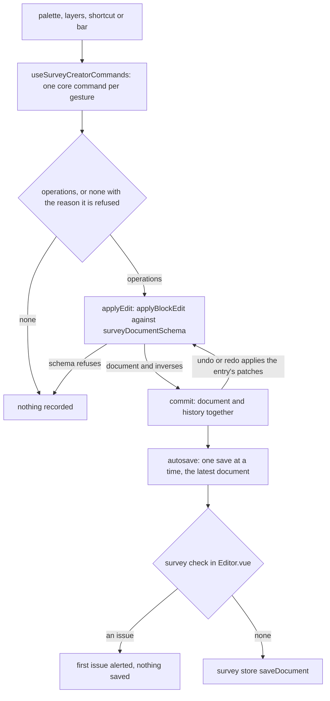

# Survey Creator

The owner's editor for a survey, on the [typed document](../survey-document/design.md). It has the shape of the [page builder](../page-builder/README.md)'s editors for webpages and emails: a store of selection, history and the preview flag, commands that turn each gesture into one core edit, and regions drawn by the editor shell with the UI library. The edits are the headless block editor's tree commands, which return JSON Patch operations, and the history is the bounded one in `@esposter/shared`.

## How it works

A gesture reaches the Creator from the palette, a row of the layers tree, a shortcut or the bar. `useSurveyCreatorCommands` turns it into the operations of one core command, or into none, with the reason it is refused, when the selection cannot take it. `applyEdit` applies those operations through the survey's document schema, so an edit the schema refuses changes nothing. An applied edit commits the document and its history together, and undo and redo apply the patches a history entry holds. Each commit reaches the autosave, which runs the survey check before it saves.

## The editor

- **Shell and layout.** `Shell.vue` hands the editor shell the creator's layout, its registry and the context the layout is resolved for: the mode, and whether a node is selected. `SurveyEditorLayout.ts` is the layout as data. A bar runs across the top. A structure region, shown in Design, holds the Outline tab, the layers tree, and the Add tab, the palette. An inspector beside the canvas holds tabs that follow the selection: with nothing selected, Survey (the survey's own texts), Logic (its calculated values) and Theme; with a node selected, Properties (the node's settings) and Logic (the conditions it holds). The parts are the [properties](../survey-properties/design.md), [logic builder](../survey-logic-builder/design.md) and [theme and files](../survey-theme-files/design.md). `SurveyEditorRegistry.ts` maps each content key the layout names to the component that draws it. In Preview the layout has neither the structure nor the inspector, so the runner has the width a respondent has. On a window below the mobile breakpoint the structure and the inspector are sheets over the canvas, so a selection never moves the canvas away from the reader.
- **Store.** `useSurveyCreatorStore` holds the document, the history, the preview flag and the selection. The selection holds the selected node's id rather than its pointer, so an edit or an undo that moves the node keeps it selected; `selectedPointer` and `selectedNode` are read off the document as it stands. `load` replaces the document and clears the history and the selection. Selection is not history.
- **Commands.** Insert places a palette kind at the insertion point the selection gives, which is `getSurveyInsertTarget`'s: after the selected element in its own slot, else at the end of a selected page, and with nothing selected at the end of the first page when that page takes the kind, otherwise at the end of the pages. The palette lists only the kinds that point takes. Move up, move down, move into the element before and move out after the parent each apply the move `getSurveyNodeMove` gives, which has no operations and a reason when the selection cannot take it. Move to a chosen place, duplicate and remove are the same kind of core command. Duplicate renames each question in the copy to a name no element holds. Remove moves the selection to the element focus falls on when the selected element goes. A property or root-prop edit is one core update. A refused command returns false and records nothing.
- **Shortcuts.** `Shell.vue` binds undo, redo and four Alt+arrow moves (up, down, into the element before, out of the parent) in the app's command scope while the Creator is mounted, whichever region has focus.
- **Layers.** `Layers.vue` lists every node in layer order, each row indented by its depth and titled by its label from `getSurveyNodeLabel`: its title, else its name, else its kind's label. Choosing a row selects it. A row dragged onto the top or bottom half of another row moves there through the move-to command, and the core refuses a slot that does not take the node's kind. The row menu offers Duplicate, the four moves, Move to… and Remove, and a move the selection cannot take is shown disabled with its reason as the description. Move to lists each slot that takes the node, labelled by the titles of the nodes it sits under. Remove asks first. A move re-renders the row, and keyboard focus follows it.
- **Palette.** `Palette.vue` feeds the shared palette the kinds the insertion point takes, grouped under six named groups, Text, Choice, Scale and ranking, Grids and repeats, Content, and Layout, with a group none of whose kinds is taken dropped. Each kind has an icon from a map keyed by every kind, and the palette searches across the groups it shows. Choosing a kind inserts it, and a press that moves past the drag distance, or a finger that rests, starts a drag instead. Pages are added from the bar.
- **Canvas.** `Canvas.vue` draws each page as a heading over its elements. A question is drawn by its runner field with pointer events off and disabled. A panel is a bordered box over its children. A click, or Enter on a focused element, selects it, and the selected element takes an accent line inside its edge. Its questions are capped at a readable width and centred. A drag, from the palette or by the handle on the selected element, shows a ghost at the pointer and draws the dragged kind in the slot it would land in, over slot boxes measured once as the drag starts; a release lands one command, and Escape, a cancel or a release over no slot changes nothing.
- **Bar.** `Toolbar.vue` is the bar, drawn by the editor's toolbar and problems components. Undo, redo and Add page are pinned, so they stay in the bar at every width. The Design or Preview switch is a group of tools, and Import, Export and Clear are held in the overflow menu at every width. Undo and redo are disabled with the reason as their description when there is nothing to act on. The problems surface lists the survey check's findings, and choosing one selects its node. Import parses the file as JSON, runs the document schema and the survey check, and raises an alert with the pointer of the first refusal and its message. A file that passes replaces the content and the root props as one history entry. Clear replaces them with an empty survey after a confirmation. Export writes the document as a JSON file.
- **Preview.** The Design or Preview switch sets the preview flag. The shell's canvas slot then draws `Runner.vue` in place of the canvas, on the current document, with a completion that does nothing, so no response is saved. The runner starts fresh each time it is shown.
- **Editor.** `Editor.vue` loads the stored document into the store when it opens and when a restore lands. It tracks the files the document references, autosaves through `useSurveyCreatorAutosave` and sweeps the files the document no longer references as it unmounts. The survey check runs before each save: an issue is alerted and nothing is saved, though the editor keeps the edit. Autosave runs as one queue under one key, so no two saves run at once, and an edit made during a save is written by the save after it.

## Decisions

- **Reorder is in the layers tree and on the canvas.** The canvas drag takes the pointer path to the same core move the layers tree and the Alt+arrow keys make. Rejected: a canvas with no drag, which was settled on the cost of hit-testing rendered fields; the slot boxes are measured once as the drag starts, and the keyboard moves remain the other way to every edit.
- **The palette inserts and is dragged.** Choosing a kind inserts it at the insertion point the selection gives, and dragging it places it where a preview shows it. Rejected: a palette that only inserts, which gave the reader no sight of the result before it landed.
- **Edits are patches.** Rejected: replacing the whole document on every change, which makes undo a list of snapshots and makes an agent's edit a different path from the owner's.
- **Selection holds an id.** Rejected: a pointer, which every move changes. An id keeps the selected element selected through a move and through an undo.
- **The survey check gates the save, not each edit.** Rejected: refusing each edit that fails the check. A name clash exists only between two elements, so the edit that resolves a clash would be refused as well. The check is held where a document is written.

## Key files

| File                                                                       | Role                                                                                                    |
| -------------------------------------------------------------------------- | ------------------------------------------------------------------------------------------------------- |
| `apps/web/app/components/Resource/Survey/Editor.vue`                       | the Editor blade: loads the document, autosaves through the check, sweeps files on unmount              |
| `apps/web/app/components/Resource/Survey/Creator/Shell.vue`                | the creator's layout, registry and context handed to the editor shell, and the keyboard commands        |
| `apps/web/app/components/Resource/Survey/Creator/Toolbar.vue`              | the bar: undo, redo, add page, the Design or Preview switch, the problems surface and the overflow menu |
| `apps/web/app/components/Editor/Shell.vue`                                 | the editor shell that draws the layout's regions beside the canvas and the sheets over it               |
| `apps/web/app/services/resource/survey/SurveyEditorLayout.ts`              | the regions, the panels and the content each panel shows for each selection kind                        |
| `apps/web/app/services/resource/survey/SurveyEditorRegistry.ts`            | the component each content key draws                                                                    |
| `apps/web/app/components/Resource/Survey/Creator/Layers.vue`               | the layers tree: selection, drag and the row menu                                                       |
| `apps/web/app/components/Resource/Survey/Creator/Palette.vue`              | the kinds the palette inserts                                                                           |
| `apps/web/app/components/Resource/Survey/Creator/Canvas.vue`               | the canvas of pages                                                                                     |
| `apps/web/app/components/Resource/Survey/Creator/CanvasNode.vue`           | one element on the canvas, selectable                                                                   |
| `apps/web/app/components/Resource/Survey/Runner.vue`                       | the runner the preview draws                                                                            |
| `apps/web/app/store/survey/creator.ts`                                     | the document, history, preview flag and selection                                                       |
| `apps/web/app/composables/survey/useSurveyCreatorCommands.ts`              | one core command per gesture, applied as patches                                                        |
| `apps/web/app/composables/survey/useSurveyCanvasSelection.ts`              | the bindings a canvas page and element take: drawn as chosen, chosen by a click or Enter                |
| `apps/web/app/composables/survey/useSurveyCreatorAutosave.ts`              | the autosave queue                                                                                      |
| `apps/web/app/store/survey/index.ts`                                       | the save path the autosave goes through                                                                 |
| `apps/web/app/services/pageBuilder/getRecordedHistory.ts`                  | folds a run of edits to one prop into one history entry                                                 |
| `apps/web/app/services/pageBuilder/constants.ts`                           | the history size, the root pointer and the default side pane width                                      |
| `packages/vue-block-editor-headless/src/services/applyBlockEdit.ts`        | applies the patches and parses the result through the schema                                            |
| `packages/vue-survey-engine-headless/src/services/surveyDocumentSchema.ts` | the document schema every edit is parsed by                                                             |
| `packages/vue-survey-engine-headless/src/services/checkSurveyDocument.ts`  | the survey check the Editor runs before a save                                                          |

## Not built

- The Alt+arrow moves are not read out through a live region. The layers tree is not a reorderable list, so nothing announces a move. The moved row keeps keyboard focus.
- Duplicate, remove and move to have no keyboard shortcut. They are reached through the row menu.
- The creator store and the files store are not keyed per resource. They hold one open survey at a time: the Editor sweeps its files before it unmounts, so a blade swapped for another survey does not carry the first survey's file set into the next.

## Notes

- A run of edits that writes the same prop of one node, or the same root props, continues the newest history entry, so typing a title one key at a time is one undo step. Consecutive writes to one list are one run as well: adding a choice and then moving it are undone together, since both write the node's `choices` prop. The cost is that one undo returns to before the whole run.
