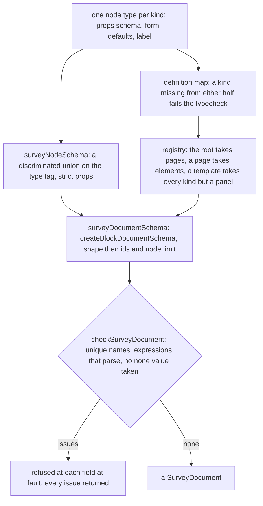

# Survey Document

The survey as a typed document in the `headless-survey-engine` package, built on the [headless block editor core](../../headless-block-editor/editor-core/design.md) and checked on save through the [survey logic](../survey-expression/design.md) expression language. A document is a root holding pages, pages and panels holding elements, and questions holding none, so the core's checks apply to it unchanged. Its kinds, props and limits are stated on this page and nowhere else, and the survey resource, the runner and the Creator all read the one schema.

## How it works

The package follows the webpage document in the page builder file for file: a node union, a children port, a static node schema per kind, a registry and a document schema built with the core's `createBlockDocumentSchema`. Each kind is three files, its node type, its props and its node type definition, and the shared files name every kind, so a kind missing from the definition map fails the typecheck.

The survey resource's content schema runs the document schema, and only where it raised no issue runs `checkSurveyDocument`, so the save check walks a tree the schema already parsed whole. The Editor runs the same check before it saves.

## The contract

**Node types.** `SurveyNodeType` is a string enum with one short lowercase tag per kind. A tag is the stored identity of its kind, since a saved document names each node by its tag, so a tag stays fixed once a survey holds it. The containers are `page` and `panel`. The question kinds are `text`, `comment`, `boolean`, `radiogroup`, `dropdown`, `checkbox`, `tagbox`, `rating`, `ranking`, `matrix`, `matrixdynamic`, `paneldynamic`, `multipletext`, `slider`, `buttongroup`, `imagepicker`, `expression`, `html` and `image`.

**Slots.** A page and a panel hold a `children` slot, and a dynamic panel holds a `template` slot. The root accepts pages only. A page and a panel accept panels and every question kind. A template accepts every kind except the two panel kinds, which bounds the recursion at one level.

**The root's props.** `title`, `description`, `logo`, `accentColor` and `backgroundColor` are strings that are empty when absent, and the two colours are `#rrggbb` strings. `showProgressBar` is `off`, `top` or `bottom` and defaults to `off`. `isQuestionNumbersVisible` defaults to false. `completedHtml`, `completeText`, `pageNextText` and `pagePrevText` are strings that are empty when absent. `calculatedValues` is a list of `{ name, expression, includeIntoResult }` with unique names.

**Every question's props.** Each question holds `id`, which the node schema adds, and the shared question shape: `name`, `title`, `description`, `requiredErrorText`, `visibleIf`, `enableIf` and `requiredIf`, each a string that is empty when absent, `isRequired` defaulting to false, and `validators`, a list of `{ expression, text }`. A name is 1 to `MAX_SURVEY_QUESTION_NAME_LENGTH` characters with no braces. Every expression a node holds, a condition, a validator's or a calculated value's, is at most `MAX_SURVEY_EXPRESSION_LENGTH` characters, the bound the logic package owns and its parser refuses past. The `html` and `image` kinds hold no answer, so they carry only `id`, `name` and `visibleIf` beside their own props, and their names are not counted when names are checked for uniqueness. A page and a panel hold `id`, `title`, `description` and `visibleIf`, which are empty when absent, and a panel also `enableIf`; each holds its slot.

**Each kind's props beyond those**, with the answer the kind holds:

| Kind            | Props                                                                                                                                                                                                                                                 | Answer                                    |
| --------------- | ----------------------------------------------------------------------------------------------------------------------------------------------------------------------------------------------------------------------------------------------------- | ----------------------------------------- |
| `text`          | `inputType` (`text`, `number`, `date`, `datetime-local`, `time`, `email`, `tel`, `url`, `password`), `placeholder`, `min`, `max`, `minLength`, `maxLength`, `pattern`                                                                                 | string, or a number for `number`          |
| `comment`       | `placeholder`, `rows` (1 to 20, default 4), `maxLength`                                                                                                                                                                                               | string                                    |
| `boolean`       | `labelTrue`, `labelFalse`, `displayStyle` (`switch`, `checkbox`, `radio`; default `switch`)                                                                                                                                                           | boolean                                   |
| `radiogroup`    | `choices`, `hasOther`, `otherText`, `hasNone`, `noneText`, `choicesOrder` (`none`, `asc`, `desc`, `random`)                                                                                                                                           | a choice value, or the typed other text   |
| `dropdown`      | `choices`, `hasOther`, `otherText`, `placeholder`, `choicesOrder`                                                                                                                                                                                     | a choice value, or the typed other text   |
| `checkbox`      | `choices`, `hasOther`, `otherText`, `hasNone`, `noneText`, `hasSelectAll`, `selectAllText`, `minSelected`, `maxSelected`, `choicesOrder`                                                                                                              | list of values                            |
| `tagbox`        | `choices`, `hasOther`, `otherText`, `placeholder`, `maxSelected`, `choicesOrder`                                                                                                                                                                      | list of values                            |
| `rating`        | `rateType` (`labels`, `stars`, `smileys`), `rateCount` (2 to 20, default 5), `minRateDescription`, `maxRateDescription`                                                                                                                               | number from 1 to `rateCount`              |
| `ranking`       | `choices`                                                                                                                                                                                                                                             | list of values in the respondent's order  |
| `matrix`        | `rows` and `columns` (choices), `isAllRowRequired`                                                                                                                                                                                                    | record from row value to column value     |
| `matrixdynamic` | `columns` (name, title, `cellType` of `text`, `comment`, `dropdown`, `checkbox`, `boolean` or `rating`, `choices` for a choice cell, `isRequired`), `rowCount` (default 2), `minRowCount`, `maxRowCount` (default 100), `addRowText`, `removeRowText` | list of records from column name to value |
| `paneldynamic`  | `template` slot, `panelCount` (default 1), `minPanelCount`, `maxPanelCount` (default 20), `addPanelText`, `removePanelText`                                                                                                                           | list of records from inner name to value  |
| `multipletext`  | `items` (name, title, `inputType` of `text`, `number` or `email`, `isRequired`)                                                                                                                                                                       | record from item name to string           |
| `slider`        | `min` (default 0), `max` (default 100), `step` (default 1), `isValueVisible`                                                                                                                                                                          | number                                    |
| `buttongroup`   | `choices`                                                                                                                                                                                                                                             | a choice value                            |
| `imagepicker`   | `choices` (value, text, `imageLink`), `multiSelect`, `isLabelVisible`, `imageFit` (`contain`, `cover`, `fill`, `none`), `imageHeight`, `imageWidth`                                                                                                   | a value, or a list when `multiSelect`     |
| `expression`    | `expression`, `displayFormat` (`none`, `decimal`, `percent`), `maxFractionDigits` (0 to 10, default 2)                                                                                                                                                | the calculated value                      |
| `html`          | `name`, `visibleIf`, `html`                                                                                                                                                                                                                           | none                                      |
| `image`         | `name`, `visibleIf`, `imageLink`, `altText` (empty means decorative), `imageHeight`, `imageWidth`, `imageFit`                                                                                                                                         | none                                      |

A choice is `{ value, text }`, where `value` is a string or a number and `text` is empty when absent. Each kind's props object is strict, so a prop the kind does not declare is refused by the schema. Lists and strings are bounded by constants in the package's constants module, and the bounds on counts that are not lists (the rating scale, comment rows, fraction digits and dynamic panel count) sit in their own kind's props module.

**Absence.** Following the repository's one absent form, a string a kind lacks is the empty string, a list it lacks is empty, and a number whose absence differs from zero, a length or a selection bound, is optional. A kind's default props are its own props schema parsed from a name alone, so a default cannot drift from the schema.

**Cross-field rules are not in the schema.** A `min` above a `max`, or a `rateCount` below the answer given, is an owner's mistake that the runner shows and does not refuse. The core's static node schema takes no refinement across fields, so none is written.

**The save check.** `checkSurveyDocument(document)` returns every issue in document order as `{ message, pointer }`, where the pointer is the JSON pointer of the field at fault, rather than stopping at the first. It checks that question names are unique across a page's and a panel's questions, a dynamic panel's template names are unique among the template's own, and a calculated value's name collides with no question name nor an earlier calculated value. It checks that every `visibleIf`, `enableIf`, `requiredIf`, validator, calculated value and expression question parses through the survey logic's `checkSurveyExpression`, and that a radio group or checkbox offering none refuses a choice holding the none answer's value, since that value is the one answer no choice may hold. It refuses a checkbox whose minimum selection is above its maximum, and a dynamic matrix whose minimum row count is above its maximum, since no answer could meet both. A reference to a name no question holds is not refused, since a calculated value or a forward reference is a legitimate target. The check is not part of `surveyDocumentSchema`: the schema parses the shape, and the check runs on the parsed result.

**The empty survey.** `createSurveyDocument` returns one page with no nodes and a fresh id, and the root's defaults. A new survey and a cleared one both start from it.

## Decisions

- **The document is the survey resource's content.** The survey resource's content is `{ document, settings }`, and its schema is the document schema with the save check as a refinement, so a save the check refuses is refused at the field it names. A save states its document, and one without it is refused: the schema has no default for it.
- **One answer for "other".** A respondent's typed other text is the answer itself, not a second key beside the choice. Rejected: SurveyJS's pair of keys, which makes a response record's columns depend on what a respondent chose.
- **One predicate for a node a response holds a value for.** `checkIsSurveyAnsweringNode` is true of a question, a calculated value included, and false of a page, a panel, a block of markup and a picture. The runner's leaf check, its question errors and its enabled check read it, and so do the app's response columns and summary cards. A calculated value answers because a completed response carries its value, though no respondent gives it, so the enabled check disables it on its own. Rejected: narrowing `SurveyQuestionNode` to the answering kinds, which drops the markup, picture and calculated kinds from the union and forces a second type for every placeable leaf.
- **A dynamic panel's template does not nest.** A template accepts no dynamic panel. Rejected: unbounded nesting, which the Creator's canvas and the runner's scopes would each have to bound for themselves.
- **The engine is published to npm, with the logic it depends on.** A survey as a typed document on the headless block editor, with no framework or DOM, is reusable on its own, and it takes the [survey logic](../survey-expression/design.md) at runtime, so the two publish as a pair. Rejected: keeping it private as app internals, which kept the document schema reachable from the app alone.

## Key files

| File                                                                          | Role                                                                                                |
| ----------------------------------------------------------------------------- | --------------------------------------------------------------------------------------------------- |
| `packages/headless-survey-engine/package.json`                                | the package's manifest                                                                              |
| `packages/headless-survey-engine/src/models/SurveyNodeType.ts`                | the kinds, by their type tags                                                                       |
| `packages/headless-survey-engine/src/models/SurveyDocument.ts`                | the document type: the core's `BlockDocument` over the node union, the root props and the page node |
| `packages/headless-survey-engine/src/models/SurveyRootProps.ts`               | the root's props and the calculated values they hold                                                |
| `packages/headless-survey-engine/src/models/SurveyQuestionBaseProps.ts`       | the shape every question shares                                                                     |
| `packages/headless-survey-engine/src/models/SurveyChoicesProps.ts`            | the choice list every choice question shares                                                        |
| `packages/headless-survey-engine/src/models/SurveyChoiceOptionsProps.ts`      | the order, other answer and its text, which a choice question that lists its choices adds           |
| `packages/headless-survey-engine/src/models/SurveyNoneChoiceProps.ts`         | the none answer, which a radio group and a checkbox may offer                                       |
| `packages/headless-survey-engine/src/services/surveyTextNodeType.ts`          | a kind's node type, the worked example: its props schema, form, defaults and label                  |
| `packages/headless-survey-engine/src/services/surveyNodeSchema.ts`            | the node union, each kind's node schema with its strict props and its children                      |
| `packages/headless-survey-engine/src/services/surveyNodeTypeDefinitionMap.ts` | every kind's definition, which the typecheck holds to every kind                                    |
| `packages/headless-survey-engine/src/services/surveyNodeTypeLists.ts`         | the types the root, a page or panel, and a template accept                                          |
| `packages/headless-survey-engine/src/services/surveyNodeChildren.ts`          | the children port, each container's slots and the typed nodes they hold                             |
| `packages/headless-survey-engine/src/services/surveyRegistry.ts`              | the registry: the root's content types and props schema, and every kind's definition                |
| `packages/headless-survey-engine/src/services/surveyIdSchema.ts`              | a node's id: bounded, and restricted to the characters an HTML id takes                             |
| `packages/headless-survey-engine/src/services/surveyNameSchema.ts`            | a question's name: bounded, with no braces                                                          |
| `packages/headless-survey-engine/src/services/surveyDocumentSchema.ts`        | the document schema, built by the core's `createBlockDocumentSchema`                                |
| `packages/headless-survey-engine/src/services/checkSurveyDocument.ts`         | the save check, returning every issue                                                               |
| `packages/headless-survey-engine/src/services/createSurveyDocument.ts`        | the empty survey                                                                                    |
| `packages/headless-survey-engine/src/services/constants.ts`                   | the package's limits on names, counts and text                                                      |
| `packages/headless-block-editor/src/models/BlockDocument.ts`                  | the core's document type, whose third parameter names the node type the root accepts                |
| `packages/headless-block-editor/src/services/createBlockDocumentSchema.ts`    | the core's document schema builder: the shape, then the ids and the node limit                      |
| `apps/web/shared/models/resource/survey/SurveyResource.ts`                    | the survey resource's content schema, the document schema with the save check as a refinement       |
| `apps/web/app/components/Resource/Survey/Editor.vue`                          | the Editor, which runs the save check before it saves                                               |
