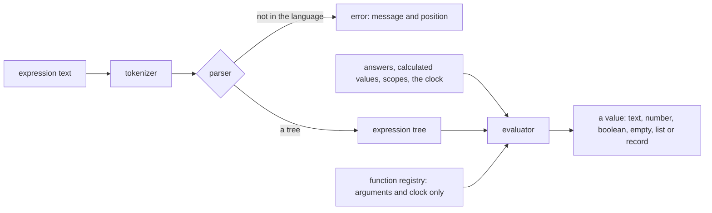

# Survey Logic

The survey's expression language as a published package: a tokenizer and parser that return a tree or a positioned error, and an evaluator over a record of answers. It is a language of its own, so it stands apart from the [math expression compiler](../../math-expression-compiler/language/design.md), which is numeric by design. The survey's values are text, numbers, booleans, lists and records, with `undefined` as the one absent value. The [survey document](../survey-document/design.md) runs its save check through this package, and the app's condition builder imports it directly. SurveyJS's expression runner is reference evidence of what an authoring tool did, not the definition of this language: each place the language answers differently is listed under [Deviations by rule key](#deviations-by-rule-key).

## How it works

The tokenizer reads the source into tokens and stops at the first character it cannot read. The parser climbs the operator table by power, so a tighter operator binds its operands first, and it refuses a source with tokens left over after a complete expression. The evaluator walks the tree over a context that holds the answers and calculated values, the scopes a dynamic panel or matrix row adds, and the clock. A call runs the function its lowercased name finds in the registry, and a name with no function evaluates to empty without reading its arguments.

## The language

- **Literals**: numbers, texts in single or double quotes, `true` and `false`, and lists in square brackets.
- **References**: `{name}` reads an answer by its exact name (R11). A name may hold dots, so `{matrix.row1.col1}` reads a nested answer: first the whole name as one key, then each dotted split read as a key of the part before it. A part may end in an index, `{panel[0].q1}`, and a digit key reads an item of a list, `{list.0}`. `{list.length}` reads the length of a list or text, and zero for any other value after a dot. A first part that names a scope the caller passes reads inside that scope, and a scope wins over a path of the same name. The survey engine passes one scope, `panel`, for a dynamic panel's row, so `{panel.name}` there reads the row's own answer.
- **Operators, loosest to tightest**: `or`; `and`; `not`, whose operand holds the comparisons and the tighter operators; the comparisons `=`, `!=`, `<`, `<=`, `>`, `>=`, `contains`, `notcontains`, `anyof`, `allof`, `empty` and `notempty`; `+` and `-`; `*`, `/` and `%`; a unary minus; and `^`, which groups to the right, so `2 ^ 3 ^ 2` is 512. The unary minus takes a power in its operand, so `-2 ^ 2` is -4. Every other binary operator groups to the left. Each operator has one spelling (R6).
- **Functions**: the date and number functions, and the list, text and logic functions. Each is one module under `services/functions/`, registered by its lowercased name, and the package's README lists them. The functions that read the live survey object, "displayValue", "isContainerReady", "isDisplayMode" and "propertyValue", are not part of the language, since the package has no survey object. The clock is passed in the context, so a test fixes it.

## The value model

- **Values.** Text, number, boolean, list and record, and `undefined`. A list holds values, a record holds values by name, and either may hold lists and records. A date is text (R9): the value model has no date value.
- **Absent.** `undefined` is the one absent value (R1). An unanswered question, an empty text, an empty list and a record whose fields are all empty are empty. Zero and false are answers, so they are not empty. Empty values equal each other and nothing else, and an empty value is never ordered (R7).
- **Numbers and texts.** A text is read as a number only where an operation needs one, and only as a plain decimal (R2). Otherwise it stays text, so an answer keeps its stored type.
- **Clock.** The date functions read the clock for an empty date, as a wall clock (R9), and `today` is the clock's day.

## Language rules

Each rule is carried by the functions named with it. The per-row conditions of a dynamic panel are the survey runner's rule, not this language's, and are in the [survey runner design](../survey-runner/design.md).

- **R1, one absent value.** `undefined` is the only absent value. A storage `null` reads as `undefined` at one boundary, `toSurveyLogicAnswer` (`toSurveyLogicAnswers` over a record). Each caller that holds stored answers converts them once, where it builds the context. `runSurveyExpression` takes that converted context and converts nothing, so the language never holds a `null`. An operation with no result is `undefined`: an unanswered or empty operand in arithmetic, a division or remainder by zero, a date that names no date, a total that overflows, and an average, minimum or maximum over nothing. Nothing returns `NaN`, `null` or an invalid date.
- **R2, one text-to-number rule.** `toSurveyLogicNumber` is the only reader of a text as a number. A finite number reads as itself. A text reads as a number when, trimmed, it is a plain decimal: an optional sign, digits with an optional point or a point and digits, and an optional exponent. Leading zeros are allowed, and there is no length limit. Hexadecimal, binary and octal texts, comma decimals, thousands separators, words, `Infinity`, booleans and lists do not read as numbers. An answer keeps its stored type, and an operation reads it as a number where it needs one.
- **R3, arithmetic is numeric.** `+`, `-`, `*`, `/`, `%` and `^` read each operand as a number (R2), and an operand that reads as none gives `undefined`. `+` is the one exception: it joins two non-empty texts when neither reads as a number. A division or remainder by zero is `undefined`, decided after the divisor reads as a number, so `'0'` and `0` alike. A list or a record is never an arithmetic operand, so a total is a `sum`. A sum, a difference or a product keeps the decimals of its operands, rounded to at most `MAX_DECIMAL_PLACES` digits.
- **R4, aggregates skip what is not a value.** `sum`, `avg`, `count`, `min` and `max`, and their "InArray" forms, take the items that read as numbers (R2). An empty value, a text that reads as no number, a boolean, a list, a record or an unanswered item is skipped, not counted and not joined. `sum` and `count` of nothing are zero, and `avg`, `min` and `max` of nothing are `undefined`. An "InArray" form counts an item only when its named field reads as a number, in both its count and its divisor. A call whose arguments are not the form's shape (fewer than two or more than four, or a field name that is not text) has no result in any of the five "InArray" forms, and an unanswered array holds no items, so its sum is zero.
- **R5, text functions read their numbers.** `substring` reads its start and end as numbers (R2) and its value as text, so a number value reads as its text and an unanswered value has no result. A start that reads as no number, an absent or empty one included, has no result, and so does an end that is present but is not a number; an empty end runs to the end of the text. An index is truncated toward zero and clamped to the text. `trunc` and `round` read their value and their precision as numbers (R2): a value that reads as no number has no result, and so does a precision that is present but is not a number, while an empty or absent precision is zero. Both operate on the number, not on its decimal string: the decimal places are read from the digits, with any exponent handled. A precision is a whole number from zero to `MAX_DECIMAL_PLACES`, read by one check both functions share, so any other precision has no result: `round(1234.5, -1)` is `undefined`, and neither function can give an infinite or a non-number result.
- **R6, one grammar.** `^` groups to the right, and a unary minus binds looser than it, so `-2 ^ 2` is `-(2 ^ 2)`. Each operator has one spelling: `=`, `!=`, `<`, `<=`, `>`, `>=`, `and`, `or`, `not`, `+`, `-`, `*`, `/`, `%`, `^`, `contains`, `notcontains`, `anyof`, `allof`, `empty` and `notempty`. The aliases `==`, `<>`, `&&`, `||` and `!` are not operators, so a source with one is a parse error. `not` and a unary minus may open any operand, and a number may start with a point. Keywords and function names are read in any case.
- **R7, comparison and membership.** Two values that read as numbers compare as numbers (R2), so `'10' < '9'` is false. Two texts compare by code point (R11). A number is never ordered against a text that does not read as a number, and an empty value is never ordered. `<=` and `>=` hold for equal values. Two values are equal when both are empty, when both read as the same number, when both are the same boolean, or when both are identical texts (R11). Two lists are equal when each item of the left pairs with a distinct equal item of the right, so their order does not matter. Two records are equal when every field either one holds is equal in both, a field one record lacks reading as absent. `contains`, `anyof` and `allof` test each item of their right side on its own: a list holds an equal item, a text holds the item as a substring (R11), and a number or a boolean holds it as text, while a record holds nothing. A scalar right side is one item, and a needle of zero or false is an item like any other. An empty needle, unanswered, an empty text or an empty list, is held by nothing, so `contains` and `anyof` are false for it. `allof` of an empty needle is true, the one vacuous case. `notcontains` is the negation of `contains`.
- **R8, conditions are booleans.** `and`, `or` and `not` read only `true` as true, so any other operand counts as false, and they return a boolean. `iif(c, a, b)` yields `a` only when `c` is `true`, and `b` otherwise. A condition (`visibleIf`, `enableIf`, `requiredIf` and a validator) holds only when its expression evaluates to `true`; a value that is not `true`, or a fault, does not hold.
- **R9, dates are calendar dates.** A date is ISO text: `YYYY-MM-DD`, or a date and a time joined by a `T` or a space, with optional seconds and fraction and an optional zone of `Z` or an offset. Any other text, and any number, is not a date, and no text is trimmed before it is read. A text with no zone is a wall-clock value: its calendar day and time of day are read as written and moved in UTC fields, so no zone or daylight saving change moves them, and `dateAdd('2026-03-08T02:30:00', 0, 'hours')` is `'2026-03-08T02:30:00.000'`. A text with a zone is the moment it names, read on the local clock as its wall clock, and the clock the date functions read is its local calendar fields. Years from zero to 9999 are the years they name, year zero a leap year, so `dateDiff('0000-01-01', '0001-01-01')` is 366, and a date that moves outside those years has no result. An empty date reads as the clock in `day`, `month`, `year` and `weekday`, and as empty in every other date function. An invalid date, such as a day its month lacks or an hour past 23, is `undefined` in every date function. Days, months and years move the calendar: a day added moves by a calendar day, so a daylight saving change cannot shift it, and a month or a year added to a day its target month lacks ends on that month's last day. A fractional count of days, months, years, hours, minutes or seconds is truncated toward zero before it moves a date, so `today(-1.5)` is yesterday. Hours, minutes and seconds move the wall clock, and the hours, minutes or seconds between two dates count the wall clock's fields, so a daylight saving change does not change the hours of a day. `dateAdd(d, 0, u)` is `d`. An unknown interval is `undefined` in `dateAdd`, `dateDiff` and `age`. `dateAdd` and `dateDiff` count days when no interval is given, and `age` counts years. A date-time end counts its time: a month is whole once the later date reaches the earlier date's day and time of day, and an hours, minutes or seconds interval counts the time of the end. `age` of a birthdate after the clock is `undefined`.
- **R10, weight is removed.** A function the language does not need is not in it, and one name serves each job: `year(x)`, `today(n)` and `dateDiff(a, b, 'days')` are the functions for their jobs, so "currentYear", "getYear", "currentDate", "getDate" and "diffDays" are not functions, and a call to a name with no function is refused by the check. An array function's filter form, a condition over the items given as its last argument, is refused by the check, and the evaluator answers empty for it.
- **R11, text is compared exactly.** Text is one comparison everywhere. Two texts are equal when identical and ordered by code point, with no trimming and no change of case, and `contains`, `anyof` and `allof` hold an item of their right side in a text as an exact, case-sensitive substring, so `'ab' contains ['a', 'b']` is true: a list needle is never joined into one text. A reference names an answer by its exact name, so `{Name}` and `{name}` are different answers. A boolean is never ordered: `<` and `>` are false for it, and `<=` and `>=` hold only for an equal value.
- **Scopes read paths.** A name whose first part is a scope reads the rest of the name inside that scope as a top-level name is read: its exact key, then its dotted path, its indexes and its length, so `{panel.mt.a}` is the `a` inside the panel's `mt`. An exact answer under the whole name wins over a scope of the same first part.

## Deviations by rule key

The package answers the recorded SurveyJS value for every fixture row except the rows below. Each deviating row of `services/fixtures/oracleFixtures.json` names one key, and `oracleFixtures.test.ts` holds the reason for each key and replays the row against the package's own value, so a change to either is noticed. Each key is explained by the rule named after it.

- **`one-absent-value` (R1).** An operation with no result is `undefined`. SurveyJS gives `null` for an unanswered reference and for a division by zero, `NaN` for arithmetic on a text that is not a number, and an invalid `Date` for a date that does not parse. This package gives `undefined` for each, as it does for `today('x')`, `day('x')` and `dateDiff('x', '1970-01-01')`.
- **`numeric-arithmetic` (R3).** An empty, boolean, list or record operand has no result, `+` joins only two non-empty texts that read as no number, and a division or remainder by zero has none. `{a} - {b}` with `''` is `undefined` where SurveyJS gives 0, `{a} + {b}` with `'abc'` is `undefined` where SurveyJS joins `'0abc'`, and `{a} + 'x'` on a record is `undefined` where SurveyJS joins `'[object Object]x'`.
- **`logic-boolean` (R8).** `and` and `or` are boolean, so an operand counts only when it is `true`. `1 and 0` is false and `{a} or {b}` with zero is false, where SurveyJS gives the operand that decides the result.
- **`condition-true` (R8).** `iif` takes its second value only when its condition is `true`, so `iif('x', 1, 2)` is 2 where SurveyJS gives 1, and `iif({a}, 1, 2)` with 5 is 2 where SurveyJS gives 1.
- **`one-number-reading` (R2).** A text is a number only as a plain decimal. `'0x1F'`, `'0b1'` and comma decimals stay text, so `{a} * 2` with `'0b1'` is `undefined` where SurveyJS gives 2. An answer keeps its text until an operation asks for a number: `{a}` with `'0x1F'` is `'0x1F'` where SurveyJS gives 31. A numeric text is a number as a date amount too, so `today('3')` adds three days where SurveyJS joins the text.
- **`aggregate-skip` (R4).** `sum`, `avg`, `count`, `min` and `max` skip what does not read as a number, where SurveyJS joins or counts it. `sum('a', 1)` is 1 where SurveyJS gives `'0a1'`, `avg('a', 2)` is 2 where SurveyJS gives `NaN`, `count('')` is 0 where SurveyJS gives 1, and `avg('', 5, 5)` is 5 where SurveyJS gives 18.33.
- **`unordered-values` (R7).** An empty value, or a number against a text that does not read as a number, is never ordered, where SurveyJS orders them as zero or as text. `{a} < {b}` with `''` and `'5'` is false where SurveyJS gives true.
- **`numbers-compare` (R7).** Two values that read as numbers compare as numbers, so `'10' < '9'` is false and `'5.0' = '5'` is true, where SurveyJS compares the texts.
- **`empty-equality` (R7).** Empty values equal each other, so `{a} = []` is true for an unanswered question and `{a} = ''` is true for a record of empty fields, where SurveyJS gives false for both.
- **`boolean-equality` (R7).** A boolean equals only the same boolean, so a list holding a number does not contain `true` and a text spelling `true` is not `true`, where SurveyJS equates them. `{a} contains {b}` with `[1, 'x']` and `true` is false where SurveyJS gives true.
- **`falsy-needle` (R7).** A needle of zero or false matches like any other value, so `{a} contains 0` is true for `'a0b'` and `{a} allof 0` is true for `0`, where SurveyJS treats the needle as empty.
- **`negated-containment` (R7).** `notcontains` is the negation of `contains`, so `{a} notcontains ''` is true for `'abc'` and `{a} notcontains {b}` is true for an unanswered answer, where SurveyJS gives false for both.
- **`empty-needle` (R7).** An empty needle is held by nothing, so `contains` and `anyof` are false for it and `allof` is true, where SurveyJS gives `contains` and `anyof` true and `allof` false. `{a} anyof []` is false for any answer, `{a} contains []` is false for `['x']`, `{a} anyof {b}` is false for `'abc'` with an unanswered `b`, and `{a} allof {b}` is true for any answer with an unanswered `b`.
- **`text-haystack` (R7, R11).** `anyof` holds its right side's items in its left side, as `contains` does, so a text holds an item of the right side as a substring and a scalar left side is not the needle: `'re' anyof 'red'` is false, where SurveyJS reads the left side as the needle and gives true.
- **`calendar-dates` (R9).** A date is ISO text only, and a date function gives the calendar's answer. `age('1970-01-03')` is `undefined` for a birthdate after the clock, where SurveyJS gives 0. `dateAdd('1970-01-31', 1, 'months')` is `'1970-02-28'`, where SurveyJS gives `'1970-03-03'`. `dateAdd('1970-01-01', 3, 'weeks')` is `undefined` for an interval the language does not know, where SurveyJS leaves the date unchanged. `dateAdd('1970-01-01', 0)` is `'1970-01-01'`, where SurveyJS gives `null`. `dateDiff('1970-01-01', '1970-01-01 05:00:00', 'hours')` is 5, where SurveyJS gives NaN for a date-time end.
- **`text-identity` (R11).** Texts are equal and contained only when identical, with no trimming and no change of case. `'  x ' = 'x'` is false, `{a} = ''` is false for `'  '`, `{a} = ['a', 'b']` is false for `['A', 'B']`, and `{a} contains 'RED'` is false for `['red']`, where SurveyJS trims and ignores case.
- **`case-sensitive` (R11).** A reference names an answer by its exact name, so `{Name}` reads only an answer named `Name`, and `{m.A.b}` reads only a key `A`, where SurveyJS ignores case.
- **`exact-text` (R11).** A boolean is never ordered, so `{a} < {b}` with `0` and `true` is false, and `true > false` is false, where SurveyJS orders a boolean as a number.
- **`accepted-syntax` (R6).** `not`, a unary minus before any operand (`-(3)`, `- 3`) and a number with a leading dot (`.5`) are part of the grammar and evaluate, where SurveyJS reports an invalid expression.
- **`power-grouping` (R6).** A chain of `^` groups to the right, so `2 ^ 3 ^ 2` is 512 where SurveyJS gives 64.
- **`unary-minus` (R6).** A unary minus binds looser than `^`, so `-2 ^ 2` is -4 where SurveyJS gives 4.
- **`answer-type` (R2).** An answer keeps its stored type, so `{a}` with `'TRUE'` is the text `'TRUE'` where SurveyJS gives true.
- **`array-filter` (R10).** The filter form of an array function is refused, so `checkSurveyExpression` refuses `avgInArray({m}, 'p', '{p} > 1')` and `runSurveyExpression` answers empty for it, where SurveyJS filters the items.
- **`precision-range` (R5).** A precision that is not a whole number from zero to `MAX_DECIMAL_PLACES` has no result, so `round(1234.5678, -2)` and `trunc(1.9, -1)` are `undefined`, where SurveyJS gives 1200 and 1.
- **`text-function` (R5).** A substring's index reads as a number (R2), so `substring('hello', 'x')` is `undefined` where SurveyJS gives `''`, `substring('hello', 1, 'x')` is `undefined` where SurveyJS gives `'ello'`, and a list is not an index either.

## Decisions

- **The check, not the parser, refuses an unknown function.** `parseSurveyExpression` accepts a call to any identifier. `checkSurveyExpression` parses, then refuses the first call in source order whose name has no function, or whose array function takes a filter, naming it. The parser needs no registry, so the tokenizer and parser are built before the functions. Rejected: the parser taking the registry, which would make the first unit wait on the last.
- **Errors carry a position.** The parser returns a neverthrow result whose error holds a message and the character index of the token it starts at, because the document's save check names the element and the Creator's builder shows the fault. A source past `MAX_SURVEY_EXPRESSION_LENGTH` is refused at its first character past the limit before it is read, since the recursive parser and evaluator spend stack per operator, so a source no longer than the limit is the one that reaches them. Rejected: throwing, which loses the position at the first catch.
- **The fixtures are reference evidence, recorded from SurveyJS, not written by hand.** A throwaway script outside the repository ran SurveyJS's expression runner over a table of expressions and answer records at a fixed clock and wrote the results as `services/fixtures/oracleFixtures.json`, which the package's test replays. SurveyJS is not a dependency of the repository, and the fixtures are a record of what an authoring tool did. Rejected: fixtures written by hand, which would record what the package does rather than what SurveyJS does.
- **Numbers are doubles, and the edges of a double are not worked around.** An integer with more significant digits than a double holds is as inexact in `trunc` as it is anywhere, a sum or a scaled value that leaves a double's range is infinite, and `round` and `trunc` scale by a power of ten, so at the far edge of the range they can lose the last digit or overflow. List equality compares element by element, so it is quadratic in the lists' lengths, which an answer list keeps small. Rejected: decimal arithmetic or an exact scaling, which would add a dependency or a slower path to every number for values a survey never holds.
- **The package is published to npm, as the other library packages are.** An expression language with no framework or DOM is reusable on its own, and the survey engine depends on it at runtime, so the two ship as a pair. Rejected: keeping it private as app internals, which left the engine's runtime dependency unpublished. It costs a trusted-publisher entry and a manual first publish, as every new package does ([release flow](../../architecture/release-flow/design.md)).
- **Dates are text.** The value model has no date value. An ISO text is a date (R9), and a date function returns its result as ISO text, so a result compares with an answer. Rejected: a date value, which would need its own comparison and a serialisation at every answer.
- **Stored answers convert once, where the caller builds the context.** `runSurveyExpression` takes a context already read as answers, so an expression reads its values with no conversion, and a pass over calculated values converts each answer once rather than once per expression. Rejected: converting inside `runSurveyExpression`, which re-walked the whole context for every expression, so a pass of calculated values read every answer once per value.

## Key files

| File                                                                             | Role                                                                                                         |
| -------------------------------------------------------------------------------- | ------------------------------------------------------------------------------------------------------------ |
| `packages/survey-expression/package.json`                                        | the package's manifest                                                                                       |
| `packages/survey-expression/README.md`                                           | the public surface, every implemented function and the deliberately absent ones                              |
| `packages/survey-expression/src/services/tokenizeSurveyExpression.ts`            | reads the source into tokens, or the first fault with its position                                           |
| `packages/survey-expression/src/services/parseSurveyExpression.ts`               | parses the tokens into a tree by power, refusing tokens left over                                            |
| `packages/survey-expression/src/services/SurveyExpressionBinaryOperatorMap.ts`   | the binary operators, their spellings and powers                                                             |
| `packages/survey-expression/src/services/evaluateSurveyExpression.ts`            | evaluates a tree over a context, one evaluator per node type                                                 |
| `packages/survey-expression/src/services/runSurveyExpression.ts`                 | parses a source and evaluates it over a context already read as answers                                      |
| `packages/survey-expression/src/services/checkSurveyExpression.ts`               | refuses a source that does not parse, calls an unknown function or uses a filter                             |
| `packages/survey-expression/src/services/findSurveyExpressionRefusal.ts`         | finds the first refused call in source order                                                                 |
| `packages/survey-expression/src/services/functions/SurveyLogicFunctionMap.ts`    | the registry the evaluator and the check read, merged from the function maps, its array functions among them |
| `packages/survey-expression/src/services/shared/toSurveyLogicAnswer.ts`          | the one boundary where stored answers are read: a storage null as undefined (R1)                             |
| `packages/survey-expression/src/services/shared/toSurveyLogicNumber.ts`          | the one reader of a text as a number (R2)                                                                    |
| `packages/survey-expression/src/services/shared/checkIsSurveyLogicItemHeld.ts`   | the one item a haystack holds, shared by `contains`, `anyof` and `allof` (R7, R11)                           |
| `packages/survey-expression/src/services/shared/checkIsSurveyLogicContaining.ts` | the containment `contains` test over every item of its right side, exact (R11)                               |
| `packages/survey-expression/src/services/shared/checkIsSurveyLogicLess.ts`       | the ordering behind `<`, with a boolean never ordered (R7, R11)                                              |
| `packages/survey-expression/src/services/shared/parseSurveyLogicDate.ts`         | the one reader of an ISO text as a date, or as none (R9)                                                     |
| `packages/survey-expression/src/services/shared/getDateDifference.ts`            | the interval between two dates, in calendar units or on the wall clock (R9)                                  |
| `packages/survey-expression/src/services/shared/createSurveyLogicWallClock.ts`   | the one constructor of a wall-clock date, its year set whole (R9)                                            |
| `packages/survey-expression/src/services/shared/toSurveyLogicWallClock.ts`       | the one reader of the local clock as a wall clock (R9)                                                       |
| `packages/survey-expression/src/services/fixtures/oracleFixtures.json`           | the recorded SurveyJS values, and each deviating row with its rule key                                       |
| `packages/survey-expression/src/services/fixtures/oracleFixtures.test.ts`        | replays each row and checks each deviation names a key and still differs                                     |
| `packages/math-expression-compiler/src/models/`                                  | the sibling package whose layout this one follows                                                            |
