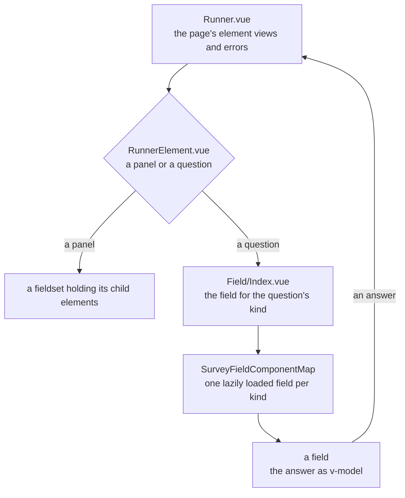

# Survey Fields

One field component per question kind, and the chooser that picks one for each question on a page. Each field is drawn from the app's UI library, so it meets the library's keyboard and ARIA contract rather than a contract of its own. The page that holds the fields, and owns the state, the errors and the focus, is the [survey runner](../survey-runner/design.md). Each field takes the node type of the [typed document](../survey-document/design.md) for its kind.

## How it works

`Field/Index.vue` takes a question's node, its error and whether it is disabled, binds the answer with `v-model`, and renders the component `SurveyFieldComponentMap` gives for the node's kind. The map loads each field on demand, and the chooser holds the question in a skeleton until its field arrives, so a page downloads only the fields its questions draw.

A field takes `node`, `isDisabled` and `error`, and binds its answer with `v-model`. It never evaluates a condition, validates an answer or reads another question: the runner decides all three, and the field shows the error the runner gives its question.

Most fields draw their question through `Field/Shell.vue`, which draws the title with a required mark, the description under it and the error as an alert. The required mark is an `aria-hidden` star beside the word "required" for speech, and the control is described by the description and the error together, in that order. Text, comment and slider keep their library control's own label instead. Matrix dynamic draws its own caption, and expression, html and image draw no question chrome of their own.

| Kind            | Field               | Drawn with                                                                                                                                                                                                                                 |
| --------------- | ------------------- | ------------------------------------------------------------------------------------------------------------------------------------------------------------------------------------------------------------------------------------------ |
| `text`          | `Text.vue`          | `UiTextField` with its type for `number`, `password` and `time`; `UiDateField` for `date` and `datetime-local`, with its time part for the latter; `email`, `tel` and `url` as plain text                                                  |
| `comment`       | `Comment.vue`       | `UiTextField` with its rows                                                                                                                                                                                                                |
| `boolean`       | `Boolean.vue`       | `UiSwitch`, `UiCheckbox` or a two-option `UiRadioGroup` by its display style, each labelled by the question's state label                                                                                                                  |
| `radiogroup`    | `RadioGroup.vue`    | `UiRadioGroup` over the choices, with the none and other options and a `UiTextField` for other text, through `useSurveyChoiceAnswer`                                                                                                       |
| `dropdown`      | `Dropdown.vue`      | `UiSelect` over the choices, with its placeholder while nothing is picked, and the other option and its text field                                                                                                                         |
| `checkbox`      | `Checkbox.vue`      | one `UiCheckbox` per choice, with select all (mixed while some are chosen), none and other, in a group                                                                                                                                     |
| `tagbox`        | `TagBox.vue`        | `UiSelect` in multiple mode over the choices, with its placeholder while nothing is picked, and an other option and its text field                                                                                                         |
| `buttongroup`   | `ButtonGroup.vue`   | `UiToggleGroup` over the choices                                                                                                                                                                                                           |
| `rating`        | `Rating.vue`        | `UiToggleGroup` of the numbers from one to the scale's count for labels; `UiRating` of stars, or of one face per step, for the other two types; the minimum and maximum descriptions beneath it in every type                              |
| `ranking`       | `Ranking.vue`       | a reorderable `UiList` of the choices in the answer's order, each row marked with its place; Alt with Up or Down moves the focused row, announced through the list's live region                                                           |
| `slider`        | `Slider.vue`        | `UiSlider`, inert and faded while disabled, with its value text when the question shows its value                                                                                                                                          |
| `matrix`        | `Matrix.vue`        | a table with a row per row choice, each row a `UiRadioGroup` over the column choices                                                                                                                                                       |
| `matrixdynamic` | `MatrixDynamic.vue` | a table whose cells are drawn by their column's kind: `UiTextField` for text and comment, `UiSelect` for dropdown, `UiCheckbox` for checkbox and boolean, `UiToggleGroup` for rating; `UiButton` adds a row and `UiIconButton` removes one |
| `paneldynamic`  | `PanelDynamic.vue`  | the template's fields drawn once for each panel, in a framed box, with add and remove buttons                                                                                                                                              |
| `multipletext`  | `MultipleText.vue`  | a `UiTextField` per item, typed as a number for a number item; an email item is drawn as plain text                                                                                                                                        |
| `imagepicker`   | `ImagePicker.vue`   | a `UiList` of the pictures, each labelled by its text, as a listbox that takes several when it allows several; each picture drawn at its author's pixel size when one is set                                                               |
| `expression`    | `Expression.vue`    | the calculated value as read-only text, rounded and formatted by its display format                                                                                                                                                        |
| `html`          | `Html.vue`          | the markup, sanitised, with no answer                                                                                                                                                                                                      |
| `image`         | `Image.vue`         | the picture with its alternative text, and nothing when it has no link                                                                                                                                                                     |

## Surface

A rating shows one of three scales, and the leanest form of each is what the respondent meets. **Labels** is the numbered segment track, unchanged. **Stars** draws no track and no number: an outlined star for each step, muted, and the chosen star and every star before it filled in the accent. Hovering a star fills the stars up to it, and leaving the scale returns them to the answer, so the pointer previews the answer before it is given. Focus is the document's focus ring on the one star that holds the choice, and the arrow keys move it. **Smileys** draws one face per step, from the angriest at the first step to the happiest at the last, muted, with the chosen face in the accent; no hover preview, since a face is read whole. Both picture types take the field's invalid state as the control's error colour and the shell's alert beneath it, and a disabled scale is faded and inert. On a narrow screen a scale longer than the width wraps its steps onto a second line rather than overflowing. The minimum and maximum descriptions stay beneath every type, since they are the question's own words for its ends.

An image picker draws each picture at the pixels its author set, and at the default size of a row's mark when neither dimension is set. A width or a height alone leaves the other to the picture's own ratio. The fit decides how a picture fills the box it is drawn in, and the title stays beside it, so a picture wider than an icon widens the row's mark rather than overlapping its title.

A dropdown and a tag box with a placeholder show it in the trigger while nothing is picked, in the same muted text a text field's placeholder takes, in place of the question's title that the shell already draws above. The list never offers it, so it cannot be picked.

## Decisions

- **A field is dumb.** It holds no logic of the survey, so the preview, the respondent page and the Creator's canvas draw the same components. Rejected: a field that evaluates its own condition, which makes the preview and the page disagree the first time a condition changes.
- **Fields load on demand.** The map imports each field lazily, so a survey's page loads only the kinds it draws. Rejected: importing every field into the runner, which loads every kind for every survey.
- **A choice's pick is held apart from its answer.** The answer holds other text as itself, so a text equal to a choice's value cannot be read back from the answer as the pick of that choice. `useSurveyChoiceAnswer`, the checkbox and the tag box keep the picks and the other text as the reader makes them, and the answer is written from them. Rejected: deriving the pick from the answer alone, which drops the other option the moment its text is cleared.
- **Markup is sanitised where it renders.** The html field passes its markup through `sanitizeHtml`, since an imported or agent-written document's markup renders in the app's origin.

## Notes

- A text field keeps the text the reader has typed apart from the answer, so a number's partial entry such as `1.` is not rewritten by the number it reads as.
- A date field's answer is the ISO text of its instant, which the picker reads back as the same moment.

## Not built

Each gap is a change to the UI library, and each field works around it as the table says.

- The text field has no email, telephone or URL type: `UiTextFieldType` holds number, password, search and time. Those answers, and the email items of a multiple text, are drawn as plain text, so the browser's own format check and the mobile keyboard for them do not apply.
- The date field has no invalid state and no error prop, so the date and datetime fields draw their error beneath the control and do not mark it invalid.
- The toggle group has no disabled prop, so the button group and the rating fields disable each item.
- The slider has no disabled prop, so the slider field is made inert and faded instead.
- The radio group and the select have no invalid state. The shell draws the error beside them.
- The library has no required prop, so the shell draws the required mark, and the matrix dynamic caption draws its own.
- There is no per-cell radio group and no tile group of images: a matrix's rows are radio groups, and the image picker is a list of rows.

## Key files

| File                                                               | Role                                                                                                |
| ------------------------------------------------------------------ | --------------------------------------------------------------------------------------------------- |
| `apps/web/app/components/Resource/Survey/Field/`                   | one field and one component test per question kind, and `Index.vue` and `Shell.vue` beside them     |
| `apps/web/app/components/Resource/Survey/Field/Index.vue`          | the chooser: the field for a node's kind, loaded behind a skeleton                                  |
| `apps/web/app/components/Resource/Survey/Field/Shell.vue`          | the title, required mark, description and error of a field, and the ids the control is described by |
| `apps/web/app/services/resource/survey/SurveyFieldComponentMap.ts` | the field each kind is drawn with, loaded on demand                                                 |
| `apps/web/app/composables/survey/useSurveyChoiceAnswer.ts`         | a choice question's pick, its other text and its ordered options                                    |
| `apps/web/app/composables/survey/useSurveyRecordAnswer.ts`         | a record answer read as an object                                                                   |
| `apps/web/app/services/resource/survey/getSurveyAnswerRows.ts`     | a list answer's rows, with the question's initial count of empty rows before any answer             |
| `apps/web/app/services/resource/survey/withSurveyAnswer.ts`        | a row's record with one answer set, or cleared                                                      |
| `apps/web/app/services/survey/getSurveyFieldHint.ts`               | the hint under a text field: its description, and the required word after it                        |
| `apps/web/app/components/Ui/`                                      | the UI library the fields are drawn from                                                            |
| `apps/web/app/components/Ui/Rating.vue`                            | a rating scale of numbered steps, filled by the caller's mark up to the pointer or the choice       |
| `apps/web/app/components/Ui/setupUiStyle.test.ts`                  | the helper that runs a field's component test once per design style                                 |
