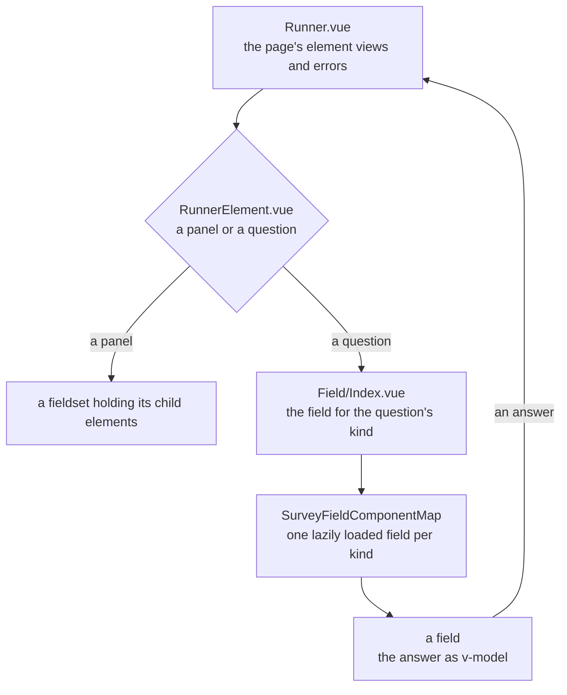

# Survey Fields

One field component per question kind, and the chooser that picks one for each question on a page. Each field is drawn from the app's UI library, so it meets the library's keyboard and ARIA contract rather than a contract of its own. The page that holds the fields, and owns the state, the errors and the focus, is the [survey runner](../survey-runner/design.md). Each field takes the node type of the [typed document](../survey-document/design.md) for its kind.

## How it works

`Field/Index.vue` takes a question's node, its error and whether it is disabled, binds the answer with `v-model`, and renders the component `SurveyFieldComponentMap` gives for the node's kind. The map loads each field on demand, and the chooser holds the question in a skeleton until its field arrives, so a page downloads only the fields its questions draw.

A field takes `node`, `isDisabled` and `error`, and binds its answer with `v-model`. It never evaluates a condition, validates an answer or reads another question: the runner decides all three, and the field shows the error the runner gives its question.

A field's required mark reads its node's own flag, so the runner's decision reaches the field on the node. `RunnerElement.vue` hands a top-level question the effective node, the question with its required flag set to the one the runner decides, which holds when the question's own flag is set or its `requiredIf` holds. A dynamic panel draws each row from the runner too: `RunnerElement.vue` and `Field/Index.vue` pass down the runner's row views, a function that gives a row the template questions it shows, each with whether the row enables it and requires it, and `PanelDynamic.vue` draws those questions and no others, disables the ones the row does not enable, and hands each its effective node. Both paths build the effective node through one function, so a mark, its hint and its `aria-required` follow the same decision. Outside a runner, as on the Creator's canvas, no function is passed and every template question is drawn with its own flags.

Most fields draw their question through `Field/Shell.vue`, which draws the title with a required mark, the description under it and the error as an alert. The required mark is an `aria-hidden` star. Speech says a required control once, by one of two routes: a control whose role takes `aria-required` (a dropdown, a tag box, a radio group, a picture list, a matrix's rows, a multiple text's item, a text input) takes it, and its title's word is left out of its name; a control whose role does not take it (a checkbox group, a switch or box, a slider thumb, a date trigger, a matrix or panel group, a ranking list) is named by its title through `aria-labelledby`, which carries the word. The control is described by the description and the error together, in that order. Text, comment, slider and date keep their library control's own label instead, which draws the same required mark from `Ui/RequiredMark.vue`. Matrix dynamic captions its table with that mark and draws it on a required column's header. A column's text, comment and dropdown cells take `aria-required`; its checkbox, boolean and rating cells take none, and are named through `aria-labelledby` by their column's header, which carries the word, as a checkbox group is. Expression, html and image draw no question chrome of their own.

| Kind            | Field               | Drawn with                                                                                                                                                                                                                                                                                     |
| --------------- | ------------------- | ---------------------------------------------------------------------------------------------------------------------------------------------------------------------------------------------------------------------------------------------------------------------------------------------- |
| `text`          | `Text.vue`          | `UiTextField` with its type for `number`, `password`, `time`, `email`, `tel` and `url`; `UiDateField` for `date` and `datetime-local`, with its time part for the latter                                                                                                                       |
| `comment`       | `Comment.vue`       | `UiTextField` with its rows                                                                                                                                                                                                                                                                    |
| `boolean`       | `Boolean.vue`       | `UiSwitch`, `UiCheckbox` or a two-option `UiRadioGroup` by its display style, each labelled by the question's state label                                                                                                                                                                      |
| `radiogroup`    | `RadioGroup.vue`    | `UiRadioGroup` over the choices, with the none and other options and a `UiTextField` for other text, through `useSurveyChoiceAnswer`                                                                                                                                                           |
| `dropdown`      | `Dropdown.vue`      | `UiSelect` over the choices, with its placeholder while nothing is picked, and the other option and its text field                                                                                                                                                                             |
| `checkbox`      | `Checkbox.vue`      | one `UiCheckbox` per choice, with select all (mixed while some are chosen), none and other, in a group                                                                                                                                                                                         |
| `tagbox`        | `TagBox.vue`        | `UiSelect` in multiple mode over the choices, with its placeholder while nothing is picked, and an other option and its text field                                                                                                                                                             |
| `buttongroup`   | `ButtonGroup.vue`   | `UiToggleGroup` over the choices                                                                                                                                                                                                                                                               |
| `rating`        | `Rating.vue`        | `UiToggleGroup` of the numbers from one to the scale's count for labels; `UiRating` of stars, or of one face per step, for the other two types; the minimum and maximum descriptions beneath it in every type                                                                                  |
| `ranking`       | `Ranking.vue`       | a reorderable `UiList` of the choices in the answer's order, each row marked with its place; Alt with Up or Down moves the focused row, announced through the list's live region                                                                                                               |
| `slider`        | `Slider.vue`        | `UiSlider`, disabled while the field is, with its value text when the question shows its value                                                                                                                                                                                                 |
| `matrix`        | `Matrix.vue`        | a table with a row per row choice, each row a `UiRadioGroup` over the column choices, required when every row is                                                                                                                                                                               |
| `matrixdynamic` | `MatrixDynamic.vue` | a table whose cells are drawn by their column's kind: `UiTextField` for text and comment, `UiSelect` for dropdown, `UiCheckbox` for checkbox and boolean, `UiToggleGroup` for rating, its steps the numbers of the matrix's rating scale; `UiButton` adds a row and `UiIconButton` removes one |
| `paneldynamic`  | `PanelDynamic.vue`  | the template's questions drawn once for each panel, a row's hidden questions absent and its disabled ones inert, in a framed box, with add and remove buttons                                                                                                                                  |
| `multipletext`  | `MultipleText.vue`  | a `UiTextField` per item, typed as a number for a number item and as an email for an email item, each required by its own flag                                                                                                                                                                 |
| `imagepicker`   | `ImagePicker.vue`   | a `UiList` of the pictures, each labelled by its text, as a listbox that takes several when it allows several; each picture drawn at its author's pixel size when one is set                                                                                                                   |
| `expression`    | `Expression.vue`    | the calculated value as read-only text, rounded and formatted by its display format                                                                                                                                                                                                            |
| `html`          | `Html.vue`          | the markup, sanitised, with no answer                                                                                                                                                                                                                                                          |
| `image`         | `Image.vue`         | the picture with its alternative text, and nothing when it has no link                                                                                                                                                                                                                         |

## Surface

A rating shows one of three scales, and the leanest form of each is what the respondent meets. **Labels** is the numbered segment track, unchanged. **Stars** draws no track and no number: an outlined star for each step, muted, and the chosen star and every star before it filled in the accent. Hovering a star fills the stars up to it, and leaving the scale returns them to the answer, so the pointer previews the answer before it is given. Focus is the document's focus ring on the one star that holds the choice, and the arrow keys move it. **Smileys** draws one face per step, from the angriest at the first step to the happiest at the last, muted, with the chosen face in the accent; no hover preview, since a face is read whole. Both picture types take the field's invalid state as the control's error colour and the shell's alert beneath it, and a disabled scale is faded and inert. On a narrow screen a scale longer than the width wraps its steps onto a second line rather than overflowing. The minimum and maximum descriptions stay beneath every type, since they are the question's own words for its ends.

An image picker draws each picture at the pixels its author set, up to the largest size a picture is drawn at (`MAX_SURVEY_IMAGE_SIZE`, which the question's own form validates against), and at the default size of a row's mark when neither dimension is set. A width or a height alone leaves the other to the picture's own ratio. The fit decides how a picture fills the box it is drawn in, and the title stays beside it, so a picture wider than an icon widens the row's mark rather than overlapping its title.

An email, telephone or URL answer is the same line field as a text answer, typed as its kind, so the browser gives it that kind's keyboard and autofill and draws nothing else for it.

An invalid radio group, select, tag box, date or datetime field is marked invalid and tinted in the error colour, with the shell's alert or the field's message beneath it and nothing else drawn for it. A dynamic panel's group takes no invalid state of its own: its rows' controls are fields that take no error of the panel's, so the group is described by the panel's alert, drawn once, rather than each row repeating it.

A disabled slider is faded as a whole, its label and value with it, and takes no press or key. A disabled matrix takes no answer in any of its cells: a text, dropdown, rating, checkbox or boolean cell does not change its answer when typed into or pressed.

A required question shows one mark after its title, the star drawn in the error colour and hidden from speech. Speech announces the word once, through the route the control takes (see the paragraph on the required mark above). A text question's hint is its description alone, and the required word reaches speech through the field's accessible name. Each labelled control draws that same mark rather than its own. A multiple text item carries the mark its own flag gives it. A matrix's rows draw no mark: the question's all-rows flag makes each row required, and each row's radio group takes `aria-required` for it, so the question's mark stays on its title alone.

A dropdown and a tag box with a placeholder show it in the trigger while nothing is picked, in the same muted text a text field's placeholder takes, in place of the question's title that the shell already draws above. The list never offers it, so it cannot be picked.

## Decisions

- **The image picker's pictures are a list's rows, not tiles.** A tile group would be a second library part with one caller, the picker, and the list already draws each picture through its mark slot at the size its author set. Rejected: a tile part for one caller.
- **A matrix's cells are a radio group per row, not a library cell.** A per-cell radio with a shared name and a roving keyboard across the rows would be a library part with one caller, the single-choice matrix, and its grid machinery costs more than the rows it replaces, which are already one radio group each. Rejected: a cell part for one caller.
- **A field is dumb.** It holds no logic of the survey, so the preview, the respondent page and the Creator's canvas draw the same components. Rejected: a field that evaluates its own condition, which makes the preview and the page disagree the first time a condition changes.
- **Fields load on demand.** The map imports each field lazily, so a survey's page loads only the kinds it draws. Rejected: importing every field into the runner, which loads every kind for every survey.
- **A choice's pick is held apart from its answer.** The answer holds other text as itself, so a text equal to a choice's value cannot be read back from the answer as the pick of that choice. `useSurveyChoiceAnswer`, the checkbox and the tag box keep the picks and the other text as the reader makes them, and the answer is written from them. Rejected: deriving the pick from the answer alone, which drops the other option the moment its text is cleared.
- **A row's flags come from the runner.** A dynamic panel evaluates no condition of its own: the row views the runner gives carry each template question's visibility, enabled state and required flag, so a row and the page are decided by one function. Rejected: a panel that evaluates its template's conditions itself, a second evaluator beside the validator's.
- **The required flag travels on the node, not beside it.** Every kind reads `node.props.isRequired`, so a required prop on each field would be read by every kind and passed by the canvas too. Rejected: that prop, since the one function that builds the effective node serves a top-level question and a row alike.
- **A dynamic panel keys its rows by an id of its own.** An answer has no id to read a row's key from, so `PanelDynamic.vue` mints one per panel, splices it with the panel on add and remove, and keys a fresh set only when the count moves from outside the component. A panel that stays keeps the picks and text its fields hold while the panels before it are removed. Rejected: keying by index, which hands a removed panel's field state to the panel that takes its place.
- **A matrix's rating cell draws the steps of the matrix's scale.** A rating column carries no choices, so its cell takes its steps from `MATRIX_CELL_RATING_COUNT` and holds the number of the step it presses; a dropdown cell keeps its column's choices. Rejected: giving a rating column a choice list.
- **Markup is sanitised where it renders.** The html field passes its markup through `sanitizeHtml`, since an imported or agent-written document's markup renders in the app's origin.

## Notes

- A text field keeps the text the reader has typed apart from the answer, so a number's partial entry such as `1.` is not rewritten by the number it reads as.
- A date field's answer is the ISO text of its instant, which the picker reads back as the same moment.

## Not built

Every gap the library lacked is built, or kept field-local by a decision above, so none is open.

## Key files

| File                                                               | Role                                                                                                  |
| ------------------------------------------------------------------ | ----------------------------------------------------------------------------------------------------- |
| `apps/web/app/components/Resource/Survey/Field/`                   | one field and one component test per question kind, and `Index.vue` and `Shell.vue` beside them       |
| `apps/web/app/components/Resource/Survey/Field/Index.vue`          | the chooser: the field for a node's kind, loaded behind a skeleton                                    |
| `apps/web/app/components/Resource/Survey/Field/Shell.vue`          | the title, required mark, description and error of a field, and the ids the control is described by   |
| `apps/web/app/services/resource/survey/SurveyFieldComponentMap.ts` | the field each kind is drawn with, loaded on demand                                                   |
| `apps/web/app/composables/survey/useSurveyChoiceAnswer.ts`         | a choice question's pick, its other text and its ordered options                                      |
| `apps/web/app/composables/survey/useSurveyRecordAnswer.ts`         | a record answer read as an object                                                                     |
| `apps/web/app/services/resource/survey/getSurveyAnswerRows.ts`     | a list answer's rows, with the question's initial count of empty rows before any answer               |
| `apps/web/app/services/resource/survey/getSurveyAnswerText.ts`     | the text an answer holds, or the empty text, read by a text field and a matrix's text cells           |
| `apps/web/app/services/resource/survey/getSurveyRatingItems.ts`    | the steps of a rating scale, drawn by a rating field and a matrix's rating cells                      |
| `apps/web/app/services/resource/survey/getSurveyRatingStep.ts`     | the step a rating answer holds, or the empty text, read by a rating field and a matrix's rating cells |
| `apps/web/app/services/resource/survey/withSurveyRequired.ts`      | a question's node with the required flag the runner decides, which its field's mark reads             |
| `apps/web/app/services/resource/survey/withSurveyAnswer.ts`        | a row's record with one answer set, or cleared                                                        |
| `apps/web/app/components/Ui/`                                      | the UI library the fields are drawn from                                                              |
| `apps/web/app/components/Ui/Rating.vue`                            | a rating scale of numbered steps, filled by the caller's mark up to the pointer or the choice         |
| `apps/web/app/components/Ui/RequiredMark.vue`                      | the required mark a label carries: drawn for sight, and the word announced once beside the label      |
| `apps/web/app/components/Ui/setupUiStyle.test.ts`                  | the helper that runs a field's component test once per design style                                   |
