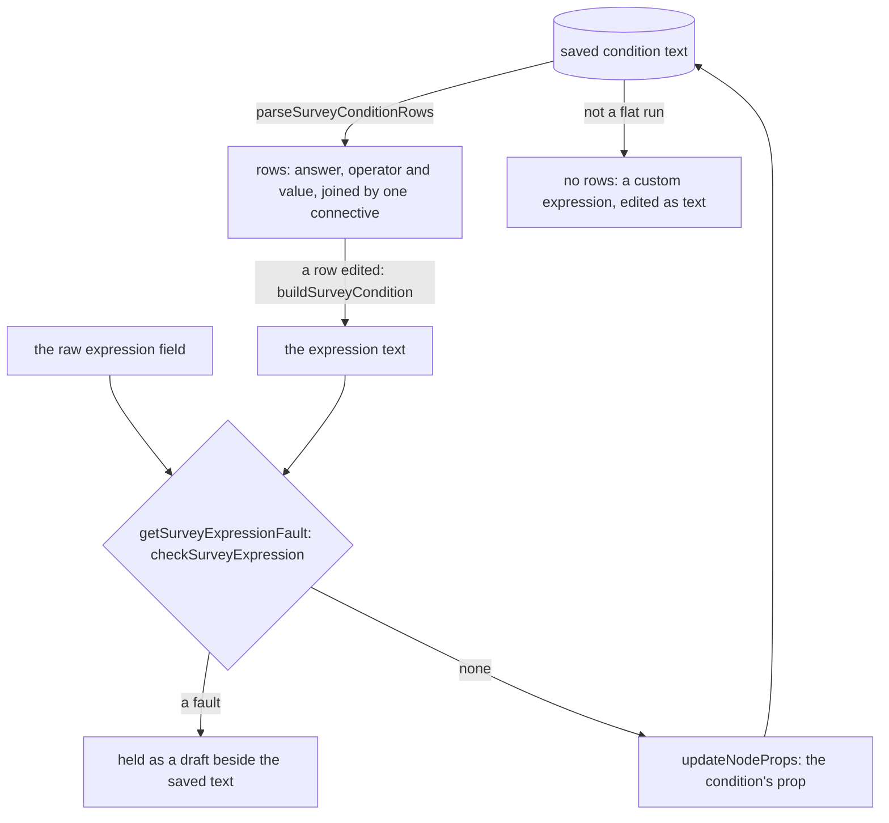

# Survey Logic Builder

The Logic tab of the [Creator](../survey-creator/design.md), over the [expression language](../survey-logic/design.md). It edits the three conditions an element holds, which are visibility, enablement and required, and the survey's calculated values.

## How it works

The rows are read from the text a condition saves, each time the tab draws, so the text is the only copy. Editing a row rebuilds the text from the rows and checks it. Typing into the raw field checks the typed text. A text that checks is written under the condition's prop. A text that does not check, or that the store refuses, is held as a draft beside the saved text, and nothing is written. A saved text that is not a flat run of comparisons has no rows: the tab says it is a custom expression and leaves it to be edited as text.

## The rows

- **Shape.** A row is a reference to an answer, a comparison operator and a literal. Rows form a flat run joined by one connective, `and` or `or`. A single comparison is one row, joined as `and`, and an empty text has no rows and holds always. A group in parentheses, a connective nested inside another, a function, arithmetic, a literal on the left of a comparison, a negation or a list is a custom expression, and the builder does not draw it. Rejected: a nested group builder, which doubles the component for expressions an owner of a survey rarely writes.
- **Answers.** The answer dropdown lists each question with a name and a title, in document order, then each calculated value. Each shows its title, with its name beside it when the two differ. Operators follow the answer's kind. A yes or no answer offers equals, not equals, empty and not empty. A checkbox, tag box, ranking, matrix, dynamic matrix, dynamic panel or multiple text answer offers contains, not contains, empty and not empty. Every other answer, and a calculated value, offers the full comparison set. A yes or no answer's value is a yes or no choice, and any other value is a text field.
- **A new row.** Adding a condition writes its row at once, comparing the first answer with an empty text. The condition takes effect before its value is typed.
- **The text is the source.** Rows are derived from the saved text each time and never stored. Rejected: storing the rows, which would give the document a second copy of each condition for an agent to keep in step.

## Calculated values

The Logic tab's second section lists the survey's calculated values, each with a name, an expression and an include-into-result switch. The name is checked by the survey check's message for that value, so a name that a question or another value already holds is refused, and the expression is checked the same way the raw field is. A new value is named `value`, numbered past any answer that already holds the name, and starts with the expression `0`.

## Key files

| File                                                                     | Role                                                                   |
| ------------------------------------------------------------------------ | ---------------------------------------------------------------------- |
| `packages/survey-logic/src/services/parseSurveyExpression.ts`            | the parser the rows are read from                                      |
| `packages/survey-logic/src/services/checkSurveyExpression.ts`            | the check whose message and position the raw field shows               |
| `apps/web/app/components/Resource/Survey/Creator/LogicBuilder.vue`       | the three conditions: rows, the raw field and its fault                |
| `apps/web/app/components/Resource/Survey/Creator/CalculatedValues.vue`   | the calculated values: name, expression and the result switch          |
| `apps/web/app/services/resource/survey/parseSurveyConditionRows.ts`      | expression text to rows, or none for a custom expression               |
| `apps/web/app/services/resource/survey/buildSurveyCondition.ts`          | rows to expression text, skipping a row with no answer                 |
| `apps/web/app/services/resource/survey/buildSurveyConditionRow.ts`       | one row to its comparison text                                         |
| `apps/web/app/services/resource/survey/toSurveyConditionRow.ts`          | one parsed comparison to a row                                         |
| `apps/web/app/services/resource/survey/getSurveyConditionAnswers.ts`     | the answers a condition may read                                       |
| `apps/web/app/services/resource/survey/getSurveyConditionOperators.ts`   | the operators an answer's kind offers                                  |
| `apps/web/app/services/resource/survey/getSurveyExpressionFault.ts`      | a check's message with the character it is refused at                  |
| `apps/web/app/services/resource/survey/getSurveyCalculatedValueIssue.ts` | the survey check's message for one calculated value                    |
| `apps/web/app/services/resource/survey/getActiveSurveyEditDraft.ts`      | a draft shown only while the saved text it was typed over still stands |
| `apps/web/app/services/resource/survey/constants.ts`                     | the condition sections, the operator sets and the messages             |
