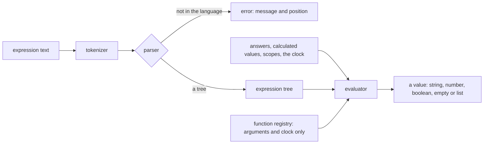

# Survey Logic

The survey's expression language as a private workspace package: a tokenizer and parser that return a tree or a positioned error, and an evaluator over a record of answers. It is a grammar and an interpreter of its own, so it stands apart from the [math expression compiler](../../math-expression-compiler/language/design.md), which is numeric by design. The survey's values are strings, booleans, numbers, empty answers and lists, and the [survey document](../survey-document/design.md) runs its save check through this package, while the app's condition builder imports it directly.

## How it works

The tokenizer reads the source into tokens and stops at the first character it cannot read. The parser climbs the operator table by power, so a tighter operator binds its operands first, and it refuses a source with tokens left over after a complete expression. The evaluator walks the tree over a context that holds the answers and calculated values, the scopes a dynamic panel or matrix row adds, and the clock. A call runs the function its lowercased name finds in the registry, and a name with no function evaluates to empty without reading its arguments.

## The language

- **Literals**: numbers, strings in single or double quotes, `true` and `false`, and lists in square brackets.
- **References**: `{name}` reads an answer by question name. A name may hold dots, so `{matrix.row1.col1}` reads a nested answer: first the whole name as one key, then each dotted split read as a key of the part before it. A part may end in an index, `{panel[0].q1}`, and a digit key reads an item of a list, `{list.0}`. `{list.length}` reads the length of a list or text, and zero for any other value after a dot. Inside a dynamic panel, `{panel.name}` reads the panel's own answer, and inside a dynamic matrix row `{row.name}` reads the row's cell, both through the scopes the caller passes, and a scope wins over a path of the same name.
- **Operators, loosest to tightest**: `or` and `||`; `and` and `&&`; `not` and `!`, whose operand holds the comparisons and the tighter operators; the comparisons `=`, `==`, `!=`, `<>`, `<`, `<=`, `>`, `>=`, `contains`, `notcontains`, `anyof`, `allof`, `empty` and `notempty`; `+` and `-`; `*`, `/` and `%`; `^`; and a unary minus. Every binary operator groups to the left, `^` included, so `2 ^ 3 ^ 2` is 64, as SurveyJS gives it. The unary minus binds tighter than `^`, so `-2 ^ 2` is 4.
- **Empty**: an unanswered reference is empty, and so is an empty text or list. An unanswered question equals only the empty text and another unanswered question, so `{a} != 5` and `{a} != 0` are true for it and `{a} != ''` is false. It is never less or greater than a value, so `{a} < 5` and `{a} > 5` are both false, while `{a} >= ''` is true through equality. A comparison of an empty text compares it as zero against a number and as text against text, so `{a} < 5` is true for an answer of `''`. An empty list equals only an empty list. The oracle fixtures hold each of these.
- **Coercion**: a comparison of a number with a text that reads as a number (R2) compares as numbers, as SurveyJS does. Arithmetic and the aggregates read such a text as a number too, and a text that does not read as one is not a number there (R3, R4).
- **Functions**: the date and number functions and the list, text and logic functions of SurveyJS's registry whose result depends only on their arguments and the clock. Each is one module under `services/functions/`, registered by lowercased name, and the package's README lists them. The functions that read the live survey object, "displayValue", "isContainerReady", "isDisplayMode" and "propertyValue", are not implemented, since the package has no survey object, and the README names them. The clock is passed in the context, so a test fixes it.

## Language rules

Each rule names the one function that carries it, and each deviation below names the rule that explains it.

- **R1, one absent value.** `undefined` is the only absent value. A `null` the storage holds reads as `undefined` at every depth when the answers are read (`toSurveyLogicAnswer`), so the language never holds a `null`. An operation with no result is `undefined`: an unanswered or empty operand in arithmetic, a division or remainder by zero, an unreadable or invalid date, and an average, minimum or maximum over nothing. Nothing returns `NaN`, `null` or an invalid `Date`.
- **R2, one text-to-number rule.** `toSurveyLogicNumber` is the only reader of a text as a number. A finite number reads as itself. A text reads as a number when, trimmed, it is a plain decimal: an optional sign, digits with an optional point or a point and digits, and an optional exponent. Leading zeros are allowed, and there is no length limit. Hexadecimal, binary, octal, comma decimals, thousands separators, words, `Infinity`, booleans and lists do not read as numbers. An answer keeps its text, and an operation reads it as a number where it needs one.
- **R3, arithmetic is numeric.** `+`, `-`, `*`, `/`, `%` and `^` read each operand as a number (R2), and an operand that reads as none gives `undefined`. `+` is the one exception: it joins two non-empty texts when neither reads as a number. A division or remainder by zero is `undefined`. A sum or a product is rounded to the decimals of its operands.
- **R4, aggregates skip what is not a value.** `sum`, `avg`, `count`, `min` and `max`, and their `InArray` forms, take only the items that read as numbers (R2). A text, a boolean, a list, a record or an unanswered item is skipped and not counted. `sum` and `count` of nothing are zero, and `avg`, `min` and `max` of nothing are `undefined`.
- **R5, text functions read their numbers.** `substring` reads its start and its end as numbers (R2): a start or an end that reads as none gives `undefined`, an absent end runs to the end of the text, and an index is truncated toward zero and clamped to the text. `trunc` and `round` operate on the number: a value or a precision that reads as none gives `undefined`, and an absent precision is zero.

## Decisions

- **The check, not the parser, refuses an unknown function.** `parseSurveyExpression` accepts a call to any identifier. `checkSurveyExpression` parses, then refuses the first call in source order whose name has no function, or whose array function takes a filter, naming it. The parser needs no registry, so the tokenizer and parser are built before the functions. Rejected: the parser taking the registry, which would make the first unit wait on the last.
- **Errors carry a position.** The parser returns a neverthrow result whose error holds a message and the character index of the token it starts at, because the document's save check names the element and the Creator's builder shows the fault. Rejected: throwing, which loses the position at the first catch.
- **The expected values are recorded from SurveyJS, not written by hand.** A throwaway script outside the repository ran SurveyJS's expression runner over a table of expressions and answer records at a fixed clock and wrote the results as `services/fixtures/oracleFixtures.json`, which the package's test replays. SurveyJS is no longer a dependency of the repository, and the fixtures stay. Rejected: fixtures written by hand, which would record what the package does rather than what SurveyJS does.
- **The package is private.** It is consumed by the survey engine and the app only, so it has no npm entry to keep alive. Rejected: publishing it, which adds a trusted-publisher entry for a package no one outside the repository has asked for.
- **Dates are strings until a function reads them.** The value model has no date value. A date function parses its string arguments with the rules SurveyJS uses and returns a string or a number.

## Key files

| File                                                                      | Role                                                                             |
| ------------------------------------------------------------------------- | -------------------------------------------------------------------------------- |
| `packages/survey-logic/package.json`                                      | the private package's manifest                                                   |
| `packages/survey-logic/README.md`                                         | the public surface, every implemented function and the deliberately absent ones  |
| `packages/survey-logic/src/services/tokenizeSurveyExpression.ts`          | reads the source into tokens, or the first fault with its position               |
| `packages/survey-logic/src/services/parseSurveyExpression.ts`             | parses the tokens into a tree by power, refusing tokens left over                |
| `packages/survey-logic/src/services/SurveyExpressionBinaryOperatorMap.ts` | the binary operators, their spellings and powers                                 |
| `packages/survey-logic/src/services/evaluateSurveyExpression.ts`          | evaluates a tree over a context, one evaluator per node type                     |
| `packages/survey-logic/src/services/runSurveyExpression.ts`               | parses and evaluates a source at the context's clock                             |
| `packages/survey-logic/src/services/checkSurveyExpression.ts`             | refuses a source that does not parse, calls an unknown function or uses a filter |
| `packages/survey-logic/src/services/findSurveyExpressionRefusal.ts`       | finds the first refused call in source order                                     |
| `packages/survey-logic/src/services/functions/surveyLogicFunctionMap.ts`  | the registry the evaluator and the check read, merged from the two function maps |
| `packages/survey-logic/src/services/shared/toSurveyLogicAnswer.ts`        | the answer as the evaluator reads it, with a storage null as undefined (R1)      |
| `packages/survey-logic/src/services/shared/toSurveyLogicNumber.ts`        | the one reader of a text as a number (R2)                                        |
| `packages/survey-logic/src/services/fixtures/oracleFixtures.json`         | the expected values recorded from SurveyJS, and each deviation with its rule     |
| `packages/survey-logic/src/services/fixtures/oracleFixtures.test.ts`      | replays each row and checks each deviation names a rule and still differs        |
| `packages/math-expression-compiler/src/models/`                           | the sibling package whose layout this one follows                                |

## Notes

- **The known deviations.** The package answers SurveyJS's value for every fixture except the cases below. Each deviating row of `services/fixtures/oracleFixtures.json` names the rule that explains it, and the reason for each rule is in `services/fixtures/oracleFixtures.test.ts`, which replays the row against the package's own value, so a change to one is noticed. A deviation that names a rule is explained by that rule in [Language rules](#language-rules):
  - **Names are case-sensitive.** `{Name}` reads only an answer named `Name`, where SurveyJS ignores case. Question names are checked unique case-sensitively, so one name is one answer.
  - **Syntax SurveyJS refuses is accepted.** `not` and `!`, a unary minus before any operand (`-{a}`, `-(3)`, `- 3`) and a number with a leading dot (`.5`) all evaluate, where SurveyJS reports an invalid expression.
  - **An operation with no result is `undefined` (R1).** SurveyJS gives `null` for an unanswered reference and for a division by zero, `NaN` for arithmetic on a text that is not a number, and an invalid `Date` for a date that does not parse, where the package gives `undefined` for each. `today('x')` and `dateAdd('x', 1)` are `undefined` for the same reason.
  - **A text that is not a plain decimal is text (R2).** Hexadecimal, binary and octal texts (`'0x1F'`, `'0b1'`) and comma decimals (`'1,5'`) stay text, where SurveyJS reads them as numbers. SurveyJS's equality also makes `'0b1'` equal to 0 and `'0o7'` equal to both 0 and 7, so no one reading matches it. An answer keeps its text, so a comparison of a numeric answer with a text that is not a number, and the `and` and `or` operators on a numeric answer, can return the text where SurveyJS reads the number: `{a} < {b}` with `'5'` and `'abc'` is true where SurveyJS gives false, and `{a} and {b}` gives `'5'` where SurveyJS gives 5. A numeric text is also a number as a date amount: `today('3')` and `dateAdd(date, '3')` add three days, where SurveyJS joins the text (January 2 plus `'3'` is day 23).
  - **A date-time end with an hours, minutes or seconds unit is the real difference.** `dateDiff('1970-01-01', '1970-01-01 05:00:00', 'hours')` is 5, where SurveyJS gives NaN for the same end. The package keeps the time of a date-time end, so the difference is the real one.
  - **Records and lists are not numbers in arithmetic (R3).** `{a} + 'x'` on a record is `undefined` where SurveyJS joins `'[object Object]x'`, and `{a} + 1` on a list is `undefined` where SurveyJS joins the list's text, `'31'` for a list of one `3`.
  - **Aggregates skip what is not a value (R4).** `sum`, `avg`, `count`, `min` and `max` skip an empty text, a text that is not a number, a boolean, a list and a record, where SurveyJS joins or counts them: `sum('a', 1)` is 1 where SurveyJS gives `'0a1'`, `max('a', 1)` is 1 where SurveyJS gives `'a'`, `count('')` is 0 where SurveyJS gives 1, and `avg('', 5, 5)` is 5 where SurveyJS gives 18.33. `sum(1.5, 'a')` is 1.5 where SurveyJS throws.
  - **A text function reads its index as a number (R5).** `substring('hello', 'x')` is `undefined` where SurveyJS gives `''`, `substring('hello', 1, 'x')` is `undefined` where SurveyJS gives `'ello'`, and a list is not an index either.
  - **The filter form of an array function is refused.** `checkSurveyExpression` refuses it and `runSurveyExpression` answers empty, where SurveyJS filters the items.
  - **Rounding is capped at 100 digits.** A sum or product with more decimals is rounded to 100, since `toFixed` throws above that.
- **The README is the function list.** Each implemented function is a row in the package's README, and the README names the SurveyJS functions the package deliberately leaves out, so an omission is visible there rather than silent.
