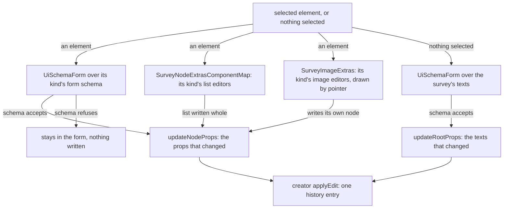

# Survey Properties

The Properties tab of the right pane of the [Creator](../survey-creator/design.md). With an element selected it shows that element's settings, drawn from the props schema the [document](../survey-document/design.md) checks. With nothing selected it shows the survey's own texts.

## How it works

The tab draws the selected element's form schema with the schema form, leaving out the props that the element's kind draws in its list editors or its image editors, so each prop is drawn once. When the form changes, the tab writes the props that changed, and only when the form's schema accepts the whole form. A value the schema refuses stays in the form, which keeps showing it until it is valid, and nothing is written. A list editor writes its list whole under its one props key, and an image editor writes its own node. Every write goes through the creator's commands, so it is one history entry and reaches the autosave like any other edit.

## The form and the list editors

- **The form.** The element's form is the `formSchema` of its kind's node definition. The root's form draws the survey's own texts: the title, the description, the completion text and HTML, and the previous and next button texts. The calculated values are the [logic builder](../survey-logic-builder/design.md)'s, and the logo, the colours, the progress bar and the question numbers are the Theme tab's, each with its own control there.
- **The list editors.** `SurveyNodeExtrasComponentMap` maps a kind to its extra editors, each a component with the props key it writes and its label. The choice list editor serves the choice kinds and the rows and columns of a matrix. The matrix column editor serves a dynamic matrix's columns, and the multiple text item editor serves a multiple text question's items. All three share `useSurveyListEditor`: each row is a draft held apart from the model, a row the list refuses stays where it was typed with its message, and the model is written only once every row is valid. A row moves with Alt+Up and Alt+Down through the library's reorder, read out through the list's live region, and with its own move buttons.
- **Choice values.** A choice's value is unique within its list. A repeated value is flagged on its row, which keeps the typed text, and the list is not written. The document schema refuses a repeat as well, through the unique-array schema that a choice list uses, so the row flag is the earlier refusal and the one that names the row.
- **Image kinds.** `SurveyImageExtras` maps an image question to its upload editor and an image picker to its choices editor. The panel draws each after the list editors, with the pointer of the node it edits, and each writes that node through the creator rather than through a props key. An image question's form keeps its `imageLink` field beside the upload, so a picture can also be typed as a link. An image picker's form leaves out `choices`, which its editor draws: `SurveyImageExtrasKeyMap` names those keys, so an image kind's omission is written the way a list's is. The editors and their files are the [theme and files](../survey-theme-files/design.md) part's.

## Decisions

- **The form is the schema.** Each kind's form draws the fields its props schema holds, so a setting appears only if the schema has it. One test per kind pins the field list of its form schema, the list the [schema forms](../../architecture/schema-forms/design.md) standard's snapshot tests cover. Rejected: a hand-written panel per kind, which would drift from the schema it is meant to show.
- **The lists are the panel's own.** A schema form cannot draw a reorderable list of objects with unique keys, so the lists are components, mounted beside the form by a map keyed by kind. Rejected: a list drawn by the schema form, which cannot reorder or flag a repeated key on its own row.
- **A repeated choice is flagged on its row, not refused as an edit.** The schema would refuse the whole edit with no row named, and the owner would lose the text typed into the row. Rejected: letting the schema's refusal stand alone.

## Key files

| File                                                                          | Role                                                                             |
| ----------------------------------------------------------------------------- | -------------------------------------------------------------------------------- |
| `apps/web/app/components/Resource/Survey/Creator/Properties.vue`              | the panel: the element's form, its list and image editors, or the survey's texts |
| `apps/web/app/components/Ui/SchemaForm/Index.vue`                             | the schema form the panel draws the settings with                                |
| `apps/web/app/components/Ui/TextField.vue`                                    | the field the list editors' text cells are drawn with                            |
| `apps/web/app/services/resource/survey/SurveyNodeExtrasComponentMap.ts`       | the map from a kind to its list editors                                          |
| `apps/web/app/services/resource/survey/SurveyImageExtras.ts`                  | the map from an image kind to its pointer editor, and the keys those draw        |
| `apps/web/app/components/Resource/Survey/Creator/ImageUpload.vue`             | an image question's picture: its upload and removal                              |
| `apps/web/app/components/Resource/Survey/Creator/ImageChoicesEditor.vue`      | an image picker's choices, each with its picture                                 |
| `apps/web/app/models/resource/survey/SurveyNodeExtraEditor.ts`                | the shape of a map entry: the component, its props key and its label             |
| `apps/web/app/components/Resource/Survey/Creator/ChoiceListEditor.vue`        | value and text rows, add, remove, reorder, pasted lines and the unique value     |
| `apps/web/app/components/Resource/Survey/Creator/MatrixColumnsEditor.vue`     | a dynamic matrix's columns: name, title, cell type, choices and required         |
| `apps/web/app/components/Resource/Survey/Creator/MultipleTextItemsEditor.vue` | a multiple text question's items: name, title, input type and required           |
| `apps/web/app/composables/survey/useSurveyListEditor.ts`                      | the draft rows, the validity gate and the keyboard reorder the editors share     |
| `apps/web/app/services/resource/survey/parseChoiceLine.ts`                    | a typed or pasted line read as one choice, its value and its text                |
| `apps/web/app/services/jsonSchema/zodToJsonSchema.ts`                         | the JSON schema the form is drawn from                                           |

## Notes

- The form writes only the props it changed, so a prop the owner did not touch is never written back with the value the panel read when it was drawn.
