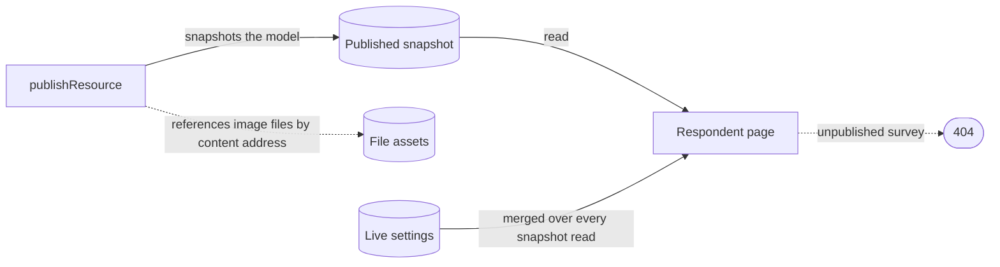

# Survey Resource

Survey is a resource type: the SurveyJS model lives in the content blob, the respondent page is Survey's published view, and only the genuinely survey-specific part — responses — has bespoke procedures; asset uploads come from the shared [FileAssets capability](../resource-file-assets/design.md).

## Data model

- Content blob: `surveyResourceSchema = z.object({ model: z.string(), settings: surveySettingsSchema })` — an object wrapper so future fields don't break the blob shape. The SurveyJS theme stays inside the model JSON under `THEME_KEY` — no reason to split it while SurveyJS owns both. The `settings` section is live collection state read outside the publish snapshot: the accepting-responses toggle and closed message ([response controls](../survey-response-controls/design.md)) and the response mode ([response modes](../survey-response-modes/design.md)) share that one object.
- `contentVersion` is server-incremented by the resource factory, never by the client.
- `SurveyResponseEntity` (Azure Table, partitionKey = survey resource id) holds respondent answers plus the opaque `participantToken` that joins a response back to a program participant.
- A survey belongs to no group; grouping resources at all is the deferred [resource groups](../../../deferred/resource/resource-groups/design.md) idea.

## Capabilities

- **FileAssets** — asset uploads under `{id}/files/…` through the shared capability procedures ([resource file assets](../resource-file-assets/design.md)).
- **Publishable** — publish goes through the generic `publishResource`, which references its image files by content address without copying them ([resource file assets](../resource-file-assets/design.md)); and the live `settings` are merged back over every snapshot read through `ResourceLiveContentMap` ([resource snapshots](../resource-snapshots/design.md)), so closing or gating never needs a re-publish. Publishing snapshots the model; the public respondent page serves that snapshot and 404s for unpublished surveys. Public reads are counted ([view analytics](../published-view-analytics/design.md)).
- **DatasetProvider** — `readSurveyResponsesDataset` serves responses through `dataset.readDataset`, auth keyed to resource ownership.

## Procedures

The `survey` router is `createResourceProcedures(ResourceType.Survey, …)` plus the type-specific procedures that are deliberately **not** capabilities (single consumer — see the admission rule in [resources](../../architecture/resource/design.md)):

| Procedure                                                                         | Auth                                             | Purpose                          |
| --------------------------------------------------------------------------------- | ------------------------------------------------ | -------------------------------- |
| `createSurveyResponse` / `updateSurveyResponse` / `readSurveyResponse`            | public, rate-limited — create on the slow budget | respondent answers → Azure Table |
| `readSurveyResponsesCount` / `deleteSurveyResponse` / `readSurveyResponseRecords` | owner                                            | response management tooling      |

An update checks the response's model version and, in Identified mode, its participant token inside a conditional write, so of two saves computed from the same version the later fails the check rather than erasing the earlier's answers ([conditional writes](../../architecture/conditional-writes/design.md)).

Asset uploads are not listed here: they come from the shared FileAssets capability rather than a survey-owned set ([resource file assets](../resource-file-assets/design.md)).

## Blades / routes

- **Editor blade** — SurveyJS creator rendered inline (`useSurveyCreator`); autosave goes through the store's `saveModel`, which merges the model with the currently loaded `settings` and saves the whole `{ model, settings }` blob — the shape the content schema requires. SurveyJS keeps owning editor/preview state; the resource layer only sees model JSON in and out. Every survey instance the creator builds passes an html question's markup through `sanitizeHtml` (`onSurveyInstanceSetupHandlers`), as the respondent page does, because an imported model's markup renders in this origin.
- **Overview blade** — wraps the generic Overview to add the response count beside the Views row, plus the Collection card owning the `settings` section.
- **Responses blade** — a table over `survey.readSurveyResponseRecords`, the first-look surface for results, with per-row detail and delete ([response management](../survey-response-management/design.md)).
- **Respondent page** — `/view/Survey/[id]` via `ViewComponentMap`: an interactive published-view renderer (plain `survey-core` Model + theme; a survey with no author theme follows the app's light/dark palette, as the creator's own chrome does) that writes responses. In-progress resume stores only a per-survey response id in localStorage — answers live solely in Azure Table — and the id is removed on submit, so a later visitor on a shared device cannot reopen a submitted response. Until that submit, the row is a draft ([response management](../survey-response-management/design.md)). Email invite blocks link it via `RoutePath.View(ResourceType.Survey, id)`.

## Key files

| File                                           | Role                                            |
| ---------------------------------------------- | ----------------------------------------------- |
| `app/components/Resource/Survey/Editor.vue`    | inline SurveyJS creator Editor blade            |
| `app/components/Resource/Survey/Responses.vue` | Responses blade (dataset table)                 |
| `app/components/Resource/Survey/View.vue`      | public respondent renderer (`ViewComponentMap`) |
| `app/composables/survey/useSurveyCreator.ts`   | creator setup + autosave wiring                 |
| `server/trpc/routers/survey.ts`                | resource factory + response procedures          |

## Notes

- Respondent procedures are public and rate-limited — they are the only unauthenticated write of a respondent's answers. (A published view's read also increments a rate-limited view count, which holds no answer.) Every response write passes `resolveSurveyResponseWrite` ([response controls](../survey-response-controls/design.md)). Being anonymous, it is also bounded: a creation adds a row, so it spends the slow budget per address (`slowRateLimitedProcedure`), and the answers are stored as one JSON property, so their serialized length is capped at what that property holds (`surveyResponseModelSchema`), refused before the write rather than by the Table after it.
- Responses whose survey row is absent are orphans, and orphans can be truncated.
