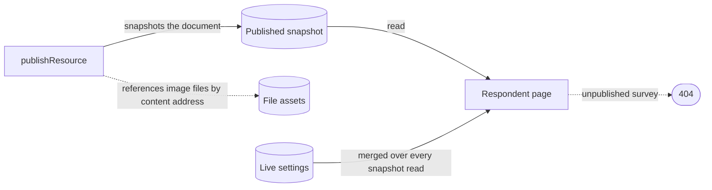

# Survey Resource

Survey is a resource type: its content is a typed survey document and its settings, the Editor blade mounts the survey's Creator, and the respondent page renders the survey's runner. Only the genuinely survey-specific part, responses, has bespoke procedures. Asset uploads come from the shared [FileAssets capability](../resource-file-assets/design.md).

## Data model

- Content blob: `surveyResourceSchema = z.strictObject({ document, settings })`. `document` is a `SurveyDocument` from the `headless-survey-engine` package, and `settings` is the [settings section](../survey-response-controls/design.md). The object is strict, so a save in the `{ model }` shape is refused rather than read as an empty survey. A save that omits its document or its settings is refused: neither key has a default. A document the survey check reports issues on is refused, and every issue is reported at the field it names.
- The `settings` section is live collection state read outside the publish snapshot: the accepting-responses toggle and closed message ([response controls](../survey-response-controls/design.md)) and the response mode ([response modes](../survey-response-modes/design.md)) share that one object.
- `contentVersion` is server-incremented by the resource factory, never by the client.
- `SurveyResponseEntity` (Azure Table, partitionKey = survey resource id) holds respondent answers plus the opaque `participantToken` that joins a response back to a program participant.
- A survey belongs to no group; grouping resources at all is the deferred [resource groups](../../../deferred/resource/resource-groups/design.md) idea.

## Capabilities

- **FileAssets**: asset uploads under `{id}/files/…` through the shared capability procedures ([resource file assets](../resource-file-assets/design.md)).
- **Publishable**: publish goes through the generic `publishResource`, which snapshots the document and references its image files by content address without copying them ([resource file assets](../resource-file-assets/design.md)). The live `settings` are merged back over every snapshot read through `ResourceLiveContentMap` ([resource snapshots](../resource-snapshots/design.md)), so closing or gating never needs a re-publish. The public respondent page serves that snapshot and 404s for unpublished surveys. Public reads are counted ([view analytics](../published-view-analytics/design.md)).
- **DatasetProvider**: `readSurveyResponsesDataset` serves responses through `dataset.readDataset`, auth keyed to resource ownership. Its columns are read from the document ([survey response summary](../survey-response-summary/design.md)).

## Procedures

The `survey` router is `createResourceProcedures(ResourceType.Survey, …)` plus the type-specific procedures that are deliberately **not** capabilities (single consumer — see the admission rule in [resources](../../architecture/resource/design.md)):

| Procedure                                                                         | Auth                                             | Purpose                          |
| --------------------------------------------------------------------------------- | ------------------------------------------------ | -------------------------------- |
| `createSurveyResponse` / `updateSurveyResponse` / `readSurveyResponse`            | public, rate-limited — create on the slow budget | respondent answers → Azure Table |
| `readSurveyResponsesCount` / `deleteSurveyResponse` / `readSurveyResponseRecords` | owner                                            | response management tooling      |

Every response write is checked against the published document, which the [survey respondent](../survey-respondent/design.md) capability states. An update checks the response's model version and, in Identified mode, its participant token inside a conditional write, so of two saves computed from the same version the later fails the check rather than erasing the earlier's answers ([conditional writes](../../architecture/conditional-writes/design.md)).

Asset uploads are not listed here: they come from the shared FileAssets capability rather than a survey-owned set ([resource file assets](../resource-file-assets/design.md)).

## Blades / routes

- **Editor blade**: `Editor.vue` mounts the survey's Creator. The Creator edits its own copy of the document, loaded from the content store. The copy autosaves through the store's `saveDocument` once the survey check finds no issue in it. An issue is shown as an alert, and the save is not written. The Editor tracks the document's image files and sweeps the ones a removal left unreferenced before it unmounts. A restore reloads the copy through the adopt path ([third-party document adapters](../../architecture/third-party-document-adapters/design.md)).
- **Overview blade**: wraps the generic Overview to add the response count beside the Views row, plus the Collection card owning the `settings` section.
- **Responses blade**: a table over `survey.readSurveyResponseRecords`, the first-look surface for results, with per-row detail and delete ([response management](../survey-response-management/design.md)). A Summary of every question sits above it ([survey response summary](../survey-response-summary/design.md)).
- **Respondent page**: `/view/Survey/[id]` via `ViewComponentMap` renders the published document through the runner and writes responses ([survey respondent](../survey-respondent/design.md)). In-progress resume stores only a per-survey response id in localStorage, and the answers live solely in Azure Table. The id is removed on submit, so a later visitor on a shared device cannot reopen a submitted response. Until that submit, the row is a draft ([response management](../survey-response-management/design.md)). Email invite blocks link it via `RoutePath.View(ResourceType.Survey, id)`.

## Key files

| File                                                        | Role                                                                            |
| ----------------------------------------------------------- | ------------------------------------------------------------------------------- |
| `apps/web/shared/models/resource/survey/SurveyResource.ts`  | the content schema, `{ document, settings }`                                    |
| `apps/web/app/store/survey/index.ts`                        | the content store: the document and settings, `saveDocument` and `saveSettings` |
| `apps/web/app/components/Resource/Survey/Editor.vue`        | the Editor blade, which mounts the Creator                                      |
| `apps/web/app/components/Resource/Survey/Creator/Shell.vue` | the Creator the Editor blade mounts                                             |
| `apps/web/app/components/Resource/Survey/Responses.vue`     | the Responses blade (dataset table)                                             |
| `apps/web/app/components/Resource/Survey/View.vue`          | the respondent page (`ViewComponentMap`)                                        |
| `apps/web/app/components/Resource/Survey/Runner.vue`        | the runner the respondent page renders                                          |
| `apps/web/server/trpc/routers/survey.ts`                    | resource factory + response procedures                                          |

## Notes

- Respondent procedures are public and rate-limited — they are the only unauthenticated write of a respondent's answers. (A published view's read also increments a rate-limited view count, which holds no answer.) Every response write passes `resolveSurveyResponseWrite` ([response controls](../survey-response-controls/design.md)). Being anonymous, it is also bounded: a creation adds a row, so it spends the slow budget per address (`slowRateLimitedProcedure`), and the answers are stored as one JSON property, so their serialized length is capped at what that property holds (`surveyResponseModelSchema`), refused before the write rather than by the Table after it.
- Responses whose survey row is absent are orphans, and orphans can be truncated.
