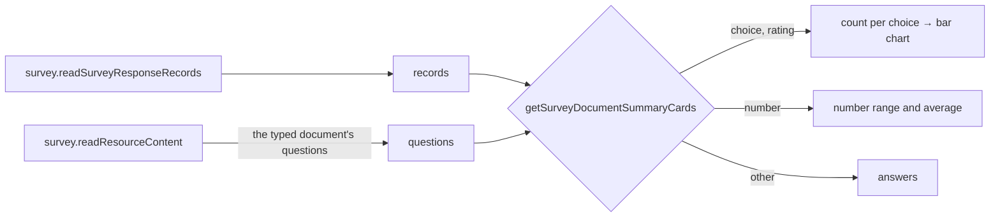

# Survey Response Summary

The Responses blade's Individual view is a table of raw responses, one column per question ([survey response management](../survey-response-management/design.md)). Seeing what the responses say — how many picked each option, the average rating — would mean building a Dashboard over the survey's dataset. Google Forms answers it on the response page itself: a **Summary** tab of one chart per question beside the **Individual** view.

This capability also holds the survey's readers of its typed document: the summary's cards and the dataset's columns, both read off the same questions.

## How it works

The blade is a `UiTabs` pair, **Summary** (the default) and **Individual**, which is the table and detail dialog. Summary is a column of cards, one per question in the survey's own order, each drawn by `getSurveyDocumentSummaryCards` from what kind of question it is:

| Question kind                                                              | Card                                                                               |
| -------------------------------------------------------------------------- | ---------------------------------------------------------------------------------- |
| `radiogroup`, `dropdown`, `buttongroup`, `boolean`                         | a bar per choice, labelled with its count and its share of the responses answering |
| `checkbox`, `tagbox`, `ranking`, a multi-select `imagepicker`              | the same; each share is of respondents, so together they can pass 100%             |
| `rating`                                                                   | a bar per rating value, and the average                                            |
| `slider`, a `text` with a numeric input, an `expression` shown as a number | minimum, average and maximum                                                       |
| `text`, `comment` and every other kind that answers                        | the first answers as a list, and a button to the Individual view for the rest      |

A boolean's two choices are its Yes and No labels, and a choice question that offers an other option gets a line of its own for the other answers, labelled with the option's text or "Other" when it has none. A choice question's none answer gets no line. Each card is headed by the question's title and "_n_ responses", counting the responses that answered it, so a skipped optional question reads honestly. The card's type is one of three, `SurveySummaryCardType`: choice, number or text. A rating is a choice card that also carries its average.

- **The questions come from the typed document.** `getSurveyDocumentResponseSummaryCards` takes the survey's content document and the records, and keeps the questions the records hold a column for, so presentation elements have no card. The questions are flattened from the pages and panels in the order a respondent meets them, by the survey engine's `flattenSurveyQuestions`, and a descriptive element (`html`, `image`) is excluded by `checkIsSurveyAnsweringNode`, the guard for a node a response holds a value for.
- **Choices are shown by their labels.** A choice's label is the text its choice carries, not the value stored for it, and a multiple answer is read against the choices' values rather than split on its separator, since a value may hold the separator.
- **No new procedure.** The blade reads the survey's content beside its response records, both existing owner reads, so the questions are the working copy's, as the Editor shows them. The two reads fail apart: a survey that cannot be read shows its error in the Summary alone, and the Individual view still lists the responses.
- **Charts are the dashboard's engine.** The bars are `StyledApexChart`'s horizontal bar chart, themed as every chart in the app is, and it adds no chart dependency.
- **The row cap applies as everywhere.** A survey past it shows the truncation alert above both views ([dataset row-cap warning](../dataset-row-cap-warning/design.md)), since the summary is computed from what was read.
- **Before the first response** the Summary view is the same empty state the table shows.

## The dataset's columns

The survey's dataset provider reads its columns from the same typed document, through `getSurveyDocumentDatasetColumns`. It gives one column per answering question, in the order a respondent meets them, so a descriptive element has none. A dynamic panel is one question and so one column for the whole panel, not one per template question.

A column's type follows the question. `boolean` is a boolean column. `rating`, `slider`, a `text` with a number input and an `expression` shown as a number are number columns. A `text` with a date or datetime input is a date column. Every other kind is a string column. A question with a title carries it as the column's title.

A response's answer becomes one cell through `toDatasetColumnValue`. A flat list of answers, such as a checkbox, a tag box, a ranking or a multi-select image picker, joins into one cell with the separator the shared survey constants name. A record, or a list of records, is one cell of compact JSON text: a matrix, a multiple text, a dynamic matrix or a dynamic panel's answer, so a row never needs a column per cell. The response record stays a flat object keyed by question name, so the reader changes and the record does not.

## What is deliberately not in it

- **Not a survey vendor's analytics dashboard.** The card kinds above cover what the summary shows, with the charts the app already owns, so no dashboard component is added for it.
- **No "latest" answers.** A response is stored under a random key with no submission time a list could order by, so a written question's card lists the first answers read and sends the reader to the Individual view for all of them.
- **No cross-filtering** ("only respondents who answered Yes"). That is the Dashboard's job, and the survey is already a dataset it binds to.
- **No per-question view** (Google Forms' Question tab). The Individual table sorts and searches by column, which is the same lookup.

## Key files

| File                                                                                    | Role                                                                               |
| --------------------------------------------------------------------------------------- | ---------------------------------------------------------------------------------- |
| `apps/web/app/components/Resource/Survey/Responses.vue`                                 | The Summary and Individual views, and the empty state both share                   |
| `apps/web/app/components/Resource/Survey/ResponseSummaryCard.vue`                       | One question's card                                                                |
| `apps/web/app/services/survey/summary/getSurveyDocumentSummaryCards.ts`                 | The cards, one per answering question, drawn by the question's kind                |
| `apps/web/app/services/survey/summary/getSurveyDocumentSummaryCards.test.ts`            | The cards' tests over the typed question kinds                                     |
| `apps/web/app/services/resource/survey/getSurveyDocumentResponseSummaryCards.ts`        | The questions the records hold a column for, read from the document, for the cards |
| `apps/web/app/composables/resource/survey/useReadSurveyResponses.ts`                    | The records and the summary's reads; a failed survey read fails only the Summary   |
| `apps/web/app/models/resource/survey/SurveySummaryCardType.ts`                          | The three card types                                                               |
| `packages/vue-survey-engine-headless/src/services/flattenSurveyQuestions.ts`            | The questions in the order a respondent meets them                                 |
| `packages/vue-survey-engine-headless/src/services/runner/checkIsSurveyAnsweringNode.ts` | Excludes the descriptive elements that collect no answer, shared with the runner   |
| `apps/web/server/services/dataset/surveyResponses/getSurveyDocumentDatasetColumns.ts`   | The dataset's columns, read from the typed document                                |
| `apps/web/server/services/dataset/surveyResponses/toDatasetColumnValue.ts`              | A flat or non-flat answer as one cell                                              |

## Sources

- [Google Forms Help — view and manage form responses](https://support.google.com/docs/answer/139706) — the Summary tab of charts per question beside the Individual tab.
