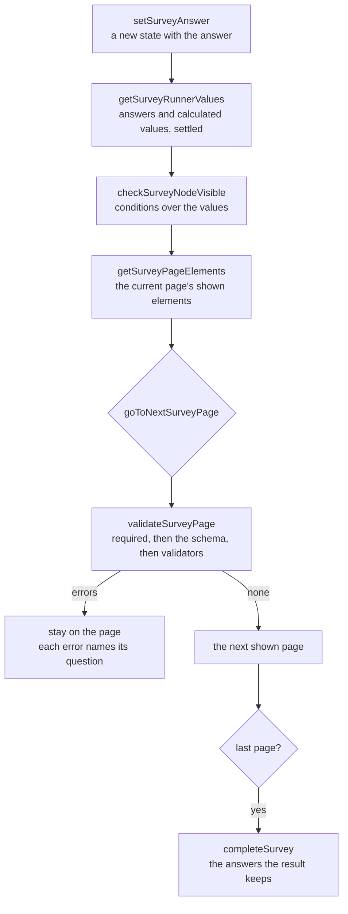

# Survey Runner

The state a respondent's session moves through, as plain functions in the `survey-engine` package with no DOM and no framework, over the [typed document](../survey-document/design.md) and the [expression language](../survey-logic/design.md). The respondent's browser, the Creator's preview and the server's check of a written response call the same functions, so all three refuse the same answer for the same reason. An answer is checked by the schema of the question's kind.

## How it works

The session's state is a `SurveyRunnerState`: the answers keyed by question name, the page index among the document's pages, and whether the survey is complete. Every function returns a new state or a derived value, and none mutates. A page index names a page of the document, and a page with no shown element is skipped in both directions.

**Calculated values.** `getSurveyRunnerValues` evaluates the document's calculated values and its calculated-value questions in document order, and repeats the pass until no value changes, for a bounded number of passes (`MAX_SURVEY_RUNNER_PASSES` in `getSurveyRunnerValues.ts`). A value that still changes after the last pass, or that faults, is left out. A calculated value never overwrites an answer of the same name. A dynamic panel's template is not evaluated at the top level. The runner reads every stored answer through the logic package's `toSurveyLogicAnswer`, which reads a null as unanswered and keeps a text as text at every depth, and it has no reader of its own.

**Conditions.** A node with no `visibleIf` is shown, and one with a condition is shown when it holds. A node is enabled unless it is a calculated value, a block of markup or a picture, which are never enabled, or its `enableIf` does not hold. A node is required when its `isRequired` flag is set or its `requiredIf` holds. A condition that faults does not hold: it hides a `visibleIf`, disables an `enableIf` and leaves a `requiredIf` unmet. A panel's children are disabled when the panel is. A dynamic panel's template reads its conditions per row: each `visibleIf`, `enableIf` and `requiredIf` reads the row's own answers through the `panel` scope. The row views the runner gives a row, the validator's check of a row and the completion of a row all read a row through that one function, so a row's question is shown, enabled and required by the same decision in each.

**Pages and elements.** A page is shown when its own `visibleIf` holds and one of its elements is shown. `getSurveyPageElements` returns the current page's shown elements as a tree of `SurveyElementView`, each with its node, pointer, whether it is enabled and whether it is required. A hidden element is absent, and a panel is absent when none of its elements is shown.

**Validation and moves.** `validateSurveyPage` reports each enabled question on the current page in document order. An unanswered required question reports its `requiredErrorText` when that is set and the required message otherwise. A present answer is checked by its schema, and the first refusal's message is reported; a question whose answer passes its schema is then checked by each validator, whose text is reported when its expression does not hold, with the answer read as `value`. `goToNextSurveyPage` returns a `SurveyRunnerMove`: the errors with the state unchanged when the page has any, or no errors and the state on the next shown page. On the last page the state comes back unchanged. `goToPreviousSurveyPage` moves to the previous shown page and never validates.

**Completion.** `completeSurvey` checks every shown page in order. At the first page with errors it returns no answers, the errors and a state on that page, unfinished. On success it keeps the answers of shown questions, and of each dynamic panel's row only the template answers that row shows, and adds the values the result includes: each shown calculated-value question and each calculated value flagged `includeIntoResult`. Those values are computed over the kept answers, so a result never reads an answer it dropped.

## Signatures

Each function that reads the document takes it first, and each whose result depends on the time takes `now`, the clock a test or the preview fixes. None mutates.

| Function                                                | Returns                                                                                                                                                              |
| ------------------------------------------------------- | -------------------------------------------------------------------------------------------------------------------------------------------------------------------- |
| `createSurveyRunnerState(document, answers, pageIndex)` | a `SurveyRunnerState`, the page index clamped into the document's pages                                                                                              |
| `getSurveyRunnerValues(document, answers, now)`         | the answers and calculated values as the record the expressions read                                                                                                 |
| `getSurveyVisiblePageIndexes(document, answers, now)`   | the indexes of the pages with a shown element                                                                                                                        |
| `getSurveyPageElements(document, state, now)`           | the current page's `SurveyElementView` tree                                                                                                                          |
| `getSurveyProgress(document, state, now)`               | a `SurveyProgress`: the shown pages up to the current one, and the total shown                                                                                       |
| `isLastSurveyPage(document, state, now)`                | whether no later page has a shown element                                                                                                                            |
| `setSurveyAnswer(state, name, value)`                   | a new state; an empty or undefined value removes the answer                                                                                                          |
| `validateSurveyPage(document, state, now)`              | the current page's `SurveyPageError` list, in document order                                                                                                         |
| `goToNextSurveyPage(document, state, now)`              | a `SurveyRunnerMove`: the blocking errors, or the state on the next shown page                                                                                       |
| `goToPreviousSurveyPage(document, state, now)`          | the state on the previous shown page, or unchanged on the first                                                                                                      |
| `completeSurvey(document, state, now)`                  | a `SurveyRunnerCompletion`: the answers to store, the errors, and the state                                                                                          |
| `checkIsSurveyAnsweringNode(node)`                      | whether a node holds a response value: a question, a calculated value included, but not a page, a panel, markup or a picture                                         |
| `checkSurveyNodeVisible(node, values, now, scopes?)`    | whether a node's `visibleIf` holds, or it has none; a dynamic panel's template reads its row through the `panel` scope                                               |
| `checkSurveyNodeEnabled(node, values, now, scopes?)`    | whether a node takes an answer: not read-only, and its `enableIf` holds or it has none; a dynamic panel's template reads its row through the `panel` scope           |
| `checkSurveyNodeRequired(node, values, now, scopes?)`   | whether a node is required by its flag or its `requiredIf`; a dynamic panel's template reads its row through the `panel` scope                                       |
| `getSurveyPanelRowViews(node, row, values, now)`        | the template questions a dynamic panel's row shows, in template order, each with whether the row enables it and requires it; the row's answers are the `panel` scope |
| `getSurveyPanelRowAnswers(node, row, values, now)`      | a row's answers without those of the template questions the row does not show                                                                                        |
| `createSurveyAnswerSchema(node, values, now)`           | the zod schema of one question's answer, switched on the question's kind; a dynamic panel's rows are read against the values and the clock                           |
| `validateSurveyAnswers(document, answers, mode, now)`   | the `SurveyAnswerIssue` list a written response's answers hold against the document                                                                                  |
| `surveyAnswerValueSchema`                               | the zod schema of a stored answer's shape: text, a number, a yes or no, or nested lists and records                                                                  |
| `getSurveyOrderedChoices(choices, choicesOrder, seed)`  | the choices in the order a respondent sees them; a random order is seeded                                                                                            |
| `getSurveyChoiceText(choice)`                           | the text a respondent reads for a choice: its text, or its value when it has none                                                                                    |

The other exports of the runner's folder are the helpers these call: the page and element views, the question errors, the value conversions between answers and the expression language, the per-kind answer schemas under `answer/`, and the messages in `constants.ts`. The choice functions live beside the package's other services rather than in the runner's folder.

## Answers

A `SurveyAnswerValue` is text, a number, a yes or no, a list of answers or a record from a name to an answer. A list or a record may nest three levels deep at most, and every text and list is bounded in length and entry count (the limits in `packages/survey-engine/src/services/constants.ts`). `surveyAnswerValueSchema` is that shape, and the server holds a stored response's answers to it.

`createSurveyAnswerSchema` dispatches on the question's kind. An answer that is absent is not checked there, since whether a question must be answered is the page flow's to say. The rules of each kind:

| Kind                      | The answer it takes                                                                                                                                                                                                                                                                                                                                                                                                                                                   |
| ------------------------- | --------------------------------------------------------------------------------------------------------------------------------------------------------------------------------------------------------------------------------------------------------------------------------------------------------------------------------------------------------------------------------------------------------------------------------------------------------------------- |
| `text`, by its input type | `number`: a number within its minimum and maximum, each bound read as a number when it is one and otherwise no bound. `date`, `datetime-local` and `time`: non-empty text within the bounds, compared as text. `email`: an email address. `url`: a URL. `text`, `tel` and `password`: text within its length bounds                                                                                                                                                   |
| `text`, all but `number`  | the question's pattern, when it has one, must match. The pattern runs on RE2, which takes time linear in the answer, and a pattern RE2 cannot compile is ignored                                                                                                                                                                                                                                                                                                      |
| `comment`                 | text within its maximum length                                                                                                                                                                                                                                                                                                                                                                                                                                        |
| `boolean`                 | a yes or no                                                                                                                                                                                                                                                                                                                                                                                                                                                           |
| `radiogroup`              | one of its choices; its none answer when it has one; non-empty text when it has an other option                                                                                                                                                                                                                                                                                                                                                                       |
| `dropdown`                | one of its choices; non-empty other text when it has an other option                                                                                                                                                                                                                                                                                                                                                                                                  |
| `buttongroup`             | one of its choices                                                                                                                                                                                                                                                                                                                                                                                                                                                    |
| `checkbox`                | distinct choices, between its minimum and maximum selected. The none answer is refused beside another answer; an other entry is non-empty text                                                                                                                                                                                                                                                                                                                        |
| `tagbox`                  | distinct choices, at most its maximum selected; an other entry is non-empty text                                                                                                                                                                                                                                                                                                                                                                                      |
| `rating`                  | a whole number from the first step to the scale's count                                                                                                                                                                                                                                                                                                                                                                                                               |
| `ranking`                 | each choice at most once, in any order                                                                                                                                                                                                                                                                                                                                                                                                                                |
| `slider`                  | a number within its range that lands on a whole step counted from its minimum                                                                                                                                                                                                                                                                                                                                                                                         |
| `matrix`                  | a record from each row's value to a column's value. A name no row holds is refused, and every row must be answered when all rows are required                                                                                                                                                                                                                                                                                                                         |
| `matrixdynamic`           | a list of rows within its minimum and maximum row count. Each row is a record over its columns, each cell checked by its column's kind (text, comment, dropdown, checkbox, boolean or rating); a required column must hold an answer. The rating cell's scale is set by `MATRIX_CELL_RATING_COUNT` in `constants.ts`                                                                                                                                                  |
| `paneldynamic`            | a list of panels within its minimum and maximum panel count. Each panel is a record over the template's questions, each checked by its own kind; a required template question must hold an answer. A template question's `visibleIf`, `enableIf` and `requiredIf` read the survey's values, with the row's own answers as the `panel` scope (`{panel.name}`); a template question a row hides or disables is skipped for that row: it is neither required nor checked |
| `multipletext`            | a record from each item's name to its text. An email item is held to the email format; a required item must hold an answer                                                                                                                                                                                                                                                                                                                                            |
| `imagepicker`             | one of its choices, or a list of distinct choices when it takes several                                                                                                                                                                                                                                                                                                                                                                                               |
| `expression`              | a text, a number or a yes or no. The runner never checks it, since a calculated value is never enabled                                                                                                                                                                                                                                                                                                                                                                |
| `html`, `image`           | nothing: any answer is refused                                                                                                                                                                                                                                                                                                                                                                                                                                        |

A required question is unanswered when its answer is absent, the empty text or an empty list; a yes or no and a zero are answers. A refused answer reports the message of the rule it broke, such as out of range, not one of the choices or too short. Every message is a constant in `packages/survey-engine/src/services/runner/constants.ts`, so the fields and the server show one wording.

`validateSurveyAnswers` checks a written response against the document. It refuses a name no question holds, and it refuses an answer to a question that is not shown on a submit, which a draft ignores. On a submit it also refuses a dynamic panel's row that holds an answer to a template question the row does not show. A draft checks each present answer of a shown, enabled question and accepts a missing required answer. A submit also checks every shown required question, and it accepts the names of the document's calculated values, which the completed result carries, where a draft refuses them as unknown.

## Choices

`getSurveyOrderedChoices` returns the list's own order, sorted by text, or a shuffle for the random order. The shuffle is seeded by the session's seed string, which is the response's id or an id generated when the page loads: a 32-bit hash of the seed drives a small seeded generator, so the order holds still across renders and across a reload that resumes the same response. Rejected: an unseeded shuffle, which reorders the choices under a respondent's cursor each time the page redraws.

## The app's wrapper and page

`useSurveyRunner` holds the state in a ref and exposes the page's element views, the errors, the progress, the navigation and the completion. It refreshes the clock on every action, so a date the expressions read is the moment of the answer or the move. Its `questionNumbers` numbers the questions of the pages up to the current one continuously, so a page carries on from the pages before it. A blocked move keeps the state and sets the errors; moving back clears them.

`Runner.vue` draws the document over that wrapper. Its progress bar sits at the top or the bottom of the page as the root's `showProgressBar` says. Previous is hidden on the first shown page, and the last page's button completes the survey. An alert above the page repeats the first error's message, and a blocked move moves focus to the control of the first error. The page passes the session's seed to each element as a `seed` prop, and the elements pass it down to the fields that order their choices. It passes the row views the same way, a function a dynamic panel calls for each of its rows. It emits `change` on every answer and page move, and `complete` with the answers of a passing completion. `RunnerElement.vue` draws one element of the page: a panel is a `fieldset` with its legend and its children, and a question is a field of its kind, with its number before it.

## Decisions

- **Plain functions, not a class.** The app's reactive wrapper holds the state in a ref and calls the functions, and the server calls them on a record. Rejected: a stateful class, which the server would construct per request to use one method, and which the preview would have to reset between runs.
- **Invisible answers are kept until completion.** An answer to a question that becomes hidden stays in the state, so a respondent who changes an earlier answer back finds theirs again. Completion drops it. A dynamic panel's row keeps a template answer it hides in the same way, and completion drops that one from the row.
- **A condition that fails reads as not holding.** A survey that passed the save check cannot hold a malformed expression, so a failure here is an evaluation fault such as a function given a wrong argument. The safe reading shows the question rather than hiding a required one.
- **The clock is a parameter.** Tests and the preview fix it; the app passes the current time.

## Key files

| File                                                                     | Role                                                                                                                |
| ------------------------------------------------------------------------ | ------------------------------------------------------------------------------------------------------------------- |
| `packages/survey-engine/src/services/runner/`                            | the functions above, one module each, with their tests; `answer/` holds the per-kind answer schemas                 |
| `packages/survey-engine/src/services/runner/createSurveyAnswerSchema.ts` | the dispatch from a question's kind to its answer schema                                                            |
| `packages/survey-engine/src/services/runner/validateSurveyAnswers.ts`    | the server's check of a written response's answers                                                                  |
| `packages/survey-engine/src/services/runner/getSurveyRunnerValues.ts`    | the calculated values, computed in bounded passes                                                                   |
| `packages/survey-engine/src/services/runner/completeSurvey.ts`           | completion: the errors, or the answers a result keeps                                                               |
| `packages/survey-engine/src/services/runner/constants.ts`                | the messages a refused answer and a required question show, and the rating scale of a matrix's cells                |
| `packages/survey-engine/src/models/`                                     | `SurveyRunnerState`, `SurveyElementView`, `SurveyPageError`, `SurveyAnswerValue` and the other models of the runner |
| `packages/survey-engine/src/services/getSurveyOrderedChoices.ts`         | the choice order, with the seeded shuffle                                                                           |
| `packages/survey-engine/src/services/getSurveyChoiceText.ts`             | the text a respondent reads for a choice                                                                            |
| `packages/survey-engine/src/services/hashSurveySeed.ts`                  | the 32-bit hash of a seed string                                                                                    |
| `packages/survey-engine/package.json`                                    | the package, which depends on `survey-logic` for expressions and `re2js` for patterns                               |
| `apps/web/app/composables/survey/useSurveyRunner.ts`                     | the reactive wrapper over the state                                                                                 |
| `apps/web/app/components/Resource/Survey/Runner.vue`                     | the page: progress, navigation, the alert and the focus of a blocked move                                           |
| `apps/web/app/components/Resource/Survey/RunnerElement.vue`              | one element of the page: a panel as a fieldset, a question as a field with its number                               |
