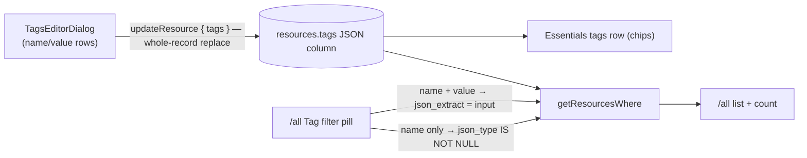

# Resource Tags

Every resource carries a flat `Record<string, string>` of tags: shown in Essentials, edited in place, and filterable on `/resource-explorer/all`. Tags are the lightweight organization layer that keeps [resource groups deferred](../../../deferred/resource/resource-groups/design.md) — cross-cutting labels without a grouping entity to model, migrate, and navigate.

## How it works

Tags live on the resource row itself as a JSON column defaulting to `{}`, not in a join table. They are read on every list query and written as a whole record, so normalizing them into rows would buy nothing but joins.

Editing replaces the whole record rather than merging. The dialog always sends every tag it knows about, and whatever it omits is gone. That makes a save one atomic write with no partial-merge ambiguity: a merge would have to tell an omitted key that was removed from one that was never touched, and the whole-record replace has no such case, which is also how the editor can express "remove this tag" at all. It edits an ordered list of name/value rows rather than the record directly — a record cannot hold a half-typed duplicate or a blank name mid-edit, and rows keep their position while the user types. Rows with a blank name are dropped at save, which is what lets an empty row sit on screen as somewhere to type without ever being written.

Filtering splits in two, because the pill's value is optional and one operator cannot cover both cases. A name _and_ value is an exact match on that key's value (`json_extract(tags, '$.env') = 'prod'`); a name alone is key presence (`json_type(tags, '$.env') IS NOT NULL`) — "tagged with this at all", which is the common case. Both go through `getResourcesWhere`, so `readResourcesCount` and `readResources` can never disagree about what matches.

## Data model

`resources.tags` is a JSON text column, `notNull().default({})`. SQLite has no containment operator and no GIN index, so both filters are expressions over the column, evaluated alongside the owner's other predicates. `resourceTagsSchema` bounds it at `MAX_TAGS_COUNT` entries with `MAX_TAG_NAME_LENGTH` / `MAX_TAG_VALUE_LENGTH` per pair.

Names are non-empty through the `normalizeString` pipe; values are not. An empty value is meaningful — `environment:` with nothing after it marks a resource as needing one — so only the name is required to exist.

## Procedures

| Procedure                                                | Auth   | Input                  | Purpose                                   |
| -------------------------------------------------------- | ------ | ---------------------- | ----------------------------------------- |
| `<type>.updateResource` (factory)                        | owner  | + `tags?`              | Whole-record replace                      |
| `resource.readResources` / `resource.readResourcesCount` | authed | + `tags?` / `tagName?` | Exact-value or key-presence filter        |
| `resource.readResourceTagCounts`                         | authed | —                      | Tag names + how many resources carry each |

## Key files

| File                                                            | Role                                       |
| --------------------------------------------------------------- | ------------------------------------------ |
| `packages/db-schema/src/models/resource/ResourceTags.ts`        | Schema, bounded by the three tag limits    |
| `packages/db-schema/src/schema/resource/resourcesInResource.ts` | `tags` column                              |
| `app/components/Resource/TagsEditorDialog.vue`                  | Name/value row editor                      |
| `app/components/Resource/List/TagFilterPill.vue`                | The `/all` Tag pill                        |
| `app/components/Resource/TagList.vue`                           | The `/resource-explorer/tags` route's list |
| `app/components/Resource/Overview.vue`                          | Essentials tags row                        |

## Notes

- Flat name:value only — no hierarchies, no typed values.
- A tags-only update leaves no `Renamed` entry in the [activity log](../activity-log/design.md): changing a label is not renaming a resource.
- [Global search](../global-search/design.md) matches a tag's name and value by whole word, so a label the owner remembers finds its resource. The `/all` filter pill and the `/resource-explorer/tags` list ([service menu](../resource-service-menu/design.md)) are the exact retrieval paths.
- `readResourceTagCounts` groups by **name only**. Tag names live inside one JSON column, so the read expands the keys with `json_each` in a subquery and groups over that — a set-returning function cannot sit beside an aggregate in one select list. A value narrows the result afterwards, through the pill.
- If tag usage grows into "give me a folder", that is the [resource groups](../../../deferred/resource/resource-groups/design.md) revisit trigger, not more tag features.
