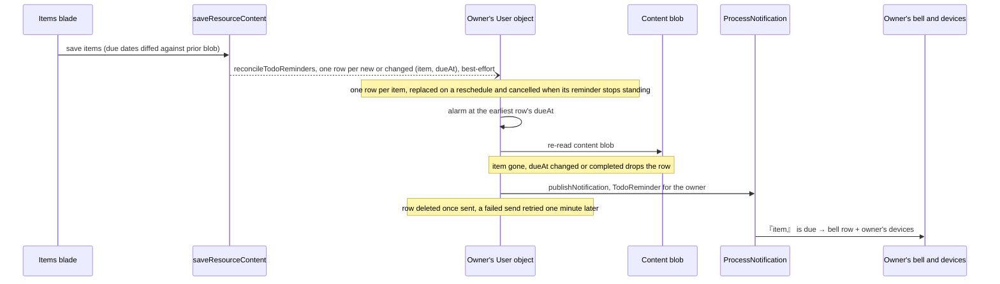

# TodoList due reminders

A TodoList item with a due date pushes a web-push reminder to its owner when it comes due — a platform feature that reuses the notification infrastructure esbabbler already runs, and the thing that turns the TodoList type from a table into an actual todo product.

## How it works

Reminder delivery adds no queue and no Azure service: each owner's User object keeps their reminders in its own SQLite and runs one alarm for the earliest of them, and the existing [notification pipeline](../../architecture/notifications/design.md) carries the notification.

- **Scheduling** — after a TodoList `saveResourceContent` persists, the server reads the prior content blob and diffs due dates, then gives the owner's User object one reminder per item whose `(itemId, dueAt)` is new or changed, in the future, and not completed. Each one replaces that item's row, and a row whose reminder no longer stands — its due date was cleared or moved to the past, or the item was completed or removed — is cancelled in the same call. A todo completed on the previous save counts as having no reminder, so reopening one gives it a reminder for its due date even if that date was set while the todo was completed. The diff is fire-and-forget and best-effort: a failed call logs and never fails the user's save, and an unreadable prior blob degrades to "no previous content" rather than blocking the save. Diffing keeps repeated saves from rewriting the reminder for an unchanged due date.
- **Fire-time verification is the consistency model** — the reminder row is the state in the owner's User object, and the alarm verifies the item at fire time. When the alarm reaches a row, it re-reads the live content blob and drops the reminder if the item was deleted, re-dated or [completed](../todolist-completion/design.md); a re-dated item's row was already replaced by the save that re-dated it. A stale row is therefore harmless, so a cancel that never lands is caught when the row fires.
- **Delivery** — the alarm sends each due row by publishing a `TodoReminder` notification, and the shared pipeline does the rest ([notifications](../../architecture/notifications/design.md)): `『{item}』 is due` reaches the owner's bell and every device they have subscribed. The row is deleted once its notification is queued, so a failed send keeps it, and the alarm retries it one minute later. Clicking the notification opens the resource's Items blade (`/resource-explorer/{id}/items`). TodoLists are single-owner resources, so the recipient set is just the owner — no fan-out.

## Data model

One table, in the owner's User object's SQLite: `todoRemindersInUser`, one row per item whose reminder has not yet been sent, keyed by `(resourceId, itemId)` and holding its `dueAt`. The TodoList item already carries `dueAt` (the Items and Calendar blades render it), and the row is the only copy of the reminder, while the content blob is what the alarm checks against. Nothing is in Postgres, and no queue carries a reminder.

## Key files

| File                                                                  | Role                                                                                                        |
| --------------------------------------------------------------------- | ----------------------------------------------------------------------------------------------------------- |
| `apps/web/server/services/resource/todoList/scheduleTodoReminders.ts` | Post-save due-date diff, reconciled into the owner's User object                                            |
| `apps/web/server/services/resource/ResourceAfterSaveContentMap.ts`    | Registers the diff as TodoList's after-save hook                                                            |
| `apps/web/server/services/resource/runAfterSaveResourceContent.ts`    | Fires the registered hook, fire-and-forget                                                                  |
| `apps/web/server/services/resource/saveResourceContent.ts`            | The one content write that runs the hook                                                                    |
| `apps/functions/src/durableObjects/UserObject.ts`                     | `reconcileTodoReminders` writes and cancels the rows; `alarm()` sends each due one                          |
| `apps/functions/src/durableObjects/user/schema.ts`                    | The `todoRemindersInUser` table, keyed by resource and item, indexed by `dueAt`                             |
| `apps/functions/src/services/todoReminder/sendTodoReminder.ts`        | Re-reads the content blob, verifies the item and publishes the notification, driven by `UserObject.alarm()` |
| `apps/functions/src/services/todoReminder/constants.ts`               | `TODO_REMINDER_RETRY_DELAY_MS`, the wait before a failed send is retried                                    |
| `apps/functions/src/services/notification/resolveNotification.ts`     | Turns the published reminder into its copy, deep link and recipient                                         |

## Notes

- At-least-once delivery: a row is deleted only once its notification is queued, so a crash between the two sends it again. The re-run re-verifies against the blob, and notifies twice in the worst case — acceptable for reminders, and cheaper than a dedup table.
- The row is keyed by item, so a due date toggled away and back across saves never leaves two reminders for one item: the save that cleared it cancels the row, and the one that set it again writes a fresh one.
- Reminder timing is exactly `dueAt`. Lead-time offsets ("remind me 1h before") are a follow-up `dueAt`-relative field, not a reason to build preference UI.
