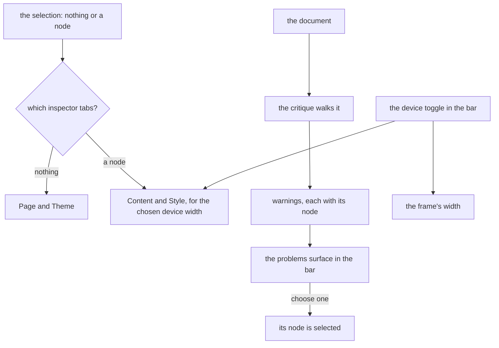

# Webpage layout

The webpage editor's arrangement on the [editor shell](../editor-shell/design.md). It places the webpage's panels in the shell's regions and does not own the [canvas](../page-builder/canvas/design.md), the [style panel](../page-builder/style-panel/design.md) or the [critique](../page-builder/critique/design.md), which keep their own designs.

A webpage is guided by its block tree, where each slot accepts some kinds, and free within it, since a page has no mail client to satisfy. Its findings, a low contrast or a fixed width, tell the author what to improve and never stop a save. So the layout is the email's shape without a compile to wait for, and with a theme.

## How it works

| Region    | Edge        | Opens        | Holds                                                                   |
| :-------- | :---------- | :----------- | :---------------------------------------------------------------------- |
| Bar       | top, docked | always       | the device toggle and the problems surface                              |
| Blocks    | start       | on demand    | tabs Blocks and Layers: the palette and the layers tree                 |
| Inspector | end         | with content | the selection's tabs, below                                             |
| Canvas    | the rest    | always       | the frame that draws the page, with the node toolbar over the selection |

With nothing selected the inspector shows two tabs, Page and Theme: the page's own settings and the theme's tokens. With a node selected it shows Content and Style, where Style edits the node's values for the device width the toggle has chosen. The critique's findings are listed in the problems surface as warnings, each naming its node, and choosing one selects the node. The inspector has no Check tab: the findings are listed in the problems surface instead.

**The device toggle is in the bar.** It chooses the width the frame draws at and the breakpoint the Style tab edits, so it governs two regions and sits above both, not floating on the canvas. The widths it offers are the ones the style panel edits.

**A compact window** keeps the canvas in view and opens Blocks and the inspector as sheets from their buttons, which sit in the strip below the canvas. A medium window does the same, as the decisions below set out.

## Decisions

- **The inspector's tabs follow the selection.** A page-wide theme next to a paragraph's content invites editing the wrong thing. Rejected: four tabs for every selection.
- **The findings are listed in the problems surface, not a tab.** A count in the bar is seen without opening anything, and one place lists findings across editors. Rejected: a tab seen only when opened, which an author must remember to open.
- **Findings stay warnings.** The critique reports what to improve before publishing, and it computes from the document, so it is advisory. A warning never refuses a save. Rejected: gating a save on contrast, which turns a design judgement into a rule the author cannot override.
- **The device toggle governs the bar, not the canvas.** It sets the frame's width and the Style tab's breakpoint. Rejected: the toggle over the canvas, which hid that it also sets which values the Style tab edits.
- **Layers keeps its tab.** The tree is the keyboard path to every move, as the canvas design settles, and a webpage nests deeper than an email.
- **The webpage keeps the page builder's editor type.** The shell keys each editor's reader state by `EditorType`, and the webpage keeps `EditorType.PageBuilder` rather than a member of its own, so its sizes and open regions are stored under that key. Rejected: a webpage member beside `PageBuilder`, which would store one page builder's sizes under two keys.
- **A region with several panels draws them as tabs, through the shell.** The Blocks region's two tabs and the settings' tabs chosen by the selection need one tab strip, so the shell draws a tab list over a region's present panels and sets the reader's active panel when a tab is chosen. A tab's title comes from a map keyed by panel id, beside the region-name map, since a layout names no text. Rejected: a tab strip inside each editor's content, which would hand the one arrangement back to every editor.
- **A medium window draws the side regions as sheets too.** Two columns of the default width leave the canvas too little width to edit in at the medium class, so that class draws the side regions as sheets as well. Rejected: docked columns at medium, which leave no canvas to edit in.
- **The bar is held at one size.** The bar holds one row of controls, so its minimum and maximum are its default size, and a region whose limits are equal draws no handle. Rejected: a bar that resizes, which would resize the row of controls.
- **Leaving a text edit shows the Layers tab before it focuses the row.** The row is a node of the tree, and the tree is the Layers tab, which the shell draws only while it is the active tab, so the edit's return selects that tab first. Rejected: focusing the canvas instead, which would move the reader off the node the edit was on.
- **The email has an arrangement of its own.** The page builder host draws the webpage's layout, and the email editor draws its own under `EditorType.Email`, so each file holds one editor's arrangement. Rejected: one arrangement in the shared host for both editors, which keeps two arrangements in one file.

## Not built

- **A publish gate on the findings.** The publish flow does not read them, so no publish waits on a finding.
- **New critique rules.** The rules belong to the critique's design, and this page adds none.
- **A different canvas.** The same-origin frame, its overlays and its node toolbar are the canvas design's, and this page leaves them as they are.

## Key files

| Path                                                             | Role                                                                        |
| :--------------------------------------------------------------- | :-------------------------------------------------------------------------- |
| `apps/web/app/components/PageBuilder/Editor.vue`                 | the page builder host, which draws the webpage's layout on the shell        |
| `apps/web/app/services/pageBuilder/webpageLayout.ts`             | the webpage's layout: the settings tabs the selection chooses               |
| `apps/web/app/services/pageBuilder/pageBuilderLayout.ts`         | the regions, panels and names the page builder layouts share                |
| `apps/web/app/services/editor/constants.ts`                      | the presentation each side region takes at each size class: column or sheet |
| `apps/web/app/components/Editor/Shell.vue`                       | the shell, which draws the regions, their tabs and the sheets' buttons      |
| `apps/web/app/components/Editor/Region.vue`                      | a region as a column or a sheet, with a handle only when its limits differ  |
| `apps/web/app/components/Editor/RegionContent.vue`               | a region's tab strip, drawn over its present panels                         |
| `apps/web/app/components/PageBuilder/Bar.vue`                    | the bar: the device toggle and the problems surface                         |
| `apps/web/app/components/Editor/Problems.vue`                    | the problems surface the bar draws                                          |
| `apps/web/app/components/PageBuilder/Palette.vue`                | the palette, drawn as the Blocks tab                                        |
| `apps/web/app/components/PageBuilder/Layers.vue`                 | the layers tree, drawn as the Layers tab                                    |
| `apps/web/app/components/PageBuilder/Canvas/DeviceToggle.vue`    | the device toggle, which sits in the bar                                    |
| `apps/web/app/composables/pageBuilder/usePageBuilderCritique.ts` | the critique's findings for the problems surface                            |
| `apps/web/app/services/pageBuilder/getCritiqueEditorFinding.ts`  | a critique finding as a warning that names its node                         |
| `openspec/specs/resource/page-builder/canvas/design.md`          | the canvas design, which places the device toggle in the bar                |
| `openspec/specs/resource/page-builder/critique/design.md`        | the critique design, which lists its findings in the problems surface       |

## Sources

- [Webflow's Navigator](https://help.webflow.com/hc/en-us/articles/33961320786451-Navigator) and [Wix Studio's layers panel](https://support.wix.com/en/article/studio-editor-using-the-layers-panel) (fetched): a tree of the page's elements in a panel at the left of the editor, which Webflow lets the reader pin open beside the canvas on a wide window. Webflow moves an element into another parent by dragging it, while Wix reorders only within a parent. The Layers tab.
- [GrapesJS's layer manager](https://grapesjs.com/docs/modules/Layers.html): the page's component tree as its own panel (fetched).
- [GrapesJS's device manager](https://grapesjs.com/docs/api/device_manager.html) and [its device](https://grapesjs.com/docs/api/device.html) (fetched): a device sets the canvas width and a separate width for media queries. The device toggle.
- [Puck's overrides](https://next.puckeditor.com/docs/api-reference/overrides) (experimental): an outline and a fields panel as separate replaceable parts, with the fields following the selected item.
