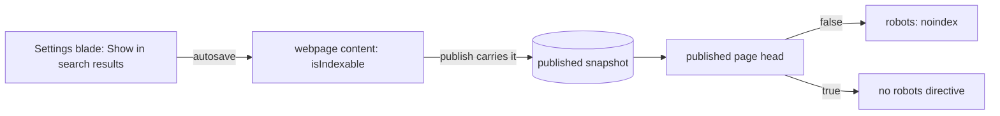

# Webpage Search Visibility

The owner decides whether search engines may list a published webpage. The published page sets a robots directive in its head when the owner has turned listing off, and says nothing when it is listed, as every published page did before the switch.

The Settings blade holds a webpage's description and share image, which the published page writes into its head as SEO and Open Graph meta. The site's route rules keep the app's own pages out of search by path, but the published views sit outside them, so the switch is the only thing that keeps a published webpage out of search results. Webflow gives each page an indexing toggle in its page settings, on to appear in search results and off to be excluded, and the switch copies it ([Webflow University, Control how search engines index your site](https://university.webflow.com/course-lesson/control-how-search-engines-index-your-site)).

## How it works

- **The switch.** `Settings.vue` draws a Search region with a `UiSwitch` labelled Show in search results, bound to the content's `isIndexable`, so a flip writes the boolean onto the content the autosave watches and saves as the description and share image do.
- **The content.** `WebpageEditor` carries `isIndexable` beside the share preview. The class starts it on, and the content schema requires it as a boolean.
- **The published head.** `View.vue` sets a `robots` meta of `noindex` from the published snapshot only when `isIndexable` is `false`.

The directive comes from the published snapshot, so an unpublished change to the switch does not reach the public page until the owner publishes, as the description and the share image already behave.

## Gap analysis

| Feature                                      | Verdict                                                                                                               |
| -------------------------------------------- | --------------------------------------------------------------------------------------------------------------------- |
| Exclude a page from search results           | Built as the switch.                                                                                                  |
| Sitemap, favicon, 404 page, global canonical | Rejected as site-level settings: [webpage site settings](../../../rejected/resource/webpage-site-settings/design.md). |

## Decisions

- **On until turned off.** A new webpage starts with the switch on, so it is listed unless its owner turns the switch off.
- **Only a webpage.** It is the one published type made to be found. A survey or a dashboard is reached through a link its owner sends, and its views stay as they are.
- **Read from the snapshot.** The public page is what was published, so its head is too.

## Key files

| File                                                         | Role                                                |
| ------------------------------------------------------------ | --------------------------------------------------- |
| `apps/web/shared/models/webpageEditor/data/WebpageEditor.ts` | the content model and schema, which gain the switch |
| `apps/web/app/components/Resource/Webpage/Settings.vue`      | the switch in the Settings blade                    |
| `apps/web/app/components/Resource/Webpage/View.vue`          | writes the robots directive into the published head |

## Sources

- [Webflow University — Control how search engines index your site](https://university.webflow.com/course-lesson/control-how-search-engines-index-your-site) — every page has an Indexing toggle in Page settings, on to appear in search results and off to be excluded from search, the per-page control the switch copies.
