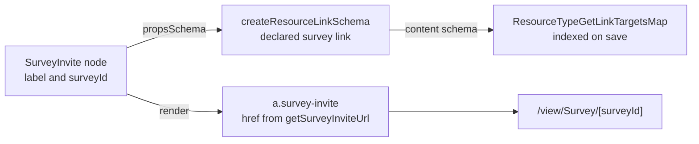

# Webpage Survey Invite

A webpage offers the owner's published surveys as an invite button, a page-builder node that links to the survey. A landing page collects responses from anyone who finds it, with zero send infrastructure. The email editor's invite is a GrapesJS block, documented in [email personalization](../email-personalization/design.md) until the email cutover.

## How it works

The invite is one node in the page builder's registry, beside the other webpage nodes. Its props are a `label` and a `surveyId`, and the id is declared with `createResourceLinkSchema(ResourceLinkType.Survey)`. The survey is therefore a resource link the index finds on save, so deleting the survey names the page holding the invite.

- **Render** — the node renders an anchor classed `survey-invite`, its `href` the absolute survey url from `getSurveyInviteUrl(context.origin, surveyId)`. The link is absolute, against the origin the page publishes from, so it works from any page that holds it. A published page loads no stylesheet of ours, so the button's styling is the node's own `css`.
- **A leaf** — the node is not focusable and has no slots. Its label is its only child text.
- **Palette** — the node sits in the Survey category and is created with the label "Survey" and an unbound `surveyId`, until the owner picks a survey. Survey names are escaped by the renderer, like every node's text.
- **No per-recipient identity** — there is no audience row behind an anonymous page visitor, so the link is always the plain published URL. Invite tokens belong to a distribution orchestrator, not a public page.
- **No form nodes** — the webpage registry has no form nodes. A published page cannot submit a form, so this invite is how a webpage collects answers.

## Key files

Paths relative to `apps/web`.

| File                                                             | Role                                                      |
| ---------------------------------------------------------------- | --------------------------------------------------------- |
| `shared/services/pageBuilder/surveyInviteNodeType.ts`            | the node: its props schema, its anchor render and its css |
| `shared/services/pageBuilder/getSurveyInviteUrl.ts`              | the absolute survey url the anchor links to               |
| `shared/services/pageBuilder/webpageNodeTypeDefinitionMap.ts`    | the registry entry                                        |
| `app/services/pageBuilder/constants.ts`                          | the Survey palette category                               |
| `app/services/pageBuilder/webpageNodeDefaults.ts`                | the node a palette drop creates                           |
| `server/services/resource/link/ResourceTypeGetLinkTargetsMap.ts` | the link index, read off each type's content schema       |

## Notes

- Embedding a survey _inline_ (an iframe of the respondent page) is deliberately out: iframes inside a published page bring sizing and sandboxing complexity for marginal gain over a button, and the respondent page is already mobile-friendly. Revisit only on real demand.
- The email flavour is `createEmailSurveyInviteBlocks` over the shared core in `apps/web/app/services/grapesjs`. It is the one part of this feature still on GrapesJS, until the email cutover moves it to the page builder.
