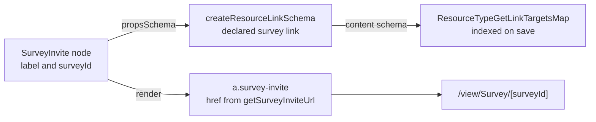

# Webpage Survey Invite

A webpage offers a survey as an invite button, a page-builder node that links to the survey. The email editor holds the same node under its own type tag, drawn as an MJML button. A landing page collects responses from anyone who finds it, with zero send infrastructure.

## How it works

The invite is one node in the page builder's registry, beside the other webpage nodes. Its props are a `label` and a `surveyId`, and the id is declared with `createResourceLinkSchema(ResourceLinkType.Survey)`. The survey is therefore a resource link the index finds on save, so deleting the survey names the page holding the invite.

- **Render** — the node renders an anchor classed `survey-invite`, its `href` the absolute survey url from `getSurveyInviteUrl(context.origin, surveyId)`. The link is absolute, against the origin the page publishes from, so it works from any page that holds it. A published page loads no stylesheet of ours, so the button's styling is the node's own `css`.
- **A leaf** — the node is not focusable and has no slots. Its label is its only child text.
- **Palette** — the webpage editor lists the node in its Survey category, created with the label "Survey" and an unbound `surveyId` until the owner picks a survey. The survey's name is never rendered; the label is the button's text.
- **Email** — the email editor's node is `EmailNodeType.SurveyInvite`, the webpage's props under the email's type tag, held by the MJML registry as a leaf. It renders as an `mj-button` with the same absolute survey `href` and the escaped label as its content. The email palette lists it in its Content category.
- **No per-recipient identity** — there is no audience row behind an anonymous page visitor, so the link is always the plain published URL. Invite tokens belong to a distribution orchestrator, not a public page.
- **No form nodes** — the webpage registry has no form nodes. A published page cannot submit a form, so this invite is how a webpage collects answers.

## Key files

Paths relative to `apps/web`.

| File                                                               | Role                                                                      |
| ------------------------------------------------------------------ | ------------------------------------------------------------------------- |
| `shared/services/pageBuilder/surveyInviteNodeType.ts`              | the node: its props schema, its anchor render and its css                 |
| `shared/services/pageBuilder/getSurveyInviteUrl.ts`                | the absolute survey url the anchor and the email button link to           |
| `shared/services/pageBuilder/webpageNodeTypeDefinitionMap.ts`      | the webpage registry entry                                                |
| `shared/services/pageBuilder/email/emailSurveyInviteType.ts`       | the email node's `mj-button` render                                       |
| `shared/services/pageBuilder/email/emailSurveyInviteNodeSchema.ts` | the email node's schema, the webpage props under the email tag            |
| `app/services/pageBuilder/constants.ts`                            | the webpage palette's Survey category                                     |
| `app/services/pageBuilder/webpageNodeDefaults.ts`                  | the node a palette drop creates                                           |
| `server/services/resource/link/ResourceTypeGetLinkTargetsMap.ts`   | the link index, read off each type's content schema                       |
| `app/components/Ui/SchemaForm/ResourceLink.vue`                    | the picker the `surveyId` is drawn by, over the owner's published surveys |

## Notes

- A survey bound to an invite that is unpublished stays bound, and the picker flags it rather than offering it again. The picker is built by [resource-webpage-survey-picker](../../../changes/resource-webpage-survey-picker/proposal.md) and its release is held until the one-time purge in the [survey form engine](../../../changes/resource-survey-form-engine/proposal.md) has run in each environment.
- Embedding a survey _inline_ (an iframe of the respondent page) is deliberately out: iframes inside a published page bring sizing and sandboxing complexity for marginal gain over a button, and the respondent page is mobile-friendly. Revisit only on real demand.
