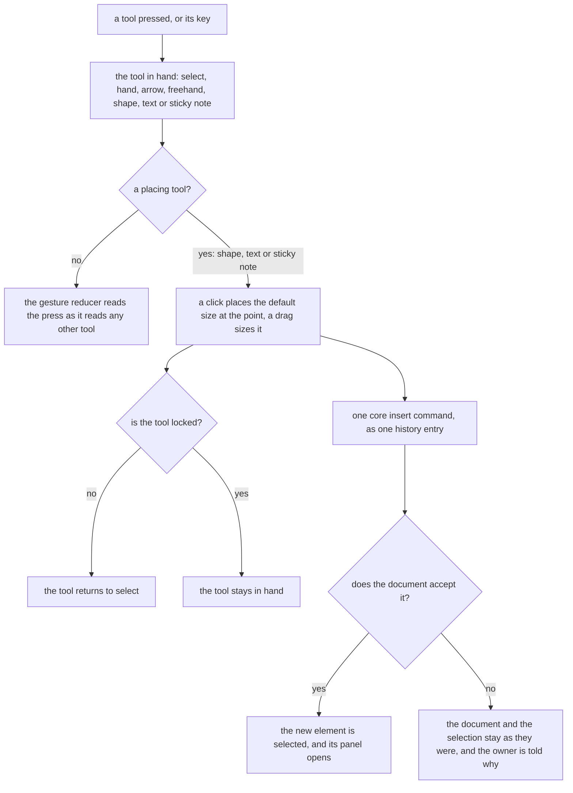

# Whiteboard layout

The whiteboard's arrangement on the [editor shell](../editor-shell/design.md): every tool is one press away in a single top toolbar, a panel appears only for what is selected, and undo and redo sit beside zoom. The shell draws the screen over a layout and a registry the whiteboard declares, and the [whiteboard design](../whiteboard/design.md) holds its document, its commands and its export.

## How it works

The whiteboard declares a layout of four regions and a registry of panel content. The shell draws each region at the edge its size class names, and draws in each panel the content the registry maps to the key the layout gives that panel.

| Region     | Edge, by size class                                                   | Opens        | Holds                                               |
| :--------- | :-------------------------------------------------------------------- | :----------- | :-------------------------------------------------- |
| Tools      | top, floating over the canvas; bottom and docked on a compact window  | always       | the toolbar                                         |
| Properties | start, over the canvas below the toolbar; a sheet on a compact window | with content | the contextual panel, for the selection kinds below |
| View       | bottom, floating over the canvas                                      | always       | undo, redo, zoom out, zoom in and fit to content    |
| Canvas     | the remainder                                                         | always       | the pannable, zoomable canvas                       |

The properties panel is shown for a shape, a sticky note, a text box, an arrow, a stroke, an image and a selection of several, and is absent with nothing selected. Its content is the component the registry maps to each key: the fill field for a shape and a sticky note, the route, the arrowheads and the detach of each bound end for an arrow, and the stacking controls for every kind but a selection of several. A selection of several shows the fill its shapes and sticky notes share, or Mixed where the fills differ. Duplicate and delete are in the panel's footer for every kind, and delete keeps its confirmation.

**A placing tool draws the element.** Choosing the shape tool and clicking puts a shape of the default size at the click, and a drag makes the shape the size of the drag. The text box and the sticky note work the same way. The shape tool is one slot in the toolbar showing the shape last used, and its menu lists the basic shapes and then the flowchart ones, as the [whiteboard design](../whiteboard/design.md) sets them out. Each shape's mark, title and key sit in `apps/web/app/services/whiteboard/tool/WhiteboardShapeItemMap.ts`, and the image types the picker accepts are `NOTE_IMAGE_MIME_TYPES` in `apps/web/shared/services/resource/note/constants.ts`, the same kinds a paste takes. The element is inserted by the core's insert command at the point, snapped to the grid as every placement is, and a commit the document check refuses leaves the document unchanged and tells the owner, as every commit does. After one placement the tool returns to select, so the next click selects, and a lock on the toolbar keeps the tool in hand for a run of the same shape.

**The image is a button.** It opens a file picker, through the app's hidden file input, and hands the chosen file to the insert a pasted image uses. An image is not drawn by a press: it is placed at the centre of the canvas. A paste and a picked file reach the same composable.

**Every tool has a shortcut.** The shortcuts are registered commands in the whiteboard's command group, so the shortcuts dialog and the command palette list them, and the [whiteboard design](../whiteboard/design.md) holds the key each tool takes. A shortcut never fires while a field has focus, so a key typed into a text field, including the inline label editor, is text and not a tool, and a modifier makes it another command.

**Undo and redo are buttons.** They sit beside zoom in the view region, so a reader on a touch screen can undo without a keyboard. Redo comes from the shared bounded history, which holds it for the page builder too, and is registered as a command beside undo.

**A compact window.** The tools region docks at the bottom edge as a bar, and items that do not fit fold into its overflow menu by the shared toolbar's rule. The properties region is a sheet, opened by the button the shell draws in the strip below the canvas while something is selected. The view floats over the canvas, above the docked bar.

## Decisions

- **The palette's kinds sit in the toolbar.** The [whiteboard design](../whiteboard/design.md) decides the palette's removal and its alternatives; this layout is what that decision looks like in the toolbar's one row.
- **An element is placed by choosing its tool and drawing it.** It is the gesture every drawing tool a reader has used shares, and it gives the reader the size at the same stroke as the place. Rejected: the drag out of a list, which can place only at a default size and needs the pointer to cross the whole canvas from the edge; and the click that puts an element at the middle of the view, which the reader then drags to where it should have been.
- **The tool returns to select after one placement, unless it is locked.** A reader who places one shape and moves on is the common case. Rejected: a tool that stays in hand, which turns the next click, meant to select, into a second shape.
- **The properties panel is absent with nothing selected.** The whiteboard has no setting of the document that needs a panel, since snap is a toolbar toggle and the view is in the view region. Rejected: a panel of canvas settings shown when nothing is selected, which holds one switch and covers the canvas for it.
- **The panel is on the start edge.** It is where Excalidraw's properties and a reader's eye on a left-to-right page both rest, and the top-right keeps the page's own controls clear. It opens over the canvas below the toolbar's row, so it never moves what was just selected.
- **Shapes share one slot.** A button for every shape would make the toolbar a crowded strip. Rejected: a button per shape.
- **The toolbar floats over the canvas on a wide window and docks at the bottom on a compact one.** A floating island keeps the canvas whole and the tool within reach of the cursor, and the bottom edge is within a thumb's reach, as Excalidraw's phone bar is. Rejected: a docked top bar on a wide window, which spends a row of the canvas on a bar that is mostly empty.
- **A click centres the default size on its point, and a drag is anchored at its press.** A click's element is centred on the point the reader clicked. A drag's box runs from the press's corner to the pointer, as a drag does in every drawing tool, and holds the minimum element size. Nothing is drawn before a drag starts, so a click's element never changes size under the reader.
- **A text box keeps the width of its drag and no height.** Its text sets its height, as the text box model stores it. Rejected: a height taken from the drag, which the text box does not store, since its text sets it.
- **The armed element is the tool in hand with the shape kind the shape tool holds.** The store holds the kind beside the tool and the lock beside both, so the toolbar's toggles bind to the tool and the shape slot binds to its kind. Rejected: one armed value that holds both, which the toolbar's toggles would have to unpack.
- **A placement selects its element only when the document accepts it.** A refused commit leaves the selection where it was, so no selection names an element that was never placed. Rejected: selecting the element before the commit, which would name an element the document refused.
- **Redo is the shared history's redo, placed beside undo.** Which history entries redo reapplies and the shortcuts it binds are decided in the [whiteboard design](../whiteboard/design.md); this layout only places the two buttons in the view region.
- **A new edit after an undo clears the redo stack.** The shared history does this on every push, and the whiteboard keeps that rule rather than adding one.
- **The shape slot binds through the toolbar's one value.** The toolbar takes one value for the tool in hand, so a shape tool's value is the kind it places: the slot draws that kind, and a choice in the slot or a shape key sets both the tool and the kind. Rejected: a second value on the toolbar for the kind, which every editor's toolbar would have to take beside its tool.
- **The slot draws the variant a key put in hand.** The toolbar records the variant of its slot each time the tool in hand becomes one of that slot's variants, not only when the reader chose it in the slot, so a shape a key chose is the shape the slot shows once another tool is in hand. Rejected: remembering only the slot's own menu choices, which shows a stale shape after a key.
- **The view is a bottom overlay, since a region names an edge and not a corner.** The view floats over the bottom of the canvas, above the bar a compact window docks. Rejected: a start overlay for the view, which would stand in the properties panel's column.
- **Panels are keyed by the selection kinds that need their own content.** An arrow and a selection of several have panels of their own. Every other kind shares the element panel through the layout's wildcard, which draws a fill where the kind has one and nothing else where it has none. Rejected: a panel per kind, which would repeat the element panel's fill and footer for each.
- **A selection of several is titled by its count.** The header reads "3 shapes" when every element is a shape and "3 elements" otherwise, in the editor's own vocabulary.
- **A selection of several has no stacking control.** Stacking moves one element by its index, and moving a selection needs one operation over the whole selection. The panel for several holds its fill and its footer, and the [whiteboard design](../whiteboard/design.md) lists the stacking under Not built.
- **Undo and redo are the store's for the buttons, and the keys keep their own.** The view's buttons call the store's undo and redo over the store's edit state. The keyboard composable runs the same two services over the edit state it is handed, since its suite mounts it over bare refs. Both read and write one history.

## Not built

- **Defaults for the next element.** A style panel shown for the tool in hand, so a reader sets a fill before drawing, is not built. A placed element starts with the fill the placement constants name, and the panel changes it afterwards.
- **New elements and tools.** A line, an eraser, a frame and an alignment control are not elements or commands of the document.
- **A stencil library.** The shapes are the ones the shape slot holds.

## Key files

| File                                                                           | Role                                                                                                  |
| :----------------------------------------------------------------------------- | :---------------------------------------------------------------------------------------------------- |
| `apps/web/app/components/Resource/Whiteboard/Editor.vue`                       | the component the shell is handed, which wires the gestures, the keys and the text edit to the stores |
| `apps/web/app/components/Resource/Whiteboard/EditorToolbar.vue`                | the tool groups as toolbar items, with the image input and the snap and lock toggles                  |
| `apps/web/app/components/Resource/Whiteboard/EditorControls.vue`               | the view's buttons: undo and redo, disabled while their history is empty, then zoom and fit           |
| `apps/web/app/components/Resource/Whiteboard/EditorPropertiesPanel.vue`        | the panel for one element, shown for every kind except an arrow and a selection of several            |
| `apps/web/app/components/Resource/Whiteboard/EditorPropertiesArrowPanel.vue`   | the arrow's panel, with the route, the arrowheads and the detach of each bound end                    |
| `apps/web/app/components/Resource/Whiteboard/EditorPropertiesSeveralPanel.vue` | the several-element panel, titled by its count and holding the fill the elements share                |
| `apps/web/app/components/Resource/Whiteboard/EditorPropertiesFooter.vue`       | the buttons every panel's footer holds: duplicate, and delete behind a confirmation                   |
| `apps/web/app/services/whiteboard/layout/constants.ts`                         | the regions of the layout, the panels that open over them, and the region names a screen reader hears |
| `apps/web/app/services/whiteboard/layout/WhiteboardContentComponentMap.ts`     | the registry: which component each content key draws                                                  |
| `apps/web/app/services/whiteboard/layout/getWhiteboardSelectionKind.ts`        | the kind a selection is keyed by in the layout: one element's type, several, or nothing               |
| `apps/web/app/composables/whiteboard/useWhiteboardGesture.ts`                  | passes each pointer event through the gesture reducer and writes the result to the stores             |
| `apps/web/app/composables/whiteboard/useWhiteboardKeyboard.ts`                 | binds the whiteboard's commands: tool keys, history, nudges and the delete request                    |
| `apps/web/app/composables/whiteboard/useInsertWhiteboardImages.ts`             | uploads picked or pasted images, then inserts each one centred on the canvas                          |
| `apps/web/app/components/Ui/HiddenFileInput.vue`                               | the hidden file input that the toolbar's image button activates                                       |
| `apps/web/app/services/whiteboard/gesture/reduceWhiteboardGesture.ts`          | the one gesture reducer, which hands each gesture to the phase it is in                               |
| `apps/web/app/services/whiteboard/gesture/startPlacingGesture.ts`              | a press with a placing tool, which holds the element it would place                                   |
| `apps/web/app/services/whiteboard/gesture/reducePlacingGesture.ts`             | the placing phase: a click places the default size, a drag sizes the element, and the tool returns    |
| `apps/web/app/services/whiteboard/tool/WhiteboardToolItemMap.ts`               | each toolbar tool with its mark, title and key                                                        |
| `apps/web/app/services/whiteboard/tool/WhiteboardShapeItemMap.ts`              | the shape slot's variants, each with a mark, a title and, where it has one, a key                     |
| `apps/web/app/services/whiteboard/tool/constants.ts`                           | the constant the shape slot reads, and the image types the picker takes                               |
| `apps/web/app/services/whiteboard/palette/constants.ts`                        | the default size, fill and text each placed element starts with                                       |
| `apps/web/app/store/resource/whiteboard/editor.ts`                             | the tool in hand, its lock, the shape kind, the selection and the viewport                            |
| `apps/web/app/store/resource/whiteboard/index.ts`                              | the whiteboard store: the saved document, the history over it, and the commit every edit goes through |
| `apps/web/app/components/Editor/Toolbar.vue`                                   | the shared toolbar, which records each slot's variant as the tool in hand moves                       |
| `openspec/specs/resource/whiteboard/design.md`                                 | the whiteboard's design, which holds the document, its commands and its export                        |

## Sources

- [Excalidraw's toolbar](https://raw.githubusercontent.com/excalidraw/excalidraw/master/packages/excalidraw/components/Toolbar.tsx) and [its actions panel](https://raw.githubusercontent.com/excalidraw/excalidraw/master/packages/excalidraw/components/Actions.tsx): the tools in one strip with variants and extras in a menu, an element drawn by choosing its tool, and a properties panel shown while something is selected or a drawing tool is in hand. The arrangement and the placing gesture.
- [tldraw's default toolbar](https://raw.githubusercontent.com/tldraw/tldraw/main/packages/tldraw/src/lib/ui/components/Toolbar/DefaultToolbar.tsx): a minimum and a maximum of visible tools, the rest overflowing, and the toolbar staying visible on a narrow window. The fold and the compact behaviour.
