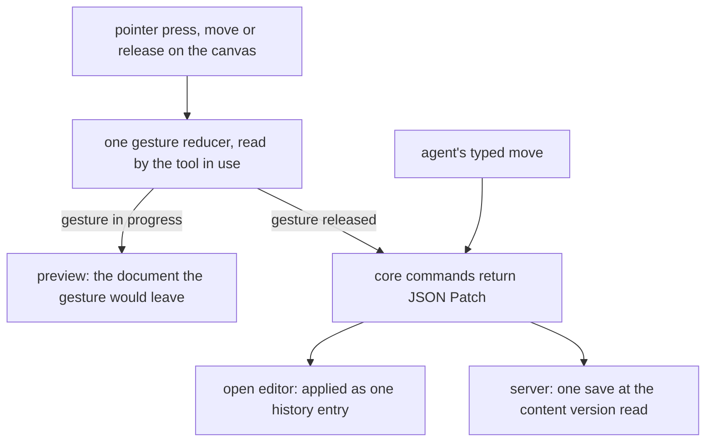
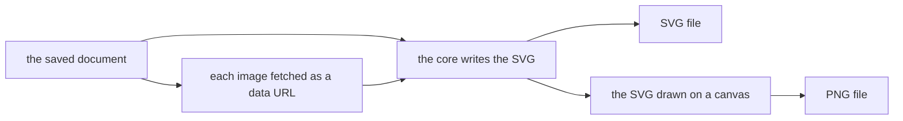

# Whiteboard

A whiteboard is a freeform canvas resource for sketching ideas and connected diagrams: shapes, arrows that bind to them, freehand strokes, text, images and sticky notes, drawn in a hand-drawn look by our own code with no third-party drawing engine. Its arrows bind to shapes and route between them the way a flowchart's connectors do. The document and the commands that edit it are the [positioned elements](../../vue-block-editor-headless/positioned-elements/design.md) model of the headless editor core.

## How it works

The editor opens on the saved document and draws it over a pannable, zoomable canvas, inside the editor shell that draws every editor's screen. The one toolbar holds every tool: select and hand, the shape slot with the basic shapes and the six flowchart shapes, arrow, freehand, text, sticky note, the image picker, and the lock that keeps a tool in hand. The toolbar floats over the top edge of the canvas on an expanded or medium window, and on a compact one it docks at the bottom edge, below the canvas. A shape, a text box or a sticky note is placed by choosing its tool and then clicking, which places the default size centred on the point, or dragging, which sizes it to the drag. The tool returns to select after one placement unless it is locked. The canvas is plain, with no grid, so a resize and a placement land where the pointer puts them, a move lands where the pointer puts it unless one of its edges or centre comes within the snap distance of another element's, and a keyboard nudge moves by its step. The view floats over the bottom edge of the canvas at every size class and holds undo, redo and zoom. A panel opens over the canvas for a selection, and is absent with nothing selected. Each element is drawn by its kind, in the order the document holds them, so the element list is the z-order.

Every gesture on the canvas goes to one reducer, which reads the tool in use and the press it started on. A gesture in progress is shown as a preview, the document the gesture would leave, and nothing is committed until the pointer is released. The release is one core command, which returns the JSON Patch that makes the edit. The open editor applies that patch to its edit state as one history entry, and the server applies the same patch when an agent moves an element, in one save at the content version the agent read.

An arrow is drawn with the arrow tool. A press on a shape's connection point, or on the shape near one, starts an arrow bound to that point, and a release on another shape's point binds the far end. A release on empty space, or on an annotation, leaves that end free. Each end takes its own arrowhead, a triangle, a diamond, a circle or a bar, or none, and the route is set in the properties panel: straight, curved or right-angled. Moving a shape reroutes each arrow bound to it in the same edit, so the move and the reroute undo as one step. A bound end follows its shape, a free end moves with a drag, and an arrow bound at both ends does not move. The properties panel detaches a bound end, which stays at its point as a free end. A selected arrow shows a handle on each free end, and a drag of one moves that end alone; a release on a shape binds the end to the connection point nearest the release, as drawing does, and a bound end shows no handle. A selected shape shows a connection handle at each of its four connection points, set a gap beyond the point so it is clear of the resize handles on the frame. A drag of one to empty canvas adds a shape of the same kind centred on the release, joined to the shape by an arrow from that connection point, and a release on another shape joins that shape by the arrow alone. Both are one edit. The handles show on the select tool, and an annotation shows no connection handle.

A double click on a shape, a sticky note or an arrow's label opens an inline editor over the element, drawn in the text's own font, size and wrap width with no box of its own. The canvas leaves the element's own text out while the editor is open, so the text is on screen once, as a drawing board shows it. A commit by blur or Enter writes one command, Escape discards the draft, and a commit made during input-method composition waits for the composition to end. A text wraps at its element's width by the core's rule, and an arrow's label sits at its route's midpoint, wrapped at a fixed label width.

Selection is a click, a Shift-click to add, or a marquee over the elements it fully covers. A selected element is framed by a solid frame in the accent that stands off its box by a fixed number of screen pixels at any zoom, and the marquee is a thin solid accent border around a faint tint. Neither is dashed, since a dashed frame beside a solid outline reads as one outline drawn half dotted. A selection shows a handle on each edge of its box and on its top-left and bottom-right corners, drawn as small squares. A selected element shows the handles its kind takes, so a text box shows its left and right ones and an arrow or a stroke none, and a selection of several shows the six around its box. A drag of a handle resizes the element, or scales each element of a selection about the side opposite the handle, as one edit. A drag that starts with Alt held copies the selection at its originals and moves the copies, which become the selection, as one edit. A right-click opens the board's own context menu: on an element it selects the element unless the selection holds it and lists the commands the selection takes, and on empty canvas it clears the selection and lists the board's commands, each item running what its shortcut runs. The keyboard commands are registered under one Whiteboard group: Delete and Backspace ask first, through a confirmation dialog, before they remove the selection, Escape clears it, the arrow keys nudge it with a larger step under Shift, Cmd+D duplicates it, Cmd+Z undoes the last edit, and Cmd+Shift+Z or Cmd+Y redoes it. A tool's key chooses the tool in hand, V for select, H for hand, A for arrow, P for freehand, T for text and N for a sticky note, and R, O and D choose the shape tool with a rectangle, an ellipse or a diamond. The panel for a selection of one element holds the style controls its element takes, its fill where it has one, its colour, its width and its dash pattern, then its stacking and the duplicate and delete buttons. A selection of several holds the fill they share, or Mixed where they differ, with the same two buttons.

A pasted image is uploaded as a file asset of its whiteboard, and the element keeps the file's id and no image bytes. A sticky note takes a fill from the properties panel and holds its text. A shape, a sticky note, an arrow, a text box and a freehand stroke take a colour, which an element with none draws in the page's text colour. A shape, a sticky note, an arrow and a freehand stroke take a width of thin, medium or bold, and a shape's or a sticky note's outline and an arrow's route take a dash pattern of solid, dashed or dotted. The canvas and the export draw each of these from one attribute function, so an element draws the same in both. A shape, a sticky note and an arrow take a sketch level of architect, artist or cartoonist, which sets how far its outline is hand-drawn, and a shape takes sharp or round corners, a round corner's radius growing with the shape up to a limit. A freehand stroke draws as a smooth curve through the points the pointer passed, its stored points unchanged. The canvas and the export take each outline and curve from one path function.

## Features

Each feature of the editor, and what the whiteboard does for it.

| Feature                                 | Whiteboard                                                                                                                                                                                                                                                                                                                                                                                                                                                         |
| --------------------------------------- | ------------------------------------------------------------------------------------------------------------------------------------------------------------------------------------------------------------------------------------------------------------------------------------------------------------------------------------------------------------------------------------------------------------------------------------------------------------------ |
| Process shape                           | the set's rectangle, drawn by the core's outline                                                                                                                                                                                                                                                                                                                                                                                                                   |
| Diagram shape set                       | terminal, process, decision, input/output, predefined process, annotation, each drawn by the core's outline                                                                                                                                                                                                                                                                                                                                                        |
| Annotation                              | a shape that takes no connection                                                                                                                                                                                                                                                                                                                                                                                                                                   |
| Shape label                             | text inside the shape, edited by double click                                                                                                                                                                                                                                                                                                                                                                                                                      |
| Shape fill                              | a fill the panel sets, or clears back to none; a new shape starts with none and a sticky note keeps its yellow fill                                                                                                                                                                                                                                                                                                                                                |
| Stroke colour                           | a colour in the panel on a shape, a sticky note, an arrow, a text box and a freehand stroke, empty for the page's text colour                                                                                                                                                                                                                                                                                                                                      |
| Stroke width                            | thin, medium or bold on a shape, a sticky note, an arrow and a freehand stroke, medium being the width each drew at before a width could be chosen                                                                                                                                                                                                                                                                                                                 |
| Dash pattern                            | solid, dashed or dotted on a shape's or a sticky note's outline and an arrow's route, solid until one is chosen; a freehand stroke stays solid                                                                                                                                                                                                                                                                                                                     |
| Sketch level                            | architect, artist or cartoonist on a shape, a sticky note and an arrow, artist until one is chosen: architect draws the outline straight, artist with the sketch an outline drew before a level could be chosen, and cartoonist with a larger one                                                                                                                                                                                                                  |
| Corners                                 | sharp or round on a shape, with no corners on an ellipse; a round corner's radius is a share of the shorter side, up to a limit                                                                                                                                                                                                                                                                                                                                    |
| Stroke smoothing                        | a freehand stroke drawn as one smooth curve through the points the pointer passed, with no control                                                                                                                                                                                                                                                                                                                                                                 |
| Shape resize                            | handles on each edge and on the two corners, with one minimum for every element; a text box shows its left and right handles only                                                                                                                                                                                                                                                                                                                                  |
| Resize several                          | the same handles around the box of a selection of several, each element scaled about the side opposite the handle in one edit, and the smallest element holding the minimum size                                                                                                                                                                                                                                                                                   |
| Duplicate by drag                       | Alt and a drag copies the selection at its originals and moves the copies, as one edit; the Duplicate key still copies with an offset                                                                                                                                                                                                                                                                                                                              |
| Object snapping                         | a moved shape, sticky note, text box or image snaps its edges and centre to the nearest edge, centre or edge midpoint of another element within six screen pixels, with a guide line while the drag runs; Alt held on a move leaves that move where the pointer is                                                                                                                                                                                                 |
| Align and distribute                    | a selection of two or more boxes aligned to the left, centre or right edge, or the top, middle or bottom edge, of its box, and of three or more distributed with equal gaps, horizontally or vertically; each is one edit, and a free arrow or stroke in the selection stays where it is                                                                                                                                                                           |
| Stacking                                | the selection moved forward, back, to the front or to the back in the panel, the context menu and the keys, keeping its order among itself, and each control disabled when the selection holds the element it would pass                                                                                                                                                                                                                                           |
| Placing                                 | the basic shapes, the six flowchart shapes, a sticky note and a text box, placed by choosing the tool and drawing                                                                                                                                                                                                                                                                                                                                                  |
| Image drop                              | an image file dropped on the canvas is uploaded as a file asset and centred on the point it lands on, as the picker and paste place an image centred on the view; a file that is not an image places nothing                                                                                                                                                                                                                                                       |
| Image alt text                          | each image holds alt text, set in the panel when the owner leaves the field or presses Enter, which names the image to assistive technology on the canvas and in the SVG export, with nothing drawn on the picture; empty until set                                                                                                                                                                                                                                |
| Palette                                 | not built: the kinds are the toolbar's, since a list beside the toolbar is a second place for the same elements                                                                                                                                                                                                                                                                                                                                                    |
| Connection points                       | four connection points per shape, numbered from the top clockwise                                                                                                                                                                                                                                                                                                                                                                                                  |
| Arrow and arrowhead                     | an arrowhead at each end, a triangle, diamond, circle or bar, or none, set for each end                                                                                                                                                                                                                                                                                                                                                                            |
| Arrow binds to shapes                   | an arrow binds each end to a connection point; an end drawn from empty space stays free                                                                                                                                                                                                                                                                                                                                                                            |
| Free end handle                         | a handle on each free end of a selected arrow, dragged alone and bound where it is released on a shape; a bound end shows none                                                                                                                                                                                                                                                                                                                                     |
| Connection handle                       | a handle at each connection point of a single selected shape: a drag to empty canvas adds a shape of the same kind joined by an arrow, and a release on another shape joins it; an annotation shows none                                                                                                                                                                                                                                                           |
| Path kinds                              | straight, curved or right-angled, computed by the core                                                                                                                                                                                                                                                                                                                                                                                                             |
| Right-angled routing                    | a right-angled route, with no obstacle avoidance                                                                                                                                                                                                                                                                                                                                                                                                                   |
| Arrow follows its shapes                | the move command reroutes bound arrows in the same patch                                                                                                                                                                                                                                                                                                                                                                                                           |
| Arrow label                             | text at the arrow's midpoint, edited by double click                                                                                                                                                                                                                                                                                                                                                                                                               |
| Text size                               | S, M, L or XL on the text of a shape, a sticky note, a text box and an arrow's label, S being the size text drew at before a size could be chosen                                                                                                                                                                                                                                                                                                                  |
| Text alignment                          | left, centre or right on a shape's, a sticky note's and a text box's text, top, middle or bottom on a shape's and a sticky note's, centred until one is chosen; an arrow's label stays centred at its midpoint                                                                                                                                                                                                                                                     |
| Auto width text box                     | a text box set to auto width is not wrapped and is as wide as its widest line, and a change of its width, from a width handle or a resize, sets it wrapped again at the width it is set to                                                                                                                                                                                                                                                                         |
| Live draft                              | the text being edited is laid out in its element's size, alignment and wrap as it is typed, so committing it does not move it                                                                                                                                                                                                                                                                                                                                      |
| Delete a shape                          | confirm; arrows bound only to it go with it                                                                                                                                                                                                                                                                                                                                                                                                                        |
| Delete an arrow                         | from the keyboard, with no panel control                                                                                                                                                                                                                                                                                                                                                                                                                           |
| Pan and zoom                            | the wheel pans, Ctrl or Cmd with the wheel and a pinch zoom about the pointer between 0.1 and 30, and Space with a drag pans                                                                                                                                                                                                                                                                                                                                       |
| Zoom and fit controls                   | zoom in and out, and fit to content, in the view beside undo and redo                                                                                                                                                                                                                                                                                                                                                                                              |
| Selection and multi-select              | single selection, Shift to add, and a marquee                                                                                                                                                                                                                                                                                                                                                                                                                      |
| Context menu                            | a right-click selects the element under the pointer and lists cut, copy, paste, duplicate, the stacking of the selection, edit text and delete; on empty canvas it lists paste, select all, zoom to fit and reset zoom                                                                                                                                                                                                                                             |
| Keyboard                                | Delete and Backspace ask before deleting, Enter commits a label, Escape clears, arrow keys nudge, Cmd+A selects every element, Cmd+C, Cmd+X and Cmd+V copy, cut and paste elements, Cmd+0 resets the zoom, Shift+1 and Shift+2 fit the content and the selection, Cmd+D, Cmd+Z, Cmd+Shift+Z and Cmd+Y, Cmd or Ctrl with [ and ] stack the selection, with Shift taking it to the ends, and V, H, A, P, T, N, R, O and D choose a tool, and Q toggles the tool lock |
| Undo and redo                           | the shared history over inverse patches, redone from the operations each entry holds, as buttons beside zoom and as keys                                                                                                                                                                                                                                                                                                                                           |
| Export PNG and SVG                      | both drawn from the model                                                                                                                                                                                                                                                                                                                                                                                                                                          |
| Export background and fonts             | the export draws the canvas background and each element's text from the model                                                                                                                                                                                                                                                                                                                                                                                      |
| Agent tools                             | the generic tools, plus a typed move that reroutes                                                                                                                                                                                                                                                                                                                                                                                                                 |
| Versions, recycle bin, tags, favourites | the generic resource layer, as for every type                                                                                                                                                                                                                                                                                                                                                                                                                      |

## Decisions

- **Text wraps by the core's one rule.** The editor's label draws the same lines the export draws, from one layout, so the canvas and the exported image break a text at the same words. The reason the rule is an estimate is in the [positioned elements](../../vue-block-editor-headless/positioned-elements/design.md) decisions. The alternative was to let the browser wrap the editor's text, which breaks it where the browser's font measures it, not where the export does.
- **Text sizes, alignments and auto width are fields of the element.** A text's size, its alignments and its wrap are fields of the element they belong to, and the one layout the export uses reads them, so the canvas, the overlay and the export place and break a text the same way. Rejected: a text style object beside the element, which the layout would have to join to each element on every draw.
- **The overlay is the live draft, and the canvas keeps the committed text out while it is edited.** The first plan drew the draft inside the element. The canvas already leaves an element's committed text out while its editor is open, so drawing the draft there would draw the text twice unless that hiding were undone. The overlay is the one visible copy, and it is placed by the layout the commit gives the text, so committing does not move it. Rejected: undoing the hiding, which the one visible copy depends on.
- **An unwrapped text box is as wide as its widest line, in the same edit as its text, size or wrap.** The commit stores the width the draft's placement uses, so the overlay and the committed text agree, and a size change or the auto width toggle sets the same width. A width handle on an auto width box sets it wrapped at the dragged width, since a box the owner sizes by hand is a wrapped one. Rejected: measuring the rendered text in the browser, which the export cannot read.
- **The typed move sits beside the generic patch.** An agent moves an element through `moveWhiteboardElement`, since a patch can set a shape's point but cannot compute the reroute of the arrows bound to it. The alternative was the generic patch alone, which moves the shape and leaves its arrows where they were until the editor opens.
- **One gesture reducer takes every gesture.** Each transition is a function over the document and the commands, so a test calls it without mounting the canvas and the component stays thin. The alternative was a handler per gesture inside the component, which would need a mounted canvas to test.
- **Shortcuts are registered commands.** Each key is a command in the Whiteboard group, so the palette and the shortcuts dialog list it. The alternative was a single keydown handler with its own switch, whose keys nothing lists.
- **Outlines are sketched by element.** Each point of an outline is offset by a value keyed on the element's id and its point's index, scaled by the element's sketch level, so the same element draws the same sketch on every render and the export matches the editor. The alternative was a random offset per draw, which would redraw a different sketch each time and differ from the export.
- **Sketch level is one control, and artist is today's sketch.** Architect draws no offset, artist the offset outlines draw today, and cartoonist a larger one, with each level's reach set beside the offset limit in the export constants. Architect is also the level that drops the sketch, so the rough-outline and sloppiness controls are one field, not a sketch switch beside a level that could disagree with it. Rejected: a free amplitude number, which the owner would have to tune.
- **Corners are sharp or round, and a round radius grows with the shape up to a limit.** A round corner curves by a share of the shorter side of the shape's box, capped, so a small shape keeps its corners and a large one does not round to a pill. The sketch moves the corners before they are rounded, so each corner curves once and does not jitter point by point. An ellipse has no corners and is never curved, and a sticky note is a card whose corners stay sharp.
- **A freehand stroke is smoothed along its stored points.** The curve is a quadratic through the midpoints between points, written in the export's path code, so the stored points stay as the pointer passed them and a stroke saved before the change draws smoothed with no rewrite. Rejected: the stroke library the reference uses, since the whiteboard takes no new third-party engine ([the rejected third-party engine](../../../rejected/resource/whiteboard-third-party-engine/design.md)), and smoothing the points when a stroke is drawn, which would change the stored document. A double stroke per outline and a smoothing toggle are rejected too: one sketch per outline is settled, and no row asks for a toggle.
- **The export is drawn from the model.** Neither format is captured from the page, so the files do not depend on the editor's theme or fonts.
- **An export survives an image that cannot be loaded.** The export leaves that image out of both files and alerts the owner with how many, so one dead image does not block the rest of the board from exporting. The alternative was to stop the export at the first failed fetch, which a single dead image would turn into a board that cannot be exported at all.
- **The wheel pans and a modifier zooms, about the pointer.** Ctrl or Cmd with the wheel, which a trackpad pinch also sends, zooms so the point under the pointer stays under it, and the zoom is held between 0.1 and 30. Rejected: a wheel that zooms with no modifier, which turns a trackpad's two-finger scroll into a zoom and leaves no way to pan by scrolling. The fit keys are registered as `shift+!` and `shift+@`, since the hotkey matches the produced key, as the existing `shift+?` is.
- **Copied elements travel as marked JSON text.** A copy writes the elements with a marker to the clipboard as plain text, a paste reads only text carrying the marker and adds offset copies with fresh ids and the arrows rebound among them, and the paste is the canvas's own paste event, so the image paste beside it is not swallowed. Rejected: an in-memory clipboard, which cannot cross two open boards.
- **The canvas is plain, and a move snaps only during its drag.** There is no dot grid and no snap setting, so a resize and a placement land where the pointer puts them. A move snaps each axis to the nearest edge, centre or edge midpoint of another element within six screen pixels, and a guide shows the alignment while the drag holds it. A snap is a pure function over the document and the proposed box, called by the move gesture, and the distance divides by the scale, so a zoomed-out board snaps no more eagerly than a zoomed-in one. Holding Alt on a move leaves that move where the pointer is, and the next move snaps again once Alt is released. Rejected: a dot grid with snap on by default, which put elements away from the pointer for a reason nothing on the canvas explained and drew noise behind freehand work, and keeping the snap with the grid hidden, which keeps the surprise and removes its only explanation. A distance in document units, which snaps from far away when zoomed out. A snap setting, which the "no snap" decision had no room for. The [object snapping change](../../../changes/archive/2026-11-12-resource-whiteboard-object-snapping/design.md) records the decision.
- **The palette is removed, and its kinds are the toolbar's.** The shapes sit in one slot, and the text box and the sticky note are tools beside the arrow, so the reader looks in one place for every element. Rejected: keeping the palette beside the toolbar, which is two places for one thing, and keeping its search, since the shape slot's menu needs none.
- **An element is placed by its tool and a click or a drag, not dragged out of a list.** A click places the default size centred on its point, and a drag sizes the element to the drag from the press. A placement returns the tool to select unless the tool is locked. Rejected: a drag from a list, which places only at a default size and needs the pointer to cross the canvas from the list's edge, and a click that places at the middle of the view, which the reader then drags to where it belongs.
- **The toolbar holds one value for the tool in hand.** A shape tool's value is the kind it places, so the shape slot binds to its kind and every other tool binds to the tool. A choice in the slot, or a shape key, sets both. Rejected: a second toolbar model for the kind, which the shell's toolbar would have to read beside the tool.
- **Redo is the shared history's redo.** The entry holds its operations beside their inverses, so a redo reapplies them through the same commit an edit takes, and a new edit clears the redo stack as the shared history does. Rejected: rebuilding a redo from the patch an undo returns, which would have to swap the entry the history moved onto the future stack.
- **Redo has two shortcuts, Cmd+Shift+Z and Cmd+Y.** The page builder and the sheet bind the same pair, so a reader finds redo under the chord their keyboard convention uses. Rejected: a redo with one shortcut, which a reader on the other keyboard convention would not find.
- **Edge handles are drawn beside the two corners.** Each resizable element and each selection of several shows its handles, so the reader sees where to grab. An edge handle moves its own side, and a corner moves the two sides it sits on. Rejected: edge hit zones with nothing drawn, which leave the grab points to be found by trial, the fault the verdict names.
- **Handles sit on the box, and the frame stands off them.** A handle is drawn and hit at its point on the box's own edge, so the frame's padding never moves the grab point. Rejected: handles on the frame, which would need the padding in the hit test.
- **A group scales about the side opposite the handle.** The side the reader did not grab holds still, and each element keeps its place relative to it. Rejected: scaling each element about its own centre, which moves the group's outer edge away from the handle the reader dragged.
- **An axis of no extent takes no scale and no handle.** A selection whose box has no height has no ratio to scale by, so it shows no top, bottom or corner handle. Rejected: a fixed scale on an empty axis, which would stretch a line out of nothing.
- **The smallest boxed element sets the limit.** The scale on each axis stops where the smallest element that takes a size on that axis reaches the minimum size, so no element of the group shrinks below it. A text box takes no limit on height, since its text sets its height and a scale never changes it, and a selection of arrows and strokes alone is limited by its own box. Rejected: each element clamping on its own, which would break the proportions between elements the reader sized together.
- **Arrows and strokes in a group scale with it.** A free arrow end and each stroke point scale about the same side, and a bound end follows its shape through the reroute the resize already makes. Rejected: leaving arrows and strokes in place, which would split them from the boxes they describe.
- **A resize reads the selection, not one element.** A handle's press holds no element, so a resize of one selected element stretches it and a resize of several scales them, both from the same press. Rejected: a separate gesture for a group, which would duplicate the press and the release.
- **An auto width text box is wrapped again only when its width changes.** A group scale that moves a text box along its height alone leaves its width as it was, so the box stays unwrapped. Rejected: wrapping on every resize, which would wrap a box the drag never widened.
- **Alt-drag copies at the originals.** The copies start where the originals are, so each moves under the pointer by the drag. Rejected: the offset copy the Duplicate key makes, which would leave the copy a fixed distance from the pointer.
- **The copies are made when the drag starts.** The copy identifiers are fixed at the press, each move previews the same operations over the document, and the release commits them as one edit. Rejected: copying on every move, which would add a copy for each pointer event.
- **Alt is read at the press.** A release of Alt during the drag does not change what the drag is. Rejected: reading Alt on each move, which would turn one drag into a copy and then a move.
- **A cancelled Alt drag restores the originals as the selection.** Its copies are never made, so the selection goes back to the elements it was. Rejected: keeping the copies selected after a cancel, which would select elements that do not exist.
- **An arrowhead is one kind per end, and the flag is gone.** Each end holds the arrowhead kind it draws, absent for an end with none, so there is one way to say whether an end has a head. The triangle is the head an arrow's new end takes, the head every arrow drew before a head could be chosen. Rejected: a second field for the new kinds beside the flag, which would leave two ways to say the same thing.
- **A connection handle stands a gap off its connection point, beyond the resize handle on the frame.** The gap is held in screen pixels, so it is the same at any zoom, and it is wider than the hit tolerance, so a press lands on one handle or the other and never on both. Rejected: a handle on the connection point itself, where the resize handle of the same edge would take the press first.
- **A dragged end and a connection release bind by the drawing rule, and the dragged arrow is left out of the hit.** An end released on a shape binds to the connection point nearest the release, as a drawn arrow does. The dragged arrow is left out of that hit, since its own line runs under the pointer where its end is released. Another arrow lying over the shape still takes the release, as it does when drawing. Rejected: a second binding rule for the drag, which would bind an end on one gesture and not on the other.
- **The flowchart helper's arrow points at the new shape and takes one arrowhead, at its far end.** The arrow leaves its source bare, as an arrow the tool draws does. Rejected: a head at both ends, which would read as a two-way link the helper does not mean.
- **The handles belong to a single selection.** A connection handle needs one selected shape and a free end handle one selected arrow, so a selection of several shows neither. Rejected: handles for a selection of several, which would show a handle beside each element with no single shape to join from.
- **An align and a distribute move boxes, through the move a drag uses.** Only the boxes take part, the shapes, sticky notes, images and text boxes that take a size, since a free arrow's end and a stroke's points are the reader's own drawing. Align lines each box up with the selection's box, so the boxes meet the outline they framed, and each box moves through the move a drag uses, so an arrow bound to it is rerouted in the same edit. Distribute keeps the outer two in place, the outer right one being the box that ends furthest even when another starts after it, and a selection in which one box starts no later and ends no earlier than every other has no outer pair, so distribute is disabled for it. Rejected for that case: keeping the spanning box in place, which places a middle box inside its span, and moving the spanning box, which the reader did not ask for and sets the gaps from the boxes' total extent, so the gaps are equal however the boxes differ in size. Rejected: aligning the bounds of every element, which moves a free arrow's end by a rule the reader never drew; a new align command in the core, which would copy the move and its reroute; aligning to the first element selected, which the selection does not record; and spacing the centres evenly, which gives unequal gaps when the boxes differ in size.
- **A control is disabled when it cannot act.** Align needs two boxes and distribute three, since two boxes share no gap, and either is also disabled when the boxes already lie as it would put them, and a stacking control is disabled when the selection holds the element it would pass: the top for bring forward and bring to front, the bottom for send backward and send to back. Rejected: a control that is enabled and does nothing.
- **A selection stacks by its own order, and its keys are the bracket keys.** Bring forward moves the element above each run of neighbouring selected elements beneath that run, and bring to front moves each selected element to the top in turn, so the selected elements keep their order among themselves and the elements that are not selected keep theirs. Rejected: moving each selected element one step on its own, which can swap two selected elements that sit side by side, and moving the element above the whole span beneath it, which reorders the unselected elements between a split selection's runs. Cmd or Ctrl with the closing bracket brings the selection forward, with the opening bracket sends it backward, and Shift takes it to the front or the back, as the reference does. The keys are bound only with a selection and not while the delete confirmation asks. Rejected: keys without a modifier, which would collide with the letter keys of the tools.
- **A dropped image is placed where it lands, through the insert a paste takes.** The drop passes the point it lands on to the same insert a paste uses, so a drop and a paste share one set of image types and one way of reporting an upload the server refuses. Rejected: centring a dropped image on the view, which would leave the reader moving each one to where it was dropped.
- **An image's alt text is a required string with no default.** Each stored image holds the field after its one-time rewrite, so the schema reads it as written, and a default would let an image parse without the rewrite. Rejected: an optional field, where a missing value and an empty one would mean the same thing in two ways. The [image alt text change](../../../changes/archive/2026-11-12-resource-whiteboard-canvas-input/design.md) records the decision.
- **Q toggles the tool lock as a registered command, through the store's toggle.** The toolbar's lock button and the key call the same toggle, so the two cannot disagree, and the shortcuts dialog lists the key. Rejected: a key on the lock button alone, which the shortcuts dialog would not list.

## Export

Both formats come from one SVG string, which the core writes from the saved document. Each image is fetched and embedded in the SVG as a data URL before the SVG is written, so the file stands alone. An image that cannot be fetched is left out of the document both files are drawn from, and the owner is alerted with how many were left out. The PNG is that SVG drawn onto a canvas and written out through the canvas's own blob export, with no dependency.

## Procedures

| Procedure                                       | Auth                                                  | Input                                                                     | Purpose                                                                                                                                                  |
| ----------------------------------------------- | ----------------------------------------------------- | ------------------------------------------------------------------------- | -------------------------------------------------------------------------------------------------------------------------------------------------------- |
| moveWhiteboardElement, on the whiteboard router | the key owner's whiteboard, under the Resources scope | the whiteboard id, the content version read, an element index and a point | moves the element, rerouting each arrow bound to a moved shape in the same write, and answers the new content version and the patch that undoes the move |

The whiteboard's other procedures are the generic resource procedures that every type gets, which read, patch and manage it. The move is the one write a whiteboard takes beside the generic patch.

## Failure and retry

A commit the document check refuses leaves the open document unchanged, and the owner is shown the error. A saved document that breaks the binding rules fails the same check when it is parsed, so the save is refused and nothing is written. A move or patch from an agent at a content version the whiteboard has since passed is refused, and the agent reads again. An export stops with an error when the canvas cannot write the PNG, and downloads nothing. An image that cannot be fetched does not stop it: the image is left out and reported.

## Not built

- **The editor and the PNG export have no browser check.** Their tests run without a browser, and the app has no browser suite that drives the canvas or saves a PNG from one (`.agents/skills/testing/references/test-environment.md`).
- **The PNG depends on the export embedding its images.** A PNG is correct only because each image is embedded as a data URL, since the rasteriser cannot load a remote image. An image that cannot be fetched is left out of both files, leaving a gap where it was; the Decisions section records why the export continues rather than stops.
- **The outline is one sketch, not two strokes.** The plan named two strokes for each outline. Each outline is one closed path, sketched point by point, so the look is a single line.
- **A freehand stroke has no pressure taper.** Its width is the one the owner chooses along its whole length, since the reference's taper is deferred.
- **Text wrapping is an estimate.** A line may draw wider or narrower than its box, because the rule wraps at estimated widths and no measurement corrects it.
- **No server writes an export.** The SVG writer is a pure function, but only the browser calls it, and an export is a download.
- **A freehand stroke has no dash pattern, and a selection of several sets its fill alone.** No row asks for dashes on a stroke, so it stays solid. A selection of several has no colour, width or dash control: each would need a Mixed value, as the fill has, and the panel for several is not designed past its fill and its arrangement.
- **The read-only published view is deferred.** It is [the deferred proposal](../../../deferred/resource/whiteboard-published-view/design.md) that settles the public route and the Publishable capability. The whiteboard declares no publish capability, so no public route exists for it.
- **Font families are not built.** Text draws in the sans-serif family, as every text did. A family needs bundled font files and a width measure the estimate does not give, so it is [the deferred font families](../../../deferred/resource/font-families/design.md).
- **Handles show no resize cursor.** The canvas sets no cursor for a handle, so the pointer does not change to show the direction a drag resizes in.
- **A group scale does not grow a text's font.** A scale changes a text box's width and leaves its text size as it is, since a text size is one of a fixed set and no row asks for a scaled one.
- **The handles have no browser check and no component test.** The hit tests and the handle lists the overlay draws from are unit tested, but the overlay that draws them is not run in a browser, as the editor is not.
- **Snapping covers a move alone.** A resize, a placement and a connection release do not snap, since the object snapping change scoped the snap to a move. The guides have no browser check and no component test, as the other overlays have none.
- **A selection of several images has no alt text control.** The panel for several holds its fill alone, so each image's alt text is set on its own panel.
- **The image drop has no browser check.** Its tests dispatch a drop with the files set on the event, so a drag from another window or page is not run in a browser, as the editor is not.

## Notes

- The rasteriser at `apps/web/app/services/capture/rasterizeSvg.ts` is shared with the dashboard's page image export, which draws its PNG through it.
- The type is one enum value. The value sits in the resource type enum, and no stored document is rewritten, since content is keyed by resource id and not by type.
- A stored element without a colour, width, dash pattern, sketch level, corners, text size or wrap reads the values it draws at today when it is parsed, so no stored document is rewritten: the page's text colour, medium width, solid, the artist sketch, sharp corners, the small text size and wrapped text. A stroke saved before the smoothing draws as a curve along the points it was saved with. A shape placed before the fill change keeps the white fill it was stored with, since a stored white cannot be told from a white the owner chose. An agent's `add` sets one of these fields on a stored element that lacks it, but a `replace` of it is refused with no such member, since the member is not stored yet. A text's alignment is not stored until one is chosen, so the first choice is an add, and a later one replaces it.
- Why the whiteboard is built on our own code and not on a third-party engine is recorded in the [rejected third-party engine](../../../rejected/resource/whiteboard-third-party-engine/design.md) idea.
- The resize handles, the Alt-drag copy, object snapping, and the align, distribute and selection stacking add no stored field, so no stored document changes. A snapped position is the element's ordinary position, so no backfill is needed. A copy takes fresh ids, as a duplicate does. The arrowhead field replaces the stored flag, so a stored arrow end still holding the flag fails its parse until it is rewritten. The one-time rewrite maps a true flag to the triangle and a false one to no arrowhead, and its dry runs on dev and prod found no stored arrow still holding a flag. The agent's arrow end is strict too, so a patch naming the flag is refused.
- A stored width is one of the three steps. The stroke width was narrowed from any positive number to thin, medium or bold, and an agent could have written a width outside them, so a one-time rewrite was owed to bring any to the nearest step, a tie to the thinner. Its dry runs on dev and prod found no stored element off a step, so nothing was rewritten.
- The image alt text adds a required field to a stored image, so a stored image without it fails its parse until its one-time rewrite sets it to the empty string. The rewrite is the [image alt text change](../../../changes/archive/2026-11-12-resource-whiteboard-canvas-input/design.md)'s, and it ran on dev, which held no image, and on prod, which held one, with a re-run on each reporting nothing left to change.

## Key files

| File                                                                               | Role                                                                                                                                                                                                      |
| :--------------------------------------------------------------------------------- | :-------------------------------------------------------------------------------------------------------------------------------------------------------------------------------------------------------- |
| `apps/web/shared/models/resource/whiteboard/WhiteboardResource.ts`                 | the whiteboard's content schema, the core's element list checked by the document refinement                                                                                                               |
| `apps/web/shared/models/resource/whiteboard/WhiteboardElement.ts`                  | the element schema the agent's description reads, with the arrow end's point marked read-only, its arrowhead described, and the end strict so an old flag fails the parse                                 |
| `apps/web/shared/models/db/resource/whiteboard/MoveWhiteboardElementInput.ts`      | the typed move's input: the content version read, the element index and the point                                                                                                                         |
| `apps/web/shared/services/resource/ResourceDefinitionMap.ts`                       | the whiteboard's definition, declaring the file assets and portable capabilities                                                                                                                          |
| `apps/web/app/services/resource/ResourceEditorComponentMap.ts`                     | maps the whiteboard to its async editor                                                                                                                                                                   |
| `apps/web/app/services/resource/ResourceTypeDescriptionMap.ts`                     | the whiteboard's description in the create flow                                                                                                                                                           |
| `apps/web/app/services/resource/PortableFormatMap.ts`                              | the PNG and SVG exports on the whiteboard's resource menu                                                                                                                                                 |
| `apps/web/app/components/Resource/Whiteboard/Editor.vue`                           | the editor: the editor shell over the whiteboard's layout and registry, with the canvas and the delete dialog                                                                                             |
| `apps/web/app/services/whiteboard/layout/constants.ts`                             | the whiteboard's layout: its regions, its panels keyed by selection kind, and the names its regions are announced by                                                                                      |
| `apps/web/app/services/whiteboard/layout/WhiteboardContentComponentMap.ts`         | the component each content key of the layout draws                                                                                                                                                        |
| `apps/web/app/services/whiteboard/layout/getWhiteboardSelectionKind.ts`            | the selection kind the layout's panels are keyed by: one element's type, several, or none                                                                                                                 |
| `apps/web/app/components/Resource/Whiteboard/EditorCanvas.vue`                     | the canvas, which takes the pointer, sends each pointer event with its modifier keys, Alt among them, and draws the elements in z-order, and takes a drop of image files at the point it lands            |
| `apps/web/app/components/Resource/Whiteboard/EditorSelection.vue`                  | the selection overlay: a frame around each selected element, a frame around a selection of several, the resize handles on its box, and on the select tool the connection handles and the free end handles |
| `apps/web/app/components/Resource/Whiteboard/EditorSnapGuides.vue`                 | draws the guides of a move in the canvas's overlay slot, above the elements, while the drag holds them                                                                                                    |
| `apps/web/app/components/Resource/Whiteboard/Element.vue`                          | draws one element by its kind                                                                                                                                                                             |
| `apps/web/app/components/Resource/Whiteboard/ElementArrow.vue`                     | draws an arrow along its route at its sketch level, in its colour, width and dash pattern, with each end's arrowhead in the same colour                                                                   |
| `apps/web/app/components/Resource/Whiteboard/ElementStickyNote.vue`                | draws a sticky note's box at its sketch level, in its colour, width and dash pattern, and its label                                                                                                       |
| `apps/web/app/components/Resource/Whiteboard/ElementStroke.vue`                    | draws a freehand stroke as one smooth curve through its points, in its colour and width                                                                                                                   |
| `apps/web/app/components/Resource/Whiteboard/ElementShape.vue`                     | draws a shape's outline at its sketch level and corners, in its colour, width and dash pattern, and its label                                                                                             |
| `apps/web/app/components/Resource/Whiteboard/Label.vue`                            | draws an element's wrapped text in its colour, size and alignment from the layout the export uses, and leaves it out while the element is edited in place                                                 |
| `apps/web/app/components/Resource/Whiteboard/ElementImage.vue`                     | draws an image from its file, with the role of an image, and the alt text as its name while it holds one                                                                                                  |
| `apps/web/app/components/Resource/Whiteboard/EditorPropertiesAltText.vue`          | the alt text field of an image, committed once when the owner leaves it or presses Enter, and shown as an undo changes it                                                                                 |
| `apps/web/app/services/whiteboard/createWhiteboardImageElement.ts`                 | the image element a placement creates, centred on a point, with empty alt text                                                                                                                            |
| `packages/vue-block-editor-headless/src/models/ImageElement.ts`                    | the image element: its file's id, its box and its alt text, which is required and has no default                                                                                                          |
| `packages/vue-block-editor-headless/src/services/export/toImageSvg.ts`             | draws an image in the SVG export, named by its alt text when it holds one, with the name escaped                                                                                                          |
| `apps/web/app/components/Resource/Whiteboard/EditorToolbar.vue`                    | the toolbar's items: every tool, the shape slot, the image picker and the lock, which lists its key                                                                                                       |
| `apps/web/app/components/Resource/Whiteboard/EditorControls.vue`                   | the view beside the canvas: undo, redo, zoom and fit to content                                                                                                                                           |
| `apps/web/app/components/Resource/Whiteboard/EditorPropertiesPanel.vue`            | the panel of one element: its fill where it has one, its colour, width and dash pattern, its sketch level and corners where it has them, its text controls where it has text, its stacking and the footer |
| `apps/web/app/components/Resource/Whiteboard/EditorPropertiesFill.vue`             | sets a shape's or a sticky note's fill, and a shape's clear back to none                                                                                                                                  |
| `apps/web/app/components/Resource/Whiteboard/EditorPropertiesStroke.vue`           | the colour, width and dash controls of one element, each one commit                                                                                                                                       |
| `apps/web/app/components/Resource/Whiteboard/EditorPropertiesSketch.vue`           | sets an element's sketch level, and a shape's corners unless it is an ellipse, each one commit                                                                                                            |
| `apps/web/app/components/Resource/Whiteboard/EditorPropertiesText.vue`             | sets an element's text size, and for a shape, a sticky note or a text box its horizontal alignment, a shape's or sticky note's vertical alignment, and a text box's auto width, each one commit           |
| `apps/web/app/components/Resource/Whiteboard/EditorPropertiesArrowPanel.vue`       | the panel of an arrow: its route and arrowheads, its colour, width, dash pattern, sketch level and label size, its stacking and the footer                                                                |
| `apps/web/app/components/Resource/Whiteboard/EditorPropertiesSeveralPanel.vue`     | the panel of a selection of several: the fill they share, or Mixed where they differ, then the align and distribute controls and the stacking                                                             |
| `apps/web/app/components/Resource/Whiteboard/EditorPropertiesFooter.vue`           | duplicates and deletes the selection from a panel, the delete asking first                                                                                                                                |
| `apps/web/app/components/Resource/Whiteboard/EditorPropertiesArrow.vue`            | an arrow's route, the arrowhead at each end, a box for each end's presence and a choice of its kind while it has one, and the detach of each bound end                                                    |
| `apps/web/app/components/Resource/Whiteboard/EditorPropertiesOrder.vue`            | the selection's stacking, which is one element's when one is selected: one step forward or back, or to the front or the back                                                                              |
| `apps/web/app/components/Resource/Whiteboard/EditorPropertiesArrange.vue`          | the align and distribute controls of a selection, each one edit, disabled below two boxes for align and three for distribute                                                                              |
| `apps/web/app/composables/whiteboard/useWhiteboardArrangeKeyboard.ts`              | registers the stacking keys, Cmd or Ctrl with the brackets and Shift taking the selection to the ends, bound only with a selection and not while the delete confirmation asks                             |
| `apps/web/app/services/whiteboard/arrange/getAlignOperations.ts`                   | the moves that line a selection's boxes up at one edge or centre of the selection's box, each through the move a drag uses                                                                                |
| `apps/web/app/services/whiteboard/arrange/getDistributeOperations.ts`              | the moves that space a selection's boxes with equal gaps, the outermost two in place                                                                                                                      |
| `apps/web/app/services/whiteboard/arrange/getStackOperations.ts`                   | the z-order moves that stack a selection one way, keeping its order, and none where the selection cannot move that way                                                                                    |
| `apps/web/app/services/whiteboard/arrange/getSelectedBoxes.ts`                     | the selected elements that take a size, each with its index and bounds, which align and distribute move                                                                                                   |
| `apps/web/app/services/whiteboard/arrange/constants.ts`                            | the fewest boxes an align takes, two, and a distribute takes, three                                                                                                                                       |
| `apps/web/app/models/whiteboard/AlignEdge.ts`                                      | the six edges and centres an align lines a selection up at                                                                                                                                                |
| `apps/web/app/models/whiteboard/DistributeAxis.ts`                                 | the horizontal and vertical axes a distribute spaces its boxes along                                                                                                                                      |
| `apps/web/app/models/whiteboard/StackMove.ts`                                      | the four stacking steps a selection takes: forward, back, to the front and to the back                                                                                                                    |
| `packages/vue-block-editor-headless/src/services/changePositionedElementZOrder.ts` | the core's z-order move, which the stacking controls commit as one edit                                                                                                                                   |
| `packages/vue-block-editor-headless/src/models/SketchLevel.ts`                     | the three sketch levels an outline takes: architect, artist and cartoonist                                                                                                                                |
| `packages/vue-block-editor-headless/src/models/CornerStyle.ts`                     | the sharp and round corner settings a shape takes                                                                                                                                                         |
| `packages/vue-block-editor-headless/src/services/export/toShapeOutlinePathData.ts` | a shape's outline as the canvas and the export both draw it: sketched at its level, then rounded at its corners when they are round                                                                       |
| `packages/vue-block-editor-headless/src/services/export/toRoundedPathData.ts`      | a closed outline with each corner curved, its radius cut to half of either side the corner joins                                                                                                          |
| `packages/vue-block-editor-headless/src/services/export/toSmoothedPathData.ts`     | a freehand stroke's smooth curve through its stored points                                                                                                                                                |
| `packages/vue-block-editor-headless/src/services/export/constants.ts`              | the sketch offset limit, the reach of each sketch level, and a round corner's radius share and limit                                                                                                      |
| `packages/vue-block-editor-headless/src/models/StrokeWidth.ts`                     | the three stroke widths an outline, an arrow and a freehand stroke draw at: thin, medium and bold                                                                                                         |
| `packages/vue-block-editor-headless/src/models/DashPattern.ts`                     | the solid, dashed and dotted patterns an outline or a route draws with                                                                                                                                    |
| `packages/vue-block-editor-headless/src/models/ElementColor.ts`                    | a colour as six hex digits, or empty for none: a shape's fill with none, or the page's text colour for an element's colour                                                                                |
| `packages/vue-block-editor-headless/src/models/export/StrokeAttributes.ts`         | the colour, width, dash array and cap a line draws with, the same on the canvas and in the export                                                                                                         |
| `packages/vue-block-editor-headless/src/services/export/getStrokeAttributes.ts`    | an element's stroke attributes from its colour, width and dash pattern, the one place the canvas and the export read                                                                                      |
| `packages/vue-block-editor-headless/src/services/export/toStrokeAttributesSvg.ts`  | the export's attribute text for a set of stroke attributes                                                                                                                                                |
| `packages/vue-block-editor-headless/src/services/getAutoTextWidthOperation.ts`     | the operation that sets an unwrapped text box's width to the width its text takes at a size                                                                                                               |
| `apps/web/app/services/whiteboard/palette/getDefaultColor.ts`                      | the colour an element draws in when it holds none: dark on a filled element and the page's text colour on an open one                                                                                     |
| `apps/web/app/services/whiteboard/palette/getElementStrokeAttributes.ts`           | an element's stroke attributes with its default colour, which the canvas elements draw their lines with                                                                                                   |
| `apps/web/app/services/whiteboard/gesture/checkIsDragStarted.ts`                   | whether a press has travelled far enough to be a drag, which the gesture reducers share                                                                                                                   |
| `apps/web/app/components/Resource/Whiteboard/EditorTextEdit.vue`                   | the inline text editor, which shows the draft in the text's own font, size, alignment and wrap over the element, and handles input-method composition                                                     |
| `apps/web/app/composables/whiteboard/useWhiteboardContextMenu.ts`                  | the right-click menu: settles the selection under the pointer, then opens the shared context menu with the selection's or the board's items                                                               |
| `apps/web/app/services/whiteboard/contextMenu/getWhiteboardContextMenuItems.ts`    | the two item lists, built from the commands the keyboard runs                                                                                                                                             |
| `apps/web/app/composables/whiteboard/useWhiteboardGesture.ts`                      | feeds the pointer events to the gesture reducer                                                                                                                                                           |
| `apps/web/app/composables/whiteboard/useWhiteboardKeyboard.ts`                     | registers the keyboard commands, the tool shortcuts, the tool lock's Q and the delete confirmation                                                                                                        |
| `apps/web/app/composables/whiteboard/useWhiteboardTextEdit.ts`                     | the in-place text edit, committed once on blur or Enter                                                                                                                                                   |
| `apps/web/app/composables/whiteboard/useInsertWhiteboardImages.ts`                 | uploads a pasted, picked or dropped image as a file asset and inserts its element, at the view's centre or at the point a drop lands                                                                      |
| `apps/web/app/services/whiteboard/gesture/reduceWhiteboardGesture.ts`              | the one gesture reducer, which dispatches to each gesture's transition, placing included                                                                                                                  |
| `apps/web/app/services/whiteboard/gesture/getArrowEnd.ts`                          | the end an arrow takes where a point lands: bound to a connection point, or free                                                                                                                          |
| `apps/web/app/services/whiteboard/gesture/getPressedHandle.ts`                     | the handle a press on the select tool lands on, of the resize handles, the connection handles and a free end, in that order                                                                               |
| `apps/web/app/services/whiteboard/gesture/getConnectionHandle.ts`                  | the connection handle a press lands on: a connection point of the one selected shape, which takes a connection                                                                                            |
| `apps/web/app/services/whiteboard/gesture/getConnectionHandlePoint.ts`             | the point a connection handle sits at: its connection point, set a gap beyond it in screen pixels                                                                                                         |
| `apps/web/app/services/whiteboard/gesture/getConnectionHandleItems.ts`             | the connection handles a single selected shape shows, each with its connection point and its drawn point                                                                                                  |
| `apps/web/app/services/whiteboard/gesture/getFreeEndHandle.ts`                     | the free end handle a press on a selected arrow's free end lands on                                                                                                                                       |
| `apps/web/app/services/whiteboard/gesture/getFreeEndHandleItems.ts`                | the free end handles a selected arrow shows, one for each end that is free                                                                                                                                |
| `apps/web/app/services/whiteboard/gesture/reduceConnectGesture.ts`                 | drags a connection handle: a release on empty canvas adds a shape of the source's kind, and a release on another shape joins it                                                                           |
| `apps/web/app/services/whiteboard/gesture/reduceEndGesture.ts`                     | drags a free arrow end, which is bound where it is released on a shape and left free on empty canvas                                                                                                      |
| `apps/web/app/services/whiteboard/gesture/getConnectOperations.ts`                 | the one edit a connection release makes: the arrow it joins, and the shape it adds on empty canvas, its arrow among them                                                                                  |
| `apps/web/app/services/whiteboard/gesture/getEndOperations.ts`                     | the move of a free end to its release, and its binding when the release lands on a shape                                                                                                                  |
| `apps/web/app/models/whiteboard/GestureConnecting.ts`                              | a connection handle's drag: its shape, its connection point, and the arrow and shape ids fixed at the press                                                                                               |
| `apps/web/app/models/whiteboard/GestureEnd.ts`                                     | a free end's drag: its arrow, which end it moves, and the press                                                                                                                                           |
| `packages/vue-block-editor-headless/src/models/ArrowheadKind.ts`                   | the four arrowhead kinds an end takes: triangle, diamond, circle and bar                                                                                                                                  |
| `packages/vue-block-editor-headless/src/services/export/getArrowheadPoints.ts`     | the corners of each arrowhead kind at its tip, opening back along the route                                                                                                                               |
| `apps/web/app/services/whiteboard/gesture/getStrokeOperations.ts`                  | the operations that add a freehand stroke as one element, in the page's text colour and medium width                                                                                                      |
| `apps/web/app/services/whiteboard/gesture/getResizeHandle.ts`                      | the handle a press lands on, corners first, of those the selection shows                                                                                                                                  |
| `apps/web/app/services/whiteboard/gesture/getSelectionResizeHandles.ts`            | the handles a selection shows around its box: none for an arrow or a stroke, the left and right ones for a text box, and only those the box has extent along                                              |
| `apps/web/app/services/whiteboard/gesture/getResizedSides.ts`                      | the sides of a box a handle moves: an edge moves its own side, and a corner the two it sits on                                                                                                            |
| `apps/web/app/services/whiteboard/gesture/getResizeHandlePoint.ts`                 | the point a handle sits at on a box, a corner or the middle of an edge                                                                                                                                    |
| `apps/web/app/services/whiteboard/gesture/getSelectionBounds.ts`                   | the box that covers the bounds of a selection's elements                                                                                                                                                  |
| `apps/web/app/services/whiteboard/gesture/getResizeOperations.ts`                  | the resize of one selected element by a delta from its handle, down to the minimum size                                                                                                                   |
| `apps/web/app/services/whiteboard/gesture/getScaleOperations.ts`                   | the scale of each element of a selection about the side opposite a handle, stopped where the smallest element reaches its minimum size                                                                    |
| `apps/web/app/services/whiteboard/gesture/getCopyMoveOperations.ts`                | an Alt drag's operations: the copies inserted at their originals, then each copy moved by the pointer's delta                                                                                             |
| `apps/web/app/services/whiteboard/gesture/reduceMovingGesture.ts`                  | the move gesture: each move snaps the moving boxes to the other elements unless Alt is held, holds the guides of the alignments on the gesture, and a release commits the shift as one edit               |
| `apps/web/app/services/whiteboard/gesture/getSnap.ts`                              | the snap of a move: the offset on each axis to the nearest edge, centre or edge midpoint of another element within the snap distance, and the guides of the alignments the snapped box holds              |
| `apps/web/app/services/whiteboard/gesture/getBoxedSelectionBounds.ts`              | the box of the selected elements that take a size, which is the box a move snaps; an arrow and a stroke are left out                                                                                      |
| `apps/web/app/models/whiteboard/SnapAxis.ts`                                       | the axis a guide is drawn on: X for a vertical line, Y for a horizontal one                                                                                                                               |
| `apps/web/app/models/whiteboard/SnapGuide.ts`                                      | a guide line: its axis, its position and the span it runs along the other axis                                                                                                                            |
| `apps/web/app/models/whiteboard/SnapResult.ts`                                     | a snap's offset on each axis and the guides it holds                                                                                                                                                      |
| `apps/web/app/services/whiteboard/edit/getCopyOperations.ts`                       | the operations that insert a copy of each original moved by an offset, shared by the duplicate and the Alt drag                                                                                           |
| `apps/web/app/services/whiteboard/edit/applyWhiteboardEdit.ts`                     | applies a command's operations to the edit state and records their inverse                                                                                                                                |
| `apps/web/app/services/whiteboard/edit/deleteWhiteboardElements.ts`                | deletes the selection through the core's delete                                                                                                                                                           |
| `apps/web/app/services/whiteboard/edit/duplicateWhiteboardElements.ts`             | copies the selection, rebinding a copied arrow's end to the copy of its shape when that shape is copied too                                                                                               |
| `apps/web/app/services/whiteboard/edit/undoWhiteboardEdit.ts`                      | undoes the last edit from the history                                                                                                                                                                     |
| `apps/web/app/services/whiteboard/edit/redoWhiteboardEdit.ts`                      | redoes the newest undone edit by reapplying its operations                                                                                                                                                |
| `apps/web/app/services/whiteboard/text/getTextEditOperations.ts`                   | the operation that writes an edited text, to which the core sets an unwrapped text box's width in the same edit                                                                                           |
| `apps/web/app/services/whiteboard/text/getDraftPlacement.ts`                       | the placement a text draws at while it is edited: the element's, with an unwrapped text box as wide as the draft's widest line                                                                            |
| `apps/web/app/services/whiteboard/text/constants.ts`                               | the text size and alignment choices the panel offers, and the maps that set the overlay editor over its anchor                                                                                            |
| `apps/web/app/services/whiteboard/keyboard/constants.ts`                           | the keyboard group's name and the nudge steps                                                                                                                                                             |
| `apps/web/app/services/whiteboard/tool/WhiteboardToolItemMap.ts`                   | the tools the toolbar chooses: each one's mark, title and key                                                                                                                                             |
| `apps/web/app/services/whiteboard/tool/WhiteboardShapeItemMap.ts`                  | the shapes the shape tool places, each with its mark, and the keys of the three that have one                                                                                                             |
| `apps/web/app/services/whiteboard/tool/constants.ts`                               | the shape slot the toolbar draws, the image types the picker accepts, and the key the tool lock is bound to                                                                                               |
| `apps/web/app/services/whiteboard/getWhiteboardElementTitle.ts`                    | the title a panel names one element by                                                                                                                                                                    |
| `apps/web/app/services/whiteboard/getSelectedElements.ts`                          | the elements a selection names, each with its index, for a panel of several                                                                                                                               |
| `apps/web/app/services/whiteboard/palette/constants.ts`                            | the size and fill each placed element starts with, the page's text colour an element with no colour draws in, and the arrowhead an arrow's new end takes                                                  |
| `apps/web/app/services/whiteboard/stroke/constants.ts`                             | the widths, dash patterns, sketch levels and corners the panel offers, each named as it reads                                                                                                             |
| `apps/web/app/services/whiteboard/viewport/getFitViewport.ts`                      | the viewport that fits the content to the canvas                                                                                                                                                          |
| `apps/web/app/services/whiteboard/export/exportWhiteboard.ts`                      | the export: the SVG download, or the PNG drawn from the same SVG, and the alert for images it left out                                                                                                    |
| `apps/web/app/services/whiteboard/export/getWhiteboardImageUrls.ts`                | fetches each image of the document as a data URL for the export, and names the ones it could not fetch                                                                                                    |
| `apps/web/app/services/capture/rasterizeSvg.ts`                                    | draws an SVG onto a canvas and writes the PNG, shared with the dashboard's page image export                                                                                                              |
| `apps/web/app/store/resource/whiteboard/index.ts`                                  | the open document, its edit state and history, its undo and redo, and the commit of each edit                                                                                                             |
| `apps/web/app/store/resource/whiteboard/editor.ts`                                 | the editor's view: the selection, the tool and its lock, the viewport and the gesture in progress                                                                                                         |
| `apps/web/app/store/resource/whiteboard/dialog.ts`                                 | the delete confirmation's target                                                                                                                                                                          |
| `apps/web/server/trpc/routers/whiteboard.ts`                                       | the whiteboard router, which holds the typed move beside the generic procedures                                                                                                                           |
| `apps/web/server/services/resource/whiteboard/moveWhiteboardElement.ts`            | the typed move: the core's move saved in one write at the content version read                                                                                                                            |
| `packages/db-schema/src/models/resource/ResourceType.ts`                           | the resource type enum, which holds the whiteboard                                                                                                                                                        |
| `packages/db-schema/src/models/resource/ResourceType.ts`                           | the resource type enum, which holds the whiteboard                                                                                                                                                        |
| `packages/db-schema/src/schema/resource/resourcesInResource.ts`                    | the whiteboard's entry, with no table of its own                                                                                                                                                          |
| `packages/db-schema/src/schema/resource/resourcesInResource.ts`                    | the resource type column the migration extends                                                                                                                                                            |

## Sources

- [Excalidraw](https://excalidraw.com/): a reference for how a whiteboard feels, the hand-drawn look, the three sketch levels, the rounded corners, the smoothed freehand line and the arrow behaviour the whiteboard matches in feel only. Its code and its packages are not used.
