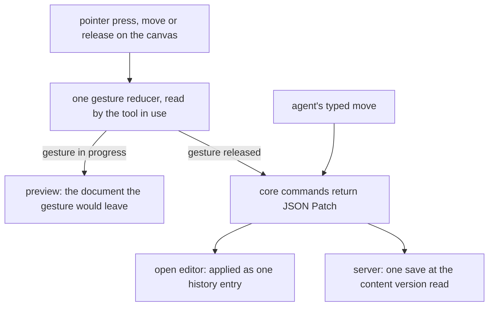
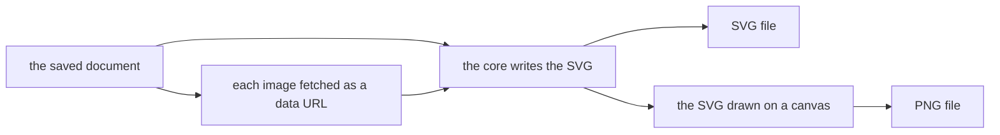

# Whiteboard

A whiteboard is a freeform canvas resource for sketching ideas and connected diagrams: shapes, arrows that bind to them, freehand strokes, text, images and sticky notes, drawn in a hand-drawn look by our own code with no third-party drawing engine. Its arrows bind to shapes and route between them the way a flowchart's connectors do. The document and the commands that edit it are the [positioned elements](../../headless-block-editor/positioned-elements/design.md) model of the headless editor core.

## How it works

The editor opens on the saved document and draws it over a pannable, zoomable canvas. The palette places the basic shapes, the six flowchart shapes and a sticky note, by a pointer drag or by a click that puts the element at the middle of the view. With snap on, which is the default, a move, a resize and a placement land on the dot grid behind the canvas, and the toolbar's toggle turns it off. Keyboard nudges move by their step without snapping, and the grid is not exported. The toolbar switches the tool between select, arrow, freehand and pan. Each element is drawn by its kind, in the order the document holds them, so the element list is the z-order.

Every gesture on the canvas goes to one reducer, which reads the tool in use and the press it started on. A gesture in progress is shown as a preview, the document the gesture would leave, and nothing is committed until the pointer is released. The release is one core command, which returns the JSON Patch that makes the edit. The open editor applies that patch to its edit state as one history entry, and the server applies the same patch when an agent moves an element, in one save at the content version the agent read.

An arrow is drawn with the arrow tool. A press on a shape's connection point, or on the shape near one, starts an arrow bound to that point, and a release on another shape's point binds the far end. A release on empty space, or on an annotation, leaves that end free. Each end takes its own arrowhead, and the route is set in the properties panel: straight, curved or right-angled. Moving a shape reroutes each arrow bound to it in the same edit, so the move and the reroute undo as one step. A bound end follows its shape, a free end moves with a drag, and an arrow bound at both ends does not move. The properties panel detaches a bound end, which stays at its point as a free end.

A double click on a shape, a sticky note or an arrow's label opens an inline editor over the element. A commit by blur or Enter writes one command, Escape discards the draft, and a commit made during input-method composition waits for the composition to end. A text wraps at its element's width by the core's rule, and an arrow's label sits at its route's midpoint, wrapped at a fixed label width.

Selection is a click, a Shift-click to add, or a marquee over the elements it fully covers. The keyboard commands are registered under one Whiteboard group: Delete and Backspace ask first, through a confirmation dialog, before they remove the selection, Escape clears it, the arrow keys nudge it with a larger step under Shift, Cmd+D duplicates it, and Cmd+Z undoes the last edit.

A pasted image is uploaded as a file asset of its whiteboard, and the element keeps the file's id and no image bytes. A sticky note takes a fill from the properties panel and holds its text.

## Gap analysis

The feature check that the [flowchart retirement](../../../changes/archive/2026-11-02-resource-flowchart-retirement/design.md) ran over the diagram type it removed, with the whiteboard's verdict on each row. The verdicts are **carried** (the whiteboard does it as the Flowchart did), **changed** (it does it differently, and the difference is named), **dropped** (it is not in the whiteboard), **not built** (the whiteboard does not yet do it), or **deferred**. The feature check reads each row's verdict from this table.

| Feature                                 | Retired type                                                                                                              | Whiteboard                                                                                                  | Verdict                                                    |
| --------------------------------------- | ------------------------------------------------------------------------------------------------------------------------- | ----------------------------------------------------------------------------------------------------------- | ---------------------------------------------------------- |
| Process node                            | one rectangle node with a label                                                                                           | the process shape, the rectangle of the set                                                                 | carried                                                    |
| Diagram shape set                       | one rectangle; the six shapes were proposed in a [rejected change](../../../rejected/resource/flowchart-shapes/design.md) | terminal, process, decision, input/output, predefined process, annotation, each drawn by the core's outline | carried                                                    |
| Annotation                              | not present                                                                                                               | a shape that takes no connection                                                                            | carried                                                    |
| Node label                              | inline edit, from the panel and by double click                                                                           | text inside the shape, edited by double click                                                               | carried                                                    |
| Node colour                             | background colour in the panel                                                                                            | fill colour in the panel                                                                                    | carried                                                    |
| Node resize                             | handles with a minimum size                                                                                               | handles, with one minimum for every element                                                                 | changed: one minimum for every element                     |
| Palette                                 | a sidebar of node types dragged onto the canvas                                                                           | the same sidebar, placed by a pointer drag or a click                                                       | changed: no native drag and drop                           |
| Connection points                       | four handles per node                                                                                                     | four connection points per shape, numbered from the top clockwise                                           | carried                                                    |
| Connector and arrowhead                 | an arrowhead at the end, closed by default                                                                                | an arrowhead at either end, set for each end                                                                | changed: both ends                                         |
| Connector binds to shapes               | an edge joins two nodes' handles                                                                                          | an arrow binds each end to a connection point; an end drawn from empty space stays free                     | carried                                                    |
| Path kinds                              | curved, right-angled, straight                                                                                            | the same three, computed by the core                                                                        | carried                                                    |
| Right-angled routing                    | steps between handles, with no obstacle avoidance                                                                         | the same rule, with no obstacle avoidance                                                                   | carried: neither avoids obstacles                          |
| Edge follows its shapes                 | the engine redraws joined edges                                                                                           | the move command reroutes bound arrows in the same patch                                                    | changed: the reroute is in the command's patch             |
| Edge label                              | inline edit at the path's midpoint                                                                                        | text at the arrow's midpoint, edited by double click                                                        | carried                                                    |
| Delete a node                           | confirm; its joined edges go with it                                                                                      | confirm; arrows bound only to it go with it                                                                 | carried                                                    |
| Delete a connector                      | from the panel                                                                                                            | from the keyboard, with no panel control                                                                    | changed: keyboard only                                     |
| Pan and zoom                            | the engine's viewport                                                                                                     | the editor's own viewport                                                                                   | carried                                                    |
| Zoom and fit controls                   | controls at the bottom left                                                                                               | zoom in and out, and fit to content                                                                         | carried                                                    |
| Background grid and snap                | background dots; shapes snap to the grid                                                                                  | a dot grid behind the canvas, and moves, resizes and placements snap to it                                  | carried                                                    |
| MiniMap                                 | a plugin in the editor and in the published view                                                                          | none                                                                                                        | dropped                                                    |
| Selection and multi-select              | the engine's single selection                                                                                             | single selection, Shift to add, and a marquee                                                               | carried, extended                                          |
| Keyboard                                | Backspace removes the selection, unnamed on screen; Enter commits a label                                                 | Delete and Backspace delete, Enter commits a label, Escape clears, arrow keys nudge, Cmd+D and Cmd+Z        | carried, extended                                          |
| Undo                                    | not in the files inspected                                                                                                | the shared history over inverse patches                                                                     | new                                                        |
| Export PNG and SVG                      | the editor's DOM is captured and rasterised                                                                               | both drawn from the model                                                                                   | changed                                                    |
| Export background and fonts             | the captured DOM carries the theme background and the editor's font                                                       | the export draws the canvas background and each element's text from the model                               | changed: the model draws it                                |
| Read-only published view                | read-only, with pan, zoom and the minimap                                                                                 | not built; deferred to its own later proposal                                                               | deferred                                                   |
| Stored content                          | the canvas engine's own node and edge JSON                                                                                | none; the whiteboard does not read it                                                                       | cannot carry, and not converted: the retirement deletes it |
| Earned achievement                      | the achievement the type earned                                                                                           | removed with the type, by the retirement                                                                    | removed by decision                                        |
| Agent tools                             | the generic tools over the content schema                                                                                 | the generic tools, plus a typed move that reroutes                                                          | carried, extended                                          |
| Versions, recycle bin, tags, favourites | the generic resource layer                                                                                                | the same                                                                                                    | carried                                                    |

## Decisions

- **Text wraps by the core's one rule.** The editor's label draws the same lines the export draws, from one layout, so the canvas and the exported image break a text at the same words. The reason the rule is an estimate is in the [positioned elements](../../headless-block-editor/positioned-elements/design.md) decisions. The alternative was to let the browser wrap the editor's text, which breaks it where the browser's font measures it, not where the export does.
- **The typed move sits beside the generic patch.** An agent moves an element through `moveWhiteboardElement`, since a patch can set a shape's point but cannot compute the reroute of the arrows bound to it. The alternative was the generic patch alone, which moves the shape and leaves its arrows where they were until the editor opens.
- **One gesture reducer takes every gesture.** Each transition is a function over the document and the commands, so a test calls it without mounting the canvas and the component stays thin. The alternative was a handler per gesture inside the component, which would need a mounted canvas to test.
- **Shortcuts are registered commands.** Each key is a command in the Whiteboard group, so the palette and the shortcuts dialog list it. The alternative was a single keydown handler with its own switch, whose keys nothing lists.
- **Outlines are sketched by element.** Each point of an outline is offset by a value keyed on the element's id and its point's index, so the same element draws the same sketch on every render and the export matches the editor. The alternative was a random offset per draw, which would redraw a different sketch each time and differ from the export.
- **The export is drawn from the model.** Neither format is captured from the page, so the files do not depend on the editor's theme or fonts. The retired type captured the page's DOM.
- **An export survives an image that cannot be loaded.** The export leaves that image out of both files and alerts the owner with how many, so one dead image does not block the rest of the board from exporting. The alternative was to stop the export at the first failed fetch, which a single dead image would turn into a board that cannot be exported at all.
- **Snapping happens in document units, not in screen pixels.** A move, a resize and a placement round the document point they land on to the grid, so the same edit lands on the same grid point at every zoom. Rejected: pixel snapping, which rounds the screen point and so puts the same drag on different grid lines at each zoom.

## Export

Both formats come from one SVG string, which the core writes from the saved document. Each image is fetched and embedded in the SVG as a data URL before the SVG is written, so the file stands alone. An image that cannot be fetched is left out of the document both files are drawn from, and the owner is alerted with how many were left out. The PNG is that SVG drawn onto a canvas and written out through the canvas's own blob export, with no dependency.

## Procedures

| Procedure                                       | Auth                                                  | Input                                                                     | Purpose                                                                                                                                                  |
| ----------------------------------------------- | ----------------------------------------------------- | ------------------------------------------------------------------------- | -------------------------------------------------------------------------------------------------------------------------------------------------------- |
| moveWhiteboardElement, on the whiteboard router | the key owner's whiteboard, under the Resources scope | the whiteboard id, the content version read, an element index and a point | moves the element, rerouting each arrow bound to a moved shape in the same write, and answers the new content version and the patch that undoes the move |

The whiteboard's other procedures are the generic resource procedures that every type gets, which read, patch and manage it. The move is the one write a whiteboard takes beside the generic patch.

## Failure and retry

A commit the document check refuses leaves the open document unchanged, and the owner is shown the error. A saved document that breaks the binding rules fails the same check when it is parsed, so the save is refused and nothing is written. A move or patch from an agent at a content version the whiteboard has since passed is refused, and the agent reads again. An export stops with an error when the canvas cannot write the PNG, and downloads nothing. An image that cannot be fetched does not stop it: the image is left out and reported.

## Not built

- **The editor and the PNG export have no browser check.** Their tests run without a browser, and the app has no browser suite that drives the canvas or saves a PNG from one (`.agents/skills/testing/references/test-environment.md`).
- **The PNG depends on the export embedding its images.** A PNG is correct only because each image is embedded as a data URL, since the rasteriser cannot load a remote image. An image that cannot be fetched is left out of both files, leaving a gap where it was; the Decisions section records why the export continues rather than stops.
- **The outline is one sketch, not two strokes.** The plan named two strokes for each outline. Each outline is one closed path, sketched point by point, so the look is a single line.
- **Strokes are not smoothed.** A freehand stroke is a polyline through the points the pointer passed, sampled as it moves.
- **Text wrapping is an estimate.** A line may draw wider or narrower than its box, because the rule wraps at estimated widths and no measurement corrects it.
- **No server writes an export.** The SVG writer is a pure function, but only the browser calls it, and an export is a download.
- **The read-only published view is deferred.** It is [the deferred proposal](../../../deferred/resource/whiteboard-published-view/design.md) that settles the public route and the Publishable capability. The whiteboard declares no publish capability, so no public route exists for it.

## Notes

- The rasteriser at `apps/web/app/services/capture/rasterizeSvg.ts` is shared with the dashboard's page image export, which draws its PNG through it.
- The type is one enum value. Its migration adds the value to the resource type enum, and no stored document is rewritten, since content is keyed by resource id and not by type.
- Why the whiteboard is built on our own code and not on a third-party engine is recorded in the [rejected third-party engine](../../../rejected/resource/whiteboard-third-party-engine/design.md) idea.

## Key files

| File                                                                                  | Role                                                                                                        |
| ------------------------------------------------------------------------------------- | ----------------------------------------------------------------------------------------------------------- |
| `apps/web/shared/models/resource/whiteboard/WhiteboardResource.ts`                    | the whiteboard's content schema, the core's element list checked by the document refinement                 |
| `apps/web/shared/models/resource/whiteboard/WhiteboardElement.ts`                     | the element schema the agent's description reads, with the arrow end's point marked read-only               |
| `apps/web/shared/models/db/resource/whiteboard/MoveWhiteboardElementInput.ts`         | the typed move's input: the content version read, the element index and the point                           |
| `apps/web/shared/services/resource/ResourceDefinitionMap.ts`                          | the whiteboard's definition, declaring the file assets and portable capabilities                            |
| `apps/web/app/services/resource/ResourceEditorComponentMap.ts`                        | maps the whiteboard to its async editor                                                                     |
| `apps/web/app/services/resource/ResourceTypeDescriptionMap.ts`                        | the whiteboard's description in the create flow                                                             |
| `apps/web/app/services/resource/PortableFormatMap.ts`                                 | the PNG and SVG exports on the whiteboard's resource menu                                                   |
| `apps/web/app/components/Resource/Whiteboard/Editor.vue`                              | the editor: the canvas, the palette, the properties panel and the delete dialog                             |
| `apps/web/app/components/Resource/Whiteboard/EditorCanvas.vue`                        | the canvas, which takes the pointer and draws the elements in z-order                                       |
| `apps/web/app/components/Resource/Whiteboard/Element.vue`                             | draws one element by its kind                                                                               |
| `apps/web/app/components/Resource/Whiteboard/ElementArrow.vue`                        | draws an arrow along its route, with an arrowhead at each end that has one                                  |
| `apps/web/app/components/Resource/Whiteboard/ElementShape.vue`                        | draws a shape's sketched outline and its label                                                              |
| `apps/web/app/components/Resource/Whiteboard/Label.vue`                               | draws an element's wrapped text from the layout the export uses                                             |
| `apps/web/app/components/Resource/Whiteboard/EditorPaletteItem.vue`                   | a palette item, placed by a pointer drag or a click                                                         |
| `apps/web/app/components/Resource/Whiteboard/EditorPropertiesArrow.vue`               | an arrow's route, the arrowhead at each end, and the detach of each bound end                               |
| `apps/web/app/components/Resource/Whiteboard/EditorPropertiesOrder.vue`               | the selected element's stacking: one step forward or back, or to the front or the back                      |
| `packages/headless-block-editor/src/services/changePositionedElementZOrder.ts`        | the core's z-order move, which the stacking controls commit as one edit                                     |
| `apps/web/app/components/Resource/Whiteboard/EditorToolbar.vue`                       | the tool switch and the snap toggle that turns grid snapping on and off                                     |
| `apps/web/app/components/Resource/Whiteboard/EditorTextEdit.vue`                      | the inline text editor, which handles input-method composition                                              |
| `apps/web/app/composables/whiteboard/useWhiteboardGesture.ts`                         | feeds the pointer events to the gesture reducer                                                             |
| `apps/web/app/composables/whiteboard/useWhiteboardKeyboard.ts`                        | registers the keyboard commands and the delete confirmation                                                 |
| `apps/web/app/composables/whiteboard/useWhiteboardTextEdit.ts`                        | the in-place text edit, committed once on blur or Enter                                                     |
| `apps/web/app/composables/whiteboard/useInsertWhiteboardImages.ts`                    | uploads a pasted image as a file asset and inserts its element                                              |
| `packages/headless-block-editor/src/services/snapToGrid.ts`                           | rounds a value to the nearest grid line, which a move, a resize and a placement snap to                     |
| `apps/web/app/services/whiteboard/gesture/reduceWhiteboardGesture.ts`                 | the one gesture reducer, which dispatches to each gesture's transition                                      |
| `apps/web/app/services/whiteboard/gesture/getArrowEnd.ts`                             | the end an arrow takes where a point lands: bound to a connection point, or free                            |
| `apps/web/app/services/whiteboard/gesture/getStrokeOperations.ts`                     | the operations that add a freehand stroke as one element                                                    |
| `apps/web/app/services/whiteboard/edit/applyWhiteboardEdit.ts`                        | applies a command's operations to the edit state and records their inverse                                  |
| `apps/web/app/services/whiteboard/edit/deleteWhiteboardElements.ts`                   | deletes the selection through the core's delete                                                             |
| `apps/web/app/services/whiteboard/edit/duplicateWhiteboardElements.ts`                | copies the selection, rebinding a copied arrow's end to the copy of its shape when that shape is copied too |
| `apps/web/app/services/whiteboard/edit/undoWhiteboardEdit.ts`                         | undoes the last edit from the history                                                                       |
| `apps/web/app/services/whiteboard/text/getTextEditOperations.ts`                      | the operation that writes an edited text                                                                    |
| `apps/web/app/services/whiteboard/keyboard/constants.ts`                              | the keyboard group's name and the nudge steps                                                               |
| `apps/web/app/services/whiteboard/palette/constants.ts`                               | the palette's groups and the size and fill each placed element starts with                                  |
| `apps/web/app/services/whiteboard/viewport/getFitViewport.ts`                         | the viewport that fits the content to the canvas                                                            |
| `apps/web/app/services/whiteboard/export/exportWhiteboard.ts`                         | the export: the SVG download, or the PNG drawn from the same SVG, and the alert for images it left out      |
| `apps/web/app/services/whiteboard/export/getWhiteboardImageUrls.ts`                   | fetches each image of the document as a data URL for the export, and names the ones it could not fetch      |
| `apps/web/app/services/capture/rasterizeSvg.ts`                                       | draws an SVG onto a canvas and writes the PNG, shared with the dashboard's page image export                |
| `apps/web/app/store/resource/whiteboard/index.ts`                                     | the open document, its edit state and history, and the commit of each edit                                  |
| `apps/web/app/store/resource/whiteboard/editor.ts`                                    | the editor's view: the selection, the tool, the viewport and the gesture in progress                        |
| `apps/web/app/store/resource/whiteboard/dialog.ts`                                    | the delete confirmation's target                                                                            |
| `apps/web/server/trpc/routers/whiteboard.ts`                                          | the whiteboard router, which holds the typed move beside the generic procedures                             |
| `apps/web/server/services/resource/whiteboard/moveWhiteboardElement.ts`               | the typed move: the core's move saved in one write at the content version read                              |
| `apps/web/server/db/migrations/20261102082233_whiteboard_resource_type/migration.sql` | adds the whiteboard value to the resource type enum                                                         |
| `packages/db-schema/src/models/resource/ResourceType.ts`                              | the resource type enum, which holds the whiteboard                                                          |
| `packages/db-schema/src/services/resource/ResourceOwnedTablesMap.ts`                  | the whiteboard's entry, with no table of its own                                                            |
| `packages/db-schema/src/schema/resource/resourcesInResource.ts`                       | the resource type column the migration extends                                                              |

## Sources

- [Excalidraw](https://excalidraw.com/): a reference for how a whiteboard feels, the hand-drawn look and the arrow behaviour the whiteboard matches in feel only. Its code and its packages are not used.
