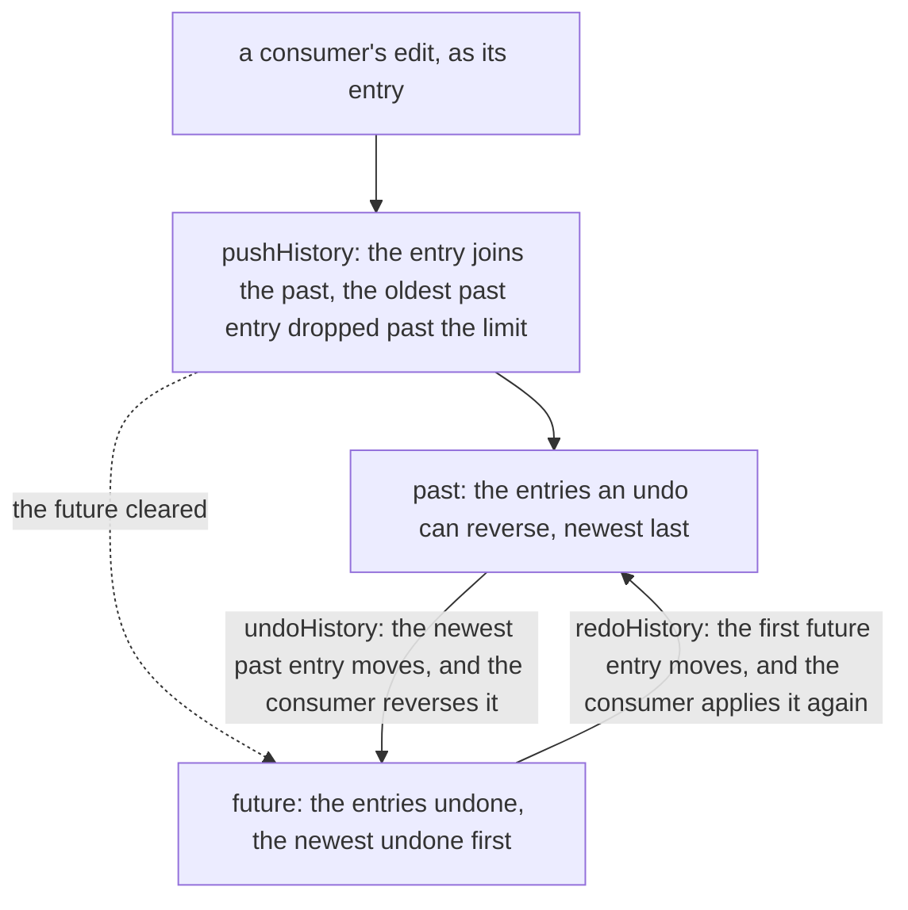

# Bounded history

The undo and redo stack in `@esposter/shared`: a history holds the entries an undo can reverse, and the entries an undo has reversed, within a limit its consumer passes. It has two consumers: the editor core's documents, whose edits the page builder records as inverse patches [for each open resource](../../resource/page-builder/undo-as-patches/design.md), and the sheet's commands, whose `useSheetHistoryStore` holds command objects as its entries. The stack is generic over its entry, so the core does not own it and the sheet does not depend on a block editor to undo.

## How an entry moves

## Decisions

- **The stack is a value, generic over its entry.** `pushHistory`, `undoHistory` and `redoHistory` return a new history rather than changing one, and undo and redo return the entry they moved, so the consumer applies it. A new entry clears the future. A redo puts its entry back on the past and keeps the rest of the future, so the redo order is the reverse of the undo order.
- **The bound is the consumer's.** `createHistory` takes the limit, and the sheet passes its own `MAX_HISTORY_SIZE`, so the stack carries no default that a consumer would have to know about.
- **An empty side is a no-op.** Undo with nothing in the past, or redo with nothing in the future, returns the history unchanged and no entry, so a consumer applies nothing.
- **One copy of the stack, in `@esposter/shared`.** Both consumers need an undo stack, so the package holds the one copy and each consumer imports it, unchanged from where the core kept it. Rejected: a sheet that imports the block editor to undo, which ties its stacks to an editor package.

## Key files

| File                                                    | Role                                                                            |
| ------------------------------------------------------- | ------------------------------------------------------------------------------- |
| `packages/shared/src/models/history/History.ts`         | the history: the past, the future and the limit                                 |
| `packages/shared/src/models/history/HistoryStep.ts`     | the entry a step moved, and the history after it                                |
| `packages/shared/src/services/history/createHistory.ts` | an empty history bounded by the limit its consumer passes                       |
| `packages/shared/src/services/history/pushHistory.ts`   | a new entry joins the past, the future cleared, the oldest past entry dropped   |
| `packages/shared/src/services/history/undoHistory.ts`   | the newest past entry moves onto the future                                     |
| `packages/shared/src/services/history/redoHistory.ts`   | the first future entry moves back onto the past, the rest of the future is kept |
| `apps/web/app/store/resource/sheet/history/index.ts`    | the sheet's history store over this stack, with its command objects as entries  |

## Notes

- **The page builder keeps one stack per open resource.** The stacks are the page builder's own, in its store, [as its undo change designs them](../../resource/page-builder/undo-as-patches/design.md); this capability holds one stack and no map of them.
