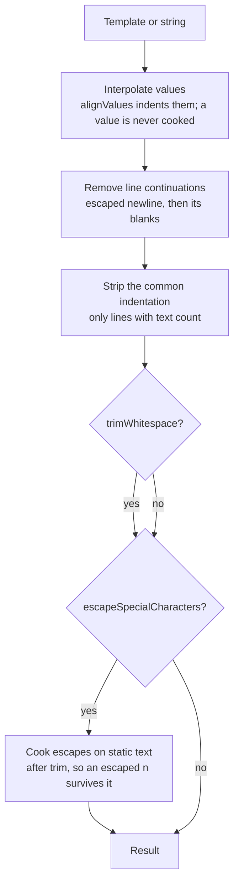

# dedent

`packages/shared/src/util/text/dedent.ts` (exported as `dedent` from `@esposter/shared`) strips the common indentation of a multi-line template and returns the text. It is the rewrite of the npm package `dedent`, absorbed because it is a small utility that its callers do not need a dependency for, and it is built as ESM with every upstream issue audited (the table below).

## How a call is answered

- **Escapes apply to the template's own text only.** The escape pass runs over the static parts of a template, after the indentation is stripped and the whitespace trimmed, so an escaped newline at the end survives the trim and a backslash inside an interpolated value is never read as an escape. That is the part a hand-rolled version gets wrong, and the table's defects are the cases it got wrong upstream.
- **Escapes are the ones a template author writes on purpose.** The cooked forms are the backslash, backtick, dollar and opening-brace escapes, the single-letter escapes n, t, r, v, b, f and 0, and the hex and Unicode forms. Anything else, such as an escaped closing brace, is kept as typed, as upstream keeps it. A code point past 10FFFF is kept as typed rather than thrown.
- **A string call is not a template.** `dedent("…")` takes its argument as raw text, so its escapes are kept unless `escapeSpecialCharacters` is set.

## Options

| Option                    | Default                                     | Effect                                                                                                |
| :------------------------ | :------------------------------------------ | :---------------------------------------------------------------------------------------------------- |
| `escapeSpecialCharacters` | `true` for a template, `false` for a string | Cook the escapes described above                                                                      |
| `trimWhitespace`          | `true`                                      | Trim the leading and trailing whitespace of the result                                                |
| `alignValues`             | `false`                                     | Indent each line of an interpolated multi-line value to the indentation of the line it is inserted on |

`dedent.withOptions({ … })` returns a new tag with the options merged over the current ones.

## Upstream

Every issue and pull request in `dmnd/dedent` has one verdict. A "fixed upstream, pinned" row is a defect the upstream `1.7.2` package already passes, so the test stays as the pin; an "In scope" defect's test fails against the upstream package first.

| Upstream                                          | Verdict                                      | Proof                                                                              |
| :------------------------------------------------ | :------------------------------------------- | :--------------------------------------------------------------------------------- |
| [#1](https://github.com/dmnd/dedent/issues/1)     | False positive — usage                       | can be used as a function                                                          |
| [#2](https://github.com/dmnd/dedent/issues/2)     | False positive — fixed upstream, pinned      | string tag character escapes > escapes backticks                                   |
| [#3](https://github.com/dmnd/dedent/issues/3)     | False positive — fixed upstream, pinned      | works with blank first line                                                        |
| [#4](https://github.com/dmnd/dedent/issues/4)     | False positive — fixed upstream, pinned      | doesn't strip explicit newlines                                                    |
| [#5](https://github.com/dmnd/dedent/issues/5)     | Out of scope — packaging (superseded by ESM) | owner: `packages/shared` build (tsdown, ESM)                                       |
| [#6](https://github.com/dmnd/dedent/issues/6)     | False positive — fixed upstream, pinned      | works with multiple blank first lines                                              |
| [#7](https://github.com/dmnd/dedent/issues/7)     | False positive — docs                        | example only, no behaviour                                                         |
| [#8](https://github.com/dmnd/dedent/issues/8)     | False positive — fixed upstream, pinned      | works with removing same number of spaces                                          |
| [#9](https://github.com/dmnd/dedent/issues/9)     | False positive — fixed upstream, pinned      | works with removing same number of spaces                                          |
| [#10](https://github.com/dmnd/dedent/issues/10)   | False positive — fixed upstream, pinned      | works with tabs for indentation                                                    |
| [#11](https://github.com/dmnd/dedent/issues/11)   | Out of scope                                 | owner: the caller; a tag function is composed by the caller, not by dedent         |
| [#12](https://github.com/dmnd/dedent/issues/12)   | In scope — feature                           | with alignValues                                                                   |
| [#13](https://github.com/dmnd/dedent/issues/13)   | In scope — feature                           | with alignValues                                                                   |
| [#14](https://github.com/dmnd/dedent/issues/14)   | Out of scope                                 | a default indent option; no caller indents its output                              |
| [#15](https://github.com/dmnd/dedent/issues/15)   | False positive — usage                       | works with blank first line                                                        |
| [#16](https://github.com/dmnd/dedent/issues/16)   | False positive — release                     | npm publish                                                                        |
| [#17](https://github.com/dmnd/dedent/issues/17)   | False positive — docs                        | doesn't strip explicit newlines                                                    |
| [#18](https://github.com/dmnd/dedent/issues/18)   | Out of scope                                 | owner: no babel macro in this tree; the build is tsdown                            |
| [#19](https://github.com/dmnd/dedent/issues/19)   | Out of scope                                 | owner: no babel macro in this tree; the build is tsdown                            |
| [#20](https://github.com/dmnd/dedent/issues/20)   | Out of scope                                 | owner: the minimum-indentation contract; no caller has an unindented line          |
| [#21](https://github.com/dmnd/dedent/issues/21)   | Out of scope                                 | a join option is a separate utility, not dedent                                    |
| [#22](https://github.com/dmnd/dedent/issues/22)   | False positive — duplicate of #12            | #22 keeps a line continuation's join when the next line has an interpolation       |
| [#23](https://github.com/dmnd/dedent/issues/23)   | False positive — fixed upstream, pinned      | works with single line input                                                       |
| [#24](https://github.com/dmnd/dedent/issues/24)   | False positive — fixed upstream, pinned      | escape sequences > passes through a hex escape                                     |
| [#25](https://github.com/dmnd/dedent/issues/25)   | Out of scope — packaging (superseded by ESM) | owner: `packages/shared` build (tsdown, ESM)                                       |
| [#26](https://github.com/dmnd/dedent/issues/26)   | False positive — fixed upstream, pinned      | function character escapes > does not escape backticks                             |
| [#27](https://github.com/dmnd/dedent/issues/27)   | Out of scope                                 | owner: no babel macro in this tree; the build is tsdown                            |
| [#28](https://github.com/dmnd/dedent/issues/28)   | False positive — fixed upstream, pinned      | works with tabs for indentation                                                    |
| [#29](https://github.com/dmnd/dedent/issues/29)   | Out of scope — packaging (superseded by ESM) | owner: `packages/shared` build; no CommonJS interop                                |
| [#30](https://github.com/dmnd/dedent/issues/30)   | Out of scope                                 | one-newline trim, see #41                                                          |
| [#31](https://github.com/dmnd/dedent/issues/31)   | False positive — release                     | release tag                                                                        |
| [#32](https://github.com/dmnd/dedent/issues/32)   | Out of scope — packaging (superseded by ESM) | owner: `packages/shared` build (tsdown, ESM and declarations)                      |
| [#33](https://github.com/dmnd/dedent/issues/33)   | Out of scope — tooling                       | owner: the repo's own CI                                                           |
| [#34](https://github.com/dmnd/dedent/issues/34)   | In scope — defect                            | #34 #90 keeps an escaped backslash before an n as a backslash and an n             |
| [#35](https://github.com/dmnd/dedent/issues/35)   | False positive — question                    | no defect                                                                          |
| [#36](https://github.com/dmnd/dedent/issues/36)   | False positive — tracking issue              | no defect                                                                          |
| [#37](https://github.com/dmnd/dedent/issues/37)   | False positive — maintenance                 | devDependency bump, not ours                                                       |
| [#38](https://github.com/dmnd/dedent/issues/38)   | False positive — maintenance                 | devDependency bump, not ours                                                       |
| [#39](https://github.com/dmnd/dedent/issues/39)   | Out of scope — packaging (superseded by ESM) | owner: `packages/shared` build; no CommonJS interop                                |
| [#40](https://github.com/dmnd/dedent/issues/40)   | Out of scope — packaging (superseded by ESM) | owner: `packages/shared` build                                                     |
| [#41](https://github.com/dmnd/dedent/issues/41)   | Out of scope                                 | one-newline trim; no caller needs it, and a trailing `\n` keeps the newline        |
| [#42](https://github.com/dmnd/dedent/issues/42)   | False positive — release                     | release tag                                                                        |
| [#43](https://github.com/dmnd/dedent/issues/43)   | False positive — fixed upstream, pinned      | can be used as a function                                                          |
| [#44](https://github.com/dmnd/dedent/issues/44)   | Out of scope — packaging (superseded by ESM) | owner: the replacement's own `Dedent` type                                         |
| [#45](https://github.com/dmnd/dedent/issues/45)   | False positive — fixed upstream, pinned      | function character escapes > does not escape dollar signs                          |
| [#46](https://github.com/dmnd/dedent/issues/46)   | False positive — duplicate of #65            | with escapeSpecialCharacters                                                       |
| [#47](https://github.com/dmnd/dedent/issues/47)   | Out of scope — packaging (superseded by ESM) | owner: `packages/shared` build; no babel macro                                     |
| [#48](https://github.com/dmnd/dedent/issues/48)   | False positive — docs                        | changelog request, no behaviour                                                    |
| [#49](https://github.com/dmnd/dedent/issues/49)   | False positive — release                     | release PR                                                                         |
| [#50](https://github.com/dmnd/dedent/issues/50)   | Out of scope — tooling                       | the replacement is TypeScript source built by tsdown                               |
| [#51](https://github.com/dmnd/dedent/issues/51)   | Out of scope — tooling                       | the replacement is TypeScript source built by tsdown                               |
| [#52](https://github.com/dmnd/dedent/issues/52)   | Out of scope                                 | owner: no babel macro in this tree                                                 |
| [#53](https://github.com/dmnd/dedent/issues/53)   | False positive — release                     | release PR                                                                         |
| [#54](https://github.com/dmnd/dedent/issues/54)   | Out of scope — tooling                       | owner: the repo's own tooling                                                      |
| [#55](https://github.com/dmnd/dedent/issues/55)   | Out of scope — tooling                       | owner: the repo's own tooling                                                      |
| [#56](https://github.com/dmnd/dedent/issues/56)   | False positive — docs                        | changelog, no behaviour                                                            |
| [#57](https://github.com/dmnd/dedent/issues/57)   | False positive — docs                        | changelog, no behaviour                                                            |
| [#58](https://github.com/dmnd/dedent/issues/58)   | Out of scope — packaging (superseded by ESM) | owner: `packages/shared` build; no CommonJS default export                         |
| [#59](https://github.com/dmnd/dedent/issues/59)   | Out of scope — packaging (superseded by ESM) | owner: `packages/shared` build (exports map)                                       |
| [#60](https://github.com/dmnd/dedent/issues/60)   | Out of scope — packaging (superseded by ESM) | owner: `packages/shared` build; no babel plugin                                    |
| [#61](https://github.com/dmnd/dedent/issues/61)   | False positive — release                     | release PR                                                                         |
| [#62](https://github.com/dmnd/dedent/issues/62)   | Out of scope — packaging (superseded by ESM) | owner: `packages/shared` build; no babel plugin                                    |
| [#63](https://github.com/dmnd/dedent/issues/63)   | In scope — feature                           | with escapeSpecialCharacters                                                       |
| [#64](https://github.com/dmnd/dedent/issues/64)   | False positive — release                     | release PR                                                                         |
| [#65](https://github.com/dmnd/dedent/issues/65)   | In scope — feature                           | with escapeSpecialCharacters                                                       |
| [#66](https://github.com/dmnd/dedent/issues/66)   | False positive — docs                        | changelog, no behaviour                                                            |
| [#67](https://github.com/dmnd/dedent/issues/67)   | Out of scope — packaging (superseded by ESM) | owner: `packages/shared` build (declarations)                                      |
| [#68](https://github.com/dmnd/dedent/issues/68)   | False positive — release                     | release PR                                                                         |
| [#69](https://github.com/dmnd/dedent/issues/69)   | False positive — duplicate of #95            | #95 keeps an escaped backslash from escaping the escape after it                   |
| [#70](https://github.com/dmnd/dedent/issues/70)   | False positive — release                     | release PR                                                                         |
| [#71](https://github.com/dmnd/dedent/issues/71)   | False positive — docs                        | changelog, no behaviour                                                            |
| [#72](https://github.com/dmnd/dedent/issues/72)   | Out of scope — packaging (superseded by ESM) | owner: `packages/shared` build (declarations)                                      |
| [#73](https://github.com/dmnd/dedent/issues/73)   | Out of scope — packaging (superseded by ESM) | owner: `packages/shared` build (declarations)                                      |
| [#74](https://github.com/dmnd/dedent/issues/74)   | False positive — release                     | release PR                                                                         |
| [#75](https://github.com/dmnd/dedent/issues/75)   | False positive — docs                        | changelog, no behaviour                                                            |
| [#76](https://github.com/dmnd/dedent/issues/76)   | Out of scope                                 | owner: TC39 String.dedent proposal, at stage 2; no caller depends on its rules     |
| [#77](https://github.com/dmnd/dedent/issues/77)   | False positive — maintenance                 | removes Flow files, no behaviour                                                   |
| [#78](https://github.com/dmnd/dedent/issues/78)   | In scope — feature                           | #78 #12 keeps a multi-line JSON value's indentation when aligned                   |
| [#79](https://github.com/dmnd/dedent/issues/79)   | False positive — usage                       | owner: a registry mirror, not dedent                                               |
| [#80](https://github.com/dmnd/dedent/issues/80)   | Out of scope — tooling                       | owner: the upstream's publishing tokens                                            |
| [#81](https://github.com/dmnd/dedent/issues/81)   | False positive — documented behaviour        | #81 removes only the indentation every line shares                                 |
| [#82](https://github.com/dmnd/dedent/issues/82)   | False positive — docs                        | README link, no behaviour                                                          |
| [#83](https://github.com/dmnd/dedent/issues/83)   | False positive — usage                       | installing from a github: spec is userland tooling                                 |
| [#84](https://github.com/dmnd/dedent/issues/84)   | False positive — docs                        | README install block, no behaviour                                                 |
| [#85](https://github.com/dmnd/dedent/issues/85)   | Out of scope — tooling                       | owner: the upstream's CI                                                           |
| [#86](https://github.com/dmnd/dedent/issues/86)   | Out of scope — tooling                       | owner: the upstream's CI                                                           |
| [#87](https://github.com/dmnd/dedent/issues/87)   | False positive — maintenance                 | dependency bump, not ours                                                          |
| [#88](https://github.com/dmnd/dedent/issues/88)   | Out of scope — packaging (superseded by ESM) | owner: `packages/shared` build; no babel plugin                                    |
| [#89](https://github.com/dmnd/dedent/issues/89)   | Out of scope — packaging (superseded by ESM) | owner: `packages/shared` build; no babel plugin                                    |
| [#90](https://github.com/dmnd/dedent/issues/90)   | In scope — defect                            | #34 #90 keeps an escaped backslash before an n as a backslash and an n             |
| [#91](https://github.com/dmnd/dedent/issues/91)   | False positive — fixed upstream, pinned      | does not replace a backslash n when called as a function                           |
| [#92](https://github.com/dmnd/dedent/issues/92)   | Out of scope — packaging (superseded by ESM) | owner: `packages/shared` build; no engines field                                   |
| [#93](https://github.com/dmnd/dedent/issues/93)   | Out of scope — packaging (superseded by ESM) | owner: `packages/shared` build; no engines field                                   |
| [#94](https://github.com/dmnd/dedent/issues/94)   | False positive — fixed upstream, pinned      | #94 turns a carriage return escape into a carriage return                          |
| [#95](https://github.com/dmnd/dedent/issues/95)   | In scope — defect                            | #95 keeps an escaped backslash from escaping the escape after it                   |
| [#96](https://github.com/dmnd/dedent/issues/96)   | In scope — feature                           | with trimWhitespace                                                                |
| [#97](https://github.com/dmnd/dedent/issues/97)   | In scope — feature                           | with trimWhitespace                                                                |
| [#98](https://github.com/dmnd/dedent/issues/98)   | False positive — release                     | release PR                                                                         |
| [#99](https://github.com/dmnd/dedent/issues/99)   | False positive — docs                        | badges, no behaviour                                                               |
| [#100](https://github.com/dmnd/dedent/issues/100) | False positive — docs                        | badges, no behaviour                                                               |
| [#101](https://github.com/dmnd/dedent/issues/101) | Out of scope                                 | owner: Bun (oven-sh/bun#8745); the repo runs on Node, pinned by the non-ASCII test |
| [#102](https://github.com/dmnd/dedent/issues/102) | In scope — feature                           | with alignValues                                                                   |
| [#103](https://github.com/dmnd/dedent/issues/103) | False positive — release                     | release PR                                                                         |
| [#104](https://github.com/dmnd/dedent/issues/104) | Out of scope                                 | owner: Bun (oven-sh/bun#8745); pinned by the non-ASCII test                        |
| [#105](https://github.com/dmnd/dedent/issues/105) | False positive — maintenance                 | dependency bump, not ours                                                          |
| [#106](https://github.com/dmnd/dedent/issues/106) | False positive — release                     | release PR                                                                         |
| [#107](https://github.com/dmnd/dedent/issues/107) | False positive — fixed upstream, pinned      | passes through a hex escape                                                        |
| [#108](https://github.com/dmnd/dedent/issues/108) | False positive — release                     | release PR                                                                         |
| [#109](https://github.com/dmnd/dedent/issues/109) | In scope — defect                            | #109 #110 #112 keeps a backslash sequence in an interpolated value as typed        |
| [#110](https://github.com/dmnd/dedent/issues/110) | In scope — defect                            | #109 #110 #112 keeps a backslash sequence in an interpolated value as typed        |
| [#112](https://github.com/dmnd/dedent/issues/112) | In scope — defect                            | #109 #110 #112 keeps a backslash sequence in an interpolated value as typed        |
| [#113](https://github.com/dmnd/dedent/issues/113) | In scope — defect                            | #113 keeps a Windows-style path in an interpolated value as typed                  |

## Sources

- The upstream package `dedent@1.7.2` on npm, [dmnd/dedent](https://github.com/dmnd/dedent), its test suite and snapshots — the parity contract for every case the table does not mark as a defect.
- The ECMAScript template literal escape rules (cooked and raw template values), which the cooking step follows for the escapes it accepts.
- The TC39 [String.dedent proposal](https://github.com/tc39/proposal-string-dedent), the spec this package does not follow (see #76).
