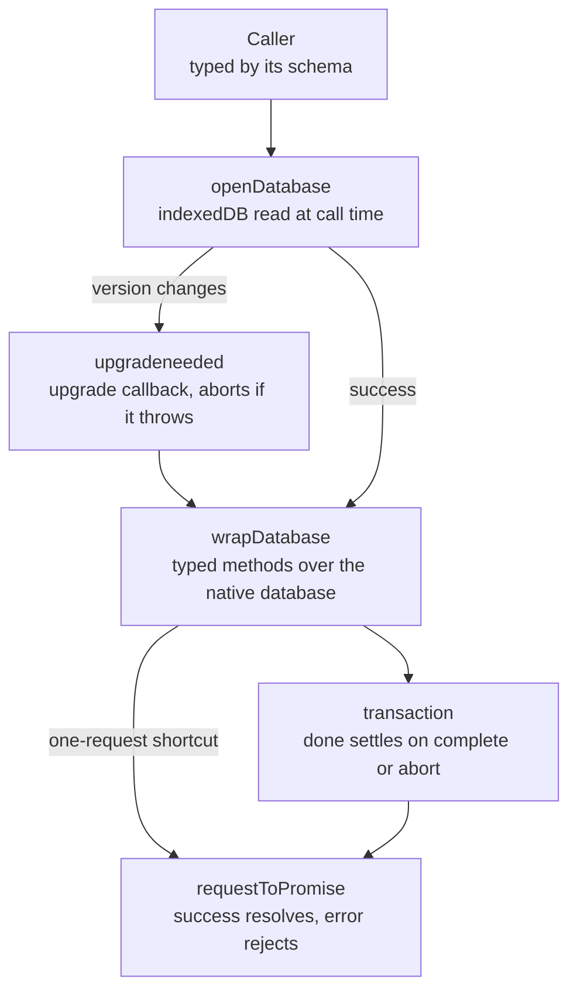

# IndexedDB

`@esposter/shared` (`packages/shared/src/services/indexedDb`) opens an IndexedDB database and types it from one schema interface. A store's key, its value and its indexes are declared once; every read, write and index lookup afterwards is checked against that declaration, so a store name, an index name or a key of the wrong type is a compile error rather than a rejected request.

It replaced `idb`, a promise wrapper over the same API, and is the absorption that the [dependency admission](../../architecture/dependency-admission/design.md) page's standard describes for a small utility: the call sites are its only consumers, so it lives in the shared package rather than a package of its own. The wrapper is written from the IndexedDB surface the app's callers use, so the [Scope](#scope) below lists what it does not carry.

## The schema

A schema extends `DatabaseSchema`, and each store names its own key, value and indexes. The callers' schema for the offline cache is one such interface, one entry per store.

```ts
interface Schema extends DatabaseSchema {
  users: { indexes: { byName: string }; key: number; value: { id: number; name: string } };
}
```

A store name that the schema does not declare is a type error, an index name is typed by the store it belongs to, and a store name that is a union takes only the indexes every store in the union declares. A schema with no literal keys, the untyped default, takes any name, which is how a caller that needs no types opens a database.

A transaction carries its mode in its type. A `readonly` transaction's store has no `put`, `delete` or `createIndex`, so a function that writes can require a writable transaction and the compiler refuses a read-only one.

## How a call is answered



- **Opening reads the global only when called.** Importing the module on the server, or in a test with no `indexedDB`, is harmless; the open call is the first thing that touches the browser.
- **The upgrade runs inside the version change.** An upgrade that throws aborts its own transaction, so the version is not applied with half its stores, and the open request rejects with the abort.
- **`done` settles with the transaction's outcome.** A transaction that fails rejects `done` with the error that aborted it, and an abort with no error of its own rejects with an `AbortError`. An upgrade's `done` is made before the upgrade callback runs, so a read after the transaction has settled still gets its outcome. A failure nobody reads is handled rather than left unhandled. The two upgrade logs split the failures between them: `openDatabase` logs an error the upgrade callback threw, and an upgrade's `done` logs a failure only when the transaction carries an error of its own, such as the request error that aborted it, so a throw's abort is not logged a second time.
- **The one-request shortcuts run in a transaction of their own** with no `done` attached, so the request's own error is what the caller receives.

## Scope

The wrapper carries what the app's callers use: `openDatabase` with the `upgrade`, `blocked`, `blocking` and `terminated` callbacks; the transaction and its object stores; the indexes; `get`, `getAll`, `getAllKeys`, `put` and `delete` on a store, an index and the database; and the store and index creation an upgrade needs.

It does not carry, and no caller needs: cursors (and so iteration, `openCursor`, `openKeyCursor` and the reverse read they give), async iterators, `add`, `clear` and `count`, `abort`, `deleteDatabase` and `databases()`, `objectStoreNames` and `indexNames`, the native request and transaction (there is no `unwrap`), transaction durability, observers, the `close` and `versionchange` event handlers beyond the callbacks above, a schema's `keyPath` and a value type for an auto-incrementing store, a version read before opening, and polyfills for engines the app does not support.

## Upstream

Every `idb` issue and pull request, with its verdict. The verdict and what each one owes are the [triage](../../architecture/dependency-admission/design.md) on the admission page. Only the `#326` regression test fails against the upstream package. The others pin behaviour the upstream already has, or are type tests the upstream was not run against.

| Upstream                                                                                                                                                                                                                                                                                                                                                                                                                                                                                                                                                                                                                                                                                                                                                                                                                                                                                                                                                                                                                                                                                                                                                                                                                                                                                                                                                                                                                                                                                                                                                                                                                                                                                                                                                                                                                                                                                                                                                                                                                                                                                                                                                                                                                                                                                                                                                                                                                                                                                                                                                                                                                                                                                                                                                                                                                                                                                                                                                                                                                                                                                                                                                                                                                                                                                                                                                                                                                                                                                                                                                                                                                                                                                                                                                                                                                                                                                                                                                                                                                                                                                                                                                                                                                                                                                                                                                                                                                                                                                                                                                                                                                                                                                                                                                                                                             | Verdict            | Proof                                                                                                                                                                  |
| -------------------------------------------------------------------------------------------------------------------------------------------------------------------------------------------------------------------------------------------------------------------------------------------------------------------------------------------------------------------------------------------------------------------------------------------------------------------------------------------------------------------------------------------------------------------------------------------------------------------------------------------------------------------------------------------------------------------------------------------------------------------------------------------------------------------------------------------------------------------------------------------------------------------------------------------------------------------------------------------------------------------------------------------------------------------------------------------------------------------------------------------------------------------------------------------------------------------------------------------------------------------------------------------------------------------------------------------------------------------------------------------------------------------------------------------------------------------------------------------------------------------------------------------------------------------------------------------------------------------------------------------------------------------------------------------------------------------------------------------------------------------------------------------------------------------------------------------------------------------------------------------------------------------------------------------------------------------------------------------------------------------------------------------------------------------------------------------------------------------------------------------------------------------------------------------------------------------------------------------------------------------------------------------------------------------------------------------------------------------------------------------------------------------------------------------------------------------------------------------------------------------------------------------------------------------------------------------------------------------------------------------------------------------------------------------------------------------------------------------------------------------------------------------------------------------------------------------------------------------------------------------------------------------------------------------------------------------------------------------------------------------------------------------------------------------------------------------------------------------------------------------------------------------------------------------------------------------------------------------------------------------------------------------------------------------------------------------------------------------------------------------------------------------------------------------------------------------------------------------------------------------------------------------------------------------------------------------------------------------------------------------------------------------------------------------------------------------------------------------------------------------------------------------------------------------------------------------------------------------------------------------------------------------------------------------------------------------------------------------------------------------------------------------------------------------------------------------------------------------------------------------------------------------------------------------------------------------------------------------------------------------------------------------------------------------------------------------------------------------------------------------------------------------------------------------------------------------------------------------------------------------------------------------------------------------------------------------------------------------------------------------------------------------------------------------------------------------------------------------------------------------------------------------------------------------- | ------------------ | ---------------------------------------------------------------------------------------------------------------------------------------------------------------------- |
| [#326](https://github.com/jakearchibald/idb/issues/326)                                                                                                                                                                                                                                                                                                                                                                                                                                                                                                                                                                                                                                                                                                                                                                                                                                                                                                                                                                                                                                                                                                                                                                                                                                                                                                                                                                                                                                                                                                                                                                                                                                                                                                                                                                                                                                                                                                                                                                                                                                                                                                                                                                                                                                                                                                                                                                                                                                                                                                                                                                                                                                                                                                                                                                                                                                                                                                                                                                                                                                                                                                                                                                                                                                                                                                                                                                                                                                                                                                                                                                                                                                                                                                                                                                                                                                                                                                                                                                                                                                                                                                                                                                                                                                                                                                                                                                                                                                                                                                                                                                                                                                                                                                                                                              | In scope — defect  | `#326 a failed write rejects done with the error that aborted the transaction` fails against the upstream package, which rejects `done` with a generic AbortError      |
| [#144](https://github.com/jakearchibald/idb/issues/144)                                                                                                                                                                                                                                                                                                                                                                                                                                                                                                                                                                                                                                                                                                                                                                                                                                                                                                                                                                                                                                                                                                                                                                                                                                                                                                                                                                                                                                                                                                                                                                                                                                                                                                                                                                                                                                                                                                                                                                                                                                                                                                                                                                                                                                                                                                                                                                                                                                                                                                                                                                                                                                                                                                                                                                                                                                                                                                                                                                                                                                                                                                                                                                                                                                                                                                                                                                                                                                                                                                                                                                                                                                                                                                                                                                                                                                                                                                                                                                                                                                                                                                                                                                                                                                                                                                                                                                                                                                                                                                                                                                                                                                                                                                                                                              | In scope — defect  | The abort path rejects with an `AbortError`, never `null`: `#294 an upgrade that throws aborts the upgrade and rejects the open`                                       |
| [#333](https://github.com/jakearchibald/idb/pull/333), [#338](https://github.com/jakearchibald/idb/pull/338)                                                                                                                                                                                                                                                                                                                                                                                                                                                                                                                                                                                                                                                                                                                                                                                                                                                                                                                                                                                                                                                                                                                                                                                                                                                                                                                                                                                                                                                                                                                                                                                                                                                                                                                                                                                                                                                                                                                                                                                                                                                                                                                                                                                                                                                                                                                                                                                                                                                                                                                                                                                                                                                                                                                                                                                                                                                                                                                                                                                                                                                                                                                                                                                                                                                                                                                                                                                                                                                                                                                                                                                                                                                                                                                                                                                                                                                                                                                                                                                                                                                                                                                                                                                                                                                                                                                                                                                                                                                                                                                                                                                                                                                                                                         | In scope — defect  | The rejection is the request's own `DOMException`, which is an `Error`: `#326 a failed write rejects done with the error that aborted the transaction`                 |
| [#307](https://github.com/jakearchibald/idb/issues/307)                                                                                                                                                                                                                                                                                                                                                                                                                                                                                                                                                                                                                                                                                                                                                                                                                                                                                                                                                                                                                                                                                                                                                                                                                                                                                                                                                                                                                                                                                                                                                                                                                                                                                                                                                                                                                                                                                                                                                                                                                                                                                                                                                                                                                                                                                                                                                                                                                                                                                                                                                                                                                                                                                                                                                                                                                                                                                                                                                                                                                                                                                                                                                                                                                                                                                                                                                                                                                                                                                                                                                                                                                                                                                                                                                                                                                                                                                                                                                                                                                                                                                                                                                                                                                                                                                                                                                                                                                                                                                                                                                                                                                                                                                                                                                              | In scope — defect  | `#307 deletes a record keyed by a number`. The upstream passes it, so the test pins the behaviour                                                                      |
| [#121](https://github.com/jakearchibald/idb/issues/121), [#169](https://github.com/jakearchibald/idb/issues/169)                                                                                                                                                                                                                                                                                                                                                                                                                                                                                                                                                                                                                                                                                                                                                                                                                                                                                                                                                                                                                                                                                                                                                                                                                                                                                                                                                                                                                                                                                                                                                                                                                                                                                                                                                                                                                                                                                                                                                                                                                                                                                                                                                                                                                                                                                                                                                                                                                                                                                                                                                                                                                                                                                                                                                                                                                                                                                                                                                                                                                                                                                                                                                                                                                                                                                                                                                                                                                                                                                                                                                                                                                                                                                                                                                                                                                                                                                                                                                                                                                                                                                                                                                                                                                                                                                                                                                                                                                                                                                                                                                                                                                                                                                                     | In scope — defect  | `#169 calls terminated when the browser closes the connection`. The upstream passes it, so the test pins the behaviour                                                 |
| [#294](https://github.com/jakearchibald/idb/issues/294)                                                                                                                                                                                                                                                                                                                                                                                                                                                                                                                                                                                                                                                                                                                                                                                                                                                                                                                                                                                                                                                                                                                                                                                                                                                                                                                                                                                                                                                                                                                                                                                                                                                                                                                                                                                                                                                                                                                                                                                                                                                                                                                                                                                                                                                                                                                                                                                                                                                                                                                                                                                                                                                                                                                                                                                                                                                                                                                                                                                                                                                                                                                                                                                                                                                                                                                                                                                                                                                                                                                                                                                                                                                                                                                                                                                                                                                                                                                                                                                                                                                                                                                                                                                                                                                                                                                                                                                                                                                                                                                                                                                                                                                                                                                                                              | In scope — defect  | `#294 an upgrade that throws aborts the upgrade and rejects the open`. The upstream already rejects, so the test pins it                                               |
| [#181](https://github.com/jakearchibald/idb/pull/181), [#190](https://github.com/jakearchibald/idb/issues/190)                                                                                                                                                                                                                                                                                                                                                                                                                                                                                                                                                                                                                                                                                                                                                                                                                                                                                                                                                                                                                                                                                                                                                                                                                                                                                                                                                                                                                                                                                                                                                                                                                                                                                                                                                                                                                                                                                                                                                                                                                                                                                                                                                                                                                                                                                                                                                                                                                                                                                                                                                                                                                                                                                                                                                                                                                                                                                                                                                                                                                                                                                                                                                                                                                                                                                                                                                                                                                                                                                                                                                                                                                                                                                                                                                                                                                                                                                                                                                                                                                                                                                                                                                                                                                                                                                                                                                                                                                                                                                                                                                                                                                                                                                                       | In scope — defect  | `#190 a shortcut write rejects with the request's own error`. The upstream already rejects, so the test pins it                                                        |
| [#96](https://github.com/jakearchibald/idb/issues/96)                                                                                                                                                                                                                                                                                                                                                                                                                                                                                                                                                                                                                                                                                                                                                                                                                                                                                                                                                                                                                                                                                                                                                                                                                                                                                                                                                                                                                                                                                                                                                                                                                                                                                                                                                                                                                                                                                                                                                                                                                                                                                                                                                                                                                                                                                                                                                                                                                                                                                                                                                                                                                                                                                                                                                                                                                                                                                                                                                                                                                                                                                                                                                                                                                                                                                                                                                                                                                                                                                                                                                                                                                                                                                                                                                                                                                                                                                                                                                                                                                                                                                                                                                                                                                                                                                                                                                                                                                                                                                                                                                                                                                                                                                                                                                                | In scope — defect  | `#96 a write to a store with generated keys resolves to the key it generated`. The upstream passes it, so the test pins it                                             |
| [#315](https://github.com/jakearchibald/idb/issues/315), [#352](https://github.com/jakearchibald/idb/pull/352)                                                                                                                                                                                                                                                                                                                                                                                                                                                                                                                                                                                                                                                                                                                                                                                                                                                                                                                                                                                                                                                                                                                                                                                                                                                                                                                                                                                                                                                                                                                                                                                                                                                                                                                                                                                                                                                                                                                                                                                                                                                                                                                                                                                                                                                                                                                                                                                                                                                                                                                                                                                                                                                                                                                                                                                                                                                                                                                                                                                                                                                                                                                                                                                                                                                                                                                                                                                                                                                                                                                                                                                                                                                                                                                                                                                                                                                                                                                                                                                                                                                                                                                                                                                                                                                                                                                                                                                                                                                                                                                                                                                                                                                                                                       | In scope — defect  | `#315 stores a NaN value and reads it back`. The upstream reads NaN back, so the test pins it                                                                          |
| [#116](https://github.com/jakearchibald/idb/issues/116), [#291](https://github.com/jakearchibald/idb/pull/291), [#311](https://github.com/jakearchibald/idb/issues/311), [#319](https://github.com/jakearchibald/idb/issues/319), [#336](https://github.com/jakearchibald/idb/pull/336), [#346](https://github.com/jakearchibald/idb/issues/346)                                                                                                                                                                                                                                                                                                                                                                                                                                                                                                                                                                                                                                                                                                                                                                                                                                                                                                                                                                                                                                                                                                                                                                                                                                                                                                                                                                                                                                                                                                                                                                                                                                                                                                                                                                                                                                                                                                                                                                                                                                                                                                                                                                                                                                                                                                                                                                                                                                                                                                                                                                                                                                                                                                                                                                                                                                                                                                                                                                                                                                                                                                                                                                                                                                                                                                                                                                                                                                                                                                                                                                                                                                                                                                                                                                                                                                                                                                                                                                                                                                                                                                                                                                                                                                                                                                                                                                                                                                                                     | In scope — defect  | Pinned by a type test in `Database.test-d.ts`, named for the issue: `#346 …`, `#345 …` or `#200 …`                                                                     |
| [#327](https://github.com/jakearchibald/idb/issues/327), [#331](https://github.com/jakearchibald/idb/issues/331), [#343](https://github.com/jakearchibald/idb/pull/343)                                                                                                                                                                                                                                                                                                                                                                                                                                                                                                                                                                                                                                                                                                                                                                                                                                                                                                                                                                                                                                                                                                                                                                                                                                                                                                                                                                                                                                                                                                                                                                                                                                                                                                                                                                                                                                                                                                                                                                                                                                                                                                                                                                                                                                                                                                                                                                                                                                                                                                                                                                                                                                                                                                                                                                                                                                                                                                                                                                                                                                                                                                                                                                                                                                                                                                                                                                                                                                                                                                                                                                                                                                                                                                                                                                                                                                                                                                                                                                                                                                                                                                                                                                                                                                                                                                                                                                                                                                                                                                                                                                                                                                              | In scope — defect  | Pinned by the package's typecheck, with the DOM and DOM.Iterable libraries its `tsconfig.json` names                                                                   |
| [#235](https://github.com/jakearchibald/idb/pull/235), [#244](https://github.com/jakearchibald/idb/pull/244), [#265](https://github.com/jakearchibald/idb/pull/265), [#268](https://github.com/jakearchibald/idb/issues/268), [#312](https://github.com/jakearchibald/idb/issues/312)                                                                                                                                                                                                                                                                                                                                                                                                                                                                                                                                                                                                                                                                                                                                                                                                                                                                                                                                                                                                                                                                                                                                                                                                                                                                                                                                                                                                                                                                                                                                                                                                                                                                                                                                                                                                                                                                                                                                                                                                                                                                                                                                                                                                                                                                                                                                                                                                                                                                                                                                                                                                                                                                                                                                                                                                                                                                                                                                                                                                                                                                                                                                                                                                                                                                                                                                                                                                                                                                                                                                                                                                                                                                                                                                                                                                                                                                                                                                                                                                                                                                                                                                                                                                                                                                                                                                                                                                                                                                                                                                | In scope — defect  | Pinned by the package's own build checks (`publint` and `attw`, run by the tsdown configuration)                                                                       |
| [#4](https://github.com/jakearchibald/idb/issues/4), [#27](https://github.com/jakearchibald/idb/pull/27), [#86](https://github.com/jakearchibald/idb/issues/86), [#108](https://github.com/jakearchibald/idb/issues/108), [#260](https://github.com/jakearchibald/idb/issues/260)                                                                                                                                                                                                                                                                                                                                                                                                                                                                                                                                                                                                                                                                                                                                                                                                                                                                                                                                                                                                                                                                                                                                                                                                                                                                                                                                                                                                                                                                                                                                                                                                                                                                                                                                                                                                                                                                                                                                                                                                                                                                                                                                                                                                                                                                                                                                                                                                                                                                                                                                                                                                                                                                                                                                                                                                                                                                                                                                                                                                                                                                                                                                                                                                                                                                                                                                                                                                                                                                                                                                                                                                                                                                                                                                                                                                                                                                                                                                                                                                                                                                                                                                                                                                                                                                                                                                                                                                                                                                                                                                    | In scope — defect  | Pinned by `loads without an indexedDB global, since nothing reads it at import` in `openDatabase.test.ts`                                                              |
| [#124](https://github.com/jakearchibald/idb/issues/124), [#140](https://github.com/jakearchibald/idb/issues/140), [#200](https://github.com/jakearchibald/idb/pull/200), [#204](https://github.com/jakearchibald/idb/pull/204), [#288](https://github.com/jakearchibald/idb/issues/288), [#345](https://github.com/jakearchibald/idb/pull/345)                                                                                                                                                                                                                                                                                                                                                                                                                                                                                                                                                                                                                                                                                                                                                                                                                                                                                                                                                                                                                                                                                                                                                                                                                                                                                                                                                                                                                                                                                                                                                                                                                                                                                                                                                                                                                                                                                                                                                                                                                                                                                                                                                                                                                                                                                                                                                                                                                                                                                                                                                                                                                                                                                                                                                                                                                                                                                                                                                                                                                                                                                                                                                                                                                                                                                                                                                                                                                                                                                                                                                                                                                                                                                                                                                                                                                                                                                                                                                                                                                                                                                                                                                                                                                                                                                                                                                                                                                                                                       | In scope — feature | Pinned by a type test in `Database.test-d.ts`, named for the issue: `#346 …`, `#345 …` or `#200 …`                                                                     |
| [#23](https://github.com/jakearchibald/idb/pull/23)                                                                                                                                                                                                                                                                                                                                                                                                                                                                                                                                                                                                                                                                                                                                                                                                                                                                                                                                                                                                                                                                                                                                                                                                                                                                                                                                                                                                                                                                                                                                                                                                                                                                                                                                                                                                                                                                                                                                                                                                                                                                                                                                                                                                                                                                                                                                                                                                                                                                                                                                                                                                                                                                                                                                                                                                                                                                                                                                                                                                                                                                                                                                                                                                                                                                                                                                                                                                                                                                                                                                                                                                                                                                                                                                                                                                                                                                                                                                                                                                                                                                                                                                                                                                                                                                                                                                                                                                                                                                                                                                                                                                                                                                                                                                                                  | In scope — feature | The `done` promise rejects when the transaction aborts, with the error that aborted it: `#326 a failed write rejects done with the error that aborted the transaction` |
| [#104](https://github.com/jakearchibald/idb/pull/104), [#237](https://github.com/jakearchibald/idb/issues/237), [#314](https://github.com/jakearchibald/idb/issues/314)                                                                                                                                                                                                                                                                                                                                                                                                                                                                                                                                                                                                                                                                                                                                                                                                                                                                                                                                                                                                                                                                                                                                                                                                                                                                                                                                                                                                                                                                                                                                                                                                                                                                                                                                                                                                                                                                                                                                                                                                                                                                                                                                                                                                                                                                                                                                                                                                                                                                                                                                                                                                                                                                                                                                                                                                                                                                                                                                                                                                                                                                                                                                                                                                                                                                                                                                                                                                                                                                                                                                                                                                                                                                                                                                                                                                                                                                                                                                                                                                                                                                                                                                                                                                                                                                                                                                                                                                                                                                                                                                                                                                                                              | In scope — feature | The option and schema types are exported from the package, and the open tests exercise each callback                                                                   |
| [#282](https://github.com/jakearchibald/idb/pull/282)                                                                                                                                                                                                                                                                                                                                                                                                                                                                                                                                                                                                                                                                                                                                                                                                                                                                                                                                                                                                                                                                                                                                                                                                                                                                                                                                                                                                                                                                                                                                                                                                                                                                                                                                                                                                                                                                                                                                                                                                                                                                                                                                                                                                                                                                                                                                                                                                                                                                                                                                                                                                                                                                                                                                                                                                                                                                                                                                                                                                                                                                                                                                                                                                                                                                                                                                                                                                                                                                                                                                                                                                                                                                                                                                                                                                                                                                                                                                                                                                                                                                                                                                                                                                                                                                                                                                                                                                                                                                                                                                                                                                                                                                                                                                                                | In scope — feature | `calls blocking, and the connection it names closes so the upgrade can run` in `openDatabase.test.ts`                                                                  |
| [#28](https://github.com/jakearchibald/idb/issues/28), [#35](https://github.com/jakearchibald/idb/issues/35), [#36](https://github.com/jakearchibald/idb/pull/36), [#38](https://github.com/jakearchibald/idb/issues/38), [#61](https://github.com/jakearchibald/idb/issues/61), [#79](https://github.com/jakearchibald/idb/issues/79), [#88](https://github.com/jakearchibald/idb/issues/88), [#90](https://github.com/jakearchibald/idb/issues/90), [#98](https://github.com/jakearchibald/idb/issues/98), [#100](https://github.com/jakearchibald/idb/issues/100), [#101](https://github.com/jakearchibald/idb/issues/101), [#103](https://github.com/jakearchibald/idb/pull/103), [#112](https://github.com/jakearchibald/idb/issues/112), [#113](https://github.com/jakearchibald/idb/issues/113), [#126](https://github.com/jakearchibald/idb/issues/126), [#132](https://github.com/jakearchibald/idb/issues/132), [#136](https://github.com/jakearchibald/idb/issues/136), [#137](https://github.com/jakearchibald/idb/pull/137), [#141](https://github.com/jakearchibald/idb/issues/141), [#147](https://github.com/jakearchibald/idb/issues/147), [#150](https://github.com/jakearchibald/idb/issues/150), [#151](https://github.com/jakearchibald/idb/pull/151), [#176](https://github.com/jakearchibald/idb/issues/176), [#185](https://github.com/jakearchibald/idb/issues/185), [#189](https://github.com/jakearchibald/idb/issues/189), [#192](https://github.com/jakearchibald/idb/issues/192), [#196](https://github.com/jakearchibald/idb/issues/196), [#197](https://github.com/jakearchibald/idb/pull/197), [#203](https://github.com/jakearchibald/idb/issues/203), [#206](https://github.com/jakearchibald/idb/issues/206), [#207](https://github.com/jakearchibald/idb/issues/207), [#211](https://github.com/jakearchibald/idb/issues/211), [#216](https://github.com/jakearchibald/idb/issues/216), [#219](https://github.com/jakearchibald/idb/issues/219), [#234](https://github.com/jakearchibald/idb/issues/234), [#236](https://github.com/jakearchibald/idb/pull/236), [#252](https://github.com/jakearchibald/idb/pull/252), [#255](https://github.com/jakearchibald/idb/issues/255), [#259](https://github.com/jakearchibald/idb/issues/259), [#275](https://github.com/jakearchibald/idb/issues/275), [#280](https://github.com/jakearchibald/idb/issues/280), [#284](https://github.com/jakearchibald/idb/pull/284), [#286](https://github.com/jakearchibald/idb/issues/286), [#300](https://github.com/jakearchibald/idb/issues/300), [#309](https://github.com/jakearchibald/idb/issues/309), [#310](https://github.com/jakearchibald/idb/issues/310), [#322](https://github.com/jakearchibald/idb/issues/322), [#324](https://github.com/jakearchibald/idb/issues/324), [#339](https://github.com/jakearchibald/idb/pull/339), [#344](https://github.com/jakearchibald/idb/issues/344), [#349](https://github.com/jakearchibald/idb/issues/349), [#350](https://github.com/jakearchibald/idb/pull/350)                                                                                                                                                                                                                                                                                                                                                                                                                                                                                                                                                                                                                                                                                                                                                                                                                                                                                                                                                                                                                                                                                                                                                                                                                                                                                                                                                                                                                                                                                                                                                                                                                                                                                                                                                                         | Out of scope       | A surface this wrapper does not carry, recorded under [Scope](#scope)                                                                                                  |
| [#334](https://github.com/jakearchibald/idb/issues/334)                                                                                                                                                                                                                                                                                                                                                                                                                                                                                                                                                                                                                                                                                                                                                                                                                                                                                                                                                                                                                                                                                                                                                                                                                                                                                                                                                                                                                                                                                                                                                                                                                                                                                                                                                                                                                                                                                                                                                                                                                                                                                                                                                                                                                                                                                                                                                                                                                                                                                                                                                                                                                                                                                                                                                                                                                                                                                                                                                                                                                                                                                                                                                                                                                                                                                                                                                                                                                                                                                                                                                                                                                                                                                                                                                                                                                                                                                                                                                                                                                                                                                                                                                                                                                                                                                                                                                                                                                                                                                                                                                                                                                                                                                                                                                              | Out of scope       | The caller's own handling: the rejection carries the request's own error, and the caller decides on it                                                                 |
| [#6](https://github.com/jakearchibald/idb/issues/6), [#26](https://github.com/jakearchibald/idb/issues/26), [#47](https://github.com/jakearchibald/idb/issues/47), [#62](https://github.com/jakearchibald/idb/pull/62), [#99](https://github.com/jakearchibald/idb/issues/99), [#122](https://github.com/jakearchibald/idb/issues/122), [#127](https://github.com/jakearchibald/idb/issues/127), [#135](https://github.com/jakearchibald/idb/issues/135), [#186](https://github.com/jakearchibald/idb/issues/186), [#202](https://github.com/jakearchibald/idb/issues/202), [#213](https://github.com/jakearchibald/idb/issues/213), [#256](https://github.com/jakearchibald/idb/issues/256), [#269](https://github.com/jakearchibald/idb/issues/269), [#272](https://github.com/jakearchibald/idb/issues/272), [#281](https://github.com/jakearchibald/idb/issues/281), [#304](https://github.com/jakearchibald/idb/issues/304), [#320](https://github.com/jakearchibald/idb/issues/320)                                                                                                                                                                                                                                                                                                                                                                                                                                                                                                                                                                                                                                                                                                                                                                                                                                                                                                                                                                                                                                                                                                                                                                                                                                                                                                                                                                                                                                                                                                                                                                                                                                                                                                                                                                                                                                                                                                                                                                                                                                                                                                                                                                                                                                                                                                                                                                                                                                                                                                                                                                                                                                                                                                                                                                                                                                                                                                                                                                                                                                                                                                                                                                                                                                                                                                                                                                                                                                                                                                                                                                                                                                                                                                                                                                                                                            | Out of scope       | Behaviour the IndexedDB specification defines (transaction lifetime, keys, blocking), which the wrapper keeps                                                          |
| [#7](https://github.com/jakearchibald/idb/issues/7), [#49](https://github.com/jakearchibald/idb/issues/49), [#54](https://github.com/jakearchibald/idb/pull/54), [#58](https://github.com/jakearchibald/idb/issues/58), [#59](https://github.com/jakearchibald/idb/issues/59), [#71](https://github.com/jakearchibald/idb/issues/71), [#72](https://github.com/jakearchibald/idb/issues/72), [#73](https://github.com/jakearchibald/idb/issues/73), [#81](https://github.com/jakearchibald/idb/issues/81), [#97](https://github.com/jakearchibald/idb/issues/97), [#105](https://github.com/jakearchibald/idb/issues/105), [#111](https://github.com/jakearchibald/idb/issues/111), [#123](https://github.com/jakearchibald/idb/issues/123), [#133](https://github.com/jakearchibald/idb/issues/133), [#139](https://github.com/jakearchibald/idb/issues/139), [#152](https://github.com/jakearchibald/idb/issues/152), [#156](https://github.com/jakearchibald/idb/issues/156), [#158](https://github.com/jakearchibald/idb/issues/158), [#180](https://github.com/jakearchibald/idb/issues/180), [#201](https://github.com/jakearchibald/idb/issues/201), [#212](https://github.com/jakearchibald/idb/issues/212), [#215](https://github.com/jakearchibald/idb/issues/215), [#218](https://github.com/jakearchibald/idb/issues/218), [#227](https://github.com/jakearchibald/idb/issues/227), [#228](https://github.com/jakearchibald/idb/issues/228), [#229](https://github.com/jakearchibald/idb/issues/229), [#238](https://github.com/jakearchibald/idb/issues/238), [#239](https://github.com/jakearchibald/idb/issues/239), [#245](https://github.com/jakearchibald/idb/issues/245), [#249](https://github.com/jakearchibald/idb/issues/249), [#258](https://github.com/jakearchibald/idb/issues/258), [#293](https://github.com/jakearchibald/idb/issues/293), [#299](https://github.com/jakearchibald/idb/issues/299), [#317](https://github.com/jakearchibald/idb/issues/317), [#321](https://github.com/jakearchibald/idb/issues/321)                                                                                                                                                                                                                                                                                                                                                                                                                                                                                                                                                                                                                                                                                                                                                                                                                                                                                                                                                                                                                                                                                                                                                                                                                                                                                                                                                                                                                                                                                                                                                                                                                                                                                                                                                                                                                                                                                                                                                                                                                                                                                                                                                                                                                                                                                                                                                                                                                                                                                                                                                                                                                                                                                                                                                                    | Out of scope       | The engine's own behaviour; the app supports current engines only ([polyfills](../../architecture/polyfills/design.md))                                                |
| [#9](https://github.com/jakearchibald/idb/pull/9), [#22](https://github.com/jakearchibald/idb/pull/22), [#76](https://github.com/jakearchibald/idb/pull/76), [#82](https://github.com/jakearchibald/idb/issues/82), [#87](https://github.com/jakearchibald/idb/issues/87), [#94](https://github.com/jakearchibald/idb/issues/94), [#95](https://github.com/jakearchibald/idb/issues/95), [#130](https://github.com/jakearchibald/idb/issues/130), [#142](https://github.com/jakearchibald/idb/issues/142), [#154](https://github.com/jakearchibald/idb/issues/154), [#160](https://github.com/jakearchibald/idb/issues/160), [#161](https://github.com/jakearchibald/idb/pull/161), [#162](https://github.com/jakearchibald/idb/issues/162), [#170](https://github.com/jakearchibald/idb/issues/170), [#177](https://github.com/jakearchibald/idb/issues/177), [#188](https://github.com/jakearchibald/idb/pull/188), [#193](https://github.com/jakearchibald/idb/pull/193), [#194](https://github.com/jakearchibald/idb/pull/194), [#195](https://github.com/jakearchibald/idb/issues/195), [#223](https://github.com/jakearchibald/idb/issues/223), [#226](https://github.com/jakearchibald/idb/issues/226), [#261](https://github.com/jakearchibald/idb/pull/261), [#262](https://github.com/jakearchibald/idb/pull/262), [#267](https://github.com/jakearchibald/idb/issues/267), [#270](https://github.com/jakearchibald/idb/issues/270), [#271](https://github.com/jakearchibald/idb/issues/271), [#276](https://github.com/jakearchibald/idb/pull/276), [#283](https://github.com/jakearchibald/idb/pull/283), [#287](https://github.com/jakearchibald/idb/issues/287), [#313](https://github.com/jakearchibald/idb/pull/313), [#337](https://github.com/jakearchibald/idb/pull/337), [#341](https://github.com/jakearchibald/idb/issues/341), [#342](https://github.com/jakearchibald/idb/pull/342)                                                                                                                                                                                                                                                                                                                                                                                                                                                                                                                                                                                                                                                                                                                                                                                                                                                                                                                                                                                                                                                                                                                                                                                                                                                                                                                                                                                                                                                                                                                                                                                                                                                                                                                                                                                                                                                                                                                                                                                                                                                                                                                                                                                                                                                                                                                                                                                                                                                                                                                                                                                                                                                                                                                                                                                                                                                                                                          | Out of scope       | The consumer's or upstream's toolchain, or a dependency bump; the repository's build and typecheck own it                                                              |
| [#5](https://github.com/jakearchibald/idb/issues/5), [#8](https://github.com/jakearchibald/idb/issues/8), [#11](https://github.com/jakearchibald/idb/issues/11), [#17](https://github.com/jakearchibald/idb/issues/17), [#19](https://github.com/jakearchibald/idb/issues/19), [#25](https://github.com/jakearchibald/idb/issues/25), [#31](https://github.com/jakearchibald/idb/issues/31), [#41](https://github.com/jakearchibald/idb/issues/41), [#48](https://github.com/jakearchibald/idb/issues/48), [#52](https://github.com/jakearchibald/idb/pull/52), [#53](https://github.com/jakearchibald/idb/issues/53), [#60](https://github.com/jakearchibald/idb/issues/60), [#63](https://github.com/jakearchibald/idb/issues/63), [#65](https://github.com/jakearchibald/idb/issues/65), [#67](https://github.com/jakearchibald/idb/issues/67), [#68](https://github.com/jakearchibald/idb/issues/68), [#70](https://github.com/jakearchibald/idb/issues/70), [#75](https://github.com/jakearchibald/idb/issues/75), [#102](https://github.com/jakearchibald/idb/issues/102), [#106](https://github.com/jakearchibald/idb/issues/106), [#107](https://github.com/jakearchibald/idb/issues/107), [#114](https://github.com/jakearchibald/idb/issues/114), [#117](https://github.com/jakearchibald/idb/issues/117), [#118](https://github.com/jakearchibald/idb/issues/118), [#119](https://github.com/jakearchibald/idb/issues/119), [#129](https://github.com/jakearchibald/idb/issues/129), [#134](https://github.com/jakearchibald/idb/issues/134), [#145](https://github.com/jakearchibald/idb/issues/145), [#146](https://github.com/jakearchibald/idb/issues/146), [#148](https://github.com/jakearchibald/idb/issues/148), [#149](https://github.com/jakearchibald/idb/issues/149), [#153](https://github.com/jakearchibald/idb/issues/153), [#157](https://github.com/jakearchibald/idb/pull/157), [#159](https://github.com/jakearchibald/idb/issues/159), [#163](https://github.com/jakearchibald/idb/issues/163), [#164](https://github.com/jakearchibald/idb/issues/164), [#165](https://github.com/jakearchibald/idb/issues/165), [#166](https://github.com/jakearchibald/idb/issues/166), [#167](https://github.com/jakearchibald/idb/issues/167), [#171](https://github.com/jakearchibald/idb/issues/171), [#172](https://github.com/jakearchibald/idb/issues/172), [#173](https://github.com/jakearchibald/idb/issues/173), [#174](https://github.com/jakearchibald/idb/issues/174), [#175](https://github.com/jakearchibald/idb/issues/175), [#182](https://github.com/jakearchibald/idb/issues/182), [#183](https://github.com/jakearchibald/idb/issues/183), [#187](https://github.com/jakearchibald/idb/issues/187), [#191](https://github.com/jakearchibald/idb/issues/191), [#199](https://github.com/jakearchibald/idb/issues/199), [#205](https://github.com/jakearchibald/idb/issues/205), [#208](https://github.com/jakearchibald/idb/issues/208), [#210](https://github.com/jakearchibald/idb/issues/210), [#220](https://github.com/jakearchibald/idb/issues/220), [#224](https://github.com/jakearchibald/idb/issues/224), [#230](https://github.com/jakearchibald/idb/issues/230), [#231](https://github.com/jakearchibald/idb/issues/231), [#241](https://github.com/jakearchibald/idb/issues/241), [#243](https://github.com/jakearchibald/idb/issues/243), [#246](https://github.com/jakearchibald/idb/issues/246), [#247](https://github.com/jakearchibald/idb/issues/247), [#250](https://github.com/jakearchibald/idb/issues/250), [#253](https://github.com/jakearchibald/idb/issues/253), [#254](https://github.com/jakearchibald/idb/issues/254), [#257](https://github.com/jakearchibald/idb/issues/257), [#263](https://github.com/jakearchibald/idb/issues/263), [#266](https://github.com/jakearchibald/idb/issues/266), [#273](https://github.com/jakearchibald/idb/issues/273), [#279](https://github.com/jakearchibald/idb/issues/279), [#285](https://github.com/jakearchibald/idb/issues/285), [#289](https://github.com/jakearchibald/idb/issues/289), [#290](https://github.com/jakearchibald/idb/issues/290), [#292](https://github.com/jakearchibald/idb/issues/292), [#297](https://github.com/jakearchibald/idb/issues/297), [#301](https://github.com/jakearchibald/idb/issues/301), [#303](https://github.com/jakearchibald/idb/issues/303), [#308](https://github.com/jakearchibald/idb/issues/308), [#316](https://github.com/jakearchibald/idb/issues/316), [#330](https://github.com/jakearchibald/idb/issues/330), [#332](https://github.com/jakearchibald/idb/issues/332), [#347](https://github.com/jakearchibald/idb/issues/347), [#348](https://github.com/jakearchibald/idb/issues/348), [#351](https://github.com/jakearchibald/idb/issues/351) | False positive     | A usage question; the documented surface already answers it, in the thread                                                                                             |
| [#14](https://github.com/jakearchibald/idb/pull/14), [#15](https://github.com/jakearchibald/idb/pull/15), [#29](https://github.com/jakearchibald/idb/pull/29), [#32](https://github.com/jakearchibald/idb/pull/32), [#33](https://github.com/jakearchibald/idb/issues/33), [#39](https://github.com/jakearchibald/idb/issues/39), [#40](https://github.com/jakearchibald/idb/pull/40), [#44](https://github.com/jakearchibald/idb/issues/44), [#46](https://github.com/jakearchibald/idb/pull/46), [#55](https://github.com/jakearchibald/idb/issues/55), [#56](https://github.com/jakearchibald/idb/issues/56), [#66](https://github.com/jakearchibald/idb/issues/66), [#69](https://github.com/jakearchibald/idb/pull/69), [#77](https://github.com/jakearchibald/idb/pull/77), [#85](https://github.com/jakearchibald/idb/pull/85), [#93](https://github.com/jakearchibald/idb/pull/93), [#115](https://github.com/jakearchibald/idb/issues/115), [#120](https://github.com/jakearchibald/idb/pull/120), [#128](https://github.com/jakearchibald/idb/pull/128), [#155](https://github.com/jakearchibald/idb/pull/155), [#222](https://github.com/jakearchibald/idb/issues/222), [#240](https://github.com/jakearchibald/idb/issues/240), [#242](https://github.com/jakearchibald/idb/pull/242), [#274](https://github.com/jakearchibald/idb/issues/274), [#278](https://github.com/jakearchibald/idb/issues/278), [#302](https://github.com/jakearchibald/idb/pull/302), [#323](https://github.com/jakearchibald/idb/issues/323)                                                                                                                                                                                                                                                                                                                                                                                                                                                                                                                                                                                                                                                                                                                                                                                                                                                                                                                                                                                                                                                                                                                                                                                                                                                                                                                                                                                                                                                                                                                                                                                                                                                                                                                                                                                                                                                                                                                                                                                                                                                                                                                                                                                                                                                                                                                                                                                                                                                                                                                                                                                                                                                                                                                                                                                                                                                                                                                                                                                                                                                                                                                                                                                                                                                                                  | False positive     | Fixed by a later upstream release, which the thread or the release notes name                                                                                          |
| [#1](https://github.com/jakearchibald/idb/pull/1), [#2](https://github.com/jakearchibald/idb/pull/2), [#3](https://github.com/jakearchibald/idb/pull/3), [#10](https://github.com/jakearchibald/idb/pull/10), [#16](https://github.com/jakearchibald/idb/pull/16), [#20](https://github.com/jakearchibald/idb/pull/20), [#21](https://github.com/jakearchibald/idb/pull/21), [#24](https://github.com/jakearchibald/idb/pull/24), [#30](https://github.com/jakearchibald/idb/issues/30), [#37](https://github.com/jakearchibald/idb/pull/37), [#42](https://github.com/jakearchibald/idb/issues/42), [#43](https://github.com/jakearchibald/idb/issues/43), [#45](https://github.com/jakearchibald/idb/issues/45), [#50](https://github.com/jakearchibald/idb/issues/50), [#51](https://github.com/jakearchibald/idb/pull/51), [#57](https://github.com/jakearchibald/idb/pull/57), [#64](https://github.com/jakearchibald/idb/pull/64), [#78](https://github.com/jakearchibald/idb/issues/78), [#80](https://github.com/jakearchibald/idb/issues/80), [#83](https://github.com/jakearchibald/idb/issues/83), [#84](https://github.com/jakearchibald/idb/issues/84), [#89](https://github.com/jakearchibald/idb/pull/89), [#91](https://github.com/jakearchibald/idb/pull/91), [#109](https://github.com/jakearchibald/idb/issues/109), [#110](https://github.com/jakearchibald/idb/pull/110), [#125](https://github.com/jakearchibald/idb/pull/125), [#178](https://github.com/jakearchibald/idb/pull/178), [#179](https://github.com/jakearchibald/idb/issues/179), [#184](https://github.com/jakearchibald/idb/issues/184), [#198](https://github.com/jakearchibald/idb/pull/198), [#209](https://github.com/jakearchibald/idb/issues/209), [#214](https://github.com/jakearchibald/idb/issues/214), [#217](https://github.com/jakearchibald/idb/pull/217), [#221](https://github.com/jakearchibald/idb/pull/221), [#232](https://github.com/jakearchibald/idb/issues/232), [#233](https://github.com/jakearchibald/idb/issues/233), [#248](https://github.com/jakearchibald/idb/issues/248), [#251](https://github.com/jakearchibald/idb/pull/251), [#264](https://github.com/jakearchibald/idb/issues/264), [#298](https://github.com/jakearchibald/idb/issues/298), [#306](https://github.com/jakearchibald/idb/issues/306), [#318](https://github.com/jakearchibald/idb/pull/318), [#328](https://github.com/jakearchibald/idb/pull/328), [#340](https://github.com/jakearchibald/idb/pull/340)                                                                                                                                                                                                                                                                                                                                                                                                                                                                                                                                                                                                                                                                                                                                                                                                                                                                                                                                                                                                                                                                                                                                                                                                                                                                                                                                                                                                                                                                                                                                                                                                                                                                                                                                                                                                                                                                                                                                                                                                                                                                                                                                                                                                                                                                                                               | False positive     | Documentation, a repository chore or a closed discussion; nothing in the code to change                                                                                |
| [#92](https://github.com/jakearchibald/idb/issues/92), [#305](https://github.com/jakearchibald/idb/issues/305), [#329](https://github.com/jakearchibald/idb/issues/329)                                                                                                                                                                                                                                                                                                                                                                                                                                                                                                                                                                                                                                                                                                                                                                                                                                                                                                                                                                                                                                                                                                                                                                                                                                                                                                                                                                                                                                                                                                                                                                                                                                                                                                                                                                                                                                                                                                                                                                                                                                                                                                                                                                                                                                                                                                                                                                                                                                                                                                                                                                                                                                                                                                                                                                                                                                                                                                                                                                                                                                                                                                                                                                                                                                                                                                                                                                                                                                                                                                                                                                                                                                                                                                                                                                                                                                                                                                                                                                                                                                                                                                                                                                                                                                                                                                                                                                                                                                                                                                                                                                                                                                              | False positive     | A usage question; the documented surface already answers it, in the thread                                                                                             |
| [#138](https://github.com/jakearchibald/idb/pull/138)                                                                                                                                                                                                                                                                                                                                                                                                                                                                                                                                                                                                                                                                                                                                                                                                                                                                                                                                                                                                                                                                                                                                                                                                                                                                                                                                                                                                                                                                                                                                                                                                                                                                                                                                                                                                                                                                                                                                                                                                                                                                                                                                                                                                                                                                                                                                                                                                                                                                                                                                                                                                                                                                                                                                                                                                                                                                                                                                                                                                                                                                                                                                                                                                                                                                                                                                                                                                                                                                                                                                                                                                                                                                                                                                                                                                                                                                                                                                                                                                                                                                                                                                                                                                                                                                                                                                                                                                                                                                                                                                                                                                                                                                                                                                                                | Out of scope       | The consumer's or upstream's toolchain, or a dependency bump; the repository's build and typecheck own it                                                              |
| [#13](https://github.com/jakearchibald/idb/pull/13), [#18](https://github.com/jakearchibald/idb/pull/18)                                                                                                                                                                                                                                                                                                                                                                                                                                                                                                                                                                                                                                                                                                                                                                                                                                                                                                                                                                                                                                                                                                                                                                                                                                                                                                                                                                                                                                                                                                                                                                                                                                                                                                                                                                                                                                                                                                                                                                                                                                                                                                                                                                                                                                                                                                                                                                                                                                                                                                                                                                                                                                                                                                                                                                                                                                                                                                                                                                                                                                                                                                                                                                                                                                                                                                                                                                                                                                                                                                                                                                                                                                                                                                                                                                                                                                                                                                                                                                                                                                                                                                                                                                                                                                                                                                                                                                                                                                                                                                                                                                                                                                                                                                             | False positive     | Documentation, a repository chore or a closed discussion; nothing in the code to change                                                                                |
| [#12](https://github.com/jakearchibald/idb/issues/12), [#34](https://github.com/jakearchibald/idb/issues/34), [#74](https://github.com/jakearchibald/idb/issues/74), [#131](https://github.com/jakearchibald/idb/pull/131), [#143](https://github.com/jakearchibald/idb/issues/143), [#168](https://github.com/jakearchibald/idb/issues/168), [#225](https://github.com/jakearchibald/idb/issues/225), [#325](https://github.com/jakearchibald/idb/issues/325), [#335](https://github.com/jakearchibald/idb/issues/335)                                                                                                                                                                                                                                                                                                                                                                                                                                                                                                                                                                                                                                                                                                                                                                                                                                                                                                                                                                                                                                                                                                                                                                                                                                                                                                                                                                                                                                                                                                                                                                                                                                                                                                                                                                                                                                                                                                                                                                                                                                                                                                                                                                                                                                                                                                                                                                                                                                                                                                                                                                                                                                                                                                                                                                                                                                                                                                                                                                                                                                                                                                                                                                                                                                                                                                                                                                                                                                                                                                                                                                                                                                                                                                                                                                                                                                                                                                                                                                                                                                                                                                                                                                                                                                                                                              | False positive     | Not a question about this library                                                                                                                                      |

## Key files

| File                                                                                   | Role                                                                     |
| -------------------------------------------------------------------------------------- | ------------------------------------------------------------------------ |
| `packages/shared/src/services/indexedDb/openDatabase.ts`                               | The open call: upgrade, blocked, blocking and terminated, in one promise |
| `packages/shared/src/services/indexedDb/wrapObjectStore.ts`                            | The typed store, every method over the native one                        |
| `packages/shared/src/services/indexedDb/getTransactionDone.ts`                         | The transaction's outcome, and the abort's own error                     |
| `packages/shared/src/models/indexedDb/DatabaseStoreName.ts`                            | The literal-key rule that makes an undeclared store name a type error    |
| `packages/shared/src/models/indexedDb/DatabaseIndexName.ts`                            | The index names a store declares, and the ones a union shares            |
| `packages/shared/src/models/indexedDb/Database.test-d.ts`                              | The type tests, one per key API                                          |
| `packages/shared/src/services/indexedDb/openDatabase.test.ts`                          | The behaviour tests, against `fake-indexeddb`                            |
| `apps/web/app/services/cache/indexedDb/openIndexedDb.ts`                               | The app's database, its stores and their indexes                         |
| `packages/genshin-world/src/services/character/createIndexedDbCharacterPackStorage.ts` | The character pack's file store, the untyped default                     |

## Sources

- [jakearchibald/idb](https://github.com/jakearchibald/idb) — the package replaced, its issues and pull requests.
- [IndexedDB 3.0](https://www.w3.org/TR/IndexedDB/) (W3C) — the specification the request, transaction and version-change behaviour follows.
- [IDBTransaction](https://developer.mozilla.org/en-US/docs/Web/API/IDBTransaction) (MDN) — the transaction's `complete`, `abort` and `error` events the `done` promise reads.
- [fake-indexeddb](https://github.com/dumbmatter/fake-indexeddb) — the in-memory implementation the behaviour tests run against.
