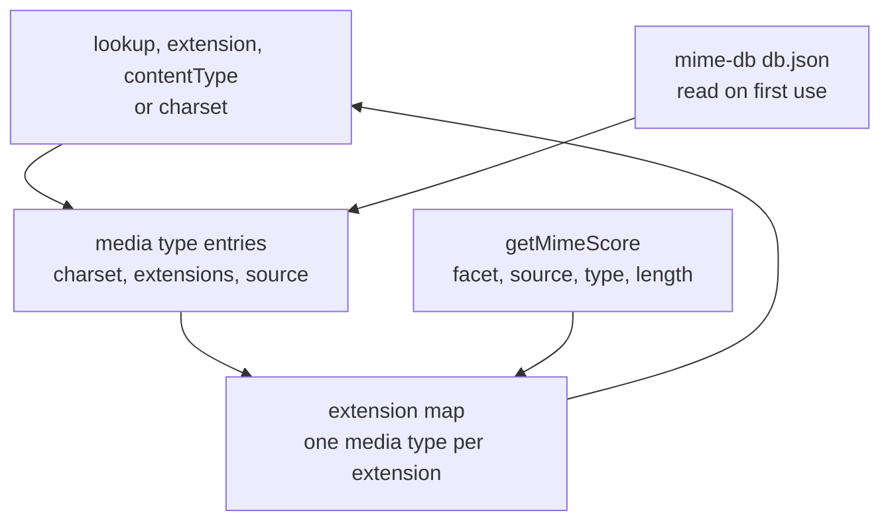

# mime-types

`packages/shared` (`@esposter/shared`) answers the three questions the app asks of a file: which media type an extension names (`lookup`), which extension a media type is saved under (`extension`), and the full `Content-Type` header for either, with the media type's charset attached (`contentType`). It replaces `mime-types`, which the app used in four places, and is the absorption the [dependency admission](../../architecture/dependency-admission/design.md) page's standard is written against.

The data stays a dependency. `mime-db` is the IANA-derived dataset `mime-types` itself read, and it changes without us, so it is kept as a catalog entry; what we take back is the layer that decided which type an extension means. The rules that layer enforces are the ones `mime-types` settled, ported with their tests.

## How a lookup is answered

- **The dataset is read on first use**, not at import. A bundle that reaches none of the three functions never carries the 200 KB JSON, and `@esposter/shared` stays `sideEffects: false`.
- **One media type per extension.** Several types can list one extension (`mp4` is claimed by `application/mp4` and `video/mp4`). `getMimeScore` ranks them the way `mime-score` does, and the higher score keeps the extension. A tie goes to the type the dataset lists later, which is the order `mime-types` has always used; the 1.54.0 dataset has no tie at the top, so that rule decides nothing today.
- **`extension` returns the first extension a type lists**, the order the dataset keeps.
- **No `node:path`.** `lookup` reads a path's last segment itself, with the separators of both posix and Windows paths, so the function runs in a browser.

## Upstream

Every `jshttp/mime-types` issue, with its verdict. The four verdicts and what each owes are the [triage](../../architecture/dependency-admission/design.md) on the dependency admission page. A defect's proof is the named test in `packages/shared/src/services/mime/`, or the owning dependency when the answer lives in its data.

| Upstream                                                | Verdict            | Proof                                                                                                                                                                                                             |
| :------------------------------------------------------ | :----------------- | :---------------------------------------------------------------------------------------------------------------------------------------------------------------------------------------------------------------- |
| [#165](https://github.com/jshttp/mime-types/issues/165) | In scope — defect  | Duplicate of #138; "resolves the extension .mp4 to video/mp4" in `lookup.test.ts`, and "prefers video/mp4 over application/mp4" in `getMimeScore.test.ts`                                                         |
| [#162](https://github.com/jshttp/mime-types/issues/162) | Out of scope       | A backport into the v2 line, which this rewrite does not continue; `mime-db` 1.54.0 is already the dataset here                                                                                                   |
| [#159](https://github.com/jshttp/mime-types/issues/159) | In scope — defect  | Fixed by construction: `@esposter/shared` is `sideEffects: false`, and the dataset is read on first use, so an unused import is dropped by the bundler                                                            |
| [#157](https://github.com/jshttp/mime-types/issues/157) | In scope — defect  | Fixed by construction: the lookup reads a path's last segment itself, so no `node:path` import reaches a browser bundle                                                                                           |
| [#156](https://github.com/jshttp/mime-types/issues/156) | In scope — defect  | The charset claim for `application/json` is the dataset's own, pinned by the `application/json` case in `contentType.test.ts`; the examples on this page quote only tested results                                |
| [#153](https://github.com/jshttp/mime-types/issues/153) | In scope — defect  | Duplicate of #138; "resolves the extension mp4 to video/mp4" in `lookup.test.ts`                                                                                                                                  |
| [#142](https://github.com/jshttp/mime-types/issues/142) | Out of scope       | The order `audio/aac` lists its extensions is mime-db's data (`["adts", "aac"]`), and `extension` returns the first listed, as `mime-types` does; the fix is open upstream as PR #211, and the owner is mime-db   |
| [#139](https://github.com/jshttp/mime-types/issues/139) | Out of scope       | The same data order: `video/quicktime` lists `qt` before `mov`, and `extension` returns the first listed; the owner is mime-db                                                                                    |
| [#138](https://github.com/jshttp/mime-types/issues/138) | In scope — defect  | `mime-score` ranks `video/mp4` over `application/mp4`; "maps mp4 to video/mp4 over its other claimants" in `getExtensionMimeTypeMap.test.ts`                                                                      |
| [#135](https://github.com/jshttp/mime-types/issues/135) | Out of scope       | The `engines` field is the repository's Node policy, which `.node-version` and the root manifests state, not this package's                                                                                       |
| [#132](https://github.com/jshttp/mime-types/issues/132) | False positive     | `mime-types` never used Babel; the transpile came from a dependency of the reporter's own project                                                                                                                 |
| [#131](https://github.com/jshttp/mime-types/issues/131) | In scope — defect  | `aac` resolves to `audio/aac`, not the deprecated `audio/x-aac`; "maps aac to audio/aac over its other claimants" in `getExtensionMimeTypeMap.test.ts`                                                            |
| [#128](https://github.com/jshttp/mime-types/issues/128) | Out of scope       | The dataset is a direct dependency here, so `mime-db` is imported where it is needed; the lookup does not re-export it, and no caller needs a second layer                                                        |
| [#125](https://github.com/jshttp/mime-types/issues/125) | Out of scope       | `map` is listed as an extension of `application/json` in mime-db's own custom types, so the lookup is right to return it; the owner is mime-db                                                                    |
| [#124](https://github.com/jshttp/mime-types/issues/124) | In scope — defect  | Fixed by construction: no `path` import is left for a bundler to externalize                                                                                                                                      |
| [#122](https://github.com/jshttp/mime-types/issues/122) | Out of scope       | Node 8 and 9 test matrices, which this repository does not run                                                                                                                                                    |
| [#116](https://github.com/jshttp/mime-types/issues/116) | In scope — feature | Extension conflicts resolved by `mime-score` ranking, in `getMimeScore.ts` and tested in `getMimeScore.test.ts`                                                                                                   |
| [#115](https://github.com/jshttp/mime-types/issues/115) | Out of scope       | The CI test matrix of the upstream repository                                                                                                                                                                     |
| [#113](https://github.com/jshttp/mime-types/issues/113) | In scope — defect  | `wav` resolves to `audio/wav`, not `audio/wave`; "maps wav to audio/wav over its other claimants" in `getExtensionMimeTypeMap.test.ts`                                                                            |
| [#111](https://github.com/jshttp/mime-types/issues/111) | In scope — defect  | Fixed by construction: the browser build reaches no `process` or `path` global                                                                                                                                    |
| [#110](https://github.com/jshttp/mime-types/issues/110) | Out of scope       | `application/javascript` is mime-db's data, which now lists `text/javascript` for `.js`; "maps js to text/javascript" in `getExtensionMimeTypeMap.test.ts` pins the result                                        |
| [#109](https://github.com/jshttp/mime-types/issues/109) | Out of scope       | The issue itself routes a missing type to mime-db; the lookup's map is read-only here, so no caller can edit it                                                                                                   |
| [#106](https://github.com/jshttp/mime-types/issues/106) | In scope — feature | TypeScript and browser support, delivered by this rewrite rather than the fork's patch                                                                                                                            |
| [#102](https://github.com/jshttp/mime-types/issues/102) | False positive     | The question was an image check built on extensions; the lookup answers the media type, and a prefix check on `image/` answers the rest                                                                           |
| [#82](https://github.com/jshttp/mime-types/issues/82)   | In scope — feature | ESM, browser-safe and dependency-light: the module graph has no CommonJS and no `node:path`, and the dataset is one JSON import                                                                                   |
| [#79](https://github.com/jshttp/mime-types/issues/79)   | Out of scope       | A release request; the dataset's own release is mime-db's, and this package is not released upstream                                                                                                              |
| [#69](https://github.com/jshttp/mime-types/issues/69)   | In scope — defect  | Duplicate of #50; fixed by construction                                                                                                                                                                           |
| [#67](https://github.com/jshttp/mime-types/issues/67)   | False positive     | Reading a file's bytes is out of scope; the lookup maps an extension, as the upstream answer says                                                                                                                 |
| [#66](https://github.com/jshttp/mime-types/issues/66)   | Out of scope       | `image/svg+xml` has no charset in mime-db's data; the charset comes from the dataset, which owns it                                                                                                               |
| [#54](https://github.com/jshttp/mime-types/issues/54)   | Out of scope       | The API keeps `false` for "no answer", as its callers test for it; the return type is `string \| false` rather than a second empty value                                                                          |
| [#50](https://github.com/jshttp/mime-types/issues/50)   | In scope — defect  | Fixed by construction: no `node:path` import, so the lookup runs in a browser                                                                                                                                     |
| [#44](https://github.com/jshttp/mime-types/issues/44)   | Out of scope       | A release timing request for the wasm mapping; `application/wasm` is in the dataset, and a release is not this package's concern                                                                                  |
| [#37](https://github.com/jshttp/mime-types/issues/37)   | Out of scope       | A dataset bump, which the dependency-updates skill owns through Renovate                                                                                                                                          |
| [#36](https://github.com/jshttp/mime-types/issues/36)   | In scope — defect  | `application/octet-stream` scores zero, so a type that lists an extension takes it over the generic type; "maps exe to application/x-msdos-program over its other claimants" in `getExtensionMimeTypeMap.test.ts` |
| [#35](https://github.com/jshttp/mime-types/issues/35)   | Out of scope       | Feedback to `node-mime`, not to this package                                                                                                                                                                      |
| [#32](https://github.com/jshttp/mime-types/issues/32)   | False positive     | `lookup` takes a path or an extension, and `application/json` is a media type; `contentType` is the call for a type                                                                                               |
| [#25](https://github.com/jshttp/mime-types/issues/25)   | Out of scope       | `audio/mp3` is an entry of mime-db's own data, which lists `mp3` for it, so the lookup returns the extension; the owner is mime-db                                                                                |
| [#23](https://github.com/jshttp/mime-types/issues/23)   | Out of scope       | A "lookupAll" for every type of an extension; no caller needs the set, and one type per extension is the design #116 settled                                                                                      |
| [#22](https://github.com/jshttp/mime-types/issues/22)   | False positive     | Sniffing a file's bytes is not a lookup; the upstream answer is to read the contents with another library                                                                                                         |
| [#19](https://github.com/jshttp/mime-types/issues/19)   | False positive     | Validating a media type against the registry is `extension` returning `false` for an unknown type, which the upstream answer names as the way to check                                                            |
| [#17](https://github.com/jshttp/mime-types/issues/17)   | Out of scope       | Detecting a type from file contents is beyond a lookup table, as the upstream answer says                                                                                                                         |
| [#16](https://github.com/jshttp/mime-types/issues/16)   | False positive     | A slow debugger parsing a large JSON file, which the reporter's IDE was the cause of; the dataset is parsed once, on first use                                                                                    |
| [#14](https://github.com/jshttp/mime-types/issues/14)   | Out of scope       | Aliases such as `form` would collide with extensions; the lookup keeps `false` for them, as the upstream answer requires                                                                                          |
| [#13](https://github.com/jshttp/mime-types/issues/13)   | Out of scope       | Falling back from an unknown suffix such as `+module` is a suffix feature no caller needs                                                                                                                         |
| [#12](https://github.com/jshttp/mime-types/issues/12)   | Out of scope       | The upstream v2.0.0 release, which this rewrite replaces                                                                                                                                                          |
| [#11](https://github.com/jshttp/mime-types/issues/11)   | Out of scope       | Turning the library into a pure data repository; the data is mime-db's, and this is the lookup over it                                                                                                            |
| [#7](https://github.com/jshttp/mime-types/issues/7)     | Out of scope       | One extension with two types for shader code is a data question for mime-db                                                                                                                                       |
| [#6](https://github.com/jshttp/mime-types/issues/6)     | Out of scope       | RFC 6839 suffix lookup, which no caller needs; the suffix data belongs in mime-db                                                                                                                                 |
| [#5](https://github.com/jshttp/mime-types/issues/5)     | False positive     | The answer chosen was the first listed extension, which is what `extension` returns                                                                                                                               |
| [#4](https://github.com/jshttp/mime-types/issues/4)     | Out of scope       | The list of additional types, which mime-db took as its own data                                                                                                                                                  |
| [#3](https://github.com/jshttp/mime-types/issues/3)     | Out of scope       | The "charsets.lookup" alias for `charset`; a compatibility alias for an upstream API the rewrite does not carry, as [no compatibility debt](../../architecture/no-compatibility-debt/design.md) requires          |
| [#2](https://github.com/jshttp/mime-types/issues/2)     | In scope — feature | `application/json` and the other text-like types carry `UTF-8`, from the dataset; the `application/json` case in `contentType.test.ts`                                                                            |

Pull requests the audit judged on their merits, rather than as issues:

| Upstream                                                                                                                                                                     | Verdict           | Proof                                                                                                                                                              |
| :--------------------------------------------------------------------------------------------------------------------------------------------------------------------------- | :---------------- | :----------------------------------------------------------------------------------------------------------------------------------------------------------------- |
| [PR #209](https://github.com/jshttp/mime-types/pull/209)                                                                                                                     | In scope — defect | "#209 attaches the charset when a parameter only contains the word charset" in `contentType.test.ts`; upstream returns `application/json; x-charset=foo` unchanged |
| [PR #211](https://github.com/jshttp/mime-types/pull/211)                                                                                                                     | Out of scope      | The extension preference upstream's proposal changes, which is #142's data question; the owner is mime-db                                                          |
| [PR #208](https://github.com/jshttp/mime-types/pull/208)                                                                                                                     | In scope — defect | Fixed by construction, as #159                                                                                                                                     |
| [PR #201](https://github.com/jshttp/mime-types/pull/201), [PR #170](https://github.com/jshttp/mime-types/pull/170), [PR #194](https://github.com/jshttp/mime-types/pull/194) | Out of scope      | The legacy resolution the upstream keeps only to report its own changes; the port has the one resolution, so there is no legacy branch to fix                      |
| [PR #137](https://github.com/jshttp/mime-types/pull/137)                                                                                                                     | In scope — defect | Fixed by construction, as #111 and #50: the lookup has no `node:path` dependency                                                                                   |
| [PR #117](https://github.com/jshttp/mime-types/pull/117)                                                                                                                     | Out of scope      | Making mime-db a peer dependency; this package depends on the dataset, the way the admission page keeps data feeds, so the choice is ours and is made here         |
| [PR #33](https://github.com/jshttp/mime-types/pull/33)                                                                                                                       | Out of scope      | The "lookupAll" of #23, judged there                                                                                                                               |
| [PR #161](https://github.com/jshttp/mime-types/pull/161)                                                                                                                     | Out of scope      | A backport into v2, as #162                                                                                                                                        |

## Sources

- The upstream repository, [jshttp/mime-types](https://github.com/jshttp/mime-types), at 3.0.2, whose `index.js` and "mimeScore.js" the port rewrites and whose test suite the cases port from.
- [mime-db](https://github.com/jshttp/mime-db), the dataset this package reads, at 1.54.0.
- [mime-score](https://github.com/broofa/mime-score), the ranking `getMimeScore` ports, and [RFC 6838](https://www.rfc-editor.org/rfc/rfc6838), the facets it scores.
