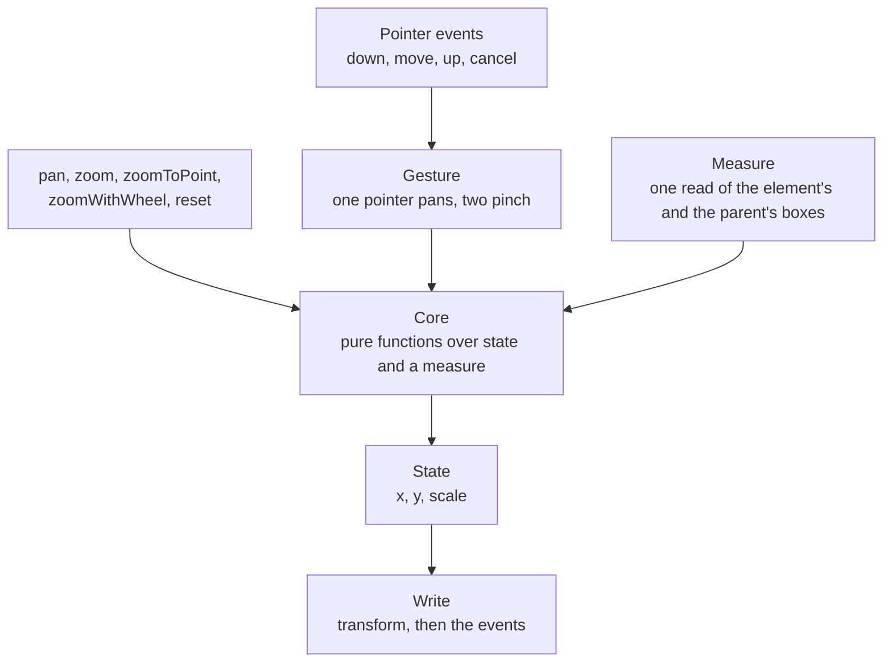

# Pan and zoom

`createPanzoom` in `@esposter/shared`: it makes one element draggable and zoomable by writing a CSS transform to it, replacing `@panzoom/panzoom`. The app's image viewer is its one consumer, and the surface is the upstream package's current surface rather than the half the viewer calls, so the next consumer finds nothing missing.

## How a gesture moves the element

## Decisions

- **State is the model, and a box is read once per call.** The element's position is `x`, `y` and `scale`, and the transform is written in the same call that changes them, never a frame later. A call that needs geometry reads the element's and the parent's `getBoundingClientRect` once, after its own previous write, so the rectangle is never one the pending transform has not reached. The unscaled size is the rectangle over the scale, and the layout centre is the rectangle's centre minus the scale times the pan. A flex-centred element, a margin and a nested layout are therefore already inside the measure and need no margin, padding or offset arithmetic of their own.
- **The core is pure.** Clamping a scale, clamping a pan under containment, the pan a zoom about a point needs, a wheel step and a pinch step are functions of numbers and one `PanzoomMeasure`, each in its own file and tested without a DOM. The shell only reads, calls the core and writes.
- **The focal point is the pointer, in unscaled offsets from the layout centre.** A zoom about the offset `q` from the layout centre keeps the point under the pointer still by moving the pan to `q / toScale - q / scale + pan`, and `toScale` is the already-clamped scale, so a zoom that clamps at the limit does not drift (a zoom against the clamp).
- **The transform origin is always the element's centre.** The focal zoom, containment and fit all measure from the layout centre, so a different origin would move each of them off the point it names. No option sets it: `transform-origin` is written as `50% 50%`, over any style the element had.
- **Containment is the parent's content box.** `inside` keeps the scaled element within it and caps the scale at the fitting scale, and `outside` keeps the element covering it and floors the scale at the covering scale. A box larger than the area it is contained in resolves to the lower bound, as upstream's clamp order does. Reset clamps the pan against the scale it is about to apply, in one step. A zero or non-finite side of the parent contains nothing on its axis, so a collapsed parent contains its element on the other axis alone, and a parent with no such side leaves the scale to its limits. The start scale is one value, clamped and contained, which the start state applies and `panOnlyWhenZoomed` judges a pan against.
- **Construction is synchronous and quiet.** The start scale and pan are applied before `createPanzoom` returns and dispatch nothing, so a pan made on the next line is not overwritten and no timer exists. `silent` still suppresses every event for an instance or a call.
- **Pointer Events and `CustomEvent`, with listeners owned by one `AbortController`.** Mouse and touch fallbacks, vendor prefixes and the polyfill file are the old browsers' and are not carried. `destroy` aborts the listeners and restores every style it wrote to the element and its parent, which upstream left behind. A destroyed panzoom writes nothing and binds nothing again, even from a listener that destroys it mid-gesture.
- **A drag survives a zoom.** The drag anchors to the pointer, the pan and the scale at the moment it began, and a zoom during the drag re-anchors it, so the next move continues from where the zoom left the element. Pinch with `pan` keeps the point between the fingers under the fingers.
- **The cursor is not forced.** The `cursor` option writes only while panning is possible, so a stylesheet cursor on a pan-disabled element stands. A parent that is a shadow root is handled by its host.
- **Events keep their names and detail.** `panzoomstart`, `panzoompan`, `panzoomzoom`, `panzoomreset`, `panzoomend` and `panzoomchange` fire on the element with `{ x, y, scale, isSVG, originalEvent }`, not bubbling.
- **The tracker's features that fit a viewer are built.**
  - A pinch is proportional (#63, #643, #671, #683): the scale is the scale at the gesture's start times the ratio of the fingers' distance now to the distance then, so it feels the same at every scale. Two fingers down on one point have no ratio, so they start no pinch: the first finger keeps its drag and the second moves nothing.
  - A wheel notch follows the delta (#586): a pixel delta of 100 is one notch, which scales by the exponential of the step divided by three, as the upstream wheel does, a smaller trackpad delta a proportional fraction of it, a line delta is taken as pixels, and one event moves at most one notch.
  - `automatic` containment (#102, #511, #598, #707, #583): per axis, `inside` where the scaled element fits the area and `outside` where it overflows. Its scale floor is the fitting scale, which is the "aspect fit" the tracker asks for apart (#504, #577, #659).
  - `panThreshold` (#441, #452) is the distance a pointer travels before a drag starts, and the click that follows a drag past it is swallowed (#674). Only a drag released by the primary button arms that swallower, so a cancelled drag or a right-button drag leaves the next click alone, and a press clears an armed one.
  - `panCursor` (#546) is the cursor while a drag is live.
  - `filter(event)` decides whether a pointer down starts a gesture, which covers the button and modifier asks (#527, #609, #197, #129); `handleStartEvent` stays for parity.
  - The element carries its scale in `--panzoom-scale` (#627).
  - `fit()` scales the element to the parent and centres it, and `startScale: "fit"` does so at construction (#432, #616, #656).
  - Attachment is `isConnected`, so an element in an iframe is accepted (#693).
- **The rest are declined, each with its reason in the Upstream table.**
  - Inertia and rubber-band (#212, #225, #625) are an animation model a consumer layers on `panzoomend`.
  - Rotation (#286, #694) is a gesture of its own.
  - Double tap (#20, #275) is a gesture recogniser's work, and a consumer calls `zoomToPoint` from its own handler.
  - Targeting an SVG element and fly-to (#73, #103, #642) are SVG-specific.
  - Pan limits by ratio (#184, #476, #490) are what containment is.
  - A panzoom inside an ancestor that applies its own scale (#292) is outside the measure's assumption that no ancestor scales the element.
  - The remainder (#230, #644, #665, #435, #684, #648, #361, #370, #617) has a workaround on the consumer's side that costs less than an option.
- **Three limits are kept, each with its trigger.**
  - Two instances on siblings under one parent each record that parent's inline styles, so the second records the first's `overflow: hidden` and a destroy in creation order leaves it behind. Destroying in reverse order restores both.
  - A listener that changes the state during a `panzoomzoom` or `panzoompan` dispatch is followed by a `panzoomchange` carrying the detail built before the nested change; `getScale()` is current.
  - A measure taken while an animated write is still running reads the box the transition has reached, so a second zoom or pan inside the transition's duration lands off by what is left of it. Animated writes are `reset` and the one-step `zoomIn` and `zoomOut` by default; `fit` writes at the instance's `animate`, off by default, and the wheel and the drag never animate.
- **One module in `@esposter/shared`.** The module is small enough that every consumer of the package can carry it, and only the viewer calls it today. Rejected: a package of its own, since it holds no engine and no state a second consumer would rebuild.

## Key files

| File                                            | Role                                                                    |
| ----------------------------------------------- | ----------------------------------------------------------------------- |
| `packages/shared/src/models/panzoom/`           | the options, the measure, the state, the event detail and the object    |
| `packages/shared/src/services/panzoom/`         | the core's pure functions, the measure, the gesture and `createPanzoom` |
| `apps/web/app/composables/shared/usePanZoom.ts` | the viewer's composable over it, mirroring the scale into a ref         |

## Upstream

The tracker of `timmywil/panzoom` was read whole, each issue given one verdict, and the verdicts are held in the table below, each linked to its issue and, for an in-scope row, to the test that proves it.

| Upstream                                                                                                            | Verdict                                                                                | Proof                                                                                                                                                                                                                                                                                                     |
| ------------------------------------------------------------------------------------------------------------------- | -------------------------------------------------------------------------------------- | --------------------------------------------------------------------------------------------------------------------------------------------------------------------------------------------------------------------------------------------------------------------------------------------------------- |
| [#1](https://github.com/timmywil/panzoom/issues/1) Misspelled "width" attribute                                     | not a defect: fixed in v4.0.0                                                          | released in 4.0.0                                                                                                                                                                                                                                                                                         |
| [#2](https://github.com/timmywil/panzoom/issues/2) Issue with FireFox Browsers                                      | out of scope - browser: Firefox 20.0.1                                                 | #2 @timmywil: I suspect this is a drawing issue in Firefox and not something that can be addressed by this plugin.                                                                                                                                                                                        |
| [#3](https://github.com/timmywil/panzoom/issues/3) Pan support for Android                                          | out of scope - browser: Android 4.0.4 and Chrome 25-26 touch events                    | #3 @timmywil: This has to do with the Android OS and its support for touch events.                                                                                                                                                                                                                        |
| [#4](https://github.com/timmywil/panzoom/issues/4) Zoom relative to pinch/viewport center instead of image cen…     | not a defect: fixed in v4.0.0                                                          | released in 4.0.0                                                                                                                                                                                                                                                                                         |
| [#5](https://github.com/timmywil/panzoom/issues/5) Zooming doesn't follow the fingers                               | not a defect: fixed in v4.0.0                                                          | released in 4.0.0                                                                                                                                                                                                                                                                                         |
| [#6](https://github.com/timmywil/panzoom/issues/6) Add the option to limit panning to the dimensions of the pa…     | not a defect: fixed in v4.0.0                                                          | released in 4.0.0                                                                                                                                                                                                                                                                                         |
| [#7](https://github.com/timmywil/panzoom/issues/7) stop the panzoom on demand                                       | not a defect: usage question                                                           | README.md L526-L536 (disablePan)                                                                                                                                                                                                                                                                          |
| [#8](https://github.com/timmywil/panzoom/issues/8) ios pan                                                          | not a defect: usage question                                                           | #8 @timmywil: Also keep in mind that panzoom must also call stopPropagation() on click and touchstart events                                                                                                                                                                                              |
| [#9](https://github.com/timmywil/panzoom/issues/9) Overwrite touchSupported                                         | not a defect: fixed in v4.0.0                                                          | released in 4.0.0                                                                                                                                                                                                                                                                                         |
| [#10](https://github.com/timmywil/panzoom/issues/10) Scroll wheel opts.middle usage                                 | not a defect: fixed in v4.0.0                                                          | released in 4.0.0                                                                                                                                                                                                                                                                                         |
| [#11](https://github.com/timmywil/panzoom/issues/11) bound pan feature to image                                     | not a defect: usage question                                                           | #11 @timmywil: Trying setting the contain option to 'invert' and let me know if you have trouble.                                                                                                                                                                                                         |
| [#12](https://github.com/timmywil/panzoom/issues/12) Pan Left, Right, Up and Down by Event                          | not a defect: usage question                                                           | README.md L857-L862 (pan with relative: true moves by an offset)                                                                                                                                                                                                                                          |
| [#13](https://github.com/timmywil/panzoom/issues/13) Ability to animate pan feature                                 | not a defect: fixed in v4.0.0                                                          | released in 4.0.0                                                                                                                                                                                                                                                                                         |
| [#14](https://github.com/timmywil/panzoom/issues/14) $element.panzoom("disable")                                    | not a defect: usage question                                                           | #14 @timmywil: It is only applicable to elements on which panzoom has been initialized.                                                                                                                                                                                                                   |
| [#15](https://github.com/timmywil/panzoom/issues/15) Is there a way to know the current zoom?                       | not a defect: usage question                                                           | README.md L761-L771 (getScale returns the current scale)                                                                                                                                                                                                                                                  |
| [#16](https://github.com/timmywil/panzoom/issues/16) How to control events ?                                        | not a defect: usage question                                                           | #16 @timmywil: The event callback is passed the scale.                                                                                                                                                                                                                                                    |
| [#17](https://github.com/timmywil/panzoom/issues/17) Scrollbars for container                                       | out of scope - consumer CSS/markup: scrollable parent around a transformed child       | #17 @timmywil: I think it's safe to say this is outside the scope of panzoom.                                                                                                                                                                                                                             |
| [#18](https://github.com/timmywil/panzoom/issues/18) SVG in OBJECT not suported?                                    | out of scope - consumer CSS/markup: object tag eats pointer events                     | #18 @jrameriz: The object does not respond to movement/pan with mouse.                                                                                                                                                                                                                                    |
| [#19](https://github.com/timmywil/panzoom/issues/19) Restoring form events                                          | not a defect: usage question                                                           | #19 @timmywil: I think it would be odd behaviour to have the mousedown both open the select element and start panning.                                                                                                                                                                                    |
| [#20](https://github.com/timmywil/panzoom/issues/20) Double tap to zoom                                             | declined                                                                               | declined: double tap is a gesture recogniser's work, and a consumer calls `zoomToPoint` from its own handler                                                                                                                                                                                              |
| [#21](https://github.com/timmywil/panzoom/issues/21) Speed up zoom movements on mobile                              | not a defect: usage question                                                           | #21 @timmywil: increment now affects the pinch.                                                                                                                                                                                                                                                           |
| [#22](https://github.com/timmywil/panzoom/issues/22) How is contain supposed to work?                               | not a defect: usage question                                                           | #22 @timmywil: Nevertheless, it sounds like what you want is                                                                                                                                                                                                                                              |
| [#23](https://github.com/timmywil/panzoom/issues/23) Add demos for all options                                      | not a defect: documentation gap                                                        | README.md L496-L510 (contain and its values documented)                                                                                                                                                                                                                                                   |
| [#24](https://github.com/timmywil/panzoom/issues/24) Viewport of image                                              | not a defect: usage question                                                           | #24 @timmywil: Specific dimensions should be set with your CSS.                                                                                                                                                                                                                                           |
| [#25](https://github.com/timmywil/panzoom/issues/25) Added a new option "constrain" to the contain option           | not a defect: usage question                                                           | closed, not merged                                                                                                                                                                                                                                                                                        |
| [#26](https://github.com/timmywil/panzoom/issues/26) Panzoom prevents contained elements from receiving events i…   | not a defect: usage question                                                           | #26 @timmywil: If you handle the event directly, you can stopPropagation and prevent the event from reaching panzoom at all                                                                                                                                                                               |
| [#27](https://github.com/timmywil/panzoom/issues/27) Question: feature-detection rather than browser-detection      | not a defect: usage question                                                           | #27 @timmywil: There's no browser detection in jQuery.panzoom.                                                                                                                                                                                                                                            |
| [#28](https://github.com/timmywil/panzoom/issues/28) Focal point mousewheel zooming doesnt work in Firefox          | not a defect: fixed in v4.0.0                                                          | released in 4.0.0                                                                                                                                                                                                                                                                                         |
| [#29](https://github.com/timmywil/panzoom/issues/29) Touch events ios positioning issue zoom and pan horizontal?    | not a defect: usage question                                                           | #29 @timmywil: Have a look at the focal option on the zoom method and let me know if you have trouble.                                                                                                                                                                                                    |
| [#30](https://github.com/timmywil/panzoom/issues/30) focal on mouse click                                           | not a defect: usage question                                                           | #30 @timmywil: Simply pass the mouse event as the focal option:                                                                                                                                                                                                                                           |
| [#31](https://github.com/timmywil/panzoom/issues/31) containt="invert" and pan the wrapper programmatically         | not a defect: usage question                                                           | #31 @timmywil: The contain option will restrict the pan even when setting the pan programatically                                                                                                                                                                                                         |
| [#32](https://github.com/timmywil/panzoom/issues/32) Zoom to the top-left corner                                    | declined: the origin is the element's centre, which every measure assumes              | #32 @timmywil: Another way is to set the css transform-origin to 0 0:                                                                                                                                                                                                                                     |
| [#33](https://github.com/timmywil/panzoom/issues/33) mac os x: image flickers after zoom                            | out of scope - browser: Chrome and Firefox on macOS                                    | #33 @timmywil: This is a known issue, but not something I can fix on my end.                                                                                                                                                                                                                              |
| [#34](https://github.com/timmywil/panzoom/issues/34) "increment" option on zoom range is not being obeyed           | not a defect: fixed in v4.0.0                                                          | released in 4.0.0                                                                                                                                                                                                                                                                                         |
| [#35](https://github.com/timmywil/panzoom/issues/35) zoom focal on contain invert panzooms                          | not a defect: fixed in v4.0.0                                                          | released in 4.0.0                                                                                                                                                                                                                                                                                         |
| [#36](https://github.com/timmywil/panzoom/issues/36) Hello                                                          | not a defect: usage question                                                           | #36 @timmywil: Yes, this is possible by passing the click event object to the focal option when zooming.                                                                                                                                                                                                  |
| [#37](https://github.com/timmywil/panzoom/issues/37) Distinguishing taps or clicks from drags or moves              | not a defect: documentation gap                                                        | #37 @timmywil: This would be worth adding to the docs.                                                                                                                                                                                                                                                    |
| [#38](https://github.com/timmywil/panzoom/issues/38) Finding location of click, or <a> tags                         | not a defect: usage question                                                           | #38 @timmywil: Anchor elements inserted directly onto SVG documents are not valid.                                                                                                                                                                                                                        |
| [#39](https://github.com/timmywil/panzoom/issues/39) Option to control child element by interacting with parent     | not a defect: fixed in v4.1.0                                                          | released in 4.1.0                                                                                                                                                                                                                                                                                         |
| [#40](https://github.com/timmywil/panzoom/issues/40) Focal point not calculated correctly                           | out of scope - third-party: jsPlumb                                                    | #40 @koosvanderkolk: synergy between the different libraries                                                                                                                                                                                                                                              |
| [#41](https://github.com/timmywil/panzoom/issues/41) Getting the SVG drawing element that was touched or clicked    | not a defect: fixed in v4.4.0                                                          | released in 4.4.0                                                                                                                                                                                                                                                                                         |
| [#42](https://github.com/timmywil/panzoom/issues/42) Resizing parent and contain=invert                             | not a defect: fixed in v4.0.0                                                          | released in 4.0.0                                                                                                                                                                                                                                                                                         |
| [#43](https://github.com/timmywil/panzoom/issues/43) Enforce inverted containment automatically                     | not a defect: fixed in v4.0.0                                                          | released in 4.0.0                                                                                                                                                                                                                                                                                         |
| [#44](https://github.com/timmywil/panzoom/issues/44) Focal point zooming running like the origin is top left whe…   | not a defect: fixed in v4.0.0                                                          | released in 4.0.0                                                                                                                                                                                                                                                                                         |
| [#45](https://github.com/timmywil/panzoom/issues/45) <a> links inside the panzoom object                            | not a defect: usage question                                                           | #45 @timmywil: Event propagation is stopped in order to facilitate panzoom elements within panzoom elements.                                                                                                                                                                                              |
| [#46](https://github.com/timmywil/panzoom/issues/46) Support pointer events                                         | not a defect: fixed in v4.0.0                                                          | released in 4.0.0                                                                                                                                                                                                                                                                                         |
| [#47](https://github.com/timmywil/panzoom/issues/47) Find location of a point after zooming                         | not a defect: usage question                                                           | #47 @timmywil: Assuming your popover is absolutely positioned in the body                                                                                                                                                                                                                                 |
| [#48](https://github.com/timmywil/panzoom/issues/48) Disabling panning stops custom cursor declarations             | fixed                                                                                  | `createPanzoom.test.ts`: #48 leaves the cursor to the stylesheet while panning is disabled, and writes it again once it is enabled                                                                                                                                                                        |
| [#49](https://github.com/timmywil/panzoom/issues/49) Viewport being 100% width and 80% height                       | not a defect: usage question                                                           | #49 @timmywil: Yes, this can be accomplished through the use of the                                                                                                                                                                                                                                       |
| [#50](https://github.com/timmywil/panzoom/issues/50) feature: inertia on drag                                       | out of scope - consumer CSS/markup: inertia loop in app code                           | #50 @timmywil: I've decided this is outside the scope of panzoom.                                                                                                                                                                                                                                         |
| [#51](https://github.com/timmywil/panzoom/issues/51) Should the default zoom actions zoom to the center of the c…   | not a defect: usage question                                                           | #51 @timmywil: The default zooming behavior is the same as the default behavior when using a scale transform.                                                                                                                                                                                             |
| [#52](https://github.com/timmywil/panzoom/issues/52) Doesn't work on IE9                                            | out of scope - browser: Internet Explorer 9                                            | #52 @timmywil: It seems this was just an issue with a test                                                                                                                                                                                                                                                |
| [#53](https://github.com/timmywil/panzoom/issues/53) PanZoom on SVG with click Event on Mobile                      | not a defect: documentation gap                                                        | #53 @timmywil: Rather than binding another click event to the SVG, I would suggest binding to a panzoom event                                                                                                                                                                                             |
| [#54](https://github.com/timmywil/panzoom/issues/54) Using one element to pan/zoom another?                         | not a defect: fixed in v4.1.0                                                          | released in 4.1.0                                                                                                                                                                                                                                                                                         |
| [#55](https://github.com/timmywil/panzoom/issues/55) Viewport width="100%" height="100%", contain: 'invert', pan…   | out of scope - browser: Firefox 25.0.1 (SVG sizing)                                    | #55 body: except for firefox (25.0.1)                                                                                                                                                                                                                                                                     |
| [#56](https://github.com/timmywil/panzoom/issues/56) Ability to only pan/zoom the element when the action comple…   | not a defect: usage question                                                           | #56 @timmywil: You should now be able to override the                                                                                                                                                                                                                                                     |
| [#57](https://github.com/timmywil/panzoom/issues/57) dx and dy equal NaN in onPan callback when reach zoom scale…   | not a defect: fixed in v4.0.0                                                          | released in 4.0.0                                                                                                                                                                                                                                                                                         |
| [#58](https://github.com/timmywil/panzoom/issues/58) disable translate3d Mode of Transform                          | not a defect: fixed in v4.0.0                                                          | released in 4.0.0                                                                                                                                                                                                                                                                                         |
| [#59](https://github.com/timmywil/panzoom/issues/59) pan/zoom disabled where image contains "area links"            | out of scope - third-party: Maphilight                                                 | #59 @Guillaume84: Panzoom divs need to wrap ALL Maphilight code in order to work.                                                                                                                                                                                                                         |
| [#60](https://github.com/timmywil/panzoom/issues/60) Conflict with map area elements (2)                            | out of scope - third-party: Maphilight                                                 | #60 @timmywil: hides the image and uses a canvas to repeat the image                                                                                                                                                                                                                                      |
| [#61](https://github.com/timmywil/panzoom/issues/61) Using panzoom to edit photos with fixed ratio                  | not a defect: usage question                                                           | #61 @timmywil: is what you're looking for                                                                                                                                                                                                                                                                 |
| [#62](https://github.com/timmywil/panzoom/issues/62) Pan Zoom Two Images Simultaneously                             | not a defect: usage question                                                           | #62 @timmywil: Currently, panzoom is optimized to work on a single element.                                                                                                                                                                                                                               |
| [#63](https://github.com/timmywil/panzoom/issues/63) Zoom Power Weakens at Larger Zooms                             | built                                                                                  | `bindPanzoom.test.ts`: #63 #643 and #671 a pinch scales by the ratio of the finger distance, not by its increment; `getPanzoomPinchScale.test.ts`: #63 scales a pinch by the ratio of the fingers' distance to the distance at the start                                                                  |
| [#64](https://github.com/timmywil/panzoom/issues/64) Crop so only the visible area remains?                         | not a defect: usage question                                                           | #64 @timmywil: The x and y values in the transform are independent of scale.                                                                                                                                                                                                                              |
| [#65](https://github.com/timmywil/panzoom/issues/65) Using OBJECT instead of IMG for the SVG image                  | out of scope - consumer CSS/markup: object tag eats events                             | #65 @timmywil: The document created by the object element is eating all of the events before they can reach panzoom.                                                                                                                                                                                      |
| [#66](https://github.com/timmywil/panzoom/issues/66) display of buttons in IE                                       | out of scope - browser: Internet Explorer default input styling                        | #66 @timmywil: The styles you are seeing are the default browser styles for those elements.                                                                                                                                                                                                               |
| [#67](https://github.com/timmywil/panzoom/issues/67) Passing through click (tap) event to the SVG when using OBJ…   | out of scope - consumer CSS/markup: object tag and cover div                           | #67 @timmywil: The easiest solution is to not use an OBJECT tag.                                                                                                                                                                                                                                          |
| [#68](https://github.com/timmywil/panzoom/issues/68) Add Pointer Event gesture support for pinch zooming            | not a defect: fixed in v4.0.0                                                          | released in 4.0.0                                                                                                                                                                                                                                                                                         |
| [#69](https://github.com/timmywil/panzoom/issues/69) zoom doesn't work in firefox                                   | not a defect: fixed in v4.0.0                                                          | released in 4.0.0                                                                                                                                                                                                                                                                                         |
| [#70](https://github.com/timmywil/panzoom/issues/70) Initial zoom and focus                                         | not a defect: usage question                                                           | README.md L446-L474 (startScale, startX and startY set the starting transform)                                                                                                                                                                                                                            |
| [#71](https://github.com/timmywil/panzoom/issues/71) Zooming not working properly in iOS                            | out of scope - consumer CSS/markup: conflicting page code in the host page             | #71 @timmywil: I'm guessing there's something else on your page conflicting with panzoom.                                                                                                                                                                                                                 |
| [#72](https://github.com/timmywil/panzoom/issues/72) iframe issue                                                   | out of scope - consumer CSS/markup: parent page eating touch events around an iframe   | #72 @timmywil: There may be an issue with the parent page eating events on Android, but I can't say for sure.                                                                                                                                                                                             |
| [#73](https://github.com/timmywil/panzoom/issues/73) A way to zoom in and pan to a particular element               | declined                                                                               | declined: targeting an SVG element and fly-to are SVG-specific                                                                                                                                                                                                                                            |
| [#74](https://github.com/timmywil/panzoom/issues/74) Rotation                                                       | out of scope - consumer CSS/markup: rotation via a setTransform override               | #74 @timmywil: I haven't, but I think that would be out of scope.                                                                                                                                                                                                                                         |
| [#75](https://github.com/timmywil/panzoom/issues/75) Call reset from javascript, not reset button                   | not a defect: usage question                                                           | #75 @timmywil: Reset can be called at any time.                                                                                                                                                                                                                                                           |
| [#76](https://github.com/timmywil/panzoom/issues/76) Wrong dimensions when using focal zoom                         | not a defect: fixed in v4.0.0                                                          | released in 4.0.0                                                                                                                                                                                                                                                                                         |
| [#77](https://github.com/timmywil/panzoom/issues/77) Problems with setMatrix method?                                | out of scope - consumer CSS/markup: flip via a setTransform override                   | src/panzoom.ts L284 (zoom scale is clamped to minScale and maxScale, so a negative scale cannot be set)                                                                                                                                                                                                   |
| [#78](https://github.com/timmywil/panzoom/issues/78) how to get image coordinates while panning/zooming             | not a defect: usage question                                                           | #78 @timmywil: A method combining all of these dimensions is out of scope for this panzoom plugin                                                                                                                                                                                                         |
| [#79](https://github.com/timmywil/panzoom/issues/79) how to get image coordinates while panning/zooming             | not a defect: duplicate of #78                                                         | #79 @timmywil: Duplicate of #78                                                                                                                                                                                                                                                                           |
| [#80](https://github.com/timmywil/panzoom/issues/80) image not showing on iOS                                       | out of scope - browser: iOS 7.1 Safari (jpg not shown)                                 | #80 @timmywil: That is an odd issue, but it has nothing to do with panzoom.                                                                                                                                                                                                                               |
| [#81](https://github.com/timmywil/panzoom/issues/81) iframe                                                         | not a defect: usage question                                                           | #81 @timmywil: I'd suggest loading jQuery and panzoom in the iframe                                                                                                                                                                                                                                       |
| [#82](https://github.com/timmywil/panzoom/issues/82) zoomIn / zoomOut center on panzoom-element's center            | not a defect: usage question                                                           | #82 @timmywil: That is the default behavior.                                                                                                                                                                                                                                                              |
| [#83](https://github.com/timmywil/panzoom/issues/83) Vertical panning in inverted containment doesn't seem to wo…   | not a defect: fixed in v4.0.0                                                          | released in 4.0.0                                                                                                                                                                                                                                                                                         |
| [#84](https://github.com/timmywil/panzoom/issues/84) Zoom-in is blurry in webkit-based browsers                     | out of scope - browser: WebKit and Blink (transformed layer raster blur)               | #84 @timmywil: This can't be fixed by panzoom.                                                                                                                                                                                                                                                            |
| [#85](https://github.com/timmywil/panzoom/issues/85) Transitions on svg                                             | not a defect: fixed in v3.2.0                                                          | #85 @Risingson: Thanks on the transition fix.                                                                                                                                                                                                                                                             |
| [#86](https://github.com/timmywil/panzoom/issues/86) IE11 svg transform matrix changes but svg remains in place     | out of scope - browser: Internet Explorer 11                                           | #86 @timmywil: I think the best solution for now is to go back to setting SVG attributes.                                                                                                                                                                                                                 |
| [#87](https://github.com/timmywil/panzoom/issues/87) 2.0.4 error                                                    | not a defect: fixed in v4.0.0                                                          | released in 4.0.0                                                                                                                                                                                                                                                                                         |
| [#88](https://github.com/timmywil/panzoom/issues/88) svg in object tag                                              | not a defect: duplicate of #18                                                         | #88 @timmywil: I believe this is a duplicate of #18.                                                                                                                                                                                                                                                      |
| [#89](https://github.com/timmywil/panzoom/issues/89) Zoom with SVG attribute transform instead of CSS               | not a defect: usage question                                                           | #89 @timmywil: Panzoom no longer uses the css transform.                                                                                                                                                                                                                                                  |
| [#90](https://github.com/timmywil/panzoom/issues/90) Input range slider behaviour                                   | not a defect: fixed in v4.0.0                                                          | released in 4.0.0                                                                                                                                                                                                                                                                                         |
| [#91](https://github.com/timmywil/panzoom/issues/91) text scrolling with div                                        | not a defect: duplicate of #96                                                         | #91 @timmywil: Please refer to #96.                                                                                                                                                                                                                                                                       |
| [#92](https://github.com/timmywil/panzoom/issues/92) Issue with image larger than container div                     | not a defect: usage question                                                           | #92 @timmywil: That is the intended behavior.                                                                                                                                                                                                                                                             |
| [#93](https://github.com/timmywil/panzoom/issues/93) Can't move object from dev/use block in firefox                | out of scope - browser: Firefox (mousedown not dispatched to use-referenced group)     | #93 @timmywil: it is a bug in Firefox that can't be fixed by Panzoom                                                                                                                                                                                                                                      |
| [#94](https://github.com/timmywil/panzoom/issues/94) j                                                              | out of scope - reporter (empty report)                                                 | digest: empty body, no comments                                                                                                                                                                                                                                                                           |
| [#95](https://github.com/timmywil/panzoom/issues/95) jQuery error Uncaught TypeError: Cannot read property 'repl…   | not a defect: fixed in v4.0.0                                                          | released in 4.0.0                                                                                                                                                                                                                                                                                         |
| [#96](https://github.com/timmywil/panzoom/issues/96) Panning breaks html elements and scrolling                     | not a defect: usage question                                                           | #96 @timmywil: The touch events issue is common and it is actually question 2 in the                                                                                                                                                                                                                      |
| [#97](https://github.com/timmywil/panzoom/issues/97) how to prevent zoom more than 100%                             | not a defect: usage question                                                           | #97 @cornernote: Ok, I think I got it.                                                                                                                                                                                                                                                                    |
| [#98](https://github.com/timmywil/panzoom/issues/98) explain maxScale within the image's actual size                | not a defect: documentation gap                                                        | closed, not merged                                                                                                                                                                                                                                                                                        |
| [#99](https://github.com/timmywil/panzoom/issues/99) explain maxScale within the image's actual size                | not a defect: documentation gap                                                        | closed, not merged                                                                                                                                                                                                                                                                                        |
| [#100](https://github.com/timmywil/panzoom/issues/100) Blurry zoom-in in web-kit                                    | not a defect: usage question                                                           | #100 @timmywil: In order to set the transform on group elements, you'll need to embed the SVG directly into the HTML.                                                                                                                                                                                     |
| [#101](https://github.com/timmywil/panzoom/issues/101) Mouse zooming is based on current mouse focal point          | not a defect: fixed in v4.0.0                                                          | released in 4.0.0                                                                                                                                                                                                                                                                                         |
| [#102](https://github.com/timmywil/panzoom/issues/102) Automatic containment method                                 | built                                                                                  | `constrainPanzoomPan.test.ts`: #102 contains automatically: inside at scale 1, and outside once zoomed past the parent; `createPanzoom.test.ts`: #102 automatic containment holds a fitting element inside its parent and an overflowing one outside it                                                   |
| [#103](https://github.com/timmywil/panzoom/issues/103) Fly To                                                       | declined                                                                               | declined: targeting an SVG element and fly-to are SVG-specific                                                                                                                                                                                                                                            |
| [#104](https://github.com/timmywil/panzoom/issues/104) in "invert" mode, images natively smaller than the viewport… | not a defect: fixed in v4.0.0                                                          | released in 4.0.0                                                                                                                                                                                                                                                                                         |
| [#105](https://github.com/timmywil/panzoom/issues/105) Disable scaling/zooming                                      | not a defect: usage question                                                           | #105 @timmywil: option will disabling scaling the panzoom element.                                                                                                                                                                                                                                        |
| [#106](https://github.com/timmywil/panzoom/issues/106) range slider broken in IE 11 (test for input-event support…  | not a defect: fixed in v4.0.0                                                          | released in 4.0.0                                                                                                                                                                                                                                                                                         |
| [#107](https://github.com/timmywil/panzoom/issues/107) Problem in webkit causing blurry image/svg                   | not a defect: duplicate of #84                                                         | #107 @timmywil: Duplicate of #84.                                                                                                                                                                                                                                                                         |
| [#108](https://github.com/timmywil/panzoom/issues/108) Blurry image/svg vs Slow (v2.0.4 vs v1.8.5)                  | not a defect: duplicate of #84                                                         | #108 @timmywil: Moving discussion to #84 (reopened).                                                                                                                                                                                                                                                      |
| [#109](https://github.com/timmywil/panzoom/issues/109) Focal zoom does not zooms at focal after window resize       | not a defect: fixed in v4.0.0                                                          | released in 4.0.0                                                                                                                                                                                                                                                                                         |
| [#110](https://github.com/timmywil/panzoom/issues/110) Typo in jquery.panzoom.js example                            | not a defect: fixed in v4.0.0                                                          | released in 4.0.0                                                                                                                                                                                                                                                                                         |
| [#111](https://github.com/timmywil/panzoom/issues/111) Images within zoomed box don't use full resolution but "jus… | out of scope - browser: iPad Safari (transformed content not re-rastered)              | #111 @SNagel: wait until apple solves this thing                                                                                                                                                                                                                                                          |
| [#112](https://github.com/timmywil/panzoom/issues/112) Zooming from the bottom up opposed from the center and out   | not a defect: usage question                                                           | #112 @timmywil: I believe the value would be                                                                                                                                                                                                                                                              |
| [#113](https://github.com/timmywil/panzoom/issues/113) Image rotation broken                                        | not a defect: fixed in v4.0.0                                                          | released in 4.0.0                                                                                                                                                                                                                                                                                         |
| [#114](https://github.com/timmywil/panzoom/issues/114) Pan Animation                                                | out of scope - consumer CSS/markup: inertia animation in app code                      | #114 @timmywil: It's not currently implemented in the plugin.                                                                                                                                                                                                                                             |
| [#115](https://github.com/timmywil/panzoom/issues/115) how to get Zooming Level that I reached during zooming??     | not a defect: usage question                                                           | #115 @timmywil: The zoom level can either be read as a parameter in the zoom event callback                                                                                                                                                                                                               |
| [#116](https://github.com/timmywil/panzoom/issues/116) Problem with iframe zooming on iOS 7.1.2                     | out of scope - consumer CSS/markup: iframe eats touch events                           | #116 @timmywil: I usually try to avoid them by working with cover elements instead.                                                                                                                                                                                                                       |
| [#117](https://github.com/timmywil/panzoom/issues/117) iframe zoom on mobile                                        | not a defect: usage question                                                           | #117 @timmywil: I'd recommend loading panzoom in the pages containing the iframes                                                                                                                                                                                                                         |
| [#118](https://github.com/timmywil/panzoom/issues/118) zoom iframe on mobile                                        | not a defect: usage question                                                           | #118 @timmywil: I've constructed an example with a working iframe                                                                                                                                                                                                                                         |
| [#119](https://github.com/timmywil/panzoom/issues/119) Way to set default zoom?                                     | not a defect: usage question                                                           | #119 @timmywil: You can set the starting scale using                                                                                                                                                                                                                                                      |
| [#120](https://github.com/timmywil/panzoom/issues/120) zoomed item click event does not work on tablets.            | not a defect: usage question                                                           | #120 @timmywil: Re-enable click events with                                                                                                                                                                                                                                                               |
| [#121](https://github.com/timmywil/panzoom/issues/121) Cordova and Panzoom                                          | out of scope - framework: Cordova                                                      | #121 @timmywil: I don't have experience with Cordova                                                                                                                                                                                                                                                      |
| [#122](https://github.com/timmywil/panzoom/issues/122) Restrain pan to its parent.                                  | not a defect: usage question                                                           | #122 @timmywil: I think you're looking for                                                                                                                                                                                                                                                                |
| [#123](https://github.com/timmywil/panzoom/issues/123) Safari PanZoom resets Pan x, y cooords.                      | not a defect: fixed in v4.0.0                                                          | released in 4.0.0                                                                                                                                                                                                                                                                                         |
| [#124](https://github.com/timmywil/panzoom/issues/124) (Question) Bind event handler on touchend/pointerup          | not a defect: usage question                                                           | src/types.ts L238-L241 (destroy)                                                                                                                                                                                                                                                                          |
| [#125](https://github.com/timmywil/panzoom/issues/125) Panzoom Plugin Advice                                        | not a defect: usage question                                                           | #125 @timmywil: You can accomplish this by applying panzoom separately for each section                                                                                                                                                                                                                   |
| [#126](https://github.com/timmywil/panzoom/issues/126) Question on retrieving current settings                      | not a defect: usage question                                                           | #126 @timmywil: There are a few ways to accomplish this                                                                                                                                                                                                                                                   |
| [#127](https://github.com/timmywil/panzoom/issues/127) add "centered" option to invert-containment                  | not a defect: fixed in v4.0.0                                                          | closed, not merged                                                                                                                                                                                                                                                                                        |
| [#128](https://github.com/timmywil/panzoom/issues/128) Input & Content Editable fields not accessible if embedded…  | not a defect: usage question                                                           | #128 @RoryOSiochain: Apologies, the documentation gives a perfect example of how to deal with this                                                                                                                                                                                                        |
| [#129](https://github.com/timmywil/panzoom/issues/129) Add docs for middle mouse only control                       | built                                                                                  | `bindPanzoom.test.ts`: #129 a filter passes only a pointer down on the middle button to a pan                                                                                                                                                                                                             |
| [#130](https://github.com/timmywil/panzoom/issues/130) On SVG marker click,pan to the marker position ?             | not a defect: usage question                                                           | src/types.ts L367-L371 (zoomToPoint takes a client point; no comment, the answer is the documented method)                                                                                                                                                                                                |
| [#131](https://github.com/timmywil/panzoom/issues/131) Fixed bug in Readme                                          | not a defect: usage question                                                           | #131 @timmywil: The docs are correct.                                                                                                                                                                                                                                                                     |
| [#132](https://github.com/timmywil/panzoom/issues/132) Zoom Dynamically Created Divs                                | not a defect: usage question                                                           | #132 @timmywil: You'll just need to call panzoom on the dynamically created element after it is created                                                                                                                                                                                                   |
| [#133](https://github.com/timmywil/panzoom/issues/133) on.mousedown event blocked in latest IE 11 version           | out of scope - browser: Internet Explorer 11                                           | #133 @Rinkana: it seems that no pointerevents are not triggered in IE11 atm                                                                                                                                                                                                                               |
| [#134](https://github.com/timmywil/panzoom/issues/134) Phonegap/Android                                             | out of scope - framework: Cordova (PhoneGap Build)                                     | #134 @vespino: but only in the Phonegap (Build) webview                                                                                                                                                                                                                                                   |
| [#135](https://github.com/timmywil/panzoom/issues/135) Draggable on X Axis Only                                     | not a defect: usage question                                                           | src/types.ts L175-L178 (disableXAxis, disableYAxis)                                                                                                                                                                                                                                                       |
| [#136](https://github.com/timmywil/panzoom/issues/136) Inverted containment issues                                  | fixed                                                                                  | `createPanzoom.test.ts`: #614 contain outside keeps a flex-centred element covering its parent; `constrainPanzoomPan.test.ts`: #614 keeps a flex-centred element covering its parent at its own layout offset                                                                                             |
| [#137](https://github.com/timmywil/panzoom/issues/137) Image Offset                                                 | not a defect: usage question                                                           | #137 @timmywil: You can also use the                                                                                                                                                                                                                                                                      |
| [#138](https://github.com/timmywil/panzoom/issues/138) Limit panning to image border                                | not a defect: usage question                                                           | #138 @timmywil: Do you mean `contain: invert`?                                                                                                                                                                                                                                                            |
| [#139](https://github.com/timmywil/panzoom/issues/139) Feature: $zoomRange: [array] or rangeStep: [array]           | not a defect: usage question                                                           | #139 @timmywil: I think this behavior is best left to the user.                                                                                                                                                                                                                                           |
| [#140](https://github.com/timmywil/panzoom/issues/140) Dragging issue for SVG in object tag with type as "image/sv… | out of scope - consumer CSS/markup: object tag                                         | #140 @timmywil: You just need the object to not eat all the pointer events.                                                                                                                                                                                                                               |
| [#141](https://github.com/timmywil/panzoom/issues/141) Panning and Zooming is very slow on Android                  | out of scope - browser: Android WebView (SVG repaint)                                  | #141 @SamuelMichelRiad: did you ever find a solution to this performance issue                                                                                                                                                                                                                            |
| [#142](https://github.com/timmywil/panzoom/issues/142) Memory leak                                                  | not a defect: usage question                                                           | #142 @timmywil: It removes all event handlers                                                                                                                                                                                                                                                             |
| [#143](https://github.com/timmywil/panzoom/issues/143) Refit element on minScale                                    | not a defect: usage question                                                           | #143 @timmywil: is just shorthand for adding a                                                                                                                                                                                                                                                            |
| [#144](https://github.com/timmywil/panzoom/issues/144) Contain image but also allow unlimited zoom in               | not a defect: usage question                                                           | #144 @timmywil: Panzoom's contain option does ensure that the entire image is always visible in the container                                                                                                                                                                                             |
| [#145](https://github.com/timmywil/panzoom/issues/145) setDimension capability                                      | not a defect: fixed in v4.0.0                                                          | released in 4.0.0                                                                                                                                                                                                                                                                                         |
| [#146](https://github.com/timmywil/panzoom/issues/146) Different width and height as the viewbox width and height   | declined                                                                               | declined: an SVG with a `viewBox` differing from its size is SVG-specific                                                                                                                                                                                                                                 |
| [#147](https://github.com/timmywil/panzoom/issues/147) Multiple Images                                              | not a defect: usage question                                                           | README.md Intro (the element can be anything)                                                                                                                                                                                                                                                             |
| [#148](https://github.com/timmywil/panzoom/issues/148) Centering image on zoom in/out                               | not a defect: usage question                                                           | #148 @timmywil: transform-origin normally takes care of this if the image is already centered                                                                                                                                                                                                             |
| [#149](https://github.com/timmywil/panzoom/issues/149) feature request: disable pan or disable zoom or both on mob… | not a defect: usage question                                                           | #149 @paulusyansen: use options disableZoom: true                                                                                                                                                                                                                                                         |
| [#150](https://github.com/timmywil/panzoom/issues/150) I am using Panzoom with an <object> tag.                     | out of scope - consumer CSS/markup: object tag                                         | #150 @jrameriz: Same problem here                                                                                                                                                                                                                                                                         |
| [#151](https://github.com/timmywil/panzoom/issues/151) Panning issue in Firefox when scrolling used for div         | out of scope - consumer CSS/markup: nested overflow:auto child                         | src/panzoom.ts L439-L446 (handleStartEvent prevents default on any pointer down under the element)                                                                                                                                                                                                        |
| [#152](https://github.com/timmywil/panzoom/issues/152) Problem when zooming on SVG element with contain:"invert"    | out of scope - browser: WebKit (Safari, iOS) SVG raster                                | #196 @hdavidzhu: It seems from the other issues that this is a -webkit issue                                                                                                                                                                                                                              |
| [#153](https://github.com/timmywil/panzoom/issues/153) can do the double tap zoom or reset ?                        | not a defect: usage question                                                           | #153 @timmywil: Yes, bind to double tap and call the zoom or reset methods                                                                                                                                                                                                                                |
| [#154](https://github.com/timmywil/panzoom/issues/154) contain invert fix for images smaller than viewport; fixes…  | not a defect: fixed in v4.0.0                                                          | released in 4.0.0 (zoom min and max scale based on containment)                                                                                                                                                                                                                                           |
| [#155](https://github.com/timmywil/panzoom/issues/155) Panzoom issue for Android tablet                             | not a defect                                                                           | not a defect: no reproduction was given                                                                                                                                                                                                                                                                   |
| [#156](https://github.com/timmywil/panzoom/issues/156) HTML element - Select box in zoom area disabled              | not a defect: usage question                                                           | #156 @timmywil: This can be fixed by adding the following                                                                                                                                                                                                                                                 |
| [#157](https://github.com/timmywil/panzoom/issues/157) Using Thumbnail and Detail Images                            | out of scope - third-party: lazy-load plugin                                           | #157 @paulusyansen: i think you need to use lazy load plugin                                                                                                                                                                                                                                              |
| [#158](https://github.com/timmywil/panzoom/issues/158) predefined onClick events get erased                         | not a defect: usage question                                                           | #158 @timmywil: Panzoom does not remove other click handlers                                                                                                                                                                                                                                              |
| [#159](https://github.com/timmywil/panzoom/issues/159) focal zoom and X alignment                                   | out of scope - reporter (empty report)                                                 | digest: empty body, no comments                                                                                                                                                                                                                                                                           |
| [#160](https://github.com/timmywil/panzoom/issues/160) Zooming Reset                                                | out of scope - reporter (empty report)                                                 | digest: empty body, no comments                                                                                                                                                                                                                                                                           |
| [#161](https://github.com/timmywil/panzoom/issues/161) Problem with zoom                                            | not a defect: usage question                                                           | #161 @paulusyansen: yes just put minScale: 1, because                                                                                                                                                                                                                                                     |
| [#162](https://github.com/timmywil/panzoom/issues/162) Zoompan stopping tap/click event propagation on swf          | out of scope - consumer CSS/markup: object tag                                         | #162 @timmywil: I think you can achieve this using                                                                                                                                                                                                                                                        |
| [#163](https://github.com/timmywil/panzoom/issues/163) Zoompan stopping tap/click event propagation on swf          | not a defect: duplicate of #162                                                        | #163 @timmywil: There are only 2 options                                                                                                                                                                                                                                                                  |
| [#164](https://github.com/timmywil/panzoom/issues/164) Add event to svg object                                      | not a defect: usage question                                                           | README.md FAQ 3                                                                                                                                                                                                                                                                                           |
| [#165](https://github.com/timmywil/panzoom/issues/165) Keep transform on setmatrix                                  | not a defect: usage question                                                           | src/types.ts L126-L129 (setTransform)                                                                                                                                                                                                                                                                     |
| [#166](https://github.com/timmywil/panzoom/issues/166) Floating point regex causes matrix reset.                    | not a defect: fixed in v4.0.0                                                          | released in 4.0.0                                                                                                                                                                                                                                                                                         |
| [#167](https://github.com/timmywil/panzoom/issues/167) How to apply contain : 'invert' on svg group                 | not a defect: usage question                                                           | src/panzoom.ts L195-L196 (getDimensions reads elem.parentNode)                                                                                                                                                                                                                                            |
| [#168](https://github.com/timmywil/panzoom/issues/168) How to make spatial effect on different layers               | out of scope - consumer CSS/markup: stacked layers with separate instances             | #168 @timmywil: the top element with Panzoom initialized would eat up the events                                                                                                                                                                                                                          |
| [#169](https://github.com/timmywil/panzoom/issues/169) The parent element set the scaling problems                  | out of scope - consumer CSS/markup: scaled ancestor                                    | (no comments)                                                                                                                                                                                                                                                                                             |
| [#170](https://github.com/timmywil/panzoom/issues/170) css:hover not working on Android                             | out of scope - browser: Android Chrome (touch has no hover)                            | #170 @TimmothyClaudius: In general, you cannot hover on a touch device.                                                                                                                                                                                                                                   |
| [#171](https://github.com/timmywil/panzoom/issues/171) WP Windows Phone touch event                                 | out of scope - browser: Windows Phone 8.1 IE touch (LEGACY)                            | #171 body: Please Fix touch event in windows phone.                                                                                                                                                                                                                                                       |
| [#172](https://github.com/timmywil/panzoom/issues/172) Disable pan while not zooming                                | not a defect: usage question                                                           | src/types.ts L181-L182 (panOnlyWhenZoomed)                                                                                                                                                                                                                                                                |
| [#173](https://github.com/timmywil/panzoom/issues/173) Problem with Firefox and Chrome at first load                | not a defect: usage question                                                           | #173 @beufanet: needed $(window).load(function() {}); before launching panzoom                                                                                                                                                                                                                            |
| [#174](https://github.com/timmywil/panzoom/issues/174) Enable pan/zoom after being initially disabled               | not a defect: usage question                                                           | #174 @andreicojea: Found the answer on the README page                                                                                                                                                                                                                                                    |
| [#175](https://github.com/timmywil/panzoom/issues/175) "panzoomstart" event not fired when zooming using trackpad…  | not a defect: usage question                                                           | README.md Events ("panzoomstart" fired when the user starts a move or pinch zoom gesture)                                                                                                                                                                                                                 |
| [#176](https://github.com/timmywil/panzoom/issues/176) saving the pan & zoom state of the map                       | not a defect: usage question                                                           | src/types.ts L248-L251 (getPan, getScale)                                                                                                                                                                                                                                                                 |
| [#177](https://github.com/timmywil/panzoom/issues/177) does not work in wordpress                                   | out of scope - third-party: WordPress                                                  | #177 @topkat: I have modified to accept DOMMouseScroll events                                                                                                                                                                                                                                             |
| [#178](https://github.com/timmywil/panzoom/issues/178) Need support for rotation in 90 degree steps                 | not a defect: usage question                                                           | #178 @david-hollifield: but panzoom overwrites the rotation transform                                                                                                                                                                                                                                     |
| [#179](https://github.com/timmywil/panzoom/issues/179) Adding icons to panzoom element                              | not a defect: usage question                                                           | src/css.ts L85-L95 (setTransform example)                                                                                                                                                                                                                                                                 |
| [#180](https://github.com/timmywil/panzoom/issues/180) Disable pinch zooming                                        | not a defect: usage question                                                           | #180 @timmywil: Use the disableZoom option.                                                                                                                                                                                                                                                               |
| [#181](https://github.com/timmywil/panzoom/issues/181) Blurred zoom when using touch                                | out of scope - browser: Android 4.4 / 5.0 WebView                                      | #181 @henkkelder: Android 5.0 in Phonegap (= webview)                                                                                                                                                                                                                                                     |
| [#182](https://github.com/timmywil/panzoom/issues/182) disabling scroll on page (mobile)                            | not a defect: usage question                                                           | #182 @kiddailey: I added a listener to the                                                                                                                                                                                                                                                                |
| [#183](https://github.com/timmywil/panzoom/issues/183) pan to correct zoom by coords by zoom 1                      | not a defect: usage question                                                           | #183 @timmywil: Set the focal option                                                                                                                                                                                                                                                                      |
| [#184](https://github.com/timmywil/panzoom/issues/184) Limit panning by some percentage                             | declined                                                                               | declined: a pan limit by ratio is what containment is                                                                                                                                                                                                                                                     |
| [#185](https://github.com/timmywil/panzoom/issues/185) Documentation bug                                            | not a defect: fixed in v4.0.0                                                          | released in 4.0.0                                                                                                                                                                                                                                                                                         |
| [#186](https://github.com/timmywil/panzoom/issues/186) On mobile device (phone and tablet) ANDROID 4.x, if you zoo… | out of scope - browser: Android 4.x                                                    | #186 @mjoakim: I am not experiencing this on either Android 4.4.4                                                                                                                                                                                                                                         |
| [#187](https://github.com/timmywil/panzoom/issues/187) Centering to bottom of container when zooming out with cont… | not a defect: fixed in v4.0.0                                                          | released in 4.0.0                                                                                                                                                                                                                                                                                         |
| [#188](https://github.com/timmywil/panzoom/issues/188) Panzoomend fix for android chrome                            | not a defect: fixed in v4.0.0                                                          | released in 4.0.0                                                                                                                                                                                                                                                                                         |
| [#189](https://github.com/timmywil/panzoom/issues/189) Not all styles removed when 'destroy' called.                | not a defect: usage question                                                           | src/panzoom.ts L98-L107 (resetStyle)                                                                                                                                                                                                                                                                      |
| [#190](https://github.com/timmywil/panzoom/issues/190) Contain: 'invert' not working properly.                      | not a defect: fixed in v4.0.0                                                          | #190 @hdotson1: You are seeing the background color of your container                                                                                                                                                                                                                                     |
| [#191](https://github.com/timmywil/panzoom/issues/191) Feature: Ability to delegate panzoom for dynamic elements    | not a defect: usage question                                                           | #191 @timmywil: This is not viable because Panzoom needs to be attached to the element it's moving.                                                                                                                                                                                                       |
| [#192](https://github.com/timmywil/panzoom/issues/192) question on zoom event                                       | out of scope - consumer CSS/markup: image source resolution                            | #192 @sam-martindale: i ended up just downloading the image at full size                                                                                                                                                                                                                                  |
| [#193](https://github.com/timmywil/panzoom/issues/193) How to get this to work within a slider?                     | out of scope - third-party: slider plugin (Swiper / wmuSlider)                         | #193 @timmywil: I suspect the mouse events are getting monopolized by one plugin or another                                                                                                                                                                                                               |
| [#194](https://github.com/timmywil/panzoom/issues/194) Sometimes not works with google map                          | out of scope - third-party: Google Maps                                                | #194 @sazarag: I have the same issue                                                                                                                                                                                                                                                                      |
| [#195](https://github.com/timmywil/panzoom/issues/195) Tooltip hotspots                                             | not a defect: usage question                                                           | #195 @timmywil: Tooltips will work fine as long as there aren't conflicting event handlers.                                                                                                                                                                                                               |
| [#196](https://github.com/timmywil/panzoom/issues/196) Blur on scale                                                | out of scope - browser: WebKit (Safari, iOS) raster scaling                            | #196 @hdavidzhu: It seems from the other issues that this is a -webkit issue                                                                                                                                                                                                                              |
| [#197](https://github.com/timmywil/panzoom/issues/197) Implement panning only on right click                        | built                                                                                  | `bindPanzoom.test.ts`: #197 a filter for the right button pans with that button only                                                                                                                                                                                                                      |
| [#198](https://github.com/timmywil/panzoom/issues/198) Panzooming outside of parent.                                | not a defect: usage question                                                           | src/types.ts L22-L32 (canvas binds the down handler to the parent)                                                                                                                                                                                                                                        |
| [#199](https://github.com/timmywil/panzoom/issues/199) What is the $elem in the documentation?                      | not a defect: usage question                                                           | #199 @liamr91: It would be $treeDisplay or you could simply replace $elem with                                                                                                                                                                                                                            |
| [#200](https://github.com/timmywil/panzoom/issues/200) Fixes #187 : Center image inside container with "invert" op… | not a defect: fixed in v4.0.0                                                          | released in 4.0.0                                                                                                                                                                                                                                                                                         |
| [#201](https://github.com/timmywil/panzoom/issues/201) zoon on doubleTap                                            | not a defect: usage question                                                           | #201 @paulusyansen: combined with hammerjs                                                                                                                                                                                                                                                                |
| [#202](https://github.com/timmywil/panzoom/issues/202) contain " invert " issues                                    | not a defect: usage question                                                           | src/panzoom.ts L271-L280 (outside never goes below cover scale)                                                                                                                                                                                                                                           |
| [#203](https://github.com/timmywil/panzoom/issues/203) "resetDimensions" not working with Inverted Containment      | not a defect: fixed in v4.0.0                                                          | #203 @timmywil: You spelled it wrong a couple times                                                                                                                                                                                                                                                       |
| [#204](https://github.com/timmywil/panzoom/issues/204) Click actions not working on elements that are inside Panzo… | not a defect: usage question                                                           | #204 @timmywil: Please see the second question of the FAQ in the README                                                                                                                                                                                                                                   |
| [#205](https://github.com/timmywil/panzoom/issues/205) Move Buttons                                                 | not a defect: usage question                                                           | #205 @timmywil: See the `contain` option.                                                                                                                                                                                                                                                                 |
| [#206](https://github.com/timmywil/panzoom/issues/206) Determining the current centre coordinates of the image wit… | not a defect: usage question                                                           | src/panzoom.ts L550-L551 (getPan, getScale)                                                                                                                                                                                                                                                               |
| [#207](https://github.com/timmywil/panzoom/issues/207) Fixed the code in documentation.                             | not a defect: fixed in v4.0.0                                                          | closed, not merged                                                                                                                                                                                                                                                                                        |
| [#208](https://github.com/timmywil/panzoom/issues/208) Vertical panning limited                                     | not a defect: fixed in v4.4.4                                                          | released in 4.4.4                                                                                                                                                                                                                                                                                         |
| [#209](https://github.com/timmywil/panzoom/issues/209) Moving (pan) <a> with mouse                                  | not a defect: usage question                                                           | README.md FAQ 3                                                                                                                                                                                                                                                                                           |
| [#210](https://github.com/timmywil/panzoom/issues/210) contain: 'invert' but snapping back into position?           | not a defect: usage question                                                           | #210 @timmywil: This is possible, but would require an animated pan in a panzoomend event.                                                                                                                                                                                                                |
| [#211](https://github.com/timmywil/panzoom/issues/211) Scrolling across pandzoom content                            | not a defect: usage question                                                           | #211 @kiddailey: setting the disablePan accordingly                                                                                                                                                                                                                                                       |
| [#212](https://github.com/timmywil/panzoom/issues/212) Transition when scroll                                       | declined                                                                               | declined: inertia and rubber-band are an animation model a consumer layers on `panzoomend`                                                                                                                                                                                                                |
| [#213](https://github.com/timmywil/panzoom/issues/213) Added disable / enable panning methods                       | not a defect: usage question                                                           | closed, not merged                                                                                                                                                                                                                                                                                        |
| [#214](https://github.com/timmywil/panzoom/issues/214) Default size not exceeding container, but allowing zooming…  | not a defect: usage question                                                           | #214 @kiddailey: Definitely.                                                                                                                                                                                                                                                                              |
| [#215](https://github.com/timmywil/panzoom/issues/215) Default focal point is not on the center of element          | not a defect: usage question                                                           | #215 @timmywil: See the startTransform option.                                                                                                                                                                                                                                                            |
| [#216](https://github.com/timmywil/panzoom/issues/216) Html links not clickable on mobile browser                   | not a defect: usage question                                                           | #216 @timmywil: Event delegation is disabled in panzoom elements by default.                                                                                                                                                                                                                              |
| [#217](https://github.com/timmywil/panzoom/issues/217) Please add rotate functionality.                             | not a defect: usage question                                                           | #217 @timmywil: Rotations will be respected in the next release                                                                                                                                                                                                                                           |
| [#218](https://github.com/timmywil/panzoom/issues/218) Set initial zoom to zero?                                    | not a defect: usage question                                                           | src/types.ts L136-L137 (startScale)                                                                                                                                                                                                                                                                       |
| [#219](https://github.com/timmywil/panzoom/issues/219) elements in $set have different startTransform scaling       | not a defect: usage question                                                           | src/panzoom.ts L129-L139 (start options per instance)                                                                                                                                                                                                                                                     |
| [#220](https://github.com/timmywil/panzoom/issues/220) Pan to cursor                                                | not a defect: usage question                                                           | #220 @kiddailey: You may also be able to use relative panning instead                                                                                                                                                                                                                                     |
| [#221](https://github.com/timmywil/panzoom/issues/221) Question: Issue movements to another instance                | not a defect: usage question                                                           | #221 @kiddailey: tie into the panzoomchange event                                                                                                                                                                                                                                                         |
| [#222](https://github.com/timmywil/panzoom/issues/222) Ios rotation fixes                                           | not a defect: usage question                                                           | closed, not merged                                                                                                                                                                                                                                                                                        |
| [#223](https://github.com/timmywil/panzoom/issues/223) elements in $set does not scale when zooming                 | not a defect: usage question                                                           | #223 @timmywil: Sounds like you need 2 instances of panzoom                                                                                                                                                                                                                                               |
| [#224](https://github.com/timmywil/panzoom/issues/224) How do I record image size and position after scaled?        | not a defect: usage question                                                           | src/types.ts L248-L251 (getPan, getScale)                                                                                                                                                                                                                                                                 |
| [#225](https://github.com/timmywil/panzoom/issues/225) Momentum Panning                                             | declined                                                                               | declined: inertia and rubber-band are an animation model a consumer layers on `panzoomend`                                                                                                                                                                                                                |
| [#226](https://github.com/timmywil/panzoom/issues/226) Contain: hides image on mobile                               | out of scope - consumer CSS/markup: maxScale computed from clientWidth at init         | #226 body: maxScale: element.naturalWidth / element.clientWidth                                                                                                                                                                                                                                           |
| [#227](https://github.com/timmywil/panzoom/issues/227) fix version number                                           | out of scope - contributor (empty PR, closed unmerged)                                 | closed, not merged                                                                                                                                                                                                                                                                                        |
| [#228](https://github.com/timmywil/panzoom/issues/228) fix version number                                           | out of scope - contributor (empty PR, closed unmerged)                                 | closed, not merged                                                                                                                                                                                                                                                                                        |
| [#229](https://github.com/timmywil/panzoom/issues/229) Zoom on hover                                                | not a defect: usage question                                                           | #229 @timmywil: Yes.                                                                                                                                                                                                                                                                                      |
| [#230](https://github.com/timmywil/panzoom/issues/230) Set contain to limit on grandparent, rather than direct par… | declined                                                                               | declined: contain measures the parent, and a consumer wraps the element it wants measured                                                                                                                                                                                                                 |
| [#231](https://github.com/timmywil/panzoom/issues/231) Making the panzoom element zoom outside of its parent        | not a defect: usage question                                                           | #231 @timmywil: its use of the focal option                                                                                                                                                                                                                                                               |
| [#232](https://github.com/timmywil/panzoom/issues/232) combination of contain and invert                            | not a defect: usage question                                                           | #232 @timmywil: bind to `panzoomzoom` and set the contain option accordingly                                                                                                                                                                                                                              |
| [#233](https://github.com/timmywil/panzoom/issues/233) Pan on hover                                                 | not a defect: usage question                                                           | #233 @timmywil: I'd say this is out of scope.                                                                                                                                                                                                                                                             |
| [#234](https://github.com/timmywil/panzoom/issues/234) SVG link                                                     | not a defect: usage question                                                           | README.md FAQ 3                                                                                                                                                                                                                                                                                           |
| [#235](https://github.com/timmywil/panzoom/issues/235) Vertical panning only                                        | not a defect: usage question                                                           | #235 @timmywil: See the recently added `disableXAxis` option.                                                                                                                                                                                                                                             |
| [#236](https://github.com/timmywil/panzoom/issues/236) Any way to center Panzoom when clicking reset?               | not a defect: usage question                                                           | #236 @timmywil: I think this can be accomplished by setting the                                                                                                                                                                                                                                           |
| [#237](https://github.com/timmywil/panzoom/issues/237) Cannot scroll when disablePan is false                       | not a defect: usage question                                                           | src/panzoom.ts L57                                                                                                                                                                                                                                                                                        |
| [#238](https://github.com/timmywil/panzoom/issues/238) Panning on mobile (Nokia Lumia 520)                          | out of scope - browser: Internet Explorer 11 on Windows Phone 8.1                      | #238 @timmywil: I'd need a test case to investigate further.                                                                                                                                                                                                                                              |
| [#239](https://github.com/timmywil/panzoom/issues/239) Destoy panzoom                                               | not a defect: usage question                                                           | #239 @timmywil: You can bind to the `panzoomzoom` event and monitor the scale.                                                                                                                                                                                                                            |
| [#240](https://github.com/timmywil/panzoom/issues/240) [SOLVED] panzoom and jquery draggable                        | out of scope - third-party: jQuery UI draggable                                        | #240 @bomastudio: solve my problem.                                                                                                                                                                                                                                                                       |
| [#241](https://github.com/timmywil/panzoom/issues/241) Image getting flushed to the right side of the <section> tag | not a defect: usage question                                                           | #241 @timmywil: setting an appropriate center value                                                                                                                                                                                                                                                       |
| [#242](https://github.com/timmywil/panzoom/issues/242) Unclear how to define "initial" and "reset" img coordinates? | not a defect: usage question                                                           | #242 @timmywil: See the `startTransform` option.                                                                                                                                                                                                                                                          |
| [#243](https://github.com/timmywil/panzoom/issues/243) panning not working on svg object                            | out of scope - consumer CSS/markup: object tag                                         | #243 @timmywil: Object tags can eat up the events.                                                                                                                                                                                                                                                        |
| [#244](https://github.com/timmywil/panzoom/issues/244) get mouse click coordinates after a pan+focal zoom           | not a defect: usage question                                                           | #244 @timmywil: Keep in min the focal point is relative to the parent.                                                                                                                                                                                                                                    |
| [#245](https://github.com/timmywil/panzoom/issues/245) Cannot pinch or zoom on mobile                               | out of scope - consumer CSS/markup: viewport meta tag                                  | #245 @timmywil: You should be able to remove the min/max scale options                                                                                                                                                                                                                                    |
| [#246](https://github.com/timmywil/panzoom/issues/246) Readme: Fix small typo                                       | not a defect: fixed in v3.1.1                                                          | PR merged; first release after merge 3.1.1 (README typo)                                                                                                                                                                                                                                                  |
| [#247](https://github.com/timmywil/panzoom/issues/247) Set CSS-class to HTML-element depending on zoom factor       | not a defect: usage question                                                           | #247 @timmywil: add classes based on the current zoom level                                                                                                                                                                                                                                               |
| [#248](https://github.com/timmywil/panzoom/issues/248) Set initial zoom to show entire image                        | not a defect: usage question                                                           | src/types.ts L137                                                                                                                                                                                                                                                                                         |
| [#249](https://github.com/timmywil/panzoom/issues/249) Doesn't work at all in jquery 3                              | not a defect: fixed in v4.0.0                                                          | released in 4.0.0                                                                                                                                                                                                                                                                                         |
| [#250](https://github.com/timmywil/panzoom/issues/250) Events not firing on setMatrix?                              | not a defect: usage question                                                           | #250 @timmywil: since it is using a CSS transition                                                                                                                                                                                                                                                        |
| [#251](https://github.com/timmywil/panzoom/issues/251) not an Issue! Remebering matrix on Page reload               | not a defect: usage question                                                           | #251 @timmywil: Since no action is required, I'll close this issue though.                                                                                                                                                                                                                                |
| [#252](https://github.com/timmywil/panzoom/issues/252) svg animation help                                           | out of scope - browser: Internet Explorer 10/11 and legacy Edge                        | #252 @timmywil: The problem persists in IE10, 11, and Edge.                                                                                                                                                                                                                                               |
| [#253](https://github.com/timmywil/panzoom/issues/253) Drag image with touch device stopped working                 | not a defect: fixed in v3.1.1                                                          | #253 @timmywil: It has been fixed and a new version is in the process of release.                                                                                                                                                                                                                         |
| [#254](https://github.com/timmywil/panzoom/issues/254) SVG panzoom help please                                      | not a defect: usage question                                                           | #254 @timmywil: an initial scale can be set with the                                                                                                                                                                                                                                                      |
| [#255](https://github.com/timmywil/panzoom/issues/255) Minimum zoom to fill                                         | not a defect: usage question                                                           | src/panzoom.ts L276-L280                                                                                                                                                                                                                                                                                  |
| [#256](https://github.com/timmywil/panzoom/issues/256) Initial Zoom and Focus                                       | not a defect: usage question                                                           | #256 @timmywil: The `focal` option should only be passed to the `zoom` method.                                                                                                                                                                                                                            |
| [#257](https://github.com/timmywil/panzoom/issues/257) Exponential zoom is too quick                                | not a defect: usage question                                                           | src/panzoom.ts L334-L337                                                                                                                                                                                                                                                                                  |
| [#258](https://github.com/timmywil/panzoom/issues/258) contain: "invert" moves content to bottom/right corner       | not a defect: usage question                                                           | #258 @timmywil: Centering on zoom can be done with the                                                                                                                                                                                                                                                    |
| [#259](https://github.com/timmywil/panzoom/issues/259) contain: true needs to account for margins                   | not a defect: fixed in v4.0.0                                                          | src/panzoom.ts L204-L226                                                                                                                                                                                                                                                                                  |
| [#260](https://github.com/timmywil/panzoom/issues/260) bugfix-259 (fixes issue with contain: true)                  | not a defect: fixed in v4.0.0                                                          | closed, not merged                                                                                                                                                                                                                                                                                        |
| [#261](https://github.com/timmywil/panzoom/issues/261) Zoom out loose focus                                         | out of scope - consumer CSS/markup: flexbox centring around the panzoom element        | #261 @timmywil: The flexbox display is really messing with things.                                                                                                                                                                                                                                        |
| [#262](https://github.com/timmywil/panzoom/issues/262) Touch events not working in multiple browsers                | out of scope - browser: Microsoft Edge 14 and Firefox 47-48 touch input                | #262 @ygoe: Edge 14 (from Windows 10.1607) still can't do it                                                                                                                                                                                                                                              |
| [#263](https://github.com/timmywil/panzoom/issues/263) Unexpected Rotation Occurring on Zoom                        | not a defect: usage question                                                           | #263 @timmywil: You're right. I didn't take rotations into account when calculating zoom.                                                                                                                                                                                                                 |
| [#264](https://github.com/timmywil/panzoom/issues/264) Blurry SVG on zoom for nested SVGs                           | out of scope - browser: Safari compositing of nested SVG                               | #264 @timmywil: This is a browser issue that is too nuanced to address from within the plugin.                                                                                                                                                                                                            |
| [#265](https://github.com/timmywil/panzoom/issues/265) Android - Unable to zoom out                                 | out of scope - browser: Android Chrome and WebView pinch handling                      | #265 @timmywil: it sounds like a browser issue                                                                                                                                                                                                                                                            |
| [#266](https://github.com/timmywil/panzoom/issues/266) Zoom: "focal" option doesn't work when "$set" was used on i… | not a defect: usage question                                                           | #266 @isaaclyman: I have a big parent div that I want to receive the panzoom events                                                                                                                                                                                                                       |
| [#267](https://github.com/timmywil/panzoom/issues/267) Use will-change for hardware acceleration if SVGs aren't bl… | out of scope - browser: will-change compositing blurs SVG                              | #267 @timmywil: It seems putting will-change on any element on the page makes SVG blurry.                                                                                                                                                                                                                 |
| [#268](https://github.com/timmywil/panzoom/issues/268) Incorrect panning when use focal zoom                        | not a defect: fixed in v4.4.2                                                          | #268 @borealissw-admin: The problem boils down to animation being set.                                                                                                                                                                                                                                    |
| [#269](https://github.com/timmywil/panzoom/issues/269) Issues with implementing startTransform and zoom pivot       | not a defect: usage question                                                           | #269 @timmywil: Modifying the `transform-origin` will cause some wacky behavior                                                                                                                                                                                                                           |
| [#270](https://github.com/timmywil/panzoom/issues/270) Zooming on mobile                                            | not a defect: fixed in v4.4.1                                                          | #270 @molson504x: The latest release seems to have fixed the issues                                                                                                                                                                                                                                       |
| [#271](https://github.com/timmywil/panzoom/issues/271) Use proper dimensions for containment                        | not a defect: fixed in v4.0.0                                                          | src/panzoom.ts L196-L202                                                                                                                                                                                                                                                                                  |
| [#272](https://github.com/timmywil/panzoom/issues/272) Return to start postion as you zoom out                      | not a defect: usage question                                                           | #272 @timmywil: You should be able to accomplish this with the                                                                                                                                                                                                                                            |
| [#273](https://github.com/timmywil/panzoom/issues/273) Basic panzoom use case, but having an issue making sense of… | not a defect: usage question                                                           | #273 @timmywil: you could either override the default                                                                                                                                                                                                                                                     |
| [#274](https://github.com/timmywil/panzoom/issues/274) No animation at first step with panOnlyWhenZoomed            | not a defect: fixed in v4.0.0                                                          | src/panzoom.ts L155-L162                                                                                                                                                                                                                                                                                  |
| [#275](https://github.com/timmywil/panzoom/issues/275) Add support double tap zooming                               | declined                                                                               | declined: double tap is a gesture recogniser's work, and a consumer calls `zoomToPoint` from its own handler                                                                                                                                                                                              |
| [#276](https://github.com/timmywil/panzoom/issues/276) Linearzoom false option not behaving as expected             | not a defect: fixed in v4.0.0                                                          | src/panzoom.ts L484-L487                                                                                                                                                                                                                                                                                  |
| [#277](https://github.com/timmywil/panzoom/issues/277) Pan and clickable elements - Devices                         | not a defect: usage question                                                           | #277 @timmywil: You might need to attach event delegation rooted at the panzoom element                                                                                                                                                                                                                   |
| [#278](https://github.com/timmywil/panzoom/issues/278) child svg element vs. img?                                   | not a defect: usage question                                                           | #278 @timmywil: Just make sure to initialize after the element is generated.                                                                                                                                                                                                                              |
| [#279](https://github.com/timmywil/panzoom/issues/279) Fix containment Y-position when contain is true and pan-zoo… | not a defect: fixed in v4.0.0                                                          | closed, not merged                                                                                                                                                                                                                                                                                        |
| [#280](https://github.com/timmywil/panzoom/issues/280) Possibly an enhancement request - non-zoomed child elements  | out of scope - consumer CSS/markup: children of a transformed element scale with it    | #280 @timmywil: Unfortunately, this is the nature of CSS.                                                                                                                                                                                                                                                 |
| [#281](https://github.com/timmywil/panzoom/issues/281) Click events on SVG elements                                 | not a defect: usage question                                                           | #281 @timmywil: This is intended behavior to allow for panzoom elements within panzoom elements                                                                                                                                                                                                           |
| [#282](https://github.com/timmywil/panzoom/issues/282) How do I make it so that I never see the background behind…  | not a defect: usage question                                                           | src/types.ts L166                                                                                                                                                                                                                                                                                         |
| [#283](https://github.com/timmywil/panzoom/issues/283) contain seems to be buggy since version 1.3.4                | not a defect: fixed in v4.0.0                                                          | src/panzoom.ts L204-L226                                                                                                                                                                                                                                                                                  |
| [#284](https://github.com/timmywil/panzoom/issues/284) cant pan to correct point ?                                  | not a defect: usage question                                                           | src/panzoom.ts L288-L303                                                                                                                                                                                                                                                                                  |
| [#285](https://github.com/timmywil/panzoom/issues/285) Goolge Maps double-tap zoom                                  | not a defect: duplicate of #275                                                        | #285 @timmywil: Please see #275.                                                                                                                                                                                                                                                                          |
| [#286](https://github.com/timmywil/panzoom/issues/286) Would it support two fingers rotation in the feature?        | declined                                                                               | declined: rotation is a gesture of its own                                                                                                                                                                                                                                                                |
| [#287](https://github.com/timmywil/panzoom/issues/287) How can I save/export current state of an paned/zoomed obje… | not a defect: usage question                                                           | #287 @teropernu: I want to save a location on a floor plan with getMatrix                                                                                                                                                                                                                                 |
| [#288](https://github.com/timmywil/panzoom/issues/288) Panzoom freezes page on IE 11 - Windows 7                    | out of scope - browser: Internet Explorer 11                                           | src/polyfills.js L3-L7                                                                                                                                                                                                                                                                                    |
| [#289](https://github.com/timmywil/panzoom/issues/289) Weird problem while using setMatrix                          | not a defect: usage question                                                           | #289 @timmywil: but `setMatrix` expects an array.                                                                                                                                                                                                                                                         |
| [#290](https://github.com/timmywil/panzoom/issues/290) Bigger SVG causes lags in Mobile devices.                    | out of scope - consumer CSS/markup: opacity transitions on SVG groups                  | #290 body: some css transitions from opacity 0 - 1 that caused the lags.                                                                                                                                                                                                                                  |
| [#291](https://github.com/timmywil/panzoom/issues/291) Transform property can't be reset nor set from JS            | not a defect: usage question                                                           | #291 @timmywil: Will reopen if this is a bug.                                                                                                                                                                                                                                                             |
| [#292](https://github.com/timmywil/panzoom/issues/292) Nested panzoom containment and scale issues                  | declined                                                                               | declined: the measure assumes no ancestor scales the element, so a panzoom inside a transformed ancestor is outside the design                                                                                                                                                                            |
| [#293](https://github.com/timmywil/panzoom/issues/293) panzoom for dynamically added content                        | not a defect: usage question                                                           | #293 @timmywil: you'll just need to call panzoom on the new elements                                                                                                                                                                                                                                      |
| [#294](https://github.com/timmywil/panzoom/issues/294) Invert + zoom < 1 causes element to be positioned badly      | not a defect: fixed in v4.0.0                                                          | src/panzoom.ts L228-L246                                                                                                                                                                                                                                                                                  |
| [#296](https://github.com/timmywil/panzoom/issues/296) Dynamic rotation                                             | not a defect: duplicate of #263                                                        | #296 @timmywil: Please follow #263.                                                                                                                                                                                                                                                                       |
| [#297](https://github.com/timmywil/panzoom/issues/297) First zoom step does not respect focal point                 | not a defect: usage question                                                           | #297 body: focal: {clientX:0, clientY:0}                                                                                                                                                                                                                                                                  |
| [#298](https://github.com/timmywil/panzoom/issues/298) Zoom with Mousewheel + contain: invert = image escapes zoom… | not a defect: fixed in v4.0.0                                                          | src/panzoom.ts L326-L331                                                                                                                                                                                                                                                                                  |
| [#299](https://github.com/timmywil/panzoom/issues/299) Panzoom hides mousedown event of sub-items on latest Chrome  | not a defect: usage question                                                           | #299 @glen-84: You can just listen to `pointerdown` on the child                                                                                                                                                                                                                                          |
| [#300](https://github.com/timmywil/panzoom/issues/300) resetPan not working correctly on "panzoomzoom" event        | not a defect: fixed in v4.0.1                                                          | released in 4.0.1                                                                                                                                                                                                                                                                                         |
| [#301](https://github.com/timmywil/panzoom/issues/301) #300 issue fix                                               | not a defect: fixed in v4.0.1                                                          | closed, not merged                                                                                                                                                                                                                                                                                        |
| [#302](https://github.com/timmywil/panzoom/issues/302) Panning beyond limits loses the panned object                | not a defect: usage question                                                           | #302 @lokeb: Can be fixed with the contain option.                                                                                                                                                                                                                                                        |
| [#303](https://github.com/timmywil/panzoom/issues/303) Pinch zoom broken in Chrome v55.02883.91 on Mobile           | not a defect: fixed in v4.0.0                                                          | src/events.ts L7-L16                                                                                                                                                                                                                                                                                      |
| [#304](https://github.com/timmywil/panzoom/issues/304) Zooming on SVG element is not working                        | not a defect: fixed in v4.0.0                                                          | src/css.ts L119-L121                                                                                                                                                                                                                                                                                      |
| [#305](https://github.com/timmywil/panzoom/issues/305) Pan events are not working with React                        | not a defect: fixed in v4.0.0                                                          | src/panzoom.ts L530-L532                                                                                                                                                                                                                                                                                  |
| [#306](https://github.com/timmywil/panzoom/issues/306) Container with Height Creates Offset. Previous Version Does… | not a defect: fixed in v4.0.0                                                          | src/panzoom.ts L461-L505                                                                                                                                                                                                                                                                                  |
| [#307](https://github.com/timmywil/panzoom/issues/307) Pinch to zoom only works the first time.                     | not a defect: fixed in v4.0.0                                                          | src/panzoom.ts L439-L459                                                                                                                                                                                                                                                                                  |
| [#308](https://github.com/timmywil/panzoom/issues/308) Panning does not work in Android Chrome 55                   | not a defect: fixed in v4.0.0                                                          | src/events.ts L7-L16                                                                                                                                                                                                                                                                                      |
| [#309](https://github.com/timmywil/panzoom/issues/309) How can i draw line with two selected points                 | out of scope - consumer CSS/markup: application drawing code, not a Panzoom behaviour  | #309 body: I need to draw line when click on two points like A and B.                                                                                                                                                                                                                                     |
| [#310](https://github.com/timmywil/panzoom/issues/310) Pinch zoom not working on Android Chrome 55                  | not a defect: duplicate of #303                                                        | #310 @jcnventura: Duplicate of #303                                                                                                                                                                                                                                                                       |
| [#311](https://github.com/timmywil/panzoom/issues/311) Pinch zoom not working on Desktop Firefox 50                 | out of scope - browser: Firefox 50 desktop page pinch-zoom                             | src/panzoom.ts L80-L88                                                                                                                                                                                                                                                                                    |
| [#312](https://github.com/timmywil/panzoom/issues/312) iPhone iOS: Not working after closing bootstrap modal        | out of scope - consumer CSS/markup: the reporter's own iOS overflow fix                | #312 @neferupitto: The issue was a conflict in my own fix on iOS overflow modal scrolling.                                                                                                                                                                                                                |
| [#313](https://github.com/timmywil/panzoom/issues/313) Gap above image, and unable to see the bottom of it          | not a defect: duplicate of #306                                                        | #313 @bil-bas: This is a duplicate of #306                                                                                                                                                                                                                                                                |
| [#314](https://github.com/timmywil/panzoom/issues/314) Positioning not correct when panned and then zoomed out      | not a defect: fixed in v4.0.0                                                          | src/panzoom.ts L327-L331                                                                                                                                                                                                                                                                                  |
| [#315](https://github.com/timmywil/panzoom/issues/315) Not able to zoom out in Firefox                              | out of scope - third-party: jquery.mousewheel                                          | #315 @BramVanroy: I cannot reproduce your issue unfortunately.                                                                                                                                                                                                                                            |
| [#316](https://github.com/timmywil/panzoom/issues/316) Zoom centered around visible part of image                   | not a defect: usage question                                                           | closed, not merged                                                                                                                                                                                                                                                                                        |
| [#317](https://github.com/timmywil/panzoom/issues/317) How to zoom to specific object?                              | not a defect: usage question                                                           | src/panzoom.ts L347-L405                                                                                                                                                                                                                                                                                  |
| [#318](https://github.com/timmywil/panzoom/issues/318) Hi, i'm glad for meet you. Could i ask you?                  | not a defect: usage question                                                           | #318 @jcnventura: Panzoom doesn't automatically pan with mouse movements.                                                                                                                                                                                                                                 |
| [#319](https://github.com/timmywil/panzoom/issues/319) problem with android L and above                             | not a defect: duplicate of #303                                                        | #319 @jcnventura: Duplicate of #303.                                                                                                                                                                                                                                                                      |
| [#320](https://github.com/timmywil/panzoom/issues/320) Panning don't work on Chrome                                 | not a defect: fixed in v4.0.0                                                          | src/panzoom.ts L461-L505                                                                                                                                                                                                                                                                                  |
| [#321](https://github.com/timmywil/panzoom/issues/321) Zooming buttons not working                                  | out of scope - consumer: deployed site differs from local (no reproduction, v3.2.2)    | #321 body: When site is run locally the zoom buttons work, but when site is pushed live nothing happens                                                                                                                                                                                                   |
| [#322](https://github.com/timmywil/panzoom/issues/322) is It possible to pan Content within an IFrame               | out of scope - consumer CSS/markup: iframe content lives in another document           | #322 body: unable to pan the content within an iframe                                                                                                                                                                                                                                                     |
| [#323](https://github.com/timmywil/panzoom/issues/323) Iframe contents : cutting off while zooming                  | out of scope - consumer CSS/markup: iframe viewport clipping                           | #323 body: some contents from the top of iframe cutting off                                                                                                                                                                                                                                               |
| [#324](https://github.com/timmywil/panzoom/issues/324) Unable to pan full picture when using contain: invert        | not a defect: usage question                                                           | #324 body: Should be able to pan the whole image regardless of div size.                                                                                                                                                                                                                                  |
| [#325](https://github.com/timmywil/panzoom/issues/325) Windows Phone Slow When Panning/Zooming Lots Of Elements     | out of scope - browser: Windows Phone Edge performance                                 | #325 body: Windows Phone, Edge. Fully up to date.                                                                                                                                                                                                                                                         |
| [#326](https://github.com/timmywil/panzoom/issues/326) panOnlyWhenZoomed doesn't allow to zoom out on Android Chro… | not a defect: duplicate of #303                                                        | #326 @jcnventura: Duplicate of #303                                                                                                                                                                                                                                                                       |
| [#327](https://github.com/timmywil/panzoom/issues/327) Adds code to precalculate the scaled dimensions              | not a defect: fixed in v4.0.0                                                          | closed, not merged                                                                                                                                                                                                                                                                                        |
| [#328](https://github.com/timmywil/panzoom/issues/328) Unable to preventDefault inside passive event listener due…  | not a defect: fixed in v4.0.0                                                          | src/panzoom.ts L531-L532                                                                                                                                                                                                                                                                                  |
| [#329](https://github.com/timmywil/panzoom/issues/329) Is not a problem, but a question for my project!             | not a defect: usage question                                                           | src/panzoom.ts L546-L552                                                                                                                                                                                                                                                                                  |
| [#330](https://github.com/timmywil/panzoom/issues/330) Fix Chrome 55+ mobile & new pad sensitivity option           | not a defect: fixed in v4.0.0                                                          | closed, not merged                                                                                                                                                                                                                                                                                        |
| [#331](https://github.com/timmywil/panzoom/issues/331) Wildly veering on mousewheel zoom with animate: true         | not a defect: fixed in v4.4.2                                                          | #331 @borealissw-admin: you need to explicitly set `animate: false`                                                                                                                                                                                                                                       |
| [#332](https://github.com/timmywil/panzoom/issues/332) ignore image map area click on panning?                      | out of scope - consumer CSS/markup: image map area click after a drag                  | #332 body: triggered after the mouseup event even when the mouse moves                                                                                                                                                                                                                                    |
| [#333](https://github.com/timmywil/panzoom/issues/333) changed not behaving as expected when zoom is min-zoom       | not a defect: usage question                                                           | src/panzoom.ts L507-L512                                                                                                                                                                                                                                                                                  |
| [#334](https://github.com/timmywil/panzoom/issues/334) Pan to touch/click position                                  | not a defect: usage question                                                           | src/panzoom.ts L288-L303                                                                                                                                                                                                                                                                                  |
| [#335](https://github.com/timmywil/panzoom/issues/335) How i could add left, right, top and bottom border to move…  | not a defect: usage question                                                           | src/panzoom.ts L288-L303                                                                                                                                                                                                                                                                                  |
| [#336](https://github.com/timmywil/panzoom/issues/336) Issue #263: allow panzoom to work on rotated/transformed im… | declined                                                                               | declined with #286: rotation is a gesture of its own                                                                                                                                                                                                                                                      |
| [#337](https://github.com/timmywil/panzoom/issues/337) Question: panning from background/container?                 | not a defect: usage question                                                           | src/types.ts L32                                                                                                                                                                                                                                                                                          |
| [#338](https://github.com/timmywil/panzoom/issues/338) IFrame Panzoom issue                                         | not a defect: usage question                                                           | #338 body: I have injected jquery and panzoom into the iframed document.                                                                                                                                                                                                                                  |
| [#339](https://github.com/timmywil/panzoom/issues/339) page not zoom in iphone6 or iphone6s                         | not a defect: fixed in v4.0.0                                                          | #339 @jcnventura: Panzoom 2.0.5? Can you try with 3.2.2, please?                                                                                                                                                                                                                                          |
| [#340](https://github.com/timmywil/panzoom/issues/340) This plugin is not working after upgrading Chrome to v59     | not a defect: fixed in v4.0.0                                                          | src/events.ts L7-L16                                                                                                                                                                                                                                                                                      |
| [#341](https://github.com/timmywil/panzoom/issues/341) Fix Chrome touch & preventDefault                            | not a defect: fixed in v4.0.0                                                          | closed, not merged                                                                                                                                                                                                                                                                                        |
| [#342](https://github.com/timmywil/panzoom/issues/342) mocha link down in code page                                 | not a defect: fixed in v4.0.0                                                          | released in 4.0.0                                                                                                                                                                                                                                                                                         |
| [#343](https://github.com/timmywil/panzoom/issues/343) Image blurry after zoom in safari browser                    | out of scope - browser: Safari bitmap scaling                                          | #343 @jtara: I would expect a bitmap to be blurry if not higher resolution.                                                                                                                                                                                                                               |
| [#344](https://github.com/timmywil/panzoom/issues/344) Jquery click events not firing                               | not a defect: usage question                                                           | #344 @timmywil: I believe question #2 of the FAQ will solve this issue.                                                                                                                                                                                                                                   |
| [#345](https://github.com/timmywil/panzoom/issues/345) Pan what is inside the element not the element itself.       | out of scope - consumer CSS/markup: canvas is a bitmap with no child elements          | #345 @jtara: It's just a bitmap surface.                                                                                                                                                                                                                                                                  |
| [#346](https://github.com/timmywil/panzoom/issues/346) "should continue with a pointer event if started with a poi… | not a defect: fixed in v4.0.0                                                          | src/panzoom.ts L439-L459                                                                                                                                                                                                                                                                                  |
| [#347](https://github.com/timmywil/panzoom/issues/347) Zoom with scale given doesn't work (broken by #263)          | not a defect: fixed in v4.0.0                                                          | src/panzoom.ts L305-L331                                                                                                                                                                                                                                                                                  |
| [#348](https://github.com/timmywil/panzoom/issues/348) Documentation mixup - destroy/instance                       | not a defect: fixed in v4.0.0                                                          | README.md L687-L695                                                                                                                                                                                                                                                                                       |
| [#349](https://github.com/timmywil/panzoom/issues/349) Touch pinch zoom doesn't work on Windows touch screens       | not a defect: fixed in v4.0.0                                                          | src/events.ts L7-L9                                                                                                                                                                                                                                                                                       |
| [#350](https://github.com/timmywil/panzoom/issues/350) Sync Pan/Zoom across multiple images                         | not a defect: usage question                                                           | #350 body: Nevermind, thank you.                                                                                                                                                                                                                                                                          |
| [#351](https://github.com/timmywil/panzoom/issues/351) Pinch Zoom Not Working                                       | not a defect: fixed in v4.0.0                                                          | src/panzoom.ts L305-L331                                                                                                                                                                                                                                                                                  |
| [#352](https://github.com/timmywil/panzoom/issues/352) Plugin code differences: git -> demo page                    | not a defect: fixed in v4.0.0                                                          | released in 4.0.0                                                                                                                                                                                                                                                                                         |
| [#353](https://github.com/timmywil/panzoom/issues/353) Buggy behavior when using focal zoom and automatic containm… | not a defect: fixed in v4.4.2                                                          | #353 body: affects the zoom-in/out behavior                                                                                                                                                                                                                                                               |
| [#354](https://github.com/timmywil/panzoom/issues/354) Unable to zoom in or zoom out with keyboard                  | not a defect: usage question                                                           | README.md L79-L94                                                                                                                                                                                                                                                                                         |
| [#355](https://github.com/timmywil/panzoom/issues/355) Bugfix/issue 351                                             | not a defect: fixed in v4.0.0                                                          | closed, not merged                                                                                                                                                                                                                                                                                        |
| [#356](https://github.com/timmywil/panzoom/issues/356) Fixed issue #303                                             | not a defect: fixed in v4.0.0                                                          | closed, not merged                                                                                                                                                                                                                                                                                        |
| [#357](https://github.com/timmywil/panzoom/issues/357) fixed issue 328                                              | not a defect: fixed in v4.0.0                                                          | closed, not merged                                                                                                                                                                                                                                                                                        |
| [#358](https://github.com/timmywil/panzoom/issues/358) Call reset from method setTimeout                            | not a defect: usage question                                                           | #358 body: I was wondering if it's possible to call reset from user leave image                                                                                                                                                                                                                           |
| [#359](https://github.com/timmywil/panzoom/issues/359) Document <picture> Support                                   | not a defect: documentation gap                                                        | #359 body: Please document whether or not this plugin supports the                                                                                                                                                                                                                                        |
| [#360](https://github.com/timmywil/panzoom/issues/360) Panzoom not working on Android                               | not a defect: fixed in v4.0.0                                                          | #360 body: I'm having a div with panzoom working fine on iOS but not in Android.                                                                                                                                                                                                                          |
| [#361](https://github.com/timmywil/panzoom/issues/361) Is there any attrs or events that indicates the element is…  | declined                                                                               | declined: a consumer reads the pan against the parent's measure on `panzoompan`                                                                                                                                                                                                                           |
| [#362](https://github.com/timmywil/panzoom/issues/362) Using focal point with button zoom?                          | not a defect: usage question                                                           | #362 body: Is there a way to zoom out with the area that was panned to remaining centered?                                                                                                                                                                                                                |
| [#363](https://github.com/timmywil/panzoom/issues/363) Using the plugin in Ionic                                    | out of scope - framework: Ionic                                                        | #363 body: I have used an _npm_ import and confirm that the node module                                                                                                                                                                                                                                   |
| [#364](https://github.com/timmywil/panzoom/issues/364) contain: invert -> zoom out moves image inside, then jumps…  | not a defect: fixed in v4.0.0                                                          | #364 body: When using contain:invert, zooming out moves the image away from the border of the container.                                                                                                                                                                                                  |
| [#365](https://github.com/timmywil/panzoom/issues/365) Cannot stop panzoom eating events in Chrome                  | not a defect: usage question                                                           | #365 body: I have a textbox and range slider in a panzoom and they are not receiving any events.                                                                                                                                                                                                          |
| [#366](https://github.com/timmywil/panzoom/issues/366) Panning goes beyond the image when zoomed in                 | not a defect: usage question                                                           | #366 body: panning reaches beyond the image then it makes the respective image to disappear from the container.                                                                                                                                                                                           |
| [#367](https://github.com/timmywil/panzoom/issues/367) Using Panzoom with .load                                     | out of scope - consumer CSS/markup: inline SVG injected with jQuery .load              | #367 body: it's very responsive, however Wayfinding uses **.load** to load in the SVG                                                                                                                                                                                                                     |
| [#368](https://github.com/timmywil/panzoom/issues/368) no option ignoreChildrensEvents?                             | not a defect: usage question                                                           | #368 body: can't see in sourcecode                                                                                                                                                                                                                                                                        |
| [#369](https://github.com/timmywil/panzoom/issues/369) How to determin current or changed zoom level?               | not a defect: usage question                                                           | #369 body: I think the panzoomzoom event could suitable                                                                                                                                                                                                                                                   |
| [#370](https://github.com/timmywil/panzoom/issues/370) Allow touchscreen page to scroll when pan reaches limit of…  | declined                                                                               | declined: a consumer reads the pan against the parent's measure on `panzoompan`                                                                                                                                                                                                                           |
| [#371](https://github.com/timmywil/panzoom/issues/371) 作者您好，3.2.2版本有点问题，手机上放大手势不生效            | out of scope - reporter (empty issue)                                                  | #371 @jcnventura: Sorry. empty issue.                                                                                                                                                                                                                                                                     |
| [#372](https://github.com/timmywil/panzoom/issues/372) Panzoom 3.2 doesn't work with jquery 1.11                    | not a defect: fixed in v4.0.0                                                          | #372 body: panzoom 3.2.2 is not compatible with jquery 1.11.0 anymore                                                                                                                                                                                                                                     |
| [#373](https://github.com/timmywil/panzoom/issues/373) Pinching is not working in iPad and mobile devices           | not a defect: fixed in v4.0.0                                                          | #373 body: In iPad (ios devices) Dragging and pinch to zoom in and zoom out is not working.                                                                                                                                                                                                               |
| [#374](https://github.com/timmywil/panzoom/issues/374) Pan and zoom on load                                         | not a defect: usage question                                                           | #374 body: Can't animate a combined pan and zoom in one transition                                                                                                                                                                                                                                        |
| [#375](https://github.com/timmywil/panzoom/issues/375) Work without Jquery?                                         | not a defect: fixed in v4.0.0                                                          | #375 body: Is it possible for this plugin to not be dependent on jquery?                                                                                                                                                                                                                                  |
| [#376](https://github.com/timmywil/panzoom/issues/376) Use Mouse Middle Button to Pan                               | not a defect: fixed in v4.0.0                                                          | #376 body: How can i use my mouse middle button to Pan?                                                                                                                                                                                                                                                   |
| [#377](https://github.com/timmywil/panzoom/issues/377) Panning to a particular element                              | not a defect: usage question                                                           | #377 body: I want to be able to pan and center to a particular element.                                                                                                                                                                                                                                   |
| [#378](https://github.com/timmywil/panzoom/issues/378) Zoom Out: Operator Border Issue                              | out of scope - browser: Firefox                                                        | #378 body: but works good using Google Chrome.                                                                                                                                                                                                                                                            |
| [#379](https://github.com/timmywil/panzoom/issues/379) Responsive viewport meta tag causing issues on mobile        | out of scope - consumer CSS/markup: parent sized by its content                        | #379 body: touching anywhere outside of the panzoom element does not allow for panning.                                                                                                                                                                                                                   |
| [#380](https://github.com/timmywil/panzoom/issues/380) Preventing the pan elements from panning past the screen ed… | not a defect: usage question                                                           | #380 body: Is there a way to prevent the pan elements from panning past the screen edge                                                                                                                                                                                                                   |
| [#381](https://github.com/timmywil/panzoom/issues/381) Can't figure out how 'increment' works                       | not a defect: documentation gap                                                        | #381 body: It should increment linearly.                                                                                                                                                                                                                                                                  |
| [#382](https://github.com/timmywil/panzoom/issues/382) Cant Scroll when Panzoom Disabled                            | not a defect: usage question                                                           | #382 body: Whenever I disable panzoom, scrolling for the rest of the webpage disables.                                                                                                                                                                                                                    |
| [#383](https://github.com/timmywil/panzoom/issues/383) Move destroy explanation to the destroy item                 | not a defect: fixed in v4.0.0                                                          | closed, not merged                                                                                                                                                                                                                                                                                        |
| [#384](https://github.com/timmywil/panzoom/issues/384) Tooltipster plugin within the panzoom parent becomes inacti… | not a defect: usage question                                                           | #384 body: The tooltip doesn't activate on touch of marker                                                                                                                                                                                                                                                |
| [#385](https://github.com/timmywil/panzoom/issues/385) How to capture the event when click the mousewheel           | not a defect: usage question                                                           | #385 body: i have to reset the default zoom level.                                                                                                                                                                                                                                                        |
| [#386](https://github.com/timmywil/panzoom/issues/386) A bug found during Zoom                                      | not a defect: fixed in v4.0.0                                                          | #386 body: Nothing has changed.                                                                                                                                                                                                                                                                           |
| [#387](https://github.com/timmywil/panzoom/issues/387) Dom elements are disabled                                    | not a defect: usage question                                                           | #387 body: How to make those to work?                                                                                                                                                                                                                                                                     |
| [#388](https://github.com/timmywil/panzoom/issues/388) Zoom not working on a mobile                                 | not a defect                                                                           | not a defect: no reproduction was given                                                                                                                                                                                                                                                                   |
| [#389](https://github.com/timmywil/panzoom/issues/389) Get transform if it exists                                   | not a defect: fixed in v3.2.3                                                          | closed, not merged                                                                                                                                                                                                                                                                                        |
| [#390](https://github.com/timmywil/panzoom/issues/390) Rebase on current master                                     | out of scope - contributor (PR withdrawn, no behaviour)                                | #390 @lanfear: closing, i did things backwards                                                                                                                                                                                                                                                            |
| [#391](https://github.com/timmywil/panzoom/issues/391) Update dependencies to enable Greenkeeper 🌴                 | out of scope - third-party: Greenkeeper                                                | closed, not merged                                                                                                                                                                                                                                                                                        |
| [#392](https://github.com/timmywil/panzoom/issues/392) Fix scale set API                                            | not a defect: fixed in v4.0.0                                                          | #392 body: Without this fix, the user provided numeric value is never considered.                                                                                                                                                                                                                         |
| [#393](https://github.com/timmywil/panzoom/issues/393) docs(readme): add Greenkeeper badge                          | out of scope - third-party: Greenkeeper                                                | #393 @timmywil: This PR is included in version 4.0.0                                                                                                                                                                                                                                                      |
| [#394](https://github.com/timmywil/panzoom/issues/394) Action required: Greenkeeper could not be activated 🚨       | out of scope - third-party: Greenkeeper                                                | #394 body: You need to enable Continuous Integration on Greenkeeper branches of this repository.                                                                                                                                                                                                          |
| [#395](https://github.com/timmywil/panzoom/issues/395) An in-range update of @types/react is breaking the build 🚨  | out of scope - third-party: @types/react                                               | #395 @greenkeeper[bot]: After pinning to **16.8.25** your tests are passing again.                                                                                                                                                                                                                        |
| [#396](https://github.com/timmywil/panzoom/issues/396) chore(deps): upgrade dependencies                            | out of scope - third-party: devDependency upgrades                                     | #396 @timmywil: This PR is included in version 4.0.0                                                                                                                                                                                                                                                      |
| [#397](https://github.com/timmywil/panzoom/issues/397) NPM package not found                                        | not a defect: fixed in v4.0.0                                                          | #397 @timmywil: The package will be available under the new name when the rewrite is done and released.                                                                                                                                                                                                   |
| [#398](https://github.com/timmywil/panzoom/issues/398) feat(events): add custom events for panning and zooming      | not a defect: fixed in v4.0.0                                                          | #398 body: This implements all of the panzoom events that were available before                                                                                                                                                                                                                           |
| [#399](https://github.com/timmywil/panzoom/issues/399) fix(events): fallback to touch and mouse events              | not a defect: fixed in v4.0.0                                                          | #399 body: Uses touch events or mouse events wherever pointer events are not supported.                                                                                                                                                                                                                   |
| [#400](https://github.com/timmywil/panzoom/issues/400) Update rollup-plugin-typescript2 to the latest version 🚀    | out of scope - third-party: rollup-plugin-typescript2                                  | #400 @timmywil: This PR is included in version 4.0.0                                                                                                                                                                                                                                                      |
| [#401](https://github.com/timmywil/panzoom/issues/401) Update rollup-plugin-typescript2 to the latest version 🚀    | out of scope - third-party: rollup-plugin-typescript2                                  | #401 @timmywil: This PR is included in version 4.0.0                                                                                                                                                                                                                                                      |
| [#402](https://github.com/timmywil/panzoom/issues/402) Pointer are not removed on mobile                            | not a defect: fixed in v4.0.0                                                          | #402 body: will keep all the others in memory.                                                                                                                                                                                                                                                            |
| [#403](https://github.com/timmywil/panzoom/issues/403) fix(events): remove pointer on event up                      | not a defect: fixed in v4.0.0                                                          | closed, not merged                                                                                                                                                                                                                                                                                        |
| [#404](https://github.com/timmywil/panzoom/issues/404) Add a destroy method                                         | not a defect: fixed in v4.0.0                                                          | #404 body: I've added a destroy method to remove all event listeners bind to the Panzoom Element                                                                                                                                                                                                          |
| [#405](https://github.com/timmywil/panzoom/issues/405) Update concurrently to the latest version 🚀                 | out of scope - third-party: concurrently                                               | #405 @timmywil: This PR is included in version 4.0.0                                                                                                                                                                                                                                                      |
| [#406](https://github.com/timmywil/panzoom/issues/406) panzoom can't work                                           | not a defect: fixed in v4.0.0                                                          | #406 @timmywil: The library has been completely rewritten since 3.2.3                                                                                                                                                                                                                                     |
| [#407](https://github.com/timmywil/panzoom/issues/407) @panzoom/panzoom not found                                   | not a defect: fixed in v4.0.0                                                          | #407 @timmywil: I haven't yet released the new version.                                                                                                                                                                                                                                                   |
| [#408](https://github.com/timmywil/panzoom/issues/408) An in-range update of uglify-js is breaking the build 🚨     | out of scope - third-party: uglify-js                                                  | #408 @timmywil: The issue is fixed on master                                                                                                                                                                                                                                                              |
| [#409](https://github.com/timmywil/panzoom/issues/409) Update puppeteer to the latest version 🚀                    | out of scope - third-party: puppeteer                                                  | #409 @timmywil: This PR is included in version 4.0.0                                                                                                                                                                                                                                                      |
| [#410](https://github.com/timmywil/panzoom/issues/410) Update about new release?                                    | not a defect: fixed in v4.0.0                                                          | #410 @timmywil: As soon as I can get to it.                                                                                                                                                                                                                                                               |
| [#411](https://github.com/timmywil/panzoom/issues/411) exclude?                                                     | not a defect: usage question                                                           | #411 @timmywil: It seems you confused this library with another library also called panzoom.                                                                                                                                                                                                              |
| [#412](https://github.com/timmywil/panzoom/issues/412) Update rollup-plugin-typescript2 to the latest version 🚀    | out of scope - third-party: rollup-plugin-typescript2                                  | #412 @timmywil: This PR is included in version 4.0.0                                                                                                                                                                                                                                                      |
| [#413](https://github.com/timmywil/panzoom/issues/413) panOnlyWhenZoomed: false doesn't allow to use pan() and res… | not a defect: fixed in v4.0.0                                                          | #413 @timmywil: Thanks for the issue. This is easy to add, so I think we can do it.                                                                                                                                                                                                                       |
| [#414](https://github.com/timmywil/panzoom/issues/414) Optional call stopPropagation() in handleDown                | not a defect: fixed in v4.0.0                                                          | #414 body: Option to manage event.stopPropagation() calling.                                                                                                                                                                                                                                              |
| [#415](https://github.com/timmywil/panzoom/issues/415) Is it possible to add Compiled JS to Git?                    | not a defect: usage question                                                           | #415 @timmywil: The compiled JS will be included in releases                                                                                                                                                                                                                                              |
| [#416](https://github.com/timmywil/panzoom/issues/416) feat(handlestartevent): add option to handle the start event | not a defect: fixed in v4.0.0                                                          | #416 body: Fixes gh-414                                                                                                                                                                                                                                                                                   |
| [#417](https://github.com/timmywil/panzoom/issues/417) panzoom not available on npm                                 | not a defect: fixed in v4.0.0                                                          | #417 @timmywil: Released! Available at                                                                                                                                                                                                                                                                    |
| [#418](https://github.com/timmywil/panzoom/issues/418) An in-range update of babel7 is breaking the build 🚨        | out of scope - third-party: @babel/core                                                | #418 body: babel7 is a devDependency of this project.                                                                                                                                                                                                                                                     |
| [#419](https://github.com/timmywil/panzoom/issues/419) An in-range update of prettier is breaking the build 🚨      | out of scope - third-party: prettier                                                   | #419 body: prettier is a devDependency of this project.                                                                                                                                                                                                                                                   |
| [#420](https://github.com/timmywil/panzoom/issues/420) An in-range update of rollup is breaking the build 🚨        | out of scope - third-party: rollup                                                     | #420 body: rollup is a devDependency of this project.                                                                                                                                                                                                                                                     |
| [#421](https://github.com/timmywil/panzoom/issues/421) Capture the pointer while dragging                           | out of scope - browser: Vivaldi (macOS)                                                | closed, not merged                                                                                                                                                                                                                                                                                        |
| [#422](https://github.com/timmywil/panzoom/issues/422) Panzoom not updating drag animation with canvas under Chrome | out of scope - browser: Chrome 77-78                                                   | #422 @edzhelyov: I think it's indeed an issue in Chrome, as this happens after recent updates to 77 and 78.                                                                                                                                                                                               |
| [#423](https://github.com/timmywil/panzoom/issues/423) An in-range update of rollup is breaking the build 🚨        | out of scope - third-party: rollup                                                     | #423 body: rollup is a devDependency of this project.                                                                                                                                                                                                                                                     |
| [#424](https://github.com/timmywil/panzoom/issues/424) Panzoom breaks on Jquery 3.4.1                               | not a defect: fixed in v3.2.3                                                          | released in 3.2.3                                                                                                                                                                                                                                                                                         |
| [#425](https://github.com/timmywil/panzoom/issues/425) Panzoom breaks on Jquery 3.4.1                               | not a defect: fixed in v3.2.3                                                          | #425 @timmywil: it's safe to say it won't have this particular issue                                                                                                                                                                                                                                      |
| [#426](https://github.com/timmywil/panzoom/issues/426) contain: outside is not guaranteed on zoom                   | not a defect: fixed in v4.0.0                                                          | #426 @partiellkorrekt: The current version of this repository fixes the bug for me                                                                                                                                                                                                                        |
| [#427](https://github.com/timmywil/panzoom/issues/427) Support overflow: visible on the parent of the panzoom div   | not a defect: fixed in v4.0.0                                                          | #427 @timmywil: I'm okay with adding this.                                                                                                                                                                                                                                                                |
| [#428](https://github.com/timmywil/panzoom/issues/428) 'panzoomend' event doesn't fire when moving zoomed element…  | not a defect: fixed in v4.0.0                                                          | #428 @timmywil: I instead moved that conditional to before the                                                                                                                                                                                                                                            |
| [#429](https://github.com/timmywil/panzoom/issues/429) Pinch zoom doesn't work in Chrome on Android                 | not a defect: fixed in v4.0.0                                                          | #429 @timmywil: The new Panzoom does support that tho.                                                                                                                                                                                                                                                    |
| [#430](https://github.com/timmywil/panzoom/issues/430) Is the example page using the rewrite version?               | not a defect: documentation gap                                                        | #430 @frnhr: the example page doesn't state explicitly which version is used                                                                                                                                                                                                                              |
| [#431](https://github.com/timmywil/panzoom/issues/431) Add deep check for excluded classes/element for all element… | not a defect: fixed in v4.0.0                                                          | #431 @timmywil: I consider this a bug.                                                                                                                                                                                                                                                                    |
| [#432](https://github.com/timmywil/panzoom/issues/432) Auto center and scale                                        | built                                                                                  | `createPanzoom.test.ts`: #432 fit scales the element to its parent and centres it on the parent's content box; `getPanzoomCentredPan.test.ts`: #432 centres the element on its parent at the fit scale                                                                                                    |
| [#433](https://github.com/timmywil/panzoom/issues/433) An in-range update of @typescript-eslint/eslint-plugin is b… | out of scope - third-party: @typescript-eslint/eslint-plugin                           | #433 body: @typescript-eslint/eslint-plugin is a devDependency of this project.                                                                                                                                                                                                                           |
| [#434](https://github.com/timmywil/panzoom/issues/434) reset only the zoom when panOnlyWhenZoomed is true           | not a defect: fixed in v4.0.1                                                          | #434 @timmywil: You're right. It should reset the pan anyway.                                                                                                                                                                                                                                             |
| [#435](https://github.com/timmywil/panzoom/issues/435) Add 'zoomWithWheel' to init options                          | declined                                                                               | declined: a consumer binds `zoomWithWheel` on its own `wheel` listener                                                                                                                                                                                                                                    |
| [#436](https://github.com/timmywil/panzoom/issues/436) Update husky to the latest version 🚀                        | out of scope - third-party: husky                                                      | closed, not merged                                                                                                                                                                                                                                                                                        |
| [#437](https://github.com/timmywil/panzoom/issues/437) Update @semantic-release/exec to the latest version 🚀       | out of scope - third-party: @semantic-release/exec                                     | closed, not merged                                                                                                                                                                                                                                                                                        |
| [#438](https://github.com/timmywil/panzoom/issues/438) Update semantic-release to the latest version 🚀             | out of scope - third-party: semantic-release                                           | closed, not merged                                                                                                                                                                                                                                                                                        |
| [#439](https://github.com/timmywil/panzoom/issues/439) disablePan does not work on runtime                          | not a defect: fixed in v4.0.1                                                          | #439 @timmywil: I completely agree.                                                                                                                                                                                                                                                                       |
| [#440](https://github.com/timmywil/panzoom/issues/440) Update typedoc to the latest version 🚀                      | out of scope - third-party: typedoc                                                    | #440 @timmywil: This PR is included in version 4.0.1                                                                                                                                                                                                                                                      |
| [#441](https://github.com/timmywil/panzoom/issues/441) Support a pan min offset / distance                          | built                                                                                  | `bindPanzoom.test.ts`: #441 and #452 a drag starts once the pointer travels past the threshold, and pans from where it went down                                                                                                                                                                          |
| [#442](https://github.com/timmywil/panzoom/issues/442) Feature: Add option to specify rotation                      | not a defect: usage question                                                           | #442 @timmywil: I think you can accomplish what you're after with the                                                                                                                                                                                                                                     |
| [#443](https://github.com/timmywil/panzoom/issues/443) An in-range update of commitlint is breaking the build 🚨    | out of scope - third-party: commitlint                                                 | #443 body: commitlint is a devDependency of this project.                                                                                                                                                                                                                                                 |
| [#444](https://github.com/timmywil/panzoom/issues/444) Update cross-env to the latest version 🚀                    | out of scope - third-party: cross-env                                                  | #444 @timmywil: This PR is included in version 4.0.3                                                                                                                                                                                                                                                      |
| [#445](https://github.com/timmywil/panzoom/issues/445) Update lint-staged to the latest version 🚀                  | out of scope - third-party: lint-staged                                                | closed, not merged                                                                                                                                                                                                                                                                                        |
| [#446](https://github.com/timmywil/panzoom/issues/446) Update semantic-release to the latest version 🚀             | out of scope - third-party: semantic-release                                           | closed, not merged                                                                                                                                                                                                                                                                                        |
| [#447](https://github.com/timmywil/panzoom/issues/447) Update @semantic-release/git to the latest version 🚀        | out of scope - third-party: @semantic-release/git                                      | closed, not merged                                                                                                                                                                                                                                                                                        |
| [#448](https://github.com/timmywil/panzoom/issues/448) Update @semantic-release/exec to the latest version 🚀       | out of scope - third-party: @semantic-release/exec                                     | closed, not merged                                                                                                                                                                                                                                                                                        |
| [#449](https://github.com/timmywil/panzoom/issues/449) Could not find a declaration file for module '@panzoom/panz… | not a defect: fixed in v4.0.3                                                          | #449 @timmywil: I'll go ahead and add the types property.                                                                                                                                                                                                                                                 |
| [#450](https://github.com/timmywil/panzoom/issues/450) isAttached: contains only supported for HTML elements in IE… | not a defect: fixed in v4.0.3                                                          | #450 @timmywil: Fixed by d4f132cb822be7b22129438a5f2b6b7d405135f4                                                                                                                                                                                                                                         |
| [#451](https://github.com/timmywil/panzoom/issues/451) Update @types/mocha to the latest version 🚀                 | out of scope - third-party: @types/mocha                                               | #451 @timmywil: This PR is included in version 4.0.4                                                                                                                                                                                                                                                      |
| [#452](https://github.com/timmywil/panzoom/issues/452) Min pan distance                                             | built                                                                                  | `bindPanzoom.test.ts`: #441 and #452 a drag starts once the pointer travels past the threshold, and pans from where it went down                                                                                                                                                                          |
| [#453](https://github.com/timmywil/panzoom/issues/453) Missing Examples                                             | not a defect: usage question                                                           | #453 @timmywil: Example code for each demo can be found on the demo page                                                                                                                                                                                                                                  |
| [#454](https://github.com/timmywil/panzoom/issues/454) Feature: Mousewheel support?                                 | not a defect: usage question                                                           | #454 @timmywil: Yes, mouse wheel is supported.                                                                                                                                                                                                                                                            |
| [#455](https://github.com/timmywil/panzoom/issues/455) An in-range update of @typescript-eslint/parser is breaking… | out of scope - third-party: @typescript-eslint/parser                                  | #455 body: @typescript-eslint/parser is a devDependency of this project.                                                                                                                                                                                                                                  |
| [#456](https://github.com/timmywil/panzoom/issues/456) An in-range update of @typescript-eslint/eslint-plugin is b… | out of scope - third-party: @typescript-eslint/eslint-plugin                           | #456 body: @typescript-eslint/eslint-plugin is a devDependency of this project.                                                                                                                                                                                                                           |
| [#457](https://github.com/timmywil/panzoom/issues/457) Update rollup-plugin-typescript2 to the latest version 🚀    | out of scope - third-party: rollup-plugin-typescript2                                  | #457 @timmywil: This PR is included in version 4.0.4                                                                                                                                                                                                                                                      |
| [#458](https://github.com/timmywil/panzoom/issues/458) Cannot use scale to flip axes                                | not a defect: usage question                                                           | #458 @sorab2142: Figured it out:                                                                                                                                                                                                                                                                          |
| [#459](https://github.com/timmywil/panzoom/issues/459) IE browser compatibility?                                    | not a defect: fixed in v4.0.3                                                          | #459 @timmywil: I had already fixed the demo in IE, but forgot to rebuild the demo                                                                                                                                                                                                                        |
| [#460](https://github.com/timmywil/panzoom/issues/460) An in-range update of @typescript-eslint/parser is breaking… | out of scope - third-party: @typescript-eslint/parser                                  | #460 body: @typescript-eslint/parser is a devDependency of this project.                                                                                                                                                                                                                                  |
| [#461](https://github.com/timmywil/panzoom/issues/461) An in-range update of lint-staged is breaking the build 🚨   | out of scope - third-party: lint-staged                                                | #461 body: lint-staged is a devDependency of this project.                                                                                                                                                                                                                                                |
| [#462](https://github.com/timmywil/panzoom/issues/462) An in-range update of babel7 is breaking the build 🚨        | out of scope - third-party: @babel/core                                                | #462 body: babel7 is a devDependency of this project.                                                                                                                                                                                                                                                     |
| [#463](https://github.com/timmywil/panzoom/issues/463) An in-range update of rollup is breaking the build 🚨        | out of scope - third-party: rollup                                                     | #463 body: rollup is a devDependency of this project.                                                                                                                                                                                                                                                     |
| [#464](https://github.com/timmywil/panzoom/issues/464) An in-range update of @types/mocha is breaking the build 🚨  | out of scope - third-party: @types/mocha                                               | #464 body: @types/mocha is a devDependency of this project.                                                                                                                                                                                                                                               |
| [#465](https://github.com/timmywil/panzoom/issues/465) Update rollup to the latest version 🚀                       | out of scope - third-party: rollup                                                     | #465 @timmywil: This PR is included in version 4.0.4                                                                                                                                                                                                                                                      |
| [#466](https://github.com/timmywil/panzoom/issues/466) Update karma-typescript to the latest version 🚀             | out of scope - third-party: karma-typescript                                           | #466 @timmywil: This PR is included in version 4.0.4                                                                                                                                                                                                                                                      |
| [#467](https://github.com/timmywil/panzoom/issues/467) cannot scroll on mobile                                      | not a defect: usage question                                                           | #467 @timmywil: There's isn't really a way around this because you can either scroll or drag, but not both.                                                                                                                                                                                               |
| [#468](https://github.com/timmywil/panzoom/issues/468) Scroll bars?                                                 | not a defect: usage question                                                           | #468 @timmywil: I don't think any code need be added to the Panzoom library itself.                                                                                                                                                                                                                       |
| [#469](https://github.com/timmywil/panzoom/issues/469) Click actions not working on elements that are inside Panzo… | not a defect: usage question                                                           | #469 @timmywil: It looks like you're using the old jQuery plugin with the new options.                                                                                                                                                                                                                    |
| [#470](https://github.com/timmywil/panzoom/issues/470) Unable to "import { PanzoomObject } from '@panzoom/panzoom'… | not a defect: fixed in v4.0.4                                                          | #470 @timmywil: I didn't actually export those.                                                                                                                                                                                                                                                           |
| [#471](https://github.com/timmywil/panzoom/issues/471) Event panzoom.zoomWithWheel doesnt work after setting conta… | out of scope - consumer CSS/markup: Panzoom set up before its parent renders           | #471 @opdich: The event coincided with the first time that Owl rendered.                                                                                                                                                                                                                                  |
| [#472](https://github.com/timmywil/panzoom/issues/472) "Infinite canvas" — controlling child via parent container…  | not a defect: fixed in v4.1.0                                                          | #472 @timmywil: I've added an option to the master branch called                                                                                                                                                                                                                                          |
| [#473](https://github.com/timmywil/panzoom/issues/473) Can't cleanly pass touch/click events to panzoom children    | not a defect: fixed in v4.2.0                                                          | #473 @timmywil: The events have been exposed on master so you don't need to copy the block.                                                                                                                                                                                                               |
| [#474](https://github.com/timmywil/panzoom/issues/474) panzoomend event not always called after zoom action comple… | fixed                                                                                  | `bindPanzoom.test.ts`: #474 sends panzoomend once, after the last of two pointers lifts from a pinch                                                                                                                                                                                                      |
| [#475](https://github.com/timmywil/panzoom/issues/475) If the page is zoomed in on the panzoom element, the user c… | not a defect: usage question                                                           | #475 @timmywil: You can pan and zoom a panzoom element or you can zoom a browser viewport                                                                                                                                                                                                                 |
| [#476](https://github.com/timmywil/panzoom/issues/476) Feature: Limit pan distance outside of canvas, e.g. maxPanR… | declined                                                                               | declined: a pan limit by ratio is what containment is                                                                                                                                                                                                                                                     |
| [#477](https://github.com/timmywil/panzoom/issues/477) feat(panzoom): add pan option - roundToPixels                | not a defect: fixed in v4.4.4                                                          | PR merged; first release after merge 4.4.4                                                                                                                                                                                                                                                                |
| [#478](https://github.com/timmywil/panzoom/issues/478) Panzoom is not defined                                       | not a defect: usage question                                                           | #478 @timmywil: It looks like you're using the old version of Panzoom, which is a jQuery plugin.                                                                                                                                                                                                          |
| [#479](https://github.com/timmywil/panzoom/issues/479) Feature: Please add zoomOut option from the center           | declined: the origin is the element's centre, which every measure assumes              | #479 @timmywil: change the default origin at your own risk.                                                                                                                                                                                                                                               |
| [#480](https://github.com/timmywil/panzoom/issues/480) Feature: consider making Panzoom export a global             | not a defect: documentation gap                                                        | #480 @timmywil: Panzoom is added to the window when added via a script tag.                                                                                                                                                                                                                               |
| [#481](https://github.com/timmywil/panzoom/issues/481) DisablePan with checkbox like the demo                       | not a defect: usage question                                                           | #481 @southernexpresso: const panzoom = Panzoom(elem, { canvas: true});                                                                                                                                                                                                                                   |
| [#482](https://github.com/timmywil/panzoom/issues/482) Does not zoom in from the center                             | not a defect: usage question                                                           | #482 @timmywil: There's a difference between zooming from the center of the viewport and the center of the image.                                                                                                                                                                                         |
| [#483](https://github.com/timmywil/panzoom/issues/483) Typescript/babel import causing “panzoom_1.default is not a… | out of scope - third-party: TypeScript and Babel module interop                        | #483 @timmywil: This does look like some sort of config issue with babel or typescript.                                                                                                                                                                                                                   |
| [#484](https://github.com/timmywil/panzoom/issues/484) Is there any zoomAndPan method?                              | not a defect: usage question                                                           | #484 @timmywil: Another option is to use both the `pan` and `zoom` methods.                                                                                                                                                                                                                               |
| [#485](https://github.com/timmywil/panzoom/issues/485) Zoom and pan (with animate) methods zoom into the wrong poi… | not a defect: usage question                                                           | #485 @timmywil: The point is wrong because it needs to finish painting to get proper dimensions for containment.                                                                                                                                                                                          |
| [#486](https://github.com/timmywil/panzoom/issues/486) Is there any way we can restrict particular div avoid zoom?  | not a defect: usage question                                                           | #486 @timmywil: I don't think that's possible.                                                                                                                                                                                                                                                            |
| [#487](https://github.com/timmywil/panzoom/issues/487) Feature: Panzoom.isSupported flag                            | not a defect: usage question                                                           | #487 @timmywil: It's up to the user to determine what features to use                                                                                                                                                                                                                                     |
| [#488](https://github.com/timmywil/panzoom/issues/488) Where's the panzoom.js?                                      | not a defect: usage question                                                           | #488 @timmywil: `npm install @panzoom/panzoom` will have the necessary files in dist.                                                                                                                                                                                                                     |
| [#489](https://github.com/timmywil/panzoom/issues/489) Panning trickles click event down to descendants             | out of scope - browser: all browsers dispatch click after a drag on the same element   | #489 @timmywil: the image gets the event _before_ Panzoom and still fires click events                                                                                                                                                                                                                    |
| [#490](https://github.com/timmywil/panzoom/issues/490) Feature: Ability to set a pan limit or padding limit         | declined                                                                               | declined: a pan limit by ratio is what containment is                                                                                                                                                                                                                                                     |
| [#491](https://github.com/timmywil/panzoom/issues/491) Feature: Multiple, Simultaneous, Side-by-Side Image Zoom fo… | not a defect: usage question                                                           | #491 @timmywil: you could accomplish this behavior in the new version by using multiple Panzoom instances                                                                                                                                                                                                 |
| [#492](https://github.com/timmywil/panzoom/issues/492) Scroll through horizontal image gallery where images are ar… | not a defect: fixed in v4.2.0                                                          | released in 4.2.0 (touchAction option, closes #492 in the releases file)                                                                                                                                                                                                                                  |
| [#493](https://github.com/timmywil/panzoom/issues/493) build(deps): bump websocket-extensions from 0.1.3 to 0.1.4   | not a defect: fixed in v4.2.0                                                          | #493 @timmywil: This PR is included in version 4.2.0                                                                                                                                                                                                                                                      |
| [#494](https://github.com/timmywil/panzoom/issues/494) touch device panning                                         | not a defect: fixed in v4.2.0                                                          | #494 @timmywil: I've added an option to deal with this issue.                                                                                                                                                                                                                                             |
| [#495](https://github.com/timmywil/panzoom/issues/495) build(deps): bump npm from 6.14.5 to 6.14.6                  | not a defect: fixed in v4.3.0                                                          | #495 @timmywil: This PR is included in version 4.3.0                                                                                                                                                                                                                                                      |
| [#496](https://github.com/timmywil/panzoom/issues/496) panzoom 4.2.0. breaks the drag functionality of jsplumb      | not a defect: fixed in v4.3.0                                                          | #496 @akreienbring: Success! After upgrading to 4.3.0 and adding the option the issue is fixed!                                                                                                                                                                                                           |
| [#497](https://github.com/timmywil/panzoom/issues/497) Feature: Change focal point with scale                       | not a defect: usage question                                                           | #497 @timmywil: BTW, you might have an easier time with `zoomToPoint` rather than using `focal`.                                                                                                                                                                                                          |
| [#498](https://github.com/timmywil/panzoom/issues/498) build(deps): bump lodash from 4.17.15 to 4.17.19             | not a defect: fixed in v4.3.0                                                          | #498 @timmywil: This PR is included in version 4.3.0                                                                                                                                                                                                                                                      |
| [#499](https://github.com/timmywil/panzoom/issues/499) Feature: ability to use panzoom with SSR                     | not a defect: fixed in v4.3.1                                                          | #499 @timmywil: This issue has been resolved in version 4.3.1                                                                                                                                                                                                                                             |
| [#500](https://github.com/timmywil/panzoom/issues/500) After Zooming Parent div the child div is not dragging prop… | not a defect: usage question                                                           | #500 @timmywil: The issue is that the child panzoom instance doesn't know about the scale of ancestors.                                                                                                                                                                                                   |
| [#501](https://github.com/timmywil/panzoom/issues/501) build(deps-dev): bump prismjs from 1.20.0 to 1.21.0          | out of scope - third-party: prismjs (devDependency)                                    | #501 @dependabot[bot]: Looks like prismjs is up-to-date now, so this is no longer needed.                                                                                                                                                                                                                 |
| [#502](https://github.com/timmywil/panzoom/issues/502) Cannot import as a regular ES Module                         | not a defect: fixed in v4.3.2                                                          | #502 @timmywil: This issue has been resolved in version 4.3.2                                                                                                                                                                                                                                             |
| [#503](https://github.com/timmywil/panzoom/issues/503) Feature: Visual Scroll Map                                   | not a defect: usage question                                                           | #503 @timmywil: I think you can implement this without adding code to Panzoom.                                                                                                                                                                                                                            |
| [#504](https://github.com/timmywil/panzoom/issues/504) Feature: 3rd contain option (mix of both inside and outside) | built                                                                                  | `constrainPanzoomScale.test.ts`: #504 and #577 floor the scale at the fit under automatic containment; `createPanzoom.test.ts`: #504 zooms out to the fit and no further under automatic containment                                                                                                      |
| [#505](https://github.com/timmywil/panzoom/issues/505) resetDimensions still possible in the new (not jquery) vers… | not a defect: usage question                                                           | #505 @timmywil: When the lib was rewritten, `resetDimensions` was no longer required.                                                                                                                                                                                                                     |
| [#506](https://github.com/timmywil/panzoom/issues/506) Feature: Adding rotate                                       | not a defect: usage question                                                           | #506 @timmywil: set the rotation on a child or parent                                                                                                                                                                                                                                                     |
| [#507](https://github.com/timmywil/panzoom/issues/507) build(deps): bump bl from 4.0.2 to 4.0.3                     | not a defect: fixed in v4.3.2                                                          | #507 @timmywil: This PR is included in version 4.3.2                                                                                                                                                                                                                                                      |
| [#508](https://github.com/timmywil/panzoom/issues/508) resizing causes image offset                                 | not a defect: usage question                                                           | #508 @timmywil: if dimension changes have not yet been painted                                                                                                                                                                                                                                            |
| [#509](https://github.com/timmywil/panzoom/issues/509) Install Broken                                               | out of scope - third-party: the reporter's custom npm registry                         | #509 @timmywil: It looks like you may have a custom npm registry that doesn't redirect to the default registry.                                                                                                                                                                                           |
| [#510](https://github.com/timmywil/panzoom/issues/510) build(deps): bump node-fetch from 2.6.0 to 2.6.1             | out of scope - third-party: node-fetch (devDependency)                                 | #510 @dependabot[bot]: Looks like node-fetch is up-to-date now, so this is no longer needed.                                                                                                                                                                                                              |
| [#511](https://github.com/timmywil/panzoom/issues/511) Feature: Reimplement automatic contain                       | built                                                                                  | `constrainPanzoomPan.test.ts`: #511 #598 and #707 contain an element that fits at the parent's leading edge and one that overflows at its covering pan; `createPanzoom.test.ts`: #583 and #511 automatic containment holds each axis by its own size                                                      |
| [#512](https://github.com/timmywil/panzoom/issues/512) Pinch zoom moves image away from screen center               | not a defect: fixed in v4.4.1                                                          | released in 4.4.1 (pinchzoom: don't call pan during pinch zoom)                                                                                                                                                                                                                                           |
| [#513](https://github.com/timmywil/panzoom/issues/513) Pinching on mobile looks off on long images                  | fixed                                                                                  | `bindPanzoom.test.ts`: #654 a pinch with pinchAndPan keeps the content under the midpoint of the fingers; `constrainPanzoomPan.test.ts`: #614 keeps a flex-centred element covering its parent at its own layout offset                                                                                   |
| [#514](https://github.com/timmywil/panzoom/issues/514) Problem with contain: 'outside'                              | not a defect: usage question                                                           | #514 @timmywil: It could be that the image isn't large enough to reach your specified X/Y coordinates                                                                                                                                                                                                     |
| [#515](https://github.com/timmywil/panzoom/issues/515) animate and zoomWithWheel together doesn't work well         | not a defect: fixed in v4.4.2                                                          | released in 4.4.2 (zoomwithwheel: animate should always be disabled when zooming with wheel)                                                                                                                                                                                                              |
| [#516](https://github.com/timmywil/panzoom/issues/516) Unable to get zoomToPoint() working                          | not a defect: usage question                                                           | #516 @timmywil: `zoomToPoint` is used in several demos and works fine, so there must be something special about your case.                                                                                                                                                                                |
| [#517](https://github.com/timmywil/panzoom/issues/517) reset() does not fire an event                               | not a defect: usage question                                                           | #517 @ClintCWC: i changed my code to use panzoomchange event and it is now working as expected.                                                                                                                                                                                                           |
| [#518](https://github.com/timmywil/panzoom/issues/518) Zoom and reset functionality broken when used under a hidde… | not a defect: usage question                                                           | #518 @e0: You could initiate Panzoom for the hidden tab when it first becomes visible.                                                                                                                                                                                                                    |
| [#519](https://github.com/timmywil/panzoom/issues/519) Touch action doesn't work in iOS browers (safari, chrome)    | out of scope - browser: iOS Safari and iOS Chrome below iOS 13                         | #519 @timmywil: it may just be a browser bug that they fixed in 13.                                                                                                                                                                                                                                       |
| [#520](https://github.com/timmywil/panzoom/issues/520) Feature: pan() to coordinate on SVG                          | not a defect: usage question                                                           | #520 @timmywil: Yes, this should be possible using `zoomToPoint`.                                                                                                                                                                                                                                         |
| [#521](https://github.com/timmywil/panzoom/issues/521) help with zoomToPoint                                        | not a defect: usage question                                                           | #521 @timmywil: `zoomToPoint` allows the user to zoom in on any point in the parent element.                                                                                                                                                                                                              |
| [#522](https://github.com/timmywil/panzoom/issues/522) Feature: Add original event in panzoom custom events         | not a defect: fixed in v4.4.0                                                          | released in 4.4.0 (events: add originalEvent to custom events detail)                                                                                                                                                                                                                                     |
| [#523](https://github.com/timmywil/panzoom/issues/523) Help with zoomToPoint part 2                                 | not a defect: usage question                                                           | #523 @timmywil: So, `zoomToPoint` takes what are usually mouse points (hence the `clientX` and `clientY`).                                                                                                                                                                                                |
| [#524](https://github.com/timmywil/panzoom/issues/524) version 4.3.2 no longer works with React DnD                 | not a defect: usage question                                                           | #524 @timmywil: These options _should_ be enough to restore DnD events.                                                                                                                                                                                                                                   |
| [#525](https://github.com/timmywil/panzoom/issues/525) Replicating canvas-like behaviour                            | not a defect: usage question                                                           | #525 @timmywil: This should be doable with multiple instances of Panzoom on the objects                                                                                                                                                                                                                   |
| [#526](https://github.com/timmywil/panzoom/issues/526) Question: Best way to restrict panning to middle mouse butt… | not a defect: usage question                                                           | #526 @timmywil: Yes, but at that point you could set `disablePan` and/or `disableZoom`.                                                                                                                                                                                                                   |
| [#527](https://github.com/timmywil/panzoom/issues/527) Feature: Ability to pass a function to panzoom options that… | built                                                                                  | `bindPanzoom.test.ts`: #527 #609 a filter that vetoes a button starts no gesture at all                                                                                                                                                                                                                   |
| [#528](https://github.com/timmywil/panzoom/issues/528) How do i temporarily get mouse scroll to scroll a window     | not a defect: usage question                                                           | #528 @timmywil: This can all be done in user code.                                                                                                                                                                                                                                                        |
| [#529](https://github.com/timmywil/panzoom/issues/529) Whether it supports Android and IOS                          | not a defect: usage question                                                           | README.md L16-L18 (iOS, Android, and Windows Mobile are supported)                                                                                                                                                                                                                                        |
| [#530](https://github.com/timmywil/panzoom/issues/530) build(deps): bump highlight.js from 10.3.2 to 10.4.1         | out of scope - third-party: highlight.js (devDependency)                               | #530 @dependabot[bot]: OK, I won't notify you again about this release                                                                                                                                                                                                                                    |
| [#531](https://github.com/timmywil/panzoom/issues/531) Missing a dist folder or the location for panzoom.js file    | not a defect: usage question                                                           | #531 @timmywil: you can download anything from npm using the cdn unpkg.com.                                                                                                                                                                                                                               |
| [#532](https://github.com/timmywil/panzoom/issues/532) Feature use - How to Panzoom an element using another eleme… | not a defect: usage question                                                           | #532 @timmywil: you should be able to accomplish this behavior by using the                                                                                                                                                                                                                               |
| [#533](https://github.com/timmywil/panzoom/issues/533) Pinch zoom moves image away from screen center               | not a defect: fixed in v4.4.1                                                          | released in 4.4.1                                                                                                                                                                                                                                                                                         |
| [#534](https://github.com/timmywil/panzoom/issues/534) build(deps): bump ini from 1.3.5 to 1.3.8                    | out of scope - third-party: ini (devDependency)                                        | #534 @dependabot[bot]: Looks like ini is up-to-date now, so this is no longer needed.                                                                                                                                                                                                                     |
| [#535](https://github.com/timmywil/panzoom/issues/535) Feature use: Infinite droppable canvas within a container    | out of scope - third-party: jQuery UI droppable on a transformed element               | #535 @kctpradeep: I'm afraid I can't use the setTransform option as the droppable surface                                                                                                                                                                                                                 |
| [#536](https://github.com/timmywil/panzoom/issues/536) Feature: Use in webcomponent                                 | not a defect: fixed in v4.6.0                                                          | released in 4.6.0 (support attached shadow dom elements #618)                                                                                                                                                                                                                                             |
| [#537](https://github.com/timmywil/panzoom/issues/537) How to install 4.x versions?                                 | not a defect: usage question                                                           | #537 @chsami: If you want to include it as a script tag, here is the url for the latest version                                                                                                                                                                                                           |
| [#538](https://github.com/timmywil/panzoom/issues/538) Incorrect zoomToPoint focal behavior (in Firefox)?           | fixed                                                                                  | `createPanzoom.test.ts`: #623 zooms about the point at the size the previous write rendered, not the one before it                                                                                                                                                                                        |
| [#539](https://github.com/timmywil/panzoom/issues/539) Contain and big image seems to break something               | not a defect: fixed in v4.4.1                                                          | #539 @timmywil: I think I have this fixed now.                                                                                                                                                                                                                                                            |
| [#540](https://github.com/timmywil/panzoom/issues/540) Disabling drag when mouse is over a div that sits above the… | out of scope - consumer CSS/markup: an element above the panzoom element               | #540 body: a different window that sits in front of the panzoom element                                                                                                                                                                                                                                   |
| [#541](https://github.com/timmywil/panzoom/issues/541) Disabling drag when mouse is over a div that sits above the… | not a defect: usage question                                                           | #542 @timmywil: you can add it to excluded elements.                                                                                                                                                                                                                                                      |
| [#542](https://github.com/timmywil/panzoom/issues/542) Disabling drag when mouse is over a div that sits above the… | not a defect: usage question                                                           | #542 @timmywil: you can add it to excluded elements.                                                                                                                                                                                                                                                      |
| [#543](https://github.com/timmywil/panzoom/issues/543) Calculating viewport coordinates relative to entire canvas   | declined                                                                               | declined: the visible region is `getPan` and `getScale` over the parent's size, which a consumer computes                                                                                                                                                                                                 |
| [#544](https://github.com/timmywil/panzoom/issues/544) build(deps): bump socket.io from 2.3.0 to 2.4.1              | out of scope - third-party: socket.io (devDependency)                                  | #544 @dependabot[bot]: Looks like socket.io is up-to-date now, so this is no longer needed.                                                                                                                                                                                                               |
| [#545](https://github.com/timmywil/panzoom/issues/545) How can I make Panzoom work for multiple images featured ea… | not a defect: usage question                                                           | #545 @timmywil: I modified your codepen. Hope this works for you too.                                                                                                                                                                                                                                     |
| [#546](https://github.com/timmywil/panzoom/issues/546) Feature: Use a different cursor while panning is active      | built                                                                                  | `bindPanzoom.test.ts`: #546 writes the pan cursor while a drag is live, and the cursor again once it ends                                                                                                                                                                                                 |
| [#547](https://github.com/timmywil/panzoom/issues/547) build(deps-dev): bump marked from 1.2.7 to 2.0.0             | out of scope - third-party: marked (devDependency)                                     | #547 @dependabot[bot]: Looks like marked is up-to-date now, so this is no longer needed.                                                                                                                                                                                                                  |
| [#548](https://github.com/timmywil/panzoom/issues/548) Blurry svg when zoomed in on Safari and iOS devices using p… | out of scope - browser: Safari on macOS and iOS                                        | #548 @timmywil: This is more a Safari bug then an issue with Panzoom.                                                                                                                                                                                                                                     |
| [#549](https://github.com/timmywil/panzoom/issues/549) Contain inside/outside does not work correctly with scaled…  | not a defect: usage question                                                           | #549 @DanielStout5: Applying the parent scale just like that example fixed this issue.                                                                                                                                                                                                                    |
| [#550](https://github.com/timmywil/panzoom/issues/550) Better zoom animations                                       | not a defect: usage question                                                           | #550 @timmywil: you can override this using the                                                                                                                                                                                                                                                           |
| [#551](https://github.com/timmywil/panzoom/issues/551) Download screenshot of a zoomed video element or draggable…  | out of scope - third-party: canvas drawImage capture, outside panzoom's scope          | #551 @timmywil: I believe screenshots are out of scope for this library.                                                                                                                                                                                                                                  |
| [#552](https://github.com/timmywil/panzoom/issues/552) Feature use - Interactive map with fixed positioned elements | not a defect: usage question                                                           | #552 @timmywil: The tooltips could be placed outside the panzoom element and absolutely positioned on hover.                                                                                                                                                                                              |
| [#553](https://github.com/timmywil/panzoom/issues/553) build(deps): bump elliptic from 6.5.3 to 6.5.4               | out of scope - third-party: elliptic (devDependency)                                   | PR merged (dependabot bump)                                                                                                                                                                                                                                                                               |
| [#554](https://github.com/timmywil/panzoom/issues/554) Destroy method should reset changes                          | not a defect: fixed in v4.4.0                                                          | released in 4.4.0 (add resetStyle method)                                                                                                                                                                                                                                                                 |
| [#555](https://github.com/timmywil/panzoom/issues/555) Feature: set origin (put image in upper left corner) withou… | not a defect: usage question                                                           | #555 @timmywil: It should be unnecessary to change the transform origin to do this.                                                                                                                                                                                                                       |
| [#556](https://github.com/timmywil/panzoom/issues/556) jquery integration, a need for old options - please shed so… | not a defect: usage question                                                           | #556 @timmywil: If you'd like to continue using the new library with jQuery, it should relatively easy.                                                                                                                                                                                                   |
| [#557](https://github.com/timmywil/panzoom/issues/557) [Question] How postion image automatically after zooming     | not a defect: usage question                                                           | #557 @timmywil: I put together a small example to show you you can rely on CSS to center things                                                                                                                                                                                                           |
| [#558](https://github.com/timmywil/panzoom/issues/558) build(deps): bump y18n from 4.0.0 to 4.0.1                   | out of scope - third-party: y18n (devDependency)                                       | #558 @dependabot[bot]: Looks like y18n is up-to-date now, so this is no longer needed.                                                                                                                                                                                                                    |
| [#559](https://github.com/timmywil/panzoom/issues/559) Raphael drag events are disabled if disablePan is true.      | not a defect: usage question                                                           | #559 @timmywil: It can get complicated sharing pointer events with other libraries                                                                                                                                                                                                                        |
| [#560](https://github.com/timmywil/panzoom/issues/560) Browser normalization for scroll zoom                        | out of scope - browser: Windows Chrome and Firefox wheel events                        | #560 @tonybob-tl: It looks like the problem is with windows versions of Chrome and Firefox.                                                                                                                                                                                                               |
| [#561](https://github.com/timmywil/panzoom/issues/561) Contain breaks initial rendering / unexpected                | not a defect: usage question                                                           | #561 @timmywil: As documented, `contain: 'outside'` only works if the panzoom element is larger than the parent                                                                                                                                                                                           |
| [#562](https://github.com/timmywil/panzoom/issues/562) Feature: Setting for contain, so that panzoom object pans/s… | not a defect: usage question                                                           | #562 @timmywil: Containment works relative to parent elements                                                                                                                                                                                                                                             |
| [#563](https://github.com/timmywil/panzoom/issues/563) Feature: Zoom on trackpad pinch                              | not a defect: usage question                                                           | #563 @jdjoshuadavison: As such, enabling zoomWithWheel will enable users to pinch to zoom.                                                                                                                                                                                                                |
| [#564](https://github.com/timmywil/panzoom/issues/564) Focal point not very consistent and robust                   | not a defect: usage question                                                           | #564 @timmywil: I think there's a misunderstanding here about what `focal` does.                                                                                                                                                                                                                          |
| [#565](https://github.com/timmywil/panzoom/issues/565) build(deps): bump handlebars from 4.7.6 to 4.7.7             | out of scope - third-party: handlebars (devDependency)                                 | #565 @dependabot[bot]: Looks like handlebars is up-to-date now, so this is no longer needed.                                                                                                                                                                                                              |
| [#566](https://github.com/timmywil/panzoom/issues/566) build(deps): bump lodash from 4.17.19 to 4.17.21             | out of scope - third-party: lodash (devDependency)                                     | #566 @dependabot[bot]: Looks like lodash is up-to-date now, so this is no longer needed.                                                                                                                                                                                                                  |
| [#567](https://github.com/timmywil/panzoom/issues/567) build(deps): bump hosted-git-info from 2.8.8 to 2.8.9        | out of scope - third-party: hosted-git-info (devDependency)                            | #567 @dependabot[bot]: Looks like hosted-git-info is up-to-date now, so this is no longer needed.                                                                                                                                                                                                         |
| [#568](https://github.com/timmywil/panzoom/issues/568) Question about getMatrix functionality                       | not a defect: usage question                                                           | #568 @timmywil: Getting more than the scale or pan is now out of scope                                                                                                                                                                                                                                    |
| [#569](https://github.com/timmywil/panzoom/issues/569) build(deps): bump dns-packet from 1.3.1 to 1.3.4             | out of scope - third-party: dns-packet (devDependency)                                 | #569 @dependabot[bot]: Looks like dns-packet is up-to-date now, so this is no longer needed.                                                                                                                                                                                                              |
| [#570](https://github.com/timmywil/panzoom/issues/570) build(deps): bump ws from 6.2.1 to 6.2.2                     | out of scope - third-party: ws (devDependency)                                         | #570 @dependabot[bot]: Looks like ws is up-to-date now, so this is no longer needed.                                                                                                                                                                                                                      |
| [#571](https://github.com/timmywil/panzoom/issues/571) Unusual zooming behaviour with mouse wheel                   | not a defect: fixed in v4.4.2                                                          | released in 4.4.2 (zoomwithwheel: animate should always be disabled when zooming with wheel)                                                                                                                                                                                                              |
| [#572](https://github.com/timmywil/panzoom/issues/572) How to enable text highlighting?                             | not a defect: usage question                                                           | #572 @lioneil: So I just needed a way to override it.                                                                                                                                                                                                                                                     |
| [#573](https://github.com/timmywil/panzoom/issues/573) startScale and startX ignored when disableZoom and disableP… | not a defect: fixed in v4.4.2                                                          | released in 4.4.2 (start: start options should ignore disable options)                                                                                                                                                                                                                                    |
| [#574](https://github.com/timmywil/panzoom/issues/574) Center image                                                 | not a defect: usage question                                                           | #574 @timmywil: centering can be done with CSS or with the                                                                                                                                                                                                                                                |
| [#575](https://github.com/timmywil/panzoom/issues/575) Transform Updates                                            | not a defect: usage question                                                           | #575 @timmywil: any zoom needs to be painted to properly constrain x and y values                                                                                                                                                                                                                         |
| [#576](https://github.com/timmywil/panzoom/issues/576) How can I init panzoom globally?                             | not a defect: usage question                                                           | #576 @timmywil: it's best not to remake Panzoom every time                                                                                                                                                                                                                                                |
| [#577](https://github.com/timmywil/panzoom/issues/577) Feature: contain: 'outside', but allow the image to fit the… | built                                                                                  | `constrainPanzoomScale.test.ts`: #504 and #577 floor the scale at the fit under automatic containment                                                                                                                                                                                                     |
| [#578](https://github.com/timmywil/panzoom/issues/578) Feature: How do I keep elements centered horizontally and v… | not a defect: usage question                                                           | #578 @timmywil: Centering in general is left to the user as centering can get very complicated                                                                                                                                                                                                            |
| [#579](https://github.com/timmywil/panzoom/issues/579) Contain: "outside" wrong transformation                      | not a defect: usage question                                                           | #579 @timmywil: you're calling `pan(0, 0)` before zooming out                                                                                                                                                                                                                                             |
| [#580](https://github.com/timmywil/panzoom/issues/580) Panning after rotation showing blank space on edges          | not a defect: usage question                                                           | #580 @timmywil: this could be solved easily in many cases by adding a wrapper                                                                                                                                                                                                                             |
| [#581](https://github.com/timmywil/panzoom/issues/581) Pinch zoom mouse wheel repeated prevent background in firef… | not a defect                                                                           | not a defect: no reproduction was given                                                                                                                                                                                                                                                                   |
| [#582](https://github.com/timmywil/panzoom/issues/582) Contain outside prevents movement when panzoom element is s… | not a defect: duplicate of #598                                                        | #582 @timmywil: Closing in favor of #598.                                                                                                                                                                                                                                                                 |
| [#583](https://github.com/timmywil/panzoom/issues/583) adds smart constrain to allow for objects with x/y being in… | built                                                                                  | `constrainPanzoomPan.test.ts`: #583 contains each axis on its own, outside where the element overflows and inside where it fits; `createPanzoom.test.ts`: #583 and #511 automatic containment holds each axis by its own size                                                                             |
| [#584](https://github.com/timmywil/panzoom/issues/584) Trouble with zooming on mobile                               | not a defect: fixed in v4.4.1                                                          | #584 @timmywil: Please try out 4.4.1+. I recently removed panning during pinch zooming                                                                                                                                                                                                                    |
| [#585](https://github.com/timmywil/panzoom/issues/585) Feature: Get the size & coordinates of the displayed sub-im… | out of scope - consumer CSS/markup: the sub-image is the consumer's own markup         | #585 @timmywil: Panzoom can only tell you about the main Panzoom element's coordinates.                                                                                                                                                                                                                   |
| [#586](https://github.com/timmywil/panzoom/issues/586) zoomWithWheel does not account for the delta value           | built                                                                                  | `createPanzoom.test.ts`: #586 a wheel step follows its delta, a full notch being one step and a smaller delta a part of one; `getPanzoomWheelScale.test.ts`: #586 scales a wheel step by its pixel delta, and one event moves at most one step                                                            |
| [#587](https://github.com/timmywil/panzoom/issues/587) Feature: Promise based API                                   | not a defect: usage question                                                           | #587 @timmywil: This is generally left to the user                                                                                                                                                                                                                                                        |
| [#588](https://github.com/timmywil/panzoom/issues/588) "panzoompan" fires when not zoomed and panOnlyWhenZoomed is… | not a defect: fixed in v4.4.3                                                          | released in 4.4.3 (pan: avoid triggering the pan event if no change)                                                                                                                                                                                                                                      |
| [#589](https://github.com/timmywil/panzoom/issues/589) startX, startY ignored when panOnlyWhenZoomed or disablePan… | not a defect: fixed in v4.4.2                                                          | released in 4.4.2 (start: start options should ignore disable options)                                                                                                                                                                                                                                    |
| [#590](https://github.com/timmywil/panzoom/issues/590) Background image disappearing on zoom                        | out of scope - browser: Chrome 95 (child background image under a scaled transform)    | #590 body: It works perfectly in Mozilla but in chrome it disappears.                                                                                                                                                                                                                                     |
| [#591](https://github.com/timmywil/panzoom/issues/591) Feature:                                                     | not a defect: usage question                                                           | #591 @timmywil: the options available should be enough to accomplish this                                                                                                                                                                                                                                 |
| [#592](https://github.com/timmywil/panzoom/issues/592) Question about Performance with > 1000 items inside panzoom… | out of scope - browser: Firefox                                                        | #592 body: especially in Firefox where I experience the most lag                                                                                                                                                                                                                                          |
| [#593](https://github.com/timmywil/panzoom/issues/593) Weird text resizing of SVG texts on Chrome                   | out of scope - browser: Chrome 96                                                      | #593 @timmywil: I've added this workaround to the README                                                                                                                                                                                                                                                  |
| [#594](https://github.com/timmywil/panzoom/issues/594) Panzoom stops working when target's height or width is 0     | not a defect: fixed in v4.4.4                                                          | #594 @timmywil: I should protect against a possible                                                                                                                                                                                                                                                       |
| [#595](https://github.com/timmywil/panzoom/issues/595) broken zip link                                              | out of scope - third-party: GitHub                                                     | #595 @timmywil: This happened when I changed the name of the main branch                                                                                                                                                                                                                                  |
| [#596](https://github.com/timmywil/panzoom/issues/596) Stop Drag at the containers corner                           | not a defect: usage question                                                           | #596 @timmywil: is how you would accomplish that                                                                                                                                                                                                                                                          |
| [#597](https://github.com/timmywil/panzoom/issues/597) #582: Fix contain outside when element is smaller than pare… | not a defect: usage question                                                           | #597 @timmywil: it is documented that the element should not be smaller than its parent                                                                                                                                                                                                                   |
| [#598](https://github.com/timmywil/panzoom/issues/598) Feature: New contain option for both inside/outside          | built                                                                                  | `constrainPanzoomPan.test.ts`: #511 #598 and #707 contain an element that fits at the parent's leading edge and one that overflows at its covering pan; `createPanzoom.test.ts`: #598 holds an element that fits inside its parent on an axis under automatic containment                                 |
| [#599](https://github.com/timmywil/panzoom/issues/599) Feature: panzooming a PDF document                           | out of scope - third-party: pdf.js                                                     | #599 @timmywil: pdf.js does have options to set transforms directly on the pdf document                                                                                                                                                                                                                   |
| [#600](https://github.com/timmywil/panzoom/issues/600) Panning breaks on Chrome 96                                  | out of scope - browser: Chromium on Linux Wayland                                      | #600 @JeffOlivr: I guess it's some weird Wayland shenanigans                                                                                                                                                                                                                                              |
| [#601](https://github.com/timmywil/panzoom/issues/601) Scroll parent on element zoom and adjust element position i… | out of scope - consumer CSS/markup: overflow scroll parent with a scaled child         | #601 @timmywil: scale transforms do not count as overflow natively                                                                                                                                                                                                                                        |
| [#602](https://github.com/timmywil/panzoom/issues/602) Safari svg and zoom issue                                    | out of scope - consumer CSS/markup: SVG grid line pattern values                       | #602 @jasperf: We found a bug in our own svg grid lines setup                                                                                                                                                                                                                                             |
| [#603](https://github.com/timmywil/panzoom/issues/603) zoomIn function not focus to center of the screen            | not a defect: usage question                                                           | #603 @timmywil: zoomIn and zoomOut don't set translations by default                                                                                                                                                                                                                                      |
| [#604](https://github.com/timmywil/panzoom/issues/604) minScale is not respected when contain: 'outside'            | not a defect: fixed in v4.4.4                                                          | #604 @timmywil: That is fixed on the main branch and I just released 4.4.4                                                                                                                                                                                                                                |
| [#605](https://github.com/timmywil/panzoom/issues/605) Different behaviour between positioning on X axis from Y ax… | not a defect: usage question                                                           | #605 @timmywil: this is native browser behavior and the x and y values are being set correctly                                                                                                                                                                                                            |
| [#606](https://github.com/timmywil/panzoom/issues/606) Pinch and pan simultaneously                                 | not a defect: fixed in v4.5.0                                                          | #606 @timmywil: I'll add an option to 4.4.x to put this behavior back                                                                                                                                                                                                                                     |
| [#607](https://github.com/timmywil/panzoom/issues/607) feat: add pinchAndPan option to enable panning during pinch… | not a defect: fixed in v4.5.0                                                          | released in 4.5.0                                                                                                                                                                                                                                                                                         |
| [#608](https://github.com/timmywil/panzoom/issues/608) Release 4.4.4 in Github.                                     | out of scope - third-party: GitHub                                                     | #608 @timmywil: Something must have went wrong                                                                                                                                                                                                                                                            |
| [#609](https://github.com/timmywil/panzoom/issues/609) Feature: Custom options for mouse down events                | built                                                                                  | `bindPanzoom.test.ts`: #527 #609 a filter that vetoes a button starts no gesture at all                                                                                                                                                                                                                   |
| [#610](https://github.com/timmywil/panzoom/issues/610) build(deps-dev): bump karma from 6.3.12 to 6.3.14            | out of scope - third-party: karma                                                      | #610 @dependabot[bot]: Looks like karma is up-to-date now, so this is no longer needed                                                                                                                                                                                                                    |
| [#611](https://github.com/timmywil/panzoom/issues/611) Focal zoom with flex-centered images                         | fixed                                                                                  | `createPanzoom.test.ts`: #611 a flex-centred element zooms about its layout centre, not its top-left corner; `getPanzoomFocalPan.test.ts`: #611 zooms about the layout centre of a flex-centred element, not its top-left corner                                                                          |
| [#612](https://github.com/timmywil/panzoom/issues/612) Feature: Return False to kill HandleDown event               | not a defect: duplicate of #609                                                        | #612 @timmywil: There is already a feature request for this                                                                                                                                                                                                                                               |
| [#613](https://github.com/timmywil/panzoom/issues/613) SVG is being clipped when it is initially out of view        | not a defect: usage question                                                           | #613 @timmywil: It looks like you're using the old jQuery version of Panzoom                                                                                                                                                                                                                              |
| [#614](https://github.com/timmywil/panzoom/issues/614) Centering element to parent container                        | fixed                                                                                  | `constrainPanzoomPan.test.ts`: #614 keeps a flex-centred element covering its parent at its own layout offset; `createPanzoom.test.ts`: #614 contain outside keeps a flex-centred element covering its parent                                                                                             |
| [#615](https://github.com/timmywil/panzoom/issues/615) Error appears related to import error in @panzoom/panzoom/d… | out of scope - third-party: TypeScript                                                 | #615 @timmywil: This kind of error might happen if you're using typescript but an old version                                                                                                                                                                                                             |
| [#616](https://github.com/timmywil/panzoom/issues/616) Feature: set initial scale of the Panzoom element to always… | built                                                                                  | `createPanzoom.test.ts`: #616 and #656 start at the fit scale when startScale is fit; `getPanzoomStartScale.test.ts`: #616 starts at the fit when asked, and at the number otherwise; `getPanzoomStartState.test.ts`: #616 a fit start scale is the fit of the parent's content box                       |
| [#617](https://github.com/timmywil/panzoom/issues/617) Feature: panTo() or centerOn()                               | declined                                                                               | declined: centring a percentage point is a `pan` call the consumer computes                                                                                                                                                                                                                               |
| [#618](https://github.com/timmywil/panzoom/issues/618) feat: support attached shadow dom elements                   | not a defect: fixed in v4.6.0                                                          | released in 4.6.0                                                                                                                                                                                                                                                                                         |
| [#619](https://github.com/timmywil/panzoom/issues/619) animate does not change zoom or drag transitions             | not a defect: documentation gap                                                        | #619 @timmywil: is intentionally ignored when dragging and zooming with the wheel                                                                                                                                                                                                                         |
| [#620](https://github.com/timmywil/panzoom/issues/620) startX, startY and startScale don't work with contain        | not a defect: usage question                                                           | #620 @timmywil: The panzoom element must remain larger than it's parent                                                                                                                                                                                                                                   |
| [#621](https://github.com/timmywil/panzoom/issues/621) Can't set initial point (origin point)                       | out of scope - consumer CSS/markup: initial position set by CSS on the panzoom element | #621 @timmywil: the initial position of the Panzoom element should just be done with CSS                                                                                                                                                                                                                  |
| [#622](https://github.com/timmywil/panzoom/issues/622) Merging PRs?                                                 | out of scope - maintainer process (not a Panzoom behaviour)                            | #622 @timmywil: #607 has been merged, but I won't release immediately                                                                                                                                                                                                                                     |
| [#623](https://github.com/timmywil/panzoom/issues/623) Bug with "fast scrolling mouse" in Firefox                   | fixed                                                                                  | `createPanzoom.test.ts`: #623 zooms about the point at the size the previous write rendered, not the one before it                                                                                                                                                                                        |
| [#624](https://github.com/timmywil/panzoom/issues/624) (Question) - Binding panning to a different button           | not a defect: usage question                                                           | #624 @timmywil: Event handlers are now on the Panzoom object returned from                                                                                                                                                                                                                                |
| [#625](https://github.com/timmywil/panzoom/issues/625) Feature: Inertia panning and zooming                         | declined                                                                               | declined: inertia and rubber-band are an animation model a consumer layers on `panzoomend`                                                                                                                                                                                                                |
| [#626](https://github.com/timmywil/panzoom/issues/626) getPrefixedName - error TS7030: Not all code paths return a… | out of scope - third-party: TypeScript                                                 | #626 @timmywil: making the library code pass everyone else's TypeScript rules would be chaos                                                                                                                                                                                                              |
| [#627](https://github.com/timmywil/panzoom/issues/627) FR: set the current scale as a CSS variable, to allow inver… | built                                                                                  | `createPanzoom.test.ts`: #627 writes the scale to the --panzoom-scale custom property                                                                                                                                                                                                                     |
| [#628](https://github.com/timmywil/panzoom/issues/628) Feature: Export PanzoomEventDetail type                      | not a defect: fixed in v4.5.1                                                          | #628 @timmywil: I may as well export all types                                                                                                                                                                                                                                                            |
| [#629](https://github.com/timmywil/panzoom/issues/629) Location element wrong offset X, Y when start pan            | not a defect: usage question                                                           | #629 @timmywil: you'll need to update the pan of panzoom2 whenever the scale changes for panzoom1                                                                                                                                                                                                         |
| [#630](https://github.com/timmywil/panzoom/issues/630) How to pan / zoom to specific point ?                        | not a defect: usage question                                                           | #630 @timmywil: The x/y values are relative to the viewport                                                                                                                                                                                                                                               |
| [#631](https://github.com/timmywil/panzoom/issues/631) Pointer-events on Safari                                     | out of scope - browser: iOS Safari (three-finger system gesture)                       | #631 body: iOS opens undo menu                                                                                                                                                                                                                                                                            |
| [#632](https://github.com/timmywil/panzoom/issues/632) [Help] Is it possible to prevent links from navigating to a… | not a defect: usage question                                                           | #632 @timmywil: adding a listener to panzoomend to check if the element moved                                                                                                                                                                                                                             |
| [#633](https://github.com/timmywil/panzoom/issues/633) Feature: panzoom("zoom") to zoom in at scroll up (instead o… | not a defect: usage question                                                           | #633 @timmywil: from back when it was still a jQuery plugin                                                                                                                                                                                                                                               |
| [#634](https://github.com/timmywil/panzoom/issues/634) How to zoom only video with videojs                          | out of scope - third-party: video.js                                                   | #634 @timmywil: videojs changes the structure of the DOM significantly                                                                                                                                                                                                                                    |
| [#635](https://github.com/timmywil/panzoom/issues/635) Wheel zoom and pinch with dynamic content                    | out of scope - consumer CSS/markup: another library moves the panzoom element          | #635 @timmywil: something besides Panzoom is panning the element                                                                                                                                                                                                                                          |
| [#636](https://github.com/timmywil/panzoom/issues/636) how to zoom to precise id                                    | out of scope - consumer CSS/markup: app-level zoom target logic                        | #636 @timmywil: I don't think a feature could be built into Panzoom that would cover all use cases                                                                                                                                                                                                        |
| [#637](https://github.com/timmywil/panzoom/issues/637) Image not always centred on load, using `contain: 'outside'` | out of scope - consumer CSS/markup: image load timing before init                      | #637 @timmywil: if an image hasn't loaded before Panzoom reads the dimensions of elements                                                                                                                                                                                                                 |
| [#638](https://github.com/timmywil/panzoom/issues/638) Trying to crop visible area of panzoom - how to handle zoom… | not a defect: documentation gap                                                        | #638 body: the coordinates no longer match the 'visible' area                                                                                                                                                                                                                                             |
| [#639](https://github.com/timmywil/panzoom/issues/639) zoomToPoint() Does not have animation                        | fixed                                                                                  | `createPanzoom.test.ts`: #639 and #692 a per-call animate writes its transition                                                                                                                                                                                                                           |
| [#640](https://github.com/timmywil/panzoom/issues/640) Using "contain:outside" throws TypeError: Window.getCompute… | out of scope - framework: Vue 2                                                        | #640 @timmywil: The answer is to wait to instantiate                                                                                                                                                                                                                                                      |
| [#641](https://github.com/timmywil/panzoom/issues/641) Issues with handleDown fn when there's a need to select tex… | not a defect: usage question                                                           | #641 @sauriio: My bad, adding the handleStartEvent                                                                                                                                                                                                                                                        |
| [#642](https://github.com/timmywil/panzoom/issues/642) Feature (Epic?): Improve Panzoom for nested content use cas… | declined                                                                               | declined: targeting an SVG element and fly-to are SVG-specific                                                                                                                                                                                                                                            |
| [#643](https://github.com/timmywil/panzoom/issues/643) Feature: adjust the zoom rate to increase with element size  | built                                                                                  | `bindPanzoom.test.ts`: #63 #643 and #671 a pinch scales by the ratio of the finger distance, not by its increment; `getPanzoomPinchScale.test.ts`: #643 a pinch that spreads the fingers from 100 to 180 pixels at scale 5 ends at scale 9                                                                |
| [#644](https://github.com/timmywil/panzoom/issues/644) Feature: option to pan on wheel event                        | declined                                                                               | declined: a wheel-to-pan binding is a consumer's own `wheel` listener over `pan`                                                                                                                                                                                                                          |
| [#645](https://github.com/timmywil/panzoom/issues/645) Cannot find name '.....' in typescript files                 | out of scope - third-party: TypeScript (consumer build setup)                          | #645 @timmywil: This can happen sometimes depending on your project setup                                                                                                                                                                                                                                 |
| [#646](https://github.com/timmywil/panzoom/issues/646) Add support for Shadow DOM parents                           | fixed                                                                                  | `createPanzoom.test.ts`: #646 a direct child of a shadow root is measured against its host; `getPanzoomParent.test.ts`: #646 a direct child of a shadow root resolves to the root's host                                                                                                                  |
| [#647](https://github.com/timmywil/panzoom/issues/647) Nested CSS scale causes unexpected pinch midpoint and trans… | out of scope - consumer CSS/markup: ancestor transform scale()                         | #647 @timmywil: if I try to support all possible scenarios                                                                                                                                                                                                                                                |
| [#648](https://github.com/timmywil/panzoom/issues/648) Feature: disable one axis scaling                            | declined                                                                               | declined: a per-axis scale is a `setTransform` override                                                                                                                                                                                                                                                   |
| [#649](https://github.com/timmywil/panzoom/issues/649) Jitter on touch devices when zooming out 'beyond the limit'. | fixed                                                                                  | fixed with #668: the scale is clamped before the focal pan is computed                                                                                                                                                                                                                                    |
| [#650](https://github.com/timmywil/panzoom/issues/650) Feature: Infinite horizontal scroll, for a map               | out of scope - consumer CSS/markup: wrap-around needs duplicated content               | #650 body: It'd be nice to be able to pan infinitely                                                                                                                                                                                                                                                      |
| [#651](https://github.com/timmywil/panzoom/issues/651) Incorrect pan position after zooming with a single pointer.  | fixed                                                                                  | `bindPanzoom.test.ts`: #651 and #652 a drag carries on from its pointer after a zoom, so the element does not jump back                                                                                                                                                                                   |
| [#652](https://github.com/timmywil/panzoom/issues/652) fix(move): fix jitter when zooming and panning as described… | fixed                                                                                  | `bindPanzoom.test.ts`: #651 and #652 a drag carries on from its pointer after a zoom, so the element does not jump back                                                                                                                                                                                   |
| [#653](https://github.com/timmywil/panzoom/issues/653) Panning and Zooming to centre of a selected element          | not a defect: documentation gap                                                        | #653 body: I want the selected element to fill the viewbox and be centered                                                                                                                                                                                                                                |
| [#654](https://github.com/timmywil/panzoom/issues/654) Pinch And Pan not much precise - at least with Canvas        | fixed                                                                                  | `bindPanzoom.test.ts`: #654 a pinch with pinchAndPan keeps the content under the midpoint of the fingers                                                                                                                                                                                                  |
| [#655](https://github.com/timmywil/panzoom/issues/655) cant seem to make sense out of focal                         | not a defect: usage question                                                           | README.md focal? section (point relative to the panzoom element's dimensions)                                                                                                                                                                                                                             |
| [#656](https://github.com/timmywil/panzoom/issues/656) Feature: adapt proportionally - scale element to fit contai… | built                                                                                  | `createPanzoom.test.ts`: #616 and #656 start at the fit scale when startScale is fit; `getPanzoomFitScale.test.ts`: #656 fits the element inside its parent at the lower of its two ratios                                                                                                                |
| [#657](https://github.com/timmywil/panzoom/issues/657) False zoom location with zoomWithWheel when having a large…  | fixed                                                                                  | `createPanzoom.test.ts`: #657 zooms a wheel about the point at the size the previous wheel rendered                                                                                                                                                                                                       |
| [#658](https://github.com/timmywil/panzoom/issues/658) disablePan not working?                                      | not a defect: usage question                                                           | src/panzoom.ts L109-L114                                                                                                                                                                                                                                                                                  |
| [#659](https://github.com/timmywil/panzoom/issues/659) feat: new aspectfit contain mode                             | built                                                                                  | `constrainPanzoomScale.test.ts`: #504 and #577 floor the scale at the fit under automatic containment; `createPanzoom.test.ts`: #504 zooms out to the fit and no further under automatic containment                                                                                                      |
| [#660](https://github.com/timmywil/panzoom/issues/660) Was something like a smart option added?                     | not a defect: duplicate of #598                                                        | #660 @timmywil: the issue was closed in favor of https://github.com/timmywil/panzoom/issues/598                                                                                                                                                                                                           |
| [#661](https://github.com/timmywil/panzoom/issues/661) Logitech smooth scrolling causes wheel to zoom into full mi… | out of scope - third-party: Logitech Options+ smooth scrolling                         | #661 @timmywil: it has less to do with the brand of mouse                                                                                                                                                                                                                                                 |
| [#662](https://github.com/timmywil/panzoom/issues/662) Pinch in Firefox does not work correctly                     | out of scope - browser: Firefox Android                                                | #662 body: causes one pointer to                                                                                                                                                                                                                                                                          |
| [#663](https://github.com/timmywil/panzoom/issues/663) How to avoid triggering the click event of a child element…  | not a defect: usage question                                                           | #663 @timmywil: To only fire the click event if the element has not moved                                                                                                                                                                                                                                 |
| [#664](https://github.com/timmywil/panzoom/issues/664) How can I change to annotation mode when viewing mode defau… | not a defect: usage question                                                           | #664 @timmywil: I'm not sure what you mean by                                                                                                                                                                                                                                                             |
| [#665](https://github.com/timmywil/panzoom/issues/665) Feature: Two-finger panning on Mac trackpad                  | declined                                                                               | declined: a wheel-to-pan binding is a consumer's own `wheel` listener over `pan`                                                                                                                                                                                                                          |
| [#666](https://github.com/timmywil/panzoom/issues/666) Saving zoom/translate state to apply to a sequence of image… | fixed                                                                                  | `createPanzoom.test.ts`: #666 keeps a pan made right after construction                                                                                                                                                                                                                                   |
| [#667](https://github.com/timmywil/panzoom/issues/667) Priotising scroll                                            | not a defect: usage question                                                           | #667 @timmywil: only preventing default under certain conditions                                                                                                                                                                                                                                          |
| [#668](https://github.com/timmywil/panzoom/issues/668) Incorrect calculation of X&Y focal point zooming             | fixed                                                                                  | `createPanzoom.test.ts`: #668 and #669 zoom about the point at the scale the limit clamps to; `getPanzoomFocalPan.test.ts`: #668 and #669 zoom about the point against the clamped scale, not the requested one; `getPanzoomZoomedState.test.ts`: #668 the scale is clamped before the focal pan is taken |
| [#669](https://github.com/timmywil/panzoom/issues/669) Fix: If "opts.focal" - calculate coordinates taking into ac… | fixed                                                                                  | `createPanzoom.test.ts`: #668 and #669 zoom about the point at the scale the limit clamps to; `getPanzoomFocalPan.test.ts`: #668 and #669 zoom about the point against the clamped scale, not the requested one                                                                                           |
| [#670](https://github.com/timmywil/panzoom/issues/670) While on startScale = num , the position of image is toward… | fixed                                                                                  | `createPanzoom.test.ts`: #670 holds the start pan at the start scale, contained at that scale, and reset lands on the same                                                                                                                                                                                |
| [#671](https://github.com/timmywil/panzoom/issues/671) Zooming in gets increasingly slower on mobile phone          | built                                                                                  | `bindPanzoom.test.ts`: #63 #643 and #671 a pinch scales by the ratio of the finger distance, not by its increment; `getPanzoomPinchScale.test.ts`: #671 a pinch at scale 10 that grows the fingers from 100 to 130 pixels ends at scale 13                                                                |
| [#672](https://github.com/timmywil/panzoom/issues/672) Erratic zooming when target element is much larger than its… | fixed                                                                                  | `bindPanzoom.test.ts`: #683 a pinch whose fingers double apart doubles the scale at any zoom; `bindPanzoom.test.ts`: #654 a pinch with pinchAndPan keeps the content under the midpoint of the fingers                                                                                                    |
| [#673](https://github.com/timmywil/panzoom/issues/673) Feature: Is panzoom still under maintainance ?               | not a defect: usage question                                                           | #673 @timmywil: I keep an eye on major issues, but it is not being actively developed                                                                                                                                                                                                                     |
| [#674](https://github.com/timmywil/panzoom/issues/674) Interaction Disruptions After Panning SVG Map                | built                                                                                  | `bindPanzoom.test.ts`: #674 swallows the click that follows a drag past the threshold                                                                                                                                                                                                                     |
| [#675](https://github.com/timmywil/panzoom/issues/675) Please do a Release with the last merged PR(618)             | not a defect: fixed in v4.6.0                                                          | #675 @timmywil: Released! https://github.com/timmywil/panzoom/releases/tag/4.6.0                                                                                                                                                                                                                          |
| [#676](https://github.com/timmywil/panzoom/issues/676) Question: using it with PDF.JS - is it possible to detect t… | not a defect: usage question                                                           | #676 @timmywil: There's an event just for zoom                                                                                                                                                                                                                                                            |
| [#677](https://github.com/timmywil/panzoom/issues/677) Resize a big image breaks its positioning                    | not a defect: usage question                                                           | #677 body: it's centered in the container                                                                                                                                                                                                                                                                 |
| [#678](https://github.com/timmywil/panzoom/issues/678) Panzoom Events Not Triggering When Iframe is Inside Panzoom… | out of scope - consumer CSS/markup: iframe swallows pointer events                     | #678 body: The presence of the iframe seems to block the event listeners                                                                                                                                                                                                                                  |
| [#679](https://github.com/timmywil/panzoom/issues/679) Incorrect type definitions for `Panzoom()` and `setOptions(… | not a defect: fixed in v4.6.1                                                          | #679 @timmywil: does not behave as expected when operating on a union type                                                                                                                                                                                                                                |
| [#680](https://github.com/timmywil/panzoom/issues/680) fix(types): correct type definitions for `Panzoom()` and `s… | not a defect: fixed in v4.6.1                                                          | closed, not merged                                                                                                                                                                                                                                                                                        |
| [#681](https://github.com/timmywil/panzoom/issues/681) fix(types): use Omit directly on MiscOptions                 | not a defect: fixed in v4.6.1                                                          | released in 4.6.1                                                                                                                                                                                                                                                                                         |
| [#682](https://github.com/timmywil/panzoom/issues/682) fix(panzoom): ignore force when passed globally              | not a defect: fixed in v4.6.1                                                          | released in 4.6.1                                                                                                                                                                                                                                                                                         |
| [#683](https://github.com/timmywil/panzoom/issues/683) zoomWithWheel zooms exponentially but pinch zooming doesn't  | built                                                                                  | `bindPanzoom.test.ts`: #683 a pinch whose fingers double apart doubles the scale at any zoom; `getPanzoomPinchScale.test.ts`: #683 a pinch whose fingers move by one wheel notch's ratio ends where that notch does, at scale 20                                                                          |
| [#684](https://github.com/timmywil/panzoom/issues/684) feat: add scaleSmoothing option for smoother pinch-zoom ges… | declined                                                                               | declined: scale smoothing is a filter a consumer applies to the scale it reads                                                                                                                                                                                                                            |
| [#685](https://github.com/timmywil/panzoom/issues/685) Pinch-zoom on touch devices breaks panzoom                   | not a defect: usage question                                                           | #685 @x528491x: Fixed with pinchAndPan                                                                                                                                                                                                                                                                    |
| [#686](https://github.com/timmywil/panzoom/issues/686) Zoom to top of SVG element                                   | not a defect: usage question                                                           | #686 @timmywil: Have you tried `zoomToPoint`?                                                                                                                                                                                                                                                             |
| [#687](https://github.com/timmywil/panzoom/issues/687) Feature: will-change: transform                              | out of scope - browser: Chrome compositing layer                                       | #687 @gdube-nrc: the zooming in makes it all blurry                                                                                                                                                                                                                                                       |
| [#688](https://github.com/timmywil/panzoom/issues/688) Why does the most left X value become negative when zoomed…  | not a defect: usage question                                                           | #688 @timmywil: should be avoided if the element can get smaller than its parent                                                                                                                                                                                                                          |
| [#689](https://github.com/timmywil/panzoom/issues/689) chore(package): upgrade all dependencies                     | out of scope - third-party: npm dependencies                                           | #689 body: Upgrade all dependencies                                                                                                                                                                                                                                                                       |
| [#690](https://github.com/timmywil/panzoom/issues/690) chore(package): update repository field                      | out of scope - third-party: npm package metadata                                       | package.json L43-L46 (repository url git+https://github.com/timmywil/panzoom.git)                                                                                                                                                                                                                         |
| [#691](https://github.com/timmywil/panzoom/issues/691) Pan and Zoom calculations don't account for ancestor elemen… | out of scope - consumer CSS/markup: ancestor transform scale()                         | #691 @timmywil: It's up to the user to set or not set transforms on ancestors                                                                                                                                                                                                                             |
| [#692](https://github.com/timmywil/panzoom/issues/692) zoomToPoint ignores { animate: true } due to option merging… | fixed                                                                                  | `createPanzoom.test.ts`: #639 and #692 a per-call animate writes its transition                                                                                                                                                                                                                           |
| [#693](https://github.com/timmywil/panzoom/issues/693) The library doesn't work inside the iframed block editor in… | built                                                                                  | `createPanzoom.test.ts`: #693 accepts an element attached to another document                                                                                                                                                                                                                             |
| [#694](https://github.com/timmywil/panzoom/issues/694) Feature: Pan rotation                                        | declined                                                                               | declined: rotation is a gesture of its own                                                                                                                                                                                                                                                                |
| [#695](https://github.com/timmywil/panzoom/issues/695) chore(deps): upgrade dependencies                            | out of scope - third-party: npm dependencies and git hooks                             | #695 body: fix tests after upgrading packages                                                                                                                                                                                                                                                             |
| [#696](https://github.com/timmywil/panzoom/issues/696) chore(deps): bump the github-actions group with 3 updates    | out of scope - third-party: GitHub Actions                                             | #696 body: Bumps the github-actions group with 3 updates                                                                                                                                                                                                                                                  |
| [#697](https://github.com/timmywil/panzoom/issues/697) Is there an "initialized" event?                             | fixed                                                                                  | `createPanzoom.test.ts`: #697 sends no event at construction                                                                                                                                                                                                                                              |
| [#698](https://github.com/timmywil/panzoom/issues/698) ci(deps): bump actions/cache from 5.0.3 to 5.0.4 in the git… | out of scope - third-party: GitHub Actions                                             | #698 body: Bumps the github-actions group with 1 update                                                                                                                                                                                                                                                   |
| [#699](https://github.com/timmywil/panzoom/issues/699) chore(deps): upgrade dependencies, including typescript@6    | out of scope - third-party: npm dependencies (TypeScript 6)                            | released in 4.6.2                                                                                                                                                                                                                                                                                         |
| [#700](https://github.com/timmywil/panzoom/issues/700) Question: how to have the image movable even if mouse press… | not a defect: usage question                                                           | #700 @dd84ai: overrides to make possible moving on mouse click                                                                                                                                                                                                                                            |
| [#701](https://github.com/timmywil/panzoom/issues/701) ci(deps): bump the github-actions group with 2 updates       | out of scope - third-party: GitHub Actions                                             | #701 body: Bumps the github-actions group with 2 updates                                                                                                                                                                                                                                                  |
| [#702](https://github.com/timmywil/panzoom/issues/702) ci(deps): bump actions/checkout from 6.0.2 to 6.0.3 in the…  | out of scope - third-party: GitHub Actions                                             | #702 body: Bumps the github-actions group with 1 update                                                                                                                                                                                                                                                   |
| [#703](https://github.com/timmywil/panzoom/issues/703) Incorrect import when compiling with TypeScript 6            | fixed                                                                                  | fixed by absence: the package ships no polyfill file and its typings import none; no test proves an absence, so how it is proven is recorded in `openspec/changes/shared-panzoom-upstream-proof/proposal.md`                                                                                              |
| [#704](https://github.com/timmywil/panzoom/issues/704) ci(deps): bump the github-actions group with 2 updates       | out of scope - third-party: GitHub Actions                                             | #704 body: Bumps the github-actions group with 2 updates                                                                                                                                                                                                                                                  |
| [#705](https://github.com/timmywil/panzoom/issues/705) TypeError: undefined is not an object (evaluating 'lastSing… | out of scope - third-party: npm panzoom 9.4.4 (another library)                        | #705 body: panzoom 9.4.4                                                                                                                                                                                                                                                                                  |
| [#706](https://github.com/timmywil/panzoom/issues/706) ci(deps): bump the github-actions group with 2 updates       | out of scope - third-party: GitHub Actions                                             | #706 body: Bumps the github-actions group with 2 updates                                                                                                                                                                                                                                                  |
| [#707](https://github.com/timmywil/panzoom/issues/707) feat: restore automatic contain option (#598)                | built                                                                                  | `constrainPanzoomPan.test.ts`: #511 #598 and #707 contain an element that fits at the parent's leading edge and one that overflows at its covering pan; `createPanzoom.test.ts`: #707 covers its parent with an element that overflows it under automatic containment                                     |
| [#708](https://github.com/timmywil/panzoom/issues/708) Reset does not work correctly in cases where it changes sca… | fixed                                                                                  | `constrainPanzoomPan.test.ts`: #708 and #709 clamp a reset's pan against the scale the reset applies, in one step; `createPanzoom.test.ts`: #708 and #709 reset clamps the start pan at the scale it applies, in one write                                                                                |
| [#709](https://github.com/timmywil/panzoom/issues/709) fix: don't change scale before coordinate constrain in rese… | fixed                                                                                  | `constrainPanzoomPan.test.ts`: #708 and #709 clamp a reset's pan against the scale the reset applies, in one step; `createPanzoom.test.ts`: #708 and #709 reset clamps the start pan at the scale it applies, in one write                                                                                |

## Sources

- [timmywil/panzoom](https://github.com/timmywil/panzoom) — the package replaced, at 4.6.2, and its tracker.
- [Pointer Events](https://www.w3.org/TR/pointerevents/) — the input model, with `setPointerCapture` and `pointercancel`.
- [CSS Transforms Module Level 1](https://www.w3.org/TR/css-transforms-1/) — the order `scale(S) translate(X, Y)` is applied in, and `transform-origin`.
