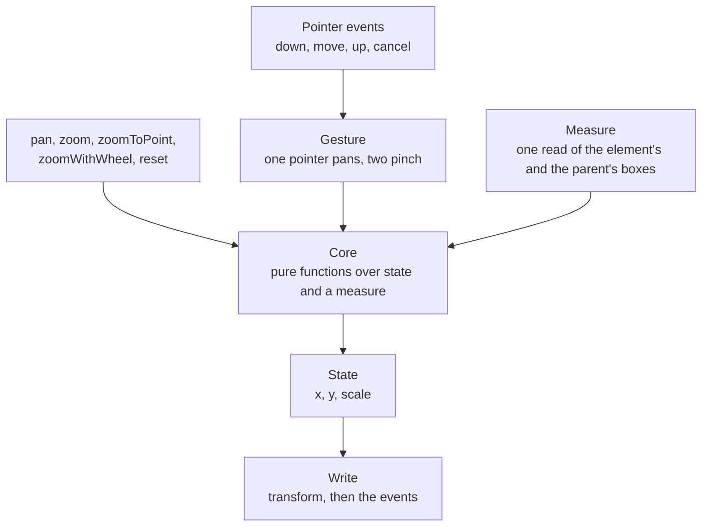

# Pan and zoom

`createPanzoom` in `@esposter/shared`: it makes one element draggable and zoomable by writing a CSS transform to it, replacing `@panzoom/panzoom`. The app's image viewer is its one consumer, and the surface is the upstream package's current surface rather than the half the viewer calls, so the next consumer finds nothing missing.

## How a gesture moves the element

## Decisions

- **State is the model, and a box is read once per call.** The element's position is `x`, `y` and `scale`, and the transform is written in the same call that changes them, never a frame later. A call that needs geometry reads the element's and the parent's `getBoundingClientRect` once, after its own previous write, so the rectangle is never one the pending transform has not reached. The unscaled size is the rectangle over the scale, and the layout centre is the rectangle's centre minus the scale times the pan. A flex-centred element, a margin and a nested layout are therefore already inside the measure and need no margin, padding or offset arithmetic of their own.
- **The core is pure.** Clamping a scale, clamping a pan under containment, the pan a zoom about a point needs, a wheel step and a pinch step are functions of numbers and one `PanzoomMeasure`, each in its own file and tested without a DOM. The shell only reads, calls the core and writes.
- **The focal point is the pointer, in unscaled offsets from the layout centre.** A zoom about the offset `q` from the layout centre keeps the point under the pointer still by moving the pan to `q / toScale - q / scale + pan`, and `toScale` is the already-clamped scale, so a zoom that clamps at the limit does not drift (a zoom against the clamp).
- **Containment is the parent's content box.** `inside` keeps the scaled element within it and caps the scale at the fitting scale, and `outside` keeps the element covering it and floors the scale at the covering scale. A box larger than the area it is contained in resolves to the lower bound, as upstream's clamp order does. Reset clamps the pan against the scale it is about to apply, in one step.
- **Construction is synchronous and quiet.** The start scale and pan are applied before `createPanzoom` returns and dispatch nothing, so a pan made on the next line is not overwritten and no timer exists. `silent` still suppresses every event for an instance or a call.
- **Pointer Events and `CustomEvent`, with listeners owned by one `AbortController`.** Mouse and touch fallbacks, vendor prefixes and the polyfill file are the old browsers' and are not carried. `destroy` aborts the listeners and restores every style it wrote to the element and its parent, which upstream left behind.
- **A drag survives a zoom.** The drag anchors to the pointer, the pan and the scale at the moment it began, and a zoom during the drag re-anchors it, so the next move continues from where the zoom left the element. Pinch with `pan` keeps the point between the fingers under the fingers.
- **The cursor is not forced.** The `cursor` option writes only while panning is possible, so a stylesheet cursor on a pan-disabled element stands. A parent that is a shadow root is handled by its host.
- **Events keep their names and detail.** `panzoomstart`, `panzoompan`, `panzoomzoom`, `panzoomreset`, `panzoomend` and `panzoomchange` fire on the element with `{ x, y, scale, isSVG, originalEvent }`, not bubbling.
- **The tracker's features that fit a viewer are built.**
  - A pinch is proportional (#63, #643, #671, #683): the scale is the scale at the gesture's start times the ratio of the fingers' distance now to the distance then, so it feels the same at every scale.
  - A wheel step follows the delta (#586): a pixel delta of 100 is one step, a smaller trackpad delta a proportional fraction, a line delta is taken as pixels, and one event moves at most one step.
  - `automatic` containment (#102, #511, #598, #707, #583): per axis, `inside` where the scaled element fits the area and `outside` where it overflows. Its scale floor is the fitting scale, which is the "aspect fit" the tracker asks for apart (#504, #577, #659).
  - `panThreshold` (#441, #452) is the distance a pointer travels before a drag starts, and the click that follows a drag past it is swallowed (#674).
  - `panCursor` (#546) is the cursor while a drag is live.
  - `filter(event)` decides whether a pointer down starts a gesture, which covers the button and modifier asks (#527, #609, #197, #129); `handleStartEvent` stays for parity.
  - The element carries its scale in `--panzoom-scale` (#627).
  - `fit()` scales the element to the parent and centres it, and `startScale: "fit"` does so at construction (#432, #616, #656).
  - Attachment is `isConnected`, so an element in an iframe is accepted (#693).
- **The rest are declined, each with its reason in the Upstream table.**
  - Inertia and rubber-band (#212, #225, #625) are an animation model a consumer layers on `panzoomend`.
  - Rotation (#286, #694) is a gesture of its own.
  - Double tap (#20, #275) is a gesture recogniser's work, and a consumer calls `zoomToPoint` from its own handler.
  - Targeting an SVG element and fly-to (#73, #103, #642) are SVG-specific.
  - Pan limits by ratio (#184, #476, #490) are what containment is.
  - The remainder (#230, #644, #665, #435, #684, #648, #361, #370, #617) has a workaround on the consumer's side that costs less than an option.
- **One module in `@esposter/shared`.** The module is small enough that every consumer of the package can carry it, and only the viewer calls it today. Rejected: a package of its own, since it holds no engine and no state a second consumer would rebuild.

## Key files

| File                                            | Role                                                                    |
| ----------------------------------------------- | ----------------------------------------------------------------------- |
| `packages/shared/src/models/panzoom/`           | the options, the measure, the state, the event detail and the object    |
| `packages/shared/src/services/panzoom/`         | the core's pure functions, the measure, the gesture and `createPanzoom` |
| `apps/web/app/composables/shared/usePanZoom.ts` | the viewer's composable over it, mirroring the scale into a ref         |

## Upstream

The tracker of `timmywil/panzoom` was read whole, each issue given one verdict, and the verdicts are held in the table below, each linked to its issue and, for an in-scope row, to the test that proves it.

(The table is written by the build.)

## Sources

- [timmywil/panzoom](https://github.com/timmywil/panzoom) — the package replaced, at 4.6.2, and its tracker.
- [Pointer Events](https://www.w3.org/TR/pointerevents/) — the input model, with `setPointerCapture` and `pointercancel`.
- [CSS Transforms Module Level 1](https://www.w3.org/TR/css-transforms-1/) — the order `scale(S) translate(X, Y)` is applied in, and `transform-origin`.
