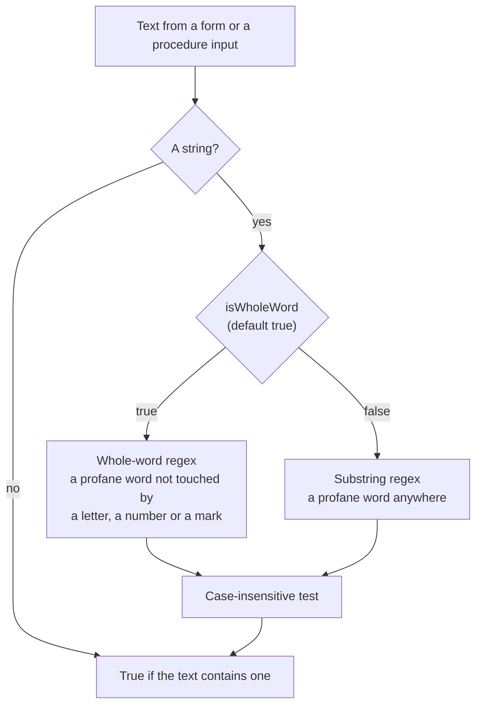

# Profanity Check

`checkContainsProfanity` in `packages/shared` (`@esposter/shared`) answers one question for the app: does this text contain an English profane word. The app's two callers, the form rule `isNotProfanity` and the tRPC middleware that rejects a room's name, both ask it that and nothing more. It replaced `@2toad/profanity`, an npm package whose word list and matcher are small enough to own outright, so the list is data in our tree and the matcher is ours.

## What a check does

- **Whole word, case-insensitive.** A profane word matches only where no letter, number or combining mark touches it. Punctuation, a hyphen, an underscore, a space and an emoji all end a word, so `butt-head`, `butt_face` and `That's 💩butt💩` match, and `arsenic`, `passionate` and `butté` do not.
- **Escaped literals.** Every word is escaped before it joins the alternation, so a word such as `a$$` matches its own characters and nothing else.
- **Non-strings are not profane.** A value that is not a string returns `false` rather than throwing.
- **Built once.** The two regexes are constants built at module load, so a check is one `test` call with no per-request compile.

## Surface

The API is one function, `checkContainsProfanity(text, { isWholeWord })`. It is English only, has no list mutation (`addWords`, "removeWords", a whitelist), no censoring and no language argument. Each of those is in the upstream package and out of this surface because no caller reads it.

## Upstream

`@2toad/profanity` 3.3.0, MIT licensed. Its English list is copied unchanged into `englishProfaneWords.ts`, and the licence notice travels beside it in `NOTICE`. Every issue on the upstream tracker has a verdict below, with the regression test that proves an in-scope defect. A defect's test is written against our function and was run against the upstream package first, where it failed, unless the row says it passed there too and is a pin.

| Issue                                                 | Title                                                                                      | Verdict                          | Where it is proven                                                                                                                                                    |
| ----------------------------------------------------- | ------------------------------------------------------------------------------------------ | -------------------------------- | --------------------------------------------------------------------------------------------------------------------------------------------------------------------- |
| [#2](https://github.com/2Toad/Profanity/issues/2)     | Add whitelist                                                                              | Out of scope                     | Whitelist is not in the surface; no caller reads a list mutation. Owner: this page, Surface                                                                           |
| [#3](https://github.com/2Toad/Profanity/issues/3)     | Exclude blank lines from file import                                                       | In scope, defect fixed by design | The list is a TypeScript module, so no file import can add blank entries                                                                                              |
| [#7](https://github.com/2Toad/Profanity/issues/7)     | Upgrade dependencies                                                                       | Out of scope                     | Upstream dependency upgrade; our tooling and the dependency-updates skill own versions                                                                                |
| [#9](https://github.com/2Toad/Profanity/issues/9)     | Relax package engine Node version requirement                                              | Out of scope                     | Upstream npm engine range; we ship source through the shared build, not the npm package                                                                               |
| [#12](https://github.com/2Toad/Profanity/issues/12)   | Replace tslint with eslint                                                                 | Out of scope                     | Upstream tslint to eslint migration; our lint is oxlint and ESLint                                                                                                    |
| [#13](https://github.com/2Toad/Profanity/issues/13)   | Add prettier to build process                                                              | Out of scope                     | Upstream prettier wiring; formatting is our own pre-commit hook                                                                                                       |
| [#16](https://github.com/2Toad/Profanity/issues/16)   | Add partial grawlix option                                                                 | Out of scope                     | Partial grawlix and censor types are not in the surface; no caller censors. Owner: this page, Surface                                                                 |
| [#17](https://github.com/2Toad/Profanity/issues/17)   | Remove FS reference for Web Browser JavaScript Support                                     | In scope, defect fixed by design | Browser bundles failed on the fs import; the matcher imports no file system module                                                                                    |
| [#18](https://github.com/2Toad/Profanity/issues/18)   | Input word "a$" causing false positives in the Regex                                       | In scope, defect                 | Test `#18 #156 reads a profane word ending in a regex character as literal text`: #156 fails upstream on a$; #18 passes there, fixed by a later release and pinned    |
| [#22](https://github.com/2Toad/Profanity/issues/22)   | words.includes is not function                                                             | False positive                   | No reproduction, and it reports an array method on a 1.x file list the rewrite replaced                                                                               |
| [#23](https://github.com/2Toad/Profanity/issues/23)   | Need some help                                                                             | False positive                   | A usage question about a custom ProfanityOptions field in the reporter's own bot, not a defect                                                                        |
| [#29](https://github.com/2Toad/Profanity/issues/29)   | npm package won't install for version 2.0.0                                                | Out of scope                     | Upstream npm tarball omitted dist in 2.0.0; we publish nothing from it. Owner: the build skill                                                                        |
| [#30](https://github.com/2Toad/Profanity/issues/30)   | Merge non-breaking 2.x changes into 1.x                                                    | Out of scope                     | Upstream 1.x backport; there is no 1.x line in our tree                                                                                                               |
| [#33](https://github.com/2Toad/Profanity/issues/33)   | NPM tries to install Husky when Profanity is added as a dependency                         | Out of scope                     | Upstream postinstall husky script; our install carries no such hook                                                                                                   |
| [#35](https://github.com/2Toad/Profanity/issues/35)   | Optimize code via best practices (linting enforced) and enhance build/deployment processes | Out of scope                     | Upstream lint and build modernisation; the shared package builds with tsdown and lints with ESLint                                                                    |
| [#37](https://github.com/2Toad/Profanity/issues/37)   | Cannot add new profane words.                                                              | False positive                   | A usage question answered in the thread: instance state is not persisted, and addWords is not in the surface                                                          |
| [#38](https://github.com/2Toad/Profanity/issues/38)   | Upgrade dependencies                                                                       | Out of scope                     | Upstream dependency upgrade; our tooling and the dependency-updates skill own versions                                                                                |
| [#40](https://github.com/2Toad/Profanity/issues/40)   | The word "Password" is censored                                                            | Out of scope                     | Whitelisting `password` is not in the surface. Owner: this page, Surface. Its substring false positive is pinned as a known false positive in Constraints on our side |
| [#41](https://github.com/2Toad/Profanity/issues/41)   | ProfanityOptions wholeWord does not appear to be working as intended                       | In scope, defect                 | Test `#41 does not find a name that merely contains a profane word` passes upstream too: fixed by the rewrite and pinned. The whitelist half is out of scope          |
| [#43](https://github.com/2Toad/Profanity/issues/43)   | Combine Google's profanity word list with existing word list                               | Out of scope                     | Merging a second word list is an undecided data question upstream; the list is kept at its 3.3.0 English content. Owner: this page, Constraints                       |
| [#46](https://github.com/2Toad/Profanity/issues/46)   | Failed to parse /node_modules/@2toad/profanity/src/data/profane-words.ts                   | Out of scope                     | A source map in the npm dist of the upstream package; we copy the data, so no source map is shipped. Owner: the build skill                                           |
| [#48](https://github.com/2Toad/Profanity/issues/48)   | Upgrade dependencies, formatting, and Node                                                 | Out of scope                     | Upstream Node and Prettier upgrade; our toolchain is vite-plus and oxfmt                                                                                              |
| [#50](https://github.com/2Toad/Profanity/issues/50)   | Documentation refers to using the CensorType enum, but it's not available for import       | Out of scope                     | CensorType export is not in the surface; no caller censors. Owner: this page, Surface                                                                                 |
| [#51](https://github.com/2Toad/Profanity/issues/51)   | [1.x.x] Fix dependency security vulnerabilities                                            | Out of scope                     | Upstream 1.x security dependency bump; there is no 1.x line in our tree                                                                                               |
| [#71](https://github.com/2Toad/Profanity/issues/71)   | Add benchmarking                                                                           | Out of scope                     | Benchmarks of the upstream matcher; ours is measured by the bench skill when it changes                                                                               |
| [#76](https://github.com/2Toad/Profanity/issues/76)   | non-string type throws error in exists and censor                                          | In scope, defect                 | Test `#76 returns false for a non-string input instead of throwing`: passes upstream 3.3.0, fixed by a later release and pinned                                       |
| [#81](https://github.com/2Toad/Profanity/issues/81)   | Remove concurrently & AirBnB plugin, upgrade ESLint & Prettier config                      | Out of scope                     | Upstream ESLint and Prettier config migration; not our lint                                                                                                           |
| [#87](https://github.com/2Toad/Profanity/issues/87)   | Support for other languages than English                                                   | Out of scope                     | Other languages; the matcher is English only. Owner: this page, Constraints                                                                                           |
| [#92](https://github.com/2Toad/Profanity/issues/92)   | Add profane words for additional languages                                                 | Out of scope                     | Other languages generated from a translator; the matcher is English only. Owner: this page, Constraints                                                               |
| [#120](https://github.com/2Toad/Profanity/issues/120) | Words added to the whitelist are still being censored.                                     | Out of scope                     | removeWords and the whitelist are not in the surface. Owner: this page, Surface                                                                                       |
| [#152](https://github.com/2Toad/Profanity/issues/152) | React Native profanity.exists() never returns                                              | Out of scope                     | Twelve languages in one alternation hung React Native; the matcher ships one language. Owner: this page, Constraints                                                  |
| [#154](https://github.com/2Toad/Profanity/issues/154) | Unicode characters cause wholeWord to break                                                | In scope, defect                 | Test `#154 treats a letter with a diacritic or a combining mark as part of the word`, failing upstream on butté                                                       |
| [#156](https://github.com/2Toad/Profanity/issues/156) | Specific word not being caught                                                             | In scope, defect                 | Test `#18 #156 reads a profane word ending in a regex character as literal text`, failing upstream on a$                                                              |
| [#159](https://github.com/2Toad/Profanity/issues/159) | "a)" in the es list                                                                        | Out of scope                     | A Spanish list entry; Spanish is not shipped. Owner: this page, Constraints                                                                                           |
| [#162](https://github.com/2Toad/Profanity/issues/162) | Replace ESLint with Oxlint and Mocha with Vitest                                           | Out of scope                     | Upstream ESLint to Oxlint migration; not our lint                                                                                                                     |
| [#164](https://github.com/2Toad/Profanity/issues/164) | Runtime performance improvements                                                           | Out of scope                     | Runtime work on removed surface (censor, whitelist, vowel regexes); the one regex is built once by design. Owner: this page, Surface                                  |
| [#166](https://github.com/2Toad/Profanity/issues/166) | Add Uzbek language support to the bad word dataset                                         | Out of scope                     | A Uzbek list; Uzbek is not shipped. Owner: this page, Constraints                                                                                                     |
| [#170](https://github.com/2Toad/Profanity/issues/170) | Mistakes in profanity in Hindi Language                                                    | Out of scope                     | Hindi list entries; Hindi is not shipped. Owner: this page, Constraints                                                                                               |

## Constraints on our side

- **English only.** A caller that needs another language adds its list beside `englishProfaneWords.ts` and its own check, and does not add a language argument to this one.
- **Whole word is the default.** Substring matching is the known-false-positive mode, kept for callers that want it. The app's callers use the default.
- **Known false positives in substring mode.** `arsenic` (`arse`), `password` and `class` (`ass`), `Scunthorpe` (`cunt`) and `Massachusetts` match inside a larger word. Their tests document that behaviour rather than fix it.

## Sources

- [@2toad/profanity](https://github.com/2Toad/Profanity) — the upstream repository, its tests and its issue tracker.
- `packages/shared/src/services/profanity/NOTICE` — the MIT notice for the copied word list.
