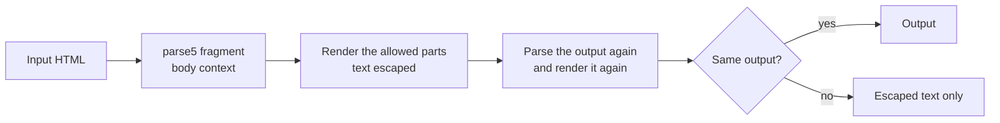

# sanitize-html in @esposter/shared

`sanitizeHtml` and `sanitizeTextHtml` are the only place rich-text HTML is cleaned before the app renders it. They used to wrap [apostrophecms/sanitize-html](https://github.com/apostrophecms/sanitize-html); they are now written in `packages/shared` on [parse5](https://github.com/inikulin/parse5), the WHATWG HTML parser. This page is the record the [dependency admission](../../architecture/dependency-admission/design.md) asks for: every upstream issue and advisory with its verdict, what the replacement does and does not do, the advisory watch that stands in for the upstream feed, and the security review of the new code.

The upstream package is a security-shaped utility, so it was absorbed under the [stop list](../../architecture/dependency-admission/design.md#the-stop-list)'s bar for one. Beyond that bar, the upstream's own test suite and DOMPurify's attack vectors are ported, and the watch reads the advisories of both packages.

## How it works

A call parses the input as a fragment in a `body` context, which is the context a rich-text container renders into. It renders the tree back to markup from the policy alone: an element the policy names is written with the attributes the policy keeps, an element it does not name is unwrapped to its text, and a non-text element (a script, a style, a textarea, an option, an xmp, an iframe) is dropped with its content. The output is then parsed and rendered again. If the second pass does not reproduce the first, the markup is one a second parse could read as a different tree, so the call returns the escaped text instead.

Nothing is copied from the upstream source. The policy is the one our two call sites state, the parser is the standard's, and the escaping is written for the output this renderer produces.

## The policy

Only the options the two call sites pass are offered: `allowedTags`, `allowedAttributes`, `allowedClasses` (per tag, with a trailing star for a prefix), `allowedStyles` (per tag and property, with the expressions a value must match in full), and an attribute transform. Everything else is default-denied.

- **Tags.** The default list is the upstream's current list. `img` is not in it, so an image needs a caller that names it. Script, style, textarea, option, noscript, title, xmp, noembed, noframes, iframe and plaintext are never rendered, whatever a caller allows, because their content is code or raw text.
- **Attributes.** A link keeps `href`, `name` and `target`, and every link is written with `rel="noopener noreferrer nofollow"` and `target="_blank"`. A table, a cell and a header keep only `style`, and a style survives only where a rule names its property.
- **Classes.** A class survives only where an `allowedClasses` rule for its tag matches it. An allowed class map implies the class attribute, so no call site lists `class` twice.
- **Schemes.** A URL attribute (`href`, `src`, `srcset`, `cite`, `action`, `formaction`, `background`, `poster`, `data`, `longdesc`, `icon`, `manifest`) keeps its value only when the scheme is `http`, `https`, `ftp`, `mailto` or `tel`, or when there is no scheme. The scheme is read after the characters a browser's URL parser drops, and before any path, query or fragment, so a tab, a space, a control character, an entity or a grave accent cannot hide `javascript:`.
- **Text.** `&`, `<`, `>` and the no-break space are written as entities, and quotes are not, which is the form the standard's serialisation asks for in text.
- **Rich text.** `sanitizeTextHtml` adds the editor's allowance: mention and custom-emoji attributes, a code block's `language-*` and the highlighter's `hljs*` classes, a span's colour and radius, a task item's `input` and `label`. A task checkbox is rewritten to a disabled checkbox that keeps only whether it was ticked.

The render depth is capped at 256 elements. Deeper content is dropped rather than rendered, since a recursion past the stack would throw on input a caller sent.

## Parser

The upstream parses with htmlparser2, which does not parse the way a browser does, and the gap between the two is where most of the bypasses in the upstream's history came from: the parser read a `<` or a quote differently from the browser that would render the output. parse5 implements the WHATWG tokenizer and tree construction and runs the html5lib conformance suite, so the tree the filter reads is the tree a standard browser builds. It was already installed beneath other packages; it is now a direct dependency of `@esposter/shared` in the catalog, kept as the engine of the filter rather than absorbed, because a tokenizer that follows the standard is a large algorithm with its own feed of spec changes.

## Upstream issues

The upstream repository holds 688 items: 418 issues and 270 pull requests, read in full with their comments through the issues API, all of them, open and closed. Each issue gets one verdict from the [dependency admission triage](../../architecture/dependency-admission/design.md#triage). A pull request is read as the issue it closes, so a fix counts against its issue and not again.

| Kind          | Items | Read as                                                                 | Verdicts                                                            |
| :------------ | ----: | :---------------------------------------------------------------------- | :------------------------------------------------------------------ |
| Issues        |   418 | one verdict each, below                                                 | see the table below                                                 |
| Pull requests |   270 | the verdict of the issue they fix or change; a dependency bump is noise | 126 noise, 76 feature, 33 defect, 27 false positive, 8 out of scope |

Verdicts by count:

| Verdict                                                             | Issues |
| :------------------------------------------------------------------ | -----: |
| False positive                                                      |    211 |
| Out of scope: option or surface we do not offer                     |    125 |
| Out of scope: owned by a dependency or the toolchain                |     33 |
| In scope: fixed or implemented                                      |     24 |
| Out of scope: parser (htmlparser2), replaced by the standard parser |     15 |
| False positive: not a sanitiser behaviour                           |     10 |

Every defect and out-of-scope verdict was read against the thread and, where the claim could be run, against the code: the reproductions in the regression tests and the probes in the review below. The false-positive and feature verdicts are a first reading of each thread's own text and its maintainer's comments; they are recorded so a reader can check them, and a reader who finds one wrong reopens it on this page. A verdict that depends on an option the policy does not offer is out of scope by the policy rather than by a dependency, and says so.

| Upstream issue                                                    | Verdict                                                             | Evidence                                                                                                                                                                 | Proof                             |
| :---------------------------------------------------------------- | :------------------------------------------------------------------ | :----------------------------------------------------------------------------------------------------------------------------------------------------------------------- | :-------------------------------- |
| [#1](https://github.com/apostrophecms/sanitize-html/issues/1)     | False positive                                                      | Title confirmed when reported: lowercase-only scheme regex and undecoded entities. Maintainer fixed it in 1.0.2 with entity decoding and mixed-case checks.              |                                   |
| [#3](https://github.com/apostrophecms/sanitize-html/issues/3)     | False positive                                                      | Size concern only, not a sanitizer behaviour. Reporter switched to own library; maintainer asks what browser use is for.                                                 |                                   |
| [#4](https://github.com/apostrophecms/sanitize-html/issues/4)     | Out of scope: option or surface we do not offer                     | Maintainer: not currently supported, would accept a pull request. Feature request, no bypass claimed.                                                                    |                                   |
| [#5](https://github.com/apostrophecms/sanitize-html/issues/5)     | Out of scope: option or surface we do not offer                     | Maintainer says fixed in 1.1.4 by an exclusion filter, a behaviour change. No security claim; needs an option we do not pass.                                            |                                   |
| [#10](https://github.com/apostrophecms/sanitize-html/issues/10)   | False positive                                                      | Title confirmed in the body: empty p text let the filter collapse it. Fixed in 1.2.0 per maintainer, so already fixed.                                                   |                                   |
| [#12](https://github.com/apostrophecms/sanitize-html/issues/12)   | False positive                                                      | Usage question; reporter closes it after issue 4 answers the glob question.                                                                                              |                                   |
| [#13](https://github.com/apostrophecms/sanitize-html/issues/13)   | False positive                                                      | Crash confirmed by reporter when filed. Maintainer fixed it in 1.2.1 with a unit test, so already fixed.                                                                 |                                   |
| [#14](https://github.com/apostrophecms/sanitize-html/issues/14)   | False positive                                                      | Output formatting preference, not a defect. Maintainer keeps the slash for markup style and closes it.                                                                   |                                   |
| [#18](https://github.com/apostrophecms/sanitize-html/issues/18)   | False positive                                                      | Maintainer and reporter agree it is not a real bug; the value starts with a backtick, so it is not a javascript scheme.                                                  |                                   |
| [#19](https://github.com/apostrophecms/sanitize-html/issues/19)   | False positive                                                      | Output with unescaped quotes confirmed when filed. Fixed by PR 20, which strips unescaped double quotes, so already fixed.                                               |                                   |
| [#23](https://github.com/apostrophecms/sanitize-html/issues/23)   | False positive                                                      | Usage question; maintainer answers by allowing the class attribute on the element, and a user shares a workaround.                                                       |                                   |
| [#24](https://github.com/apostrophecms/sanitize-html/issues/24)   | False positive                                                      | Maintainer: stripping script contents is intended, and unescaped less-than is invalid markup. Expected behaviour, not a defect.                                          |                                   |
| [#25](https://github.com/apostrophecms/sanitize-html/issues/25)   | False positive                                                      | Usage question; maintainer points to the transformations documentation and no defect is shown.                                                                           |                                   |
| [#26](https://github.com/apostrophecms/sanitize-html/issues/26)   | False positive                                                      | Usage error per maintainer reply: transformTags must return tagName, and target must be in allowedAttributes.                                                            |                                   |
| [#28](https://github.com/apostrophecms/sanitize-html/issues/28)   | Out of scope: option or surface we do not offer                     | Feature request; maintainer would accept a pull request. textFilter is an option we do not pass.                                                                         |                                   |
| [#29](https://github.com/apostrophecms/sanitize-html/issues/29)   | False positive                                                      | Img surviving in output confirmed when filed. Maintainer fixed it via the decodeEntities parser option, so treated as already fixed.                                     |                                   |
| [#30](https://github.com/apostrophecms/sanitize-html/issues/30)   | In scope: fixed or implemented                                      | allowedStyles keeps the declarations a tag names                                                                                                                         | policy suite                      |
| [#31](https://github.com/apostrophecms/sanitize-html/issues/31)   | Out of scope: option or surface we do not offer                     | Maintainer says not supported and points to per-tag style rules instead. Feature request, no bypass.                                                                     |                                   |
| [#32](https://github.com/apostrophecms/sanitize-html/issues/32)   | False positive                                                      | Maintainer: object literal keys are IdentifierNames and allowed since ES5. Not a defect.                                                                                 |                                   |
| [#33](https://github.com/apostrophecms/sanitize-html/issues/33)   | Out of scope: option or surface we do not offer                     | Feature proposal with sample code; not a defect. Option we do not pass.                                                                                                  |                                   |
| [#34](https://github.com/apostrophecms/sanitize-html/issues/34)   | False positive                                                      | Maintainer closed it as normal filtering. Textarea is in the default nonTextTags in current releases, so its content is dropped.                                         |                                   |
| [#36](https://github.com/apostrophecms/sanitize-html/issues/36)   | False positive                                                      | Maintainer: the transform assigned an undefined value, which the parser never does. Caller bug, not reproducible as a sanitizer defect.                                  |                                   |
| [#38](https://github.com/apostrophecms/sanitize-html/issues/38)   | Out of scope: option or surface we do not offer                     | Feature request; maintainer welcomes it with tests and the default staying off. allowComments is an option we do not pass.                                               |                                   |
| [#39](https://github.com/apostrophecms/sanitize-html/issues/39)   | False positive                                                      | Crash confirmed by reporter when filed. Maintainer fixed it in a later release, so already fixed.                                                                        |                                   |
| [#41](https://github.com/apostrophecms/sanitize-html/issues/41)   | In scope: fixed or implemented                                      | Plain text is written with quotes unencoded                                                                                                                              | policy suite                      |
| [#44](https://github.com/apostrophecms/sanitize-html/issues/44)   | False positive                                                      | Maintainer: 'The test suite passes without this code, so I've removed it and published 1.6.1.' Already fixed in a later release.                                         |                                   |
| [#45](https://github.com/apostrophecms/sanitize-html/issues/45)   | Out of scope: option or surface we do not offer                     | Maintainer points to cheerio and htmlparser2 instead; text editing is not a supported transform. Closed as completed.                                                    |                                   |
| [#46](https://github.com/apostrophecms/sanitize-html/issues/46)   | False positive                                                      | Maintainer: 'I'm not sure it would be a great fit with bower.' Reporter closed it as a mistaken premise.                                                                 |                                   |
| [#48](https://github.com/apostrophecms/sanitize-html/issues/48)   | Out of scope: option or surface we do not offer                     | Maintainer: 'The characters I'm escaping are the only ones that would break the markup.' Option we do not pass.                                                          |                                   |
| [#49](https://github.com/apostrophecms/sanitize-html/issues/49)   | Out of scope: option or surface we do not offer                     | Maintainer: 'I agree, and there should be an option to override that list. I'd take a pull request.' Output-spacing feature.                                             |                                   |
| [#50](https://github.com/apostrophecms/sanitize-html/issues/50)   | Out of scope: option or surface we do not offer                     | Implemented by PR 54 as allowedSchemesByTag, released. Maintainer: 'I don't see any reason why this couldn't be accommodated.'                                           |                                   |
| [#51](https://github.com/apostrophecms/sanitize-html/issues/51)   | Out of scope: option or surface we do not offer                     | Maintainer keeps the slash for valid HTML: 'sanitize-html will continue to use its internal list of void elements.' Output style, not a bypass.                          |                                   |
| [#52](https://github.com/apostrophecms/sanitize-html/issues/52)   | Out of scope: option or surface we do not offer                     | Maintainer: 'This is not a module for taking in sort-of-HTML-ish markup languages.' Out-of-scope feature request, closed as stale.                                       |                                   |
| [#55](https://github.com/apostrophecms/sanitize-html/issues/55)   | False positive                                                      | Maintainer: 'a separate file might frustrate a different group who expect it in the README.' Documentation layout request, not behaviour.                                |                                   |
| [#56](https://github.com/apostrophecms/sanitize-html/issues/56)   | False positive: not a sanitiser behaviour                           | Maintainer: 'Been doing this for a little bit now.' Release process housekeeping, not sanitizer behaviour.                                                               |                                   |
| [#57](https://github.com/apostrophecms/sanitize-html/issues/57)   | Out of scope: option or surface we do not offer                     | Maintainer: 'I don't recall such a feature... What is the use case where you want some tags respected but others escaped?' No such option exists.                        |                                   |
| [#58](https://github.com/apostrophecms/sanitize-html/issues/58)   | False positive                                                      | Maintainer: 'For more complex manipulations like this you should use the cheerio module.' Usage question with a filter option we do not pass.                            |                                   |
| [#59](https://github.com/apostrophecms/sanitize-html/issues/59)   | False positive                                                      | Maintainer: 'Closing this as there's a separate module for it.' Not a sanitize-html behaviour.                                                                           |                                   |
| [#60](https://github.com/apostrophecms/sanitize-html/issues/60)   | In scope: fixed or implemented                                      | Option content is dropped with the option                                                                                                                                | `sanitizeHtml.advisories.test.ts` |
| [#61](https://github.com/apostrophecms/sanitize-html/issues/61)   | Out of scope: option or surface we do not offer                     | Maintainer: 'the parser can't tell if a tag is redundant without looking ahead... That's a good reason for leaving this to another library.'                             |                                   |
| [#62](https://github.com/apostrophecms/sanitize-html/issues/62)   | False positive                                                      | Maintainer: 'This is invalid HTML, so no... I think it would make sense to write a separate sanitize-markdown module.'                                                   |                                   |
| [#64](https://github.com/apostrophecms/sanitize-html/issues/64)   | False positive: not a sanitiser behaviour                           | CI configuration only. Maintainer notes 'I imagine that list of node versions is out of date.'                                                                           |                                   |
| [#69](https://github.com/apostrophecms/sanitize-html/issues/69)   | False positive                                                      | Maintainer: 'Prior to HTML5 this was just plain wrong... It's called sanitize-html because its output is a valid HTML fragment.' Intended behaviour.                     |                                   |
| [#71](https://github.com/apostrophecms/sanitize-html/issues/71)   | False positive                                                      | Maintainer: 'The out string is correct... the question doesn't really belong here.' Reporter agreed the output was correct.                                              |                                   |
| [#74](https://github.com/apostrophecms/sanitize-html/issues/74)   | Out of scope: option or surface we do not offer                     | Maintainer: 'running in the browser is currently not considered in scope or a good idea.' Closed as housekeeping.                                                        |                                   |
| [#76](https://github.com/apostrophecms/sanitize-html/issues/76)   | False positive                                                      | Maintainer: 'It's called text because that's all you get. The text of that tag.' Documented behaviour, not a defect.                                                     |                                   |
| [#79](https://github.com/apostrophecms/sanitize-html/issues/79)   | Out of scope: parser (htmlparser2), replaced by the standard parser | Maintainer: 'This is an upstream bug in htmlparser2... Upstream bug, no fix yet.' Title confirmed; owner is htmlparser2, default features.                               |                                   |
| [#81](https://github.com/apostrophecms/sanitize-html/issues/81)   | Out of scope: option or surface we do not offer                     | Maintainer: 'not this module's responsibility to check whether you passed it an argument that is actually a string.' Closed completed.                                   |                                   |
| [#82](https://github.com/apostrophecms/sanitize-html/issues/82)   | Out of scope: option or surface we do not offer                     | Maintainer: 'It would. Want to do a pull request?' Wildcard classes were later added via PR #84; not a defect.                                                           |                                   |
| [#83](https://github.com/apostrophecms/sanitize-html/issues/83)   | False positive                                                      | Reporter replies 'nvm my bad' and the thread closes as completed; no sanitizer defect shown.                                                                             |                                   |
| [#87](https://github.com/apostrophecms/sanitize-html/issues/87)   | False positive                                                      | Maintainer: escaping these characters is never incorrect in HTML and removing it would open attack vectors. Closed completed.                                            |                                   |
| [#88](https://github.com/apostrophecms/sanitize-html/issues/88)   | False positive                                                      | Maintainer: '<3' is a broken tag; escape < > and & as entities. Working as designed.                                                                                     |                                   |
| [#89](https://github.com/apostrophecms/sanitize-html/issues/89)   | Out of scope: option or surface we do not offer                     | Maintainer: 'Not at the moment'; accepting non-HTML5 tags is risky. Later comment asks for disallowed-tags option for AMP use.                                           |                                   |
| [#90](https://github.com/apostrophecms/sanitize-html/issues/90)   | False positive                                                      | Reporter: 'it compiles to wrong code, not what I mentioned. So sorry it's not an issue.' Closed completed.                                                               |                                   |
| [#91](https://github.com/apostrophecms/sanitize-html/issues/91)   | False positive                                                      | Answered: 'This is now possible with the disallowedTagsMode escape option.' That option is one we do not pass.                                                           |                                   |
| [#92](https://github.com/apostrophecms/sanitize-html/issues/92)   | False positive                                                      | Docs state text of disallowed tags is preserved; the question is answered by the reporter. General question, not a defect.                                               |                                   |
| [#94](https://github.com/apostrophecms/sanitize-html/issues/94)   | Out of scope: option or surface we do not offer                     | Maintainer: 'This is incorrect HTML and will not be added.' Request declined; the output is valid HTML.                                                                  |                                   |
| [#96](https://github.com/apostrophecms/sanitize-html/issues/96)   | False positive                                                      | Answered: use the textFilter option to replace &quot; back to quotes; maintainer confirms 'that should work'. Usage question.                                            |                                   |
| [#97](https://github.com/apostrophecms/sanitize-html/issues/97)   | False positive                                                      | Maintainer: 'There is a unit test showing this works'; asks for a complete failing test. Reporter's snippet is truncated; no reproduction.                               |                                   |
| [#99](https://github.com/apostrophecms/sanitize-html/issues/99)   | Out of scope: option or surface we do not offer                     | Maintainer: sanitize-html is Node-focused with big dependencies; reporter says 'Having a .d.ts definition file makes it nice.' Closed completed.                         |                                   |
| [#100](https://github.com/apostrophecms/sanitize-html/issues/100) | False positive                                                      | Title claim confirmed at the time: decoded text breaks out of textarea into svg onload. Fixed upstream in 2016 (commit 5d205a1); needs a nonTextTag allowed.             |                                   |
| [#101](https://github.com/apostrophecms/sanitize-html/issues/101) | False positive                                                      | Title claim confirmed at the time: '<**proto**>' throws. Maintainer: 'Just pushed a fix' and published to npm; already fixed.                                            |                                   |
| [#103](https://github.com/apostrophecms/sanitize-html/issues/103) | False positive                                                      | Maintainer: 'Options to not correctly escape things will not be happening'; the current escaping is valid HTML. Declined by design.                                      |                                   |
| [#104](https://github.com/apostrophecms/sanitize-html/issues/104) | Out of scope: option or surface we do not offer                     | Maintainer: 'Not currently'; would consider a disallowedAttributes PR but warns negative lists are hard to prove safe.                                                   |                                   |
| [#105](https://github.com/apostrophecms/sanitize-html/issues/105) | False positive                                                      | Maintainer: 'This should be available already.' Usage question, answered by existing frame data.                                                                         |                                   |
| [#107](https://github.com/apostrophecms/sanitize-html/issues/107) | False positive                                                      | Answered: 'You could check it with frame.text in that exclusiveFilter function.' Usage question.                                                                         |                                   |
| [#109](https://github.com/apostrophecms/sanitize-html/issues/109) | False positive                                                      | Abea: 'This is a duplicate of apostrophecms/sanitize-html#268.' Duplicate request, closed completed.                                                                     |                                   |
| [#110](https://github.com/apostrophecms/sanitize-html/issues/110) | False positive                                                      | Answered by a linked earlier comment in issue 74; a usage question, not a defect.                                                                                        |                                   |
| [#112](https://github.com/apostrophecms/sanitize-html/issues/112) | False positive                                                      | Maintainer: 'Using this module on the browser side normally does not make sense... You can't trust anything that comes from the browser.'                                |                                   |
| [#116](https://github.com/apostrophecms/sanitize-html/issues/116) | False positive                                                      | Abea: 'exclusiveFilter is not meant to alter the frame object. It should return a boolean.' Usage error; stale bot closed.                                               |                                   |
| [#117](https://github.com/apostrophecms/sanitize-html/issues/117) | False positive                                                      | Maintainer: if allowed, href and src are subject to the naughtyHref test, so whitelisting is a good idea. Question answered.                                             |                                   |
| [#118](https://github.com/apostrophecms/sanitize-html/issues/118) | False positive                                                      | A workaround using frame.updateParentNodeText was posted and works; stale bot closed. Usage question.                                                                    |                                   |
| [#119](https://github.com/apostrophecms/sanitize-html/issues/119) | Out of scope: option or surface we do not offer                     | Maintainer: 'No, but you could turn it into a span tag.' Reporter notes spans still leave extra markup. Behaviour request declined.                                      |                                   |
| [#121](https://github.com/apostrophecms/sanitize-html/issues/121) | Out of scope: option or surface we do not offer                     | Asks to pass a parser_handler through; maintainer replies 'not needed'. Needs a parser option we do not pass.                                                            |                                   |
| [#122](https://github.com/apostrophecms/sanitize-html/issues/122) | In scope: fixed or implemented                                      | h1 and h2 are in the default allowlist                                                                                                                                   | `sanitizeHtml.advisories.test.ts` |
| [#123](https://github.com/apostrophecms/sanitize-html/issues/123) | False positive                                                      | Maintainer: empty attributes without quotes are valid HTML and boolean attributes must stay bare; user fixed it with transformTags.                                      |                                   |
| [#124](https://github.com/apostrophecms/sanitize-html/issues/124) | Out of scope: option or surface we do not offer                     | Maintainer would review a PR for an option disabling all JavaScript, noting javascript: URLs would also need clobbering.                                                 |                                   |
| [#125](https://github.com/apostrophecms/sanitize-html/issues/125) | Out of scope: option or surface we do not offer                     | Reproduced: output 'Why am I here twice?Why am I here twice?'. Confirmed; the text-return path is not one we use.                                                        |                                   |
| [#126](https://github.com/apostrophecms/sanitize-html/issues/126) | Out of scope: parser (htmlparser2), replaced by the standard parser | Maintainer: will not support anything htmlparser2 will not parse as HTML. Owner is the htmlparser2 parser.                                                               |                                   |
| [#127](https://github.com/apostrophecms/sanitize-html/issues/127) | Out of scope: parser (htmlparser2), replaced by the standard parser | Output '
4 
' confirmed. Maintainer: unescaped < is invalid HTML; the fix belongs in htmlparser2, not this module.                                                  |                                   |
| [#128](https://github.com/apostrophecms/sanitize-html/issues/128) | False positive                                                      | Maintainer: htmlparser2 decodes to UTF-8 and only minimal re-escaping is applied; nbsp as a unicode character is equivalent.                                             |                                   |
| [#129](https://github.com/apostrophecms/sanitize-html/issues/129) | False positive                                                      | Maintainer: advisories are found through GitHub issues. A usage question, not a defect.                                                                                  |                                   |
| [#131](https://github.com/apostrophecms/sanitize-html/issues/131) | Out of scope: option or surface we do not offer                     | Maintainer: would be disruptive by default, an option to retain doctypes would be sensible. Feature request needing an option we do not pass.                            |                                   |
| [#132](https://github.com/apostrophecms/sanitize-html/issues/132) | False positive                                                      | Resolved upstream: allowProtocolRelative option was added and the issue was closed against it. Our default disallows protocol-relative URLs.                             |                                   |
| [#133](https://github.com/apostrophecms/sanitize-html/issues/133) | Out of scope: option or surface we do not offer                     | Maintainer: no option; a PR substituting the escapeHtml function would be considered. Feature request, not a defect.                                                     |                                   |
| [#134](https://github.com/apostrophecms/sanitize-html/issues/134) | False positive                                                      | Maintainer: pass one options object with both properties. Usage error, resolved by the reporter.                                                                         |                                   |
| [#135](https://github.com/apostrophecms/sanitize-html/issues/135) | False positive                                                      | Maintainer: exclusiveFilter is one function; put the logic in it. Usage question, not a defect.                                                                          |                                   |
| [#136](https://github.com/apostrophecms/sanitize-html/issues/136) | Out of scope: option or surface we do not offer                     | Confirmed by several reproductions: 'GithubGithub' and 'zz' output. The text-return path is outside our transformTags use.                                               |                                   |
| [#139](https://github.com/apostrophecms/sanitize-html/issues/139) | False positive                                                      | Maintainer: expected behaviour; see the nonTextTags option in the documentation.                                                                                         |                                   |
| [#140](https://github.com/apostrophecms/sanitize-html/issues/140) | Out of scope: option or surface we do not offer                     | Maintainer: escaping fixed significant sanitization bugs and is unlikely to change. Option request, not a defect.                                                        |                                   |
| [#141](https://github.com/apostrophecms/sanitize-html/issues/141) | False positive                                                      | Maintainer: frame.text is text, not tags, so it is intentionally empty. Usage question; suggests cheerio for more logic.                                                 |                                   |
| [#142](https://github.com/apostrophecms/sanitize-html/issues/142) | False positive                                                      | Maintainer: this is not sanitization and is not in scope. Usage question.                                                                                                |                                   |
| [#143](https://github.com/apostrophecms/sanitize-html/issues/143) | False positive                                                      | A reporter points to a third-party package built on sanitize-html. Usage question, no defect.                                                                            |                                   |
| [#144](https://github.com/apostrophecms/sanitize-html/issues/144) | False positive                                                      | Maintainer: see allowedSchemes and allowedSchemesByTag; data is not in the default schemes. Configuration question.                                                      |                                   |
| [#145](https://github.com/apostrophecms/sanitize-html/issues/145) | False positive                                                      | Maintainer: the module sanitizes HTML strings and has no number type concept. Expected behaviour, usage question.                                                        |                                   |
| [#146](https://github.com/apostrophecms/sanitize-html/issues/146) | False positive                                                      | Maintainer: resolved in 1.16.3 via the files property. Already fixed by a later release.                                                                                 |                                   |
| [#147](https://github.com/apostrophecms/sanitize-html/issues/147) | False positive                                                      | Replies point to a command-line tester and npm RunKit. Documentation gap, not a defect.                                                                                  |                                   |
| [#148](https://github.com/apostrophecms/sanitize-html/issues/148) | False positive                                                      | Maintainer: resolved in 1.16.3. Build tooling issue already fixed by a later release.                                                                                    |                                   |
| [#149](https://github.com/apostrophecms/sanitize-html/issues/149) | Out of scope: option or surface we do not offer                     | Closed in favour of issue 164 discussion and a pending PR. Trailing text is kept as text; a cleanup request, not a bypass.                                               |                                   |
| [#150](https://github.com/apostrophecms/sanitize-html/issues/150) | False positive                                                      | Maintainer reply: this is possible with exclusiveFilter. Usage question answered in the thread.                                                                          |                                   |
| [#151](https://github.com/apostrophecms/sanitize-html/issues/151) | False positive                                                      | Maintainer: the browser decodes the attribute on use, so it does not break; the spec requires escaping. Reporter agreed.                                                 |                                   |
| [#152](https://github.com/apostrophecms/sanitize-html/issues/152) | Out of scope: option or surface we do not offer                     | A reply says textFilter can return a paragraph tag with text; no new option exists. Usage request, not a defect.                                                         |                                   |
| [#153](https://github.com/apostrophecms/sanitize-html/issues/153) | False positive                                                      | Maintainer: documented in the README; build it with npm run build. Documentation question.                                                                               |                                   |
| [#154](https://github.com/apostrophecms/sanitize-html/issues/154) | False positive                                                      | A reply notes three years of use without complaints. Question, no defect.                                                                                                |                                   |
| [#155](https://github.com/apostrophecms/sanitize-html/issues/155) | In scope: fixed or implemented                                      | Per-tag class prefix globs match hashed class names                                                                                                                      | policy suite                      |
| [#158](https://github.com/apostrophecms/sanitize-html/issues/158) | In scope: fixed or implemented                                      | allowedStyles per-tag property rules                                                                                                                                     | policy suite                      |
| [#159](https://github.com/apostrophecms/sanitize-html/issues/159) | False positive                                                      | Reply: add data to allowedSchemes. Configuration question, not a defect.                                                                                                 |                                   |
| [#161](https://github.com/apostrophecms/sanitize-html/issues/161) | Out of scope: parser (htmlparser2), replaced by the standard parser | Maintainer: HTML5 treats '<=' as text, but the cause is htmlparser2 itself, so report it there. Output 'this = test' with default options.                               |                                   |
| [#162](https://github.com/apostrophecms/sanitize-html/issues/162) | False positive                                                      | Closed as duplicate of #52. A usage question about restructuring markup, not a sanitizer defect.                                                                         |                                   |
| [#163](https://github.com/apostrophecms/sanitize-html/issues/163) | Out of scope: option or surface we do not offer                     | Maintainer: would need 2.x and significant community effort; parsing errors cited are not a reported bypass.                                                             |                                   |
| [#164](https://github.com/apostrophecms/sanitize-html/issues/164) | Out of scope: option or surface we do not offer                     | Maintainer: reasonable, but must be an option for backward compatibility. PR 166 added enforceHtmlBoundary, off by default.                                              |                                   |
| [#165](https://github.com/apostrophecms/sanitize-html/issues/165) | Out of scope: option or surface we do not offer                     | data URIs are already rejected by default schemes (http, https, mailto). Maintainer: a simple option PR would be welcome.                                                |                                   |
| [#167](https://github.com/apostrophecms/sanitize-html/issues/167) | False positive                                                      | Maintainer: 'Just allow all of the tags you would like to keep.' A usage answer, no defect.                                                                              |                                   |
| [#168](https://github.com/apostrophecms/sanitize-html/issues/168) | Out of scope: option or surface we do not offer                     | Maintainer: no objection to a PR, but it is always safer to allow than to exclude. A new option, not a bypass.                                                           |                                   |
| [#170](https://github.com/apostrophecms/sanitize-html/issues/170) | False positive                                                      | Documentation gap, closed when the maintainer pointed to a security policy page added to the repository.                                                                 |                                   |
| [#171](https://github.com/apostrophecms/sanitize-html/issues/171) | Out of scope: option or surface we do not offer                     | PoC keeps href for a slash-backslash prefix with allowProtocolRelative false, so the title is confirmed. Fixed by PR 172.                                                |                                   |
| [#173](https://github.com/apostrophecms/sanitize-html/issues/173) | False positive                                                      | Packaging regression from a reverted package.json change. Maintainer: 'Fixed, sorry for the hassle.' Not sanitizer behaviour.                                            |                                   |
| [#175](https://github.com/apostrophecms/sanitize-html/issues/175) | False positive                                                      | Maintainer: strings are not documented for list options and runtime checks cost performance. Arrays are the documented form, so misconfiguration.                        |                                   |
| [#176](https://github.com/apostrophecms/sanitize-html/issues/176) | In scope: fixed or implemented                                      | allowedTags falsy/undefined uses the default list, never disables filtering                                                                                              | `sanitizeHtml.advisories.test.ts` |
| [#177](https://github.com/apostrophecms/sanitize-html/issues/177) | Out of scope: option or surface we do not offer                     | No transformAttribute option exists. Maintainer points to the transforming-versus-sanitizing discussion in #52. Stale feature request.                                   |                                   |
| [#179](https://github.com/apostrophecms/sanitize-html/issues/179) | False positive                                                      | Build-level scoping error in an older version. Maintainer: 'This is resolved in 1.16.3.' No current defect.                                                              |                                   |
| [#181](https://github.com/apostrophecms/sanitize-html/issues/181) | Out of scope: option or surface we do not offer                     | Maintainer: schemes and extensions differ, and content type comes from the server. Custom URL validation is a separate feature.                                          |                                   |
| [#185](https://github.com/apostrophecms/sanitize-html/issues/185) | False positive                                                      | Question only, closed when the reporter got the answer. Unsupported browser, no defect reported.                                                                         |                                   |
| [#187](https://github.com/apostrophecms/sanitize-html/issues/187) | Out of scope: owned by a dependency or the toolchain                | Owner: postcss and its chalk and ansi-styles dependencies. Maintainer doubts the IE11 cause. Browser bundling, not sanitizer output.                                     |                                   |
| [#188](https://github.com/apostrophecms/sanitize-html/issues/188) | False positive                                                      | Maintainer: IE10 gets no vendor security patches; use the babel-compiled dist build. Unsupported platform, not a defect.                                                 |                                   |
| [#189](https://github.com/apostrophecms/sanitize-html/issues/189) | Out of scope: option or surface we do not offer                     | Maintainer: would accept a community PR, since browser support is not a primary use case. Build tooling request.                                                         |                                   |
| [#193](https://github.com/apostrophecms/sanitize-html/issues/193) | False positive                                                      | Maintainer: fragments assume UTF-8 with no encoding attribute. Encoding mismatch in the consuming page, not sanitizer output.                                            |                                   |
| [#194](https://github.com/apostrophecms/sanitize-html/issues/194) | False positive                                                      | Maintainer: 'Per the documentation, please use the babel-compiled version in the dist/ folder.' Build target issue.                                                      |                                   |
| [#195](https://github.com/apostrophecms/sanitize-html/issues/195) | Out of scope: owned by a dependency or the toolchain                | Owner: postcss (terminal-highlight needs chalk). Reporter found removing postcss also cleared the error. Dependency issue.                                               |                                   |
| [#197](https://github.com/apostrophecms/sanitize-html/issues/197) | Out of scope: option or surface we do not offer                     | Maintainer: no current plans, and browser-side use is large and slow. A wrapper is a feature request, not a defect.                                                      |                                   |
| [#198](https://github.com/apostrophecms/sanitize-html/issues/198) | Out of scope: owned by a dependency or the toolchain                | Owner: postcss and readable-stream dependencies. Maintainer: postcss serves CSS validation, and suggests DOMPurify for browser use.                                      |                                   |
| [#199](https://github.com/apostrophecms/sanitize-html/issues/199) | Out of scope: option or surface we do not offer                     | Title confirmed: htmlparser2 lowercases names, so camelCase allowlist entries never match. Lowercase entry works. Over-stripping, not a bypass.                          |                                   |
| [#200](https://github.com/apostrophecms/sanitize-html/issues/200) | False positive                                                      | Expected output keeps tel and ftp, which default schemes exclude. Maintainer asked for a failing test, none supplied. Usage question.                                    |                                   |
| [#203](https://github.com/apostrophecms/sanitize-html/issues/203) | Out of scope: option or surface we do not offer                     | Maintainer: no easy way today, a PR would be welcome; proposes attribute objects with values arrays. New capability, not a defect.                                       |                                   |
| [#205](https://github.com/apostrophecms/sanitize-html/issues/205) | False positive                                                      | Maintainer moved the script to prepublishOnly. Packaging script, not sanitizer behaviour, and already fixed.                                                             |                                   |
| [#207](https://github.com/apostrophecms/sanitize-html/issues/207) | False positive                                                      | Commenter: old transitive dependency, no longer in the lock file. Stale, already resolved.                                                                               |                                   |
| [#208](https://github.com/apostrophecms/sanitize-html/issues/208) | False positive                                                      | Real packaging typo fixed by maintainer, with a second casing error on lodash.isPlainObject. Load-time packaging bug, fixed in a later release.                          |                                   |
| [#211](https://github.com/apostrophecms/sanitize-html/issues/211) | Out of scope: option or surface we do not offer                     | Maintainer: htmlparser2 cannot keep the original representation while sanitizing safely, so out of scope. Requested capability.                                          |                                   |
| [#212](https://github.com/apostrophecms/sanitize-html/issues/212) | False positive                                                      | Maintainer: default kept to avoid breaking changes, not a bypass. Usage question answered in thread; data stays opt-in.                                                  |                                   |
| [#213](https://github.com/apostrophecms/sanitize-html/issues/213) | False positive                                                      | Reporter found https was missing from allowedSchemes, so href was removed. User configuration error, not a defect.                                                       |                                   |
| [#215](https://github.com/apostrophecms/sanitize-html/issues/215) | False positive                                                      | Maintainer confirms the docs misprint: src is an attribute, so allowedAttributes is correct. Documentation gap, not a sanitizer bug.                                     |                                   |
| [#217](https://github.com/apostrophecms/sanitize-html/issues/217) | Out of scope: option or surface we do not offer                     | srcdoc on an iframe never rendered (iframe is a non-text element)                                                                                                        |                                   |
| [#218](https://github.com/apostrophecms/sanitize-html/issues/218) | Out of scope: owned by a dependency or the toolchain                | Needs selfClosing and transformTags beyond our use; reporter's own output shows nesting. Owner is htmlparser2 and option handling, not default behaviour.                |                                   |
| [#219](https://github.com/apostrophecms/sanitize-html/issues/219) | False positive                                                      | Duplicate of issue 218. Commenter: not a use case for sanitize-html, a simple sanitizer, not a DOM transformer.                                                          |                                   |
| [#220](https://github.com/apostrophecms/sanitize-html/issues/220) | False positive                                                      | Maintainer: it is plain JavaScript, but sanitization belongs on the server, not in a client app. Usage question.                                                         |                                   |
| [#221](https://github.com/apostrophecms/sanitize-html/issues/221) | False positive                                                      | Maintainer: span is useless without attributes and classes, so it is not enabled by default. Usage question, by design.                                                  |                                   |
| [#222](https://github.com/apostrophecms/sanitize-html/issues/222) | False positive                                                      | Maintainer: duplicate of issue 131. Duplicate feature request, closed.                                                                                                   |                                   |
| [#223](https://github.com/apostrophecms/sanitize-html/issues/223) | False positive                                                      | Maintainer: answered on Stack Overflow. Usage question, not a sanitizer defect.                                                                                          |                                   |
| [#224](https://github.com/apostrophecms/sanitize-html/issues/224) | False positive                                                      | Maintainer asked for a breaking test, none given; closed stale. Likely camelCase name vs lowercased attribute. Not reproduced.                                           |                                   |
| [#225](https://github.com/apostrophecms/sanitize-html/issues/225) | False positive                                                      | Packaging metadata request, not sanitizer behaviour. Resolved by PR 226, a manifest change.                                                                              |                                   |
| [#227](https://github.com/apostrophecms/sanitize-html/issues/227) | Out of scope: owned by a dependency or the toolchain                | Maintainer: browser use is outside his use cases; closed until reproduced. Owner is the browserify bundler, not the sanitizer.                                           |                                   |
| [#228](https://github.com/apostrophecms/sanitize-html/issues/228) | Out of scope: parser (htmlparser2), replaced by the standard parser | Maintainer: fix would be an htmlparser2 option; sanitize-html passes options on. Parse divergence owned by htmlparser2, table tags in default set.                       |                                   |
| [#229](https://github.com/apostrophecms/sanitize-html/issues/229) | False positive                                                      | Maintainer: the bug is user transformTags code setting href to undefined, not in the module. Confirmed as user-code bug.                                                 |                                   |
| [#230](https://github.com/apostrophecms/sanitize-html/issues/230) | Out of scope: owned by a dependency or the toolchain                | Maintainer: sounds like a bug in htmlparser2, the base parser. Also needs allowedTags false and exclusiveFilter, which we do not pass.                                   |                                   |
| [#231](https://github.com/apostrophecms/sanitize-html/issues/231) | Out of scope: option or surface we do not offer                     | Maintainer: would welcome a PR passing removed content to console.debug. Debug capability request, not a defect.                                                         |                                   |
| [#232](https://github.com/apostrophecms/sanitize-html/issues/232) | False positive                                                      | Maintainer: duplicate, fixed earlier; reporter confirmed updating resolved it. Browser build, already fixed.                                                             |                                   |
| [#233](https://github.com/apostrophecms/sanitize-html/issues/233) | False positive                                                      | Reporter found the database field was too small to store the output. Not a sanitizer behaviour.                                                                          |                                   |
| [#234](https://github.com/apostrophecms/sanitize-html/issues/234) | False positive                                                      | Body says ops, ignore, no comments. Empty report, not a sanitizer behaviour.                                                                                             |                                   |
| [#235](https://github.com/apostrophecms/sanitize-html/issues/235) | Out of scope: option or surface we do not offer                     | Maintainer: a PR for a different valid quoting option would be welcome, while still escaping attribute quotes. Output-format request.                                    |                                   |
| [#236](https://github.com/apostrophecms/sanitize-html/issues/236) | False positive                                                      | Maintainer: a separate migration guide would be accepted, not prioritised. Documentation gap, not a defect.                                                              |                                   |
| [#237](https://github.com/apostrophecms/sanitize-html/issues/237) | Out of scope: option or surface we do not offer                     | Maintainer: says no to folding prettyprinting in, other modules do it. Feature declined.                                                                                 |                                   |
| [#239](https://github.com/apostrophecms/sanitize-html/issues/239) | Out of scope: option or surface we do not offer                     | Maintainer: fix merged and published via PR 240. Behaviour change to iframe src handling, a request rather than a bypass.                                                |                                   |
| [#241](https://github.com/apostrophecms/sanitize-html/issues/241) | False positive                                                      | Packaging bug from browser field; maintainer says the bad dist came from build config. Fixed by 1.18.4 release (#244).                                                   |                                   |
| [#242](https://github.com/apostrophecms/sanitize-html/issues/242) | False positive                                                      | Same frontend dist breakage as #241; maintainer says server-side src and tests use defaults correctly. Duplicate, fixed in 1.18.4.                                       |                                   |
| [#243](https://github.com/apostrophecms/sanitize-html/issues/243) | False positive                                                      | Reporter says duplicate of #241 themselves; same frontend build packaging problem.                                                                                       |                                   |
| [#246](https://github.com/apostrophecms/sanitize-html/issues/246) | Out of scope: option or surface we do not offer                     | Maintainer: escaping is correct and the request is unlikely; only allows unescaped chars where browsers never misinterpret them.                                         |                                   |
| [#248](https://github.com/apostrophecms/sanitize-html/issues/248) | False positive                                                      | Typings-only gap fixed in DefinitelyTyped; parser is an option the replacement does not pass.                                                                            |                                   |
| [#249](https://github.com/apostrophecms/sanitize-html/issues/249) | Out of scope: option or surface we do not offer                     | Title confirmed by reproducer: amp becomes amp-amp. Needs parser decodeEntities false; fixed upstream by merged #250.                                                    |                                   |
| [#251](https://github.com/apostrophecms/sanitize-html/issues/251) | Out of scope: option or surface we do not offer                     | Maintainer: welcome a PR adding an opt-in option; implemented as allowIframeRelativeUrls in #252. Needs allowedIframeHostnames, not passed.                              |                                   |
| [#253](https://github.com/apostrophecms/sanitize-html/issues/253) | Out of scope: option or surface we do not offer                     | Wildcard class key not in surface; per-tag classes filtered                                                                                                              |                                   |
| [#254](https://github.com/apostrophecms/sanitize-html/issues/254) | False positive                                                      | Usage question; maintainer says out of scope, suggests allowedStyles or cheerio.                                                                                         |                                   |
| [#255](https://github.com/apostrophecms/sanitize-html/issues/255) | False positive                                                      | General JavaScript question; maintainer says wrap sanitize in your own function with the options.                                                                        |                                   |
| [#256](https://github.com/apostrophecms/sanitize-html/issues/256) | In scope: fixed or implemented                                      | Transform output is filtered like the markup it replaced                                                                                                                 | `sanitizeHtml.advisories.test.ts` |
| [#257](https://github.com/apostrophecms/sanitize-html/issues/257) | Out of scope: option or surface we do not offer                     | Dependency refactor request; closed by #365 per maintainer. No behaviour change.                                                                                         |                                   |
| [#258](https://github.com/apostrophecms/sanitize-html/issues/258) | Out of scope: option or surface we do not offer                     | Maintainer: too complex, use cheerio. Children-editing transform is a new capability.                                                                                    |                                   |
| [#259](https://github.com/apostrophecms/sanitize-html/issues/259) | False positive                                                      | Typings and README mismatch; maintainer fixed the README docs for empty values.                                                                                          |                                   |
| [#260](https://github.com/apostrophecms/sanitize-html/issues/260) | False positive                                                      | Maintainer: the key should be allowedAttributes with capital A; reporter confirmed the typo was the cause.                                                               |                                   |
| [#263](https://github.com/apostrophecms/sanitize-html/issues/263) | Out of scope: option or surface we do not offer                     | Maintainer: could make sense to autoescape these; alternatively do it after sanitizing. Not a sanitizer defect.                                                          |                                   |
| [#265](https://github.com/apostrophecms/sanitize-html/issues/265) | False positive                                                      | Maintainer: intended, sanitize-html output is markup; attribute values must be escaped by the caller, use a simpler tool for attribute validation.                       |                                   |
| [#266](https://github.com/apostrophecms/sanitize-html/issues/266) | False positive                                                      | Maintainer: escaped entities are not an active tag and cannot execute in the browser; nothing to sanitize.                                                               |                                   |
| [#268](https://github.com/apostrophecms/sanitize-html/issues/268) | Out of scope: option or surface we do not offer                     | Maintainer: significant upgrade for the general case, suggests cheerio. A new capability rather than a defect.                                                           |                                   |
| [#269](https://github.com/apostrophecms/sanitize-html/issues/269) | Out of scope: owned by a dependency or the toolchain                | Title confirmed: reporter traced it to csstree walker create.js eval, occurring for any input. Owner css-tree; rolled back in 1.19.3.                                    |                                   |
| [#271](https://github.com/apostrophecms/sanitize-html/issues/271) | Out of scope: owned by a dependency or the toolchain                | Owner is the consuming app's polyfills or Babel config; maintainers say polyfill Symbol via core-js or babel-polyfill.                                                   |                                   |
| [#272](https://github.com/apostrophecms/sanitize-html/issues/272) | False positive                                                      | Reporter found the cause was MySQL charset, not sanitize-html; switching to utf8mb4 fixed it.                                                                            |                                   |
| [#273](https://github.com/apostrophecms/sanitize-html/issues/273) | Out of scope: option or surface we do not offer                     | Maintainer: inline CSS validation is a requested feature; removal would be a breaking change. Not a defect.                                                              |                                   |
| [#274](https://github.com/apostrophecms/sanitize-html/issues/274) | False positive                                                      | Maintainer: input is not well-formed; ampersands in attributes must be escaped as amp, so the parser behaviour is expected.                                              |                                   |
| [#276](https://github.com/apostrophecms/sanitize-html/issues/276) | Out of scope: option or surface we do not offer                     | Title confirmed in part: parser lowercases names so camelCase allowed names never match; setting lowerCaseAttributeNames false fixes viewBox per reporter.               |                                   |
| [#277](https://github.com/apostrophecms/sanitize-html/issues/277) | False positive                                                      | Documentation and typings gap only; parser option not passed by the replacement.                                                                                         |                                   |
| [#278](https://github.com/apostrophecms/sanitize-html/issues/278) | False positive                                                      | Typings gap only; textFilter is an option the replacement does not pass.                                                                                                 |                                   |
| [#279](https://github.com/apostrophecms/sanitize-html/issues/279) | False positive                                                      | Maintainer: successful test install; the error is from the local node and npm setup, not this module.                                                                    |                                   |
| [#281](https://github.com/apostrophecms/sanitize-html/issues/281) | Out of scope: parser (htmlparser2), replaced by the standard parser | Maintainer: discarding what might be a disallowed tag is sanitize-html doing its job; reading is htmlparser2's, so the report belongs upstream there.                    |                                   |
| [#282](https://github.com/apostrophecms/sanitize-html/issues/282) | False positive                                                      | Maintainer: the spec forbids end tags like </img>, not self-closing syntax; the title claim is not confirmed.                                                            |                                   |
| [#283](https://github.com/apostrophecms/sanitize-html/issues/283) | False positive                                                      | No defect stated; the output is the standard HTML parse of unclosed p tags, a usage question.                                                                            |                                   |
| [#284](https://github.com/apostrophecms/sanitize-html/issues/284) | False positive                                                      | Maintainer: correct parsing of invalid markup; emitting 

 is odd but valid, so no defect.                                                                          |                                   |
| [#285](https://github.com/apostrophecms/sanitize-html/issues/285) | False positive                                                      | Maintainer deferred removal to 2.x; iframe is not in the 2.x default tag list, so the concern is already resolved.                                                       |                                   |
| [#288](https://github.com/apostrophecms/sanitize-html/issues/288) | False positive                                                      | Maintainer: no problem with these tags; asks for a failing test case, none was given.                                                                                    |                                   |
| [#289](https://github.com/apostrophecms/sanitize-html/issues/289) | False positive                                                      | Body empty; the only comment names strikethrough, a wrong tag name, so no defect is shown.                                                                               |                                   |
| [#290](https://github.com/apostrophecms/sanitize-html/issues/290) | False positive                                                      | Maintainer: output is valid, correctly escaped HTML that renders as the same text; by design.                                                                            |                                   |
| [#291](https://github.com/apostrophecms/sanitize-html/issues/291) | Out of scope: option or surface we do not offer                     | Requests a way to keep script text; needs transformTags text rewriting and disallowedTagsMode, which we do not pass.                                                     |                                   |
| [#292](https://github.com/apostrophecms/sanitize-html/issues/292) | Out of scope: option or surface we do not offer                     | Maintainer: there is not a way; recommends cheerio. This is a capability request on exclusiveFilter, which we do not pass.                                               |                                   |
| [#293](https://github.com/apostrophecms/sanitize-html/issues/293) | False positive                                                      | Maintainer: Snyk lists only old versions; the fix in PR 156 was the transform-attribute change, so the claim is historic and not confirmed for current versions.         |                                   |
| [#294](https://github.com/apostrophecms/sanitize-html/issues/294) | False positive                                                      | Closed by the reporter: the wrong API method was used; a transform's returned attribs replace the originals by design.                                                   |                                   |
| [#295](https://github.com/apostrophecms/sanitize-html/issues/295) | Out of scope: owned by a dependency or the toolchain                | Maintainer asks for a unit test; reporter says a plugin or parcel causes it. Bundler and postcss-modules conflict, not a sanitizer defect.                               |                                   |
| [#296](https://github.com/apostrophecms/sanitize-html/issues/296) | False positive                                                      | Maintainer: no, the library generates strictly valid markup; encoding & as &amp; in attributes is by design.                                                             |                                   |
| [#297](https://github.com/apostrophecms/sanitize-html/issues/297) | False positive                                                      | Maintainer: output is valid HTML representing the same characters; preserving input representation is not supported.                                                     |                                   |
| [#298](https://github.com/apostrophecms/sanitize-html/issues/298) | Out of scope: owned by a dependency or the toolchain                | Maintainer: caret ranges never install the old version; the advisory is in lodash, a dependency we do not carry.                                                         |                                   |
| [#300](https://github.com/apostrophecms/sanitize-html/issues/300) | Out of scope: owned by a dependency or the toolchain                | Build pipeline ordering (babel, browserify, uglifyjs) in dom-serializer output; the toolchain owns it, not runtime sanitizer output.                                     |                                   |
| [#302](https://github.com/apostrophecms/sanitize-html/issues/302) | False positive: not a sanitiser behaviour                           | Maintainer: thanks, but cannot officially link it without reviewers; documentation link only, no code concern.                                                           |                                   |
| [#303](https://github.com/apostrophecms/sanitize-html/issues/303) | False positive                                                      | Maintainer: sanitize-html sanitizes HTML strings only; iterating JSON fields is the caller's job, so no defect.                                                          |                                   |
| [#304](https://github.com/apostrophecms/sanitize-html/issues/304) | False positive                                                      | Maintainer: a bare > is escaped to &gt; as valid HTML requires; the markdown renderer, not sanitize-html, is the cause.                                                  |                                   |
| [#305](https://github.com/apostrophecms/sanitize-html/issues/305) | In scope: fixed or implemented                                      | No-break space before a javascript: address does not hide its scheme                                                                                                     | `sanitizeHtml.advisories.test.ts` |
| [#307](https://github.com/apostrophecms/sanitize-html/issues/307) | False positive                                                      | Reporter solved it with transformTags allowing a href by host; a usage question, not a defect.                                                                           |                                   |
| [#309](https://github.com/apostrophecms/sanitize-html/issues/309) | False positive                                                      | Maintainer: this module sanitizes only HTML and fragments thereof; custom non-HTML tags are outside its design.                                                          |                                   |
| [#313](https://github.com/apostrophecms/sanitize-html/issues/313) | False positive                                                      | Maintainer abea: frame.text is doing its job, there is no text; a fix needs a new innerHtml field, a feature, and exclusiveFilter is not passed.                         |                                   |
| [#315](https://github.com/apostrophecms/sanitize-html/issues/315) | Out of scope: parser (htmlparser2), replaced by the standard parser | Maintainer: malformed tag, handled by htmlparser2; capturing it would need a fix below sanitize-html, so the owner is htmlparser2.                                       |                                   |
| [#316](https://github.com/apostrophecms/sanitize-html/issues/316) | Out of scope: option or surface we do not offer                     | Requests value-based filtering, achievable only with exclusiveFilter or transformTags logic beyond our feature set; no defect reported.                                  |                                   |
| [#317](https://github.com/apostrophecms/sanitize-html/issues/317) | False positive                                                      | Maintainer: see the README, configure allowed tags and attributes; a configuration answer, not a defect.                                                                 |                                   |
| [#318](https://github.com/apostrophecms/sanitize-html/issues/318) | False positive                                                      | Usage question with no failing case and no maintainer reply; relative URLs are not a sanitizer defect.                                                                   |                                   |
| [#319](https://github.com/apostrophecms/sanitize-html/issues/319) | False positive                                                      | Maintainer: cannot reproduce with the same config in the test suite; asks for a failing test, none supplied, so unconfirmed.                                             |                                   |
| [#320](https://github.com/apostrophecms/sanitize-html/issues/320) | Out of scope: owned by a dependency or the toolchain                | Reporter's own dependency tree: domhandler 3 types shadow domutils 1.7; the owners are htmlparser2 and @types packages, typing only.                                     |                                   |
| [#321](https://github.com/apostrophecms/sanitize-html/issues/321) | False positive                                                      | Maintainer: 'Thanks, published 1.21.1.' Already fixed by a later release; closed completed.                                                                              |                                   |
| [#325](https://github.com/apostrophecms/sanitize-html/issues/325) | In scope: fixed or implemented                                      | Malformed attributes sanitise without throwing                                                                                                                           | `sanitizeHtml.advisories.test.ts` |
| [#327](https://github.com/apostrophecms/sanitize-html/issues/327) | False positive                                                      | Maintainer: 'your examples are being corrupted, probably because of Markdown.' Usage question, closed completed.                                                         |                                   |
| [#328](https://github.com/apostrophecms/sanitize-html/issues/328) | Out of scope: option or surface we do not offer                     | Maintainer: 'this list is a bit arbitrary, you should just configure your own.' Capability request, not a defect.                                                        |                                   |
| [#329](https://github.com/apostrophecms/sanitize-html/issues/329) | Out of scope: owned by a dependency or the toolchain                | Build artifact inlines a dependency needing JSON files at runtime; #335 names dom-serializer in the minified dist; closed completed.                                     |                                   |
| [#330](https://github.com/apostrophecms/sanitize-html/issues/330) | Out of scope: option or surface we do not offer                     | Maintainer: CSS support could become an optional module in a future major; closed after v2 beta shipped without a build.                                                 |                                   |
| [#331](https://github.com/apostrophecms/sanitize-html/issues/331) | False positive                                                      | Usage question; maintainer points to transformations docs. Closed stale with no defect.                                                                                  |                                   |
| [#332](https://github.com/apostrophecms/sanitize-html/issues/332) | False positive: not a sanitiser behaviour                           | CI badge config; maintainer: 'This looks resolved now.'                                                                                                                  |                                   |
| [#333](https://github.com/apostrophecms/sanitize-html/issues/333) | Out of scope: owned by a dependency or the toolchain                | dmattia: 'the issue is with the typed library, not this module'; owner is @types/sanitize-html and @types/htmlparser2.                                                   |                                   |
| [#334](https://github.com/apostrophecms/sanitize-html/issues/334) | Out of scope: option or surface we do not offer                     | Title claim confirmed: the jest expectation fails and the input text and form opening tag are missing. Needs escape mode, which we do not pass.                          |                                   |
| [#335](https://github.com/apostrophecms/sanitize-html/issues/335) | False positive                                                      | Duplicate of #329 by its own framing, with the root-cause pointer. Closed completed as v2 work.                                                                          |                                   |
| [#336](https://github.com/apostrophecms/sanitize-html/issues/336) | In scope: fixed or implemented                                      | abbr in the default allowlist                                                                                                                                            | `sanitizeHtml.advisories.test.ts` |
| [#339](https://github.com/apostrophecms/sanitize-html/issues/339) | Out of scope: parser (htmlparser2), replaced by the standard parser | Maintainer: 'This is an htmlparser2 issue... The fundamental parsing of the HTML does not occur in sanitize-html itself.'                                                |                                   |
| [#340](https://github.com/apostrophecms/sanitize-html/issues/340) | False positive                                                      | Answered by allowedAttributes; maintainer warns it is a CSRF vector and suggests data attributes instead. Usage question.                                                |                                   |
| [#341](https://github.com/apostrophecms/sanitize-html/issues/341) | False positive                                                      | Maintainer: 'Handlebars templates are not HTML and are out of scope for this module.'                                                                                    |                                   |
| [#345](https://github.com/apostrophecms/sanitize-html/issues/345) | False positive                                                      | Maintainer: the sanitizer cannot control a frontend build; another module imports it as a prerequisite.                                                                  |                                   |
| [#346](https://github.com/apostrophecms/sanitize-html/issues/346) | False positive                                                      | Module interop and typings usage; the reply points to the v2 branch. Not a sanitizer behaviour.                                                                          |                                   |
| [#347](https://github.com/apostrophecms/sanitize-html/issues/347) | Out of scope: option or surface we do not offer                     | Maintainer: htmlparser2 cannot change rules mid-parse; 'out of scope for this module.' Needs a parser option we do not pass.                                             |                                   |
| [#348](https://github.com/apostrophecms/sanitize-html/issues/348) | Out of scope: option or surface we do not offer                     | Maintainer: check htmlparser2 options; 'if not it is out of scope for this module.' Needs options we do not pass.                                                        |                                   |
| [#350](https://github.com/apostrophecms/sanitize-html/issues/350) | False positive                                                      | Title claim not confirmed: maintainer 'was not able to reproduce this issue'; no failing test was supplied; closed stale.                                                |                                   |
| [#351](https://github.com/apostrophecms/sanitize-html/issues/351) | Out of scope: option or surface we do not offer                     | Maintainer: 'we'd be up for taking a PR'; disallowedTags would need to win over allowedTags. Capability request; needs an option we do not pass.                         |                                   |
| [#352](https://github.com/apostrophecms/sanitize-html/issues/352) | Out of scope: option or surface we do not offer                     | Maintainer: 'I don't think this is a bug'; the option is to remove. Escaping exclusiveFilter is an enhancement.                                                          |                                   |
| [#353](https://github.com/apostrophecms/sanitize-html/issues/353) | Out of scope: option or surface we do not offer                     | Title claim confirmed: actual output drops the preceding text and the img, shown as '. &lt;a href=...'. Requires escape mode, which we do not pass.                      |                                   |
| [#359](https://github.com/apostrophecms/sanitize-html/issues/359) | Out of scope: option or surface we do not offer                     | Capability request for allowedIframeHostnames, an option we do not pass.                                                                                                 |                                   |
| [#363](https://github.com/apostrophecms/sanitize-html/issues/363) | Out of scope: owned by a dependency or the toolchain                | Maintainer: 'This is a transitive dependency, it can't be fixed from here'; owner is the entities package.                                                               |                                   |
| [#367](https://github.com/apostrophecms/sanitize-html/issues/367) | In scope: fixed or implemented                                      | srcset keeps a CDN URL intact                                                                                                                                            | `sanitizeHtml.advisories.test.ts` |
| [#369](https://github.com/apostrophecms/sanitize-html/issues/369) | False positive                                                      | Closed as duplicate of issue 38 by maintainer.                                                                                                                           |                                   |
| [#371](https://github.com/apostrophecms/sanitize-html/issues/371) | Out of scope: parser (htmlparser2), replaced by the standard parser | Maintainer: 'Not guaranteeing we'll act on things that involve changing the behavior upstream of htmlparser2'; no failing test; the a tag is sanitized correctly.        |                                   |
| [#372](https://github.com/apostrophecms/sanitize-html/issues/372) | In scope: fixed or implemented                                      | Style declarations matched per property, no backtracking over a font list                                                                                                | `sanitizeHtml.advisories.test.ts` |
| [#376](https://github.com/apostrophecms/sanitize-html/issues/376) | False positive: not a sanitiser behaviour                           | Release planning checklist; not a defect or a feature request for sanitizer behaviour.                                                                                   |                                   |
| [#389](https://github.com/apostrophecms/sanitize-html/issues/389) | In scope: fixed or implemented                                      | srcset per the standard                                                                                                                                                  | policy suite                      |
| [#391](https://github.com/apostrophecms/sanitize-html/issues/391) | False positive                                                      | Maintainer: 'you are missing a level' in allowedStyles; the reporter's config permitted all styles because font was absent from allowedStyles.                           |                                   |
| [#394](https://github.com/apostrophecms/sanitize-html/issues/394) | False positive                                                      | Maintainer: 'If it doesn't discard something... it's going to use entity escapes properly'; intended behaviour, documentation gap at most.                               |                                   |
| [#397](https://github.com/apostrophecms/sanitize-html/issues/397) | Out of scope: option or surface we do not offer                     | New option request; maintainer suggests comparing sanitizeHtml(s) with s instead.                                                                                        |                                   |
| [#398](https://github.com/apostrophecms/sanitize-html/issues/398) | Out of scope: option or surface we do not offer                     | Reporter: output is 'Hello ' instead of 'Hello '; stray closing tag confirmed in report, maintainer did not confirm the root cause.                      |                                   |
| [#399](https://github.com/apostrophecms/sanitize-html/issues/399) | False positive                                                      | Maintainer: 'This is not HTML or even XML'; the library is for sanitizing HTML, so this is out of use case.                                                              |                                   |
| [#400](https://github.com/apostrophecms/sanitize-html/issues/400) | False positive                                                      | Maintainer: 'Array/String.includes is not experimental... IE11 is legacy here'; a platform-support question, not a sanitizer behaviour.                                  |                                   |
| [#403](https://github.com/apostrophecms/sanitize-html/issues/403) | Out of scope: option or surface we do not offer                     | Maintainer: v2 ships no frontend build, use babel or polyfills. IE11 support is a build-side request, not a defect.                                                      |                                   |
| [#405](https://github.com/apostrophecms/sanitize-html/issues/405) | Out of scope: option or surface we do not offer                     | Maintainer: 'No, I don't think there is'; suggests it as a contribution. Needs allowedScriptHostnames, which we do not pass.                                             |                                   |
| [#406](https://github.com/apostrophecms/sanitize-html/issues/406) | False positive                                                      | Maintainer: 'This is not the purpose of the library, it is a sanitization library.' Usage question.                                                                      |                                   |
| [#408](https://github.com/apostrophecms/sanitize-html/issues/408) | False positive                                                      | Title claim not confirmed: maintainer 'unable to reproduce' and closed; the expected output 'strong' passes the test.                                                    |                                   |
| [#420](https://github.com/apostrophecms/sanitize-html/issues/420) | Out of scope: owned by a dependency or the toolchain                | Maintainer: index still uses module.exports, breaking browserify and webpack builds; the failure is in the consumer's CommonJS bundling setup.                           |                                   |
| [#423](https://github.com/apostrophecms/sanitize-html/issues/423) | Out of scope: option or surface we do not offer                     | Maintainer: 'Version 2 has no client-side build at all'; babel-izing for older browsers is the consumer's job.                                                           |                                   |
| [#425](https://github.com/apostrophecms/sanitize-html/issues/425) | False positive                                                      | Maintainer: 'The changelog needed fixing... The release is tomorrow.' A release-process gap, not a sanitizer behaviour.                                                  |                                   |
| [#427](https://github.com/apostrophecms/sanitize-html/issues/427) | False positive                                                      | Maintainer: 'Yes, that is one of its intended use cases.' Usage question, answered.                                                                                      |                                   |
| [#428](https://github.com/apostrophecms/sanitize-html/issues/428) | Out of scope: option or surface we do not offer                     | Maintainer: 'I don't think this is a feature right now'; workaround via transformTags with empty tagName. Not a defect.                                                  |                                   |
| [#430](https://github.com/apostrophecms/sanitize-html/issues/430) | Out of scope: parser (htmlparser2), replaced by the standard parser | Title not a defect: maintainer 'there is no bug here'. Real divergence: htmlparser2 upstream drops text after '<-' that browsers keep.                                   |                                   |
| [#431](https://github.com/apostrophecms/sanitize-html/issues/431) | False positive                                                      | Maintainer: 'It seems this was an issue in PostCSS that has been resolved.' Environment issue, not sanitizer behaviour.                                                  |                                   |
| [#433](https://github.com/apostrophecms/sanitize-html/issues/433) | False positive                                                      | Maintainer: 'This module is only intended to sanitize HTML... You'll need to use a parser for that template language.'                                                   |                                   |
| [#434](https://github.com/apostrophecms/sanitize-html/issues/434) | Out of scope: option or surface we do not offer                     | Maintainer points to transformTags and recommends transforming to classes rather than allowing CSS. Feature request with a workaround.                                   |                                   |
| [#442](https://github.com/apostrophecms/sanitize-html/issues/442) | Out of scope: option or surface we do not offer                     | Maintainer: 'not within the scope of what sanitize-html is meant to do.'                                                                                                 |                                   |
| [#443](https://github.com/apostrophecms/sanitize-html/issues/443) | In scope: fixed or implemented                                      | tel in default schemes                                                                                                                                                   | `sanitizeHtml.advisories.test.ts` |
| [#447](https://github.com/apostrophecms/sanitize-html/issues/447) | Out of scope: option or surface we do not offer                     | Maintainer: 'It would also need to support syncronous use... Not a small project.'                                                                                       |                                   |
| [#448](https://github.com/apostrophecms/sanitize-html/issues/448) | Out of scope: option or surface we do not offer                     | Maintainer: 'This would be a CSRF attack vector.' Requested behaviour is unsafe.                                                                                         |                                   |
| [#449](https://github.com/apostrophecms/sanitize-html/issues/449) | False positive                                                      | Maintainer: 'Please test again without that'; adding ins and del to the test passed; closed as user error.                                                               |                                   |
| [#450](https://github.com/apostrophecms/sanitize-html/issues/450) | Out of scope: owned by a dependency or the toolchain                | Owner is the bundler (webpack/Angular) resolving Node built-ins in postcss; no sanitizer behaviour involved.                                                             |                                   |
| [#451](https://github.com/apostrophecms/sanitize-html/issues/451) | False positive                                                      | Maintainer: 'Duplicate of #450.'                                                                                                                                         |                                   |
| [#452](https://github.com/apostrophecms/sanitize-html/issues/452) | False positive                                                      | Reply: 'the image by default is not allowed. so img are escaped'; config fix confirmed.                                                                                  |                                   |
| [#453](https://github.com/apostrophecms/sanitize-html/issues/453) | Out of scope: option or surface we do not offer                     | Maintainer: 'I see no reason why not. Want to make a PR?' Option we do not pass.                                                                                         |                                   |
| [#454](https://github.com/apostrophecms/sanitize-html/issues/454) | False positive                                                      | No transformTags function shown; the null comes from caller's transform returning nothing, not sanitizer input.                                                          |                                   |
| [#462](https://github.com/apostrophecms/sanitize-html/issues/462) | False positive                                                      | Maintainer: 'a duplicate of https://github.com/apostrophecms/sanitize-html/issues/450.'                                                                                  |                                   |
| [#463](https://github.com/apostrophecms/sanitize-html/issues/463) | False positive                                                      | Commenter reproduced expected output 'somelinktext</a> blaat'; claim not confirmed; closed as completed.                                                                 |                                   |
| [#464](https://github.com/apostrophecms/sanitize-html/issues/464) | Out of scope: option or surface we do not offer                     | Maintainer: 'Yes, I see your point.' Confirmed; needs disallowedTagsMode escape, which we do not pass.                                                                   |                                   |
| [#465](https://github.com/apostrophecms/sanitize-html/issues/465) | Out of scope: option or surface we do not offer                     | Maintainer: decodeEntities false is unsupported; would need parser option we do not pass.                                                                                |                                   |
| [#467](https://github.com/apostrophecms/sanitize-html/issues/467) | Out of scope: parser (htmlparser2), replaced by the standard parser | Maintainer: 'depends on the htmlparser2 module'; tag tokenising is owned by htmlparser2.                                                                                 |                                   |
| [#468](https://github.com/apostrophecms/sanitize-html/issues/468) | False positive                                                      | Maintainer: 'See the textFilter option in the documentation.' Usage question.                                                                                            |                                   |
| [#470](https://github.com/apostrophecms/sanitize-html/issues/470) | False positive                                                      | Maintainer: 'Please check if this is a duplicate of #420.' Module interop, not sanitizer behaviour.                                                                      |                                   |
| [#471](https://github.com/apostrophecms/sanitize-html/issues/471) | False positive                                                      | Maintainer: 'I added a test for this scenario and it does pass.' Not reproduced.                                                                                         |                                   |
| [#475](https://github.com/apostrophecms/sanitize-html/issues/475) | False positive                                                      | Maintainer: 'sanitize-html outputs standards-compliant HTML'; docs note suggested, not a defect.                                                                         |                                   |
| [#476](https://github.com/apostrophecms/sanitize-html/issues/476) | Out of scope: owned by a dependency or the toolchain                | Owner htmlparser2: 'recognized as hexadecimal HTML Entities by htmlparser2'; decoded private-use character, default decodeEntities.                                      |                                   |
| [#477](https://github.com/apostrophecms/sanitize-html/issues/477) | False positive                                                      | Maintainer: 'sanitize-html isn't compiled and doesn't have a build... specific to your project.'                                                                         |                                   |
| [#479](https://github.com/apostrophecms/sanitize-html/issues/479) | False positive                                                      | Empty title and body; no sanitize-html behaviour described.                                                                                                              |                                   |
| [#481](https://github.com/apostrophecms/sanitize-html/issues/481) | False positive                                                      | Maintainer: set selfClosingTags without br to treat it as a normal tag; documented option, usage question.                                                               |                                   |
| [#482](https://github.com/apostrophecms/sanitize-html/issues/482) | False positive                                                      | Maintainer ran the same test and it passed; no breaking case supplied, so the title's claim is not confirmed.                                                            |                                   |
| [#483](https://github.com/apostrophecms/sanitize-html/issues/483) | Out of scope: owned by a dependency or the toolchain                | Maintainer: external to sanitize-html; is-plain-object export shape and Nuxt build, not sanitizer output.                                                                |                                   |
| [#484](https://github.com/apostrophecms/sanitize-html/issues/484) | Out of scope: owned by a dependency or the toolchain                | Maintainer: module is not ES5 and pipeline issues are outside sanitize-html scope.                                                                                       |                                   |
| [#485](https://github.com/apostrophecms/sanitize-html/issues/485) | False positive                                                      | Maintainer: img is not in default allowedTags, so its removal is expected unless overridden.                                                                             |                                   |
| [#486](https://github.com/apostrophecms/sanitize-html/issues/486) | Out of scope: option or surface we do not offer                     | Proposed solution: return empty string for nullish input; the caller is responsible for passing a string otherwise.                                                      |                                   |
| [#487](https://github.com/apostrophecms/sanitize-html/issues/487) | In scope: fixed or implemented                                      | !important kept on an allowed declaration                                                                                                                                | `sanitizeHtml.advisories.test.ts` |
| [#488](https://github.com/apostrophecms/sanitize-html/issues/488) | False positive                                                      | Maintainer and README: 2.x ships no browser build; developers must bundle it with their own build tool.                                                                  |                                   |
| [#489](https://github.com/apostrophecms/sanitize-html/issues/489) | Out of scope: option or surface we do not offer                     | Lowercasing comes from htmlparser2; maintainer suggests disabling its lowerCaseTags parser option, which the replacement does not pass.                                  |                                   |
| [#490](https://github.com/apostrophecms/sanitize-html/issues/490) | Out of scope: option or surface we do not offer                     | Maintainer: mediaChildren covers immediate children only; a PR extending detection would be welcome.                                                                     |                                   |
| [#492](https://github.com/apostrophecms/sanitize-html/issues/492) | False positive                                                      | Maintainer: configure allowedSchemes with a filter; allowing javascript links unfiltered is an XSS vector.                                                               |                                   |
| [#494](https://github.com/apostrophecms/sanitize-html/issues/494) | Out of scope: option or surface we do not offer                     | Maintainer: I can reproduce this issue; body must be purged when no source present. Requires allowedScriptHostnames, which is not passed.                                |                                   |
| [#497](https://github.com/apostrophecms/sanitize-html/issues/497) | False positive                                                      | Maintainer: escaping entities produces correct HTML and the HTML5 spec encourages it; not a bug.                                                                         |                                   |
| [#498](https://github.com/apostrophecms/sanitize-html/issues/498) | Out of scope: option or surface we do not offer                     | Maintainer: the module is not a validator and its parser is tolerant, so this is not a direction for it.                                                                 |                                   |
| [#502](https://github.com/apostrophecms/sanitize-html/issues/502) | False positive                                                      | Maintainer: string return is the contract; a change to return empty string for nullish input is already scheduled.                                                       |                                   |
| [#504](https://github.com/apostrophecms/sanitize-html/issues/504) | Out of scope: option or surface we do not offer                     | Maintainer: limitation of the browser URL class, not an issue in Node.js which is the primary use case; fails closed.                                                    |                                   |
| [#506](https://github.com/apostrophecms/sanitize-html/issues/506) | In scope: fixed or implemented                                      | Text after a transformed element kept                                                                                                                                    | `sanitizeHtml.advisories.test.ts` |
| [#507](https://github.com/apostrophecms/sanitize-html/issues/507) | Out of scope: option or surface we do not offer                     | Maintainer calls the inconsistency a bug and welcomes a PR with a failing test; script is not in the replacement's allowed tags.                                         |                                   |
| [#508](https://github.com/apostrophecms/sanitize-html/issues/508) | Out of scope: option or surface we do not offer                     | Maintainer: capitalized tag names are not allowed, a possible enhancement; the rest should work.                                                                         |                                   |
| [#509](https://github.com/apostrophecms/sanitize-html/issues/509) | False positive                                                      | Maintainer: the filter returns true for a tags with no text, which are discarded; a usage question.                                                                      |                                   |
| [#510](https://github.com/apostrophecms/sanitize-html/issues/510) | In scope: fixed or implemented                                      | One allowed declaration never drops its neighbour                                                                                                                        | `sanitizeHtml.advisories.test.ts` |
| [#517](https://github.com/apostrophecms/sanitize-html/issues/517) | Out of scope: option or surface we do not offer                     | Maintainer: defaults are documented and changing them would need a major bump; a design decision, not a bypass.                                                          |                                   |
| [#518](https://github.com/apostrophecms/sanitize-html/issues/518) | False positive                                                      | Maintainer: escaping entities produces correct HTML; compare differently or use a separate tool for those characters.                                                    |                                   |
| [#519](https://github.com/apostrophecms/sanitize-html/issues/519) | False positive                                                      | Maintainer: no specific pentest is documented; a sponsor could arrange one. Not a behaviour defect.                                                                      |                                   |
| [#524](https://github.com/apostrophecms/sanitize-html/issues/524) | False positive                                                      | Closing this, as the html itself was broken. Maintainer had asked for the smallest test case; none was provided.                                                         |                                   |
| [#525](https://github.com/apostrophecms/sanitize-html/issues/525) | Out of scope: option or surface we do not offer                     | alt attribute is required by the HTML standard and should not be removed by default. A default-allowlist change, not a bypass.                                           |                                   |
| [#526](https://github.com/apostrophecms/sanitize-html/issues/526) | Out of scope: option or surface we do not offer                     | decodeEntities: false has known security concerns and a complete test suite does not exist. Owner: the parser option we do not pass.                                     |                                   |
| [#528](https://github.com/apostrophecms/sanitize-html/issues/528) | Out of scope: option or surface we do not offer                     | I would like the ability to be able to accept any case of whitelisted CSS properties. Uppercase properties are dropped, which is the safe direction.                     |                                   |
| [#531](https://github.com/apostrophecms/sanitize-html/issues/531) | Out of scope: option or surface we do not offer                     | generating an exception making allowed value as false, so src is removed. Title confirmed, but reached only with allowProtocolRelative, which we do not pass.            |                                   |
| [#532](https://github.com/apostrophecms/sanitize-html/issues/532) | False positive                                                      | You can use exclusive filter. Answered by the maintainers' documented exclusiveFilter option.                                                                            |                                   |
| [#537](https://github.com/apostrophecms/sanitize-html/issues/537) | Out of scope: owned by a dependency or the toolchain                | removing yarn.lock and reinstalling all the packages solved the issue. Owner: nanoid via postcss, a lockfile resolution.                                                 |                                   |
| [#538](https://github.com/apostrophecms/sanitize-html/issues/538) | False positive                                                      | The parser module we depend on doesn't tell us what was used originally, it just gives us the structure. Intended serialization.                                         |                                   |
| [#539](https://github.com/apostrophecms/sanitize-html/issues/539) | False positive                                                      | I believe the exclusiveFilter can be used here. Answered with a documented workaround.                                                                                   |                                   |
| [#540](https://github.com/apostrophecms/sanitize-html/issues/540) | Out of scope: option or surface we do not offer                     | I agree it doesn't make sense for recursiveEscape to keep tags (in escaped form) and yet discard attributes. Needs a new option.                                         |                                   |
| [#541](https://github.com/apostrophecms/sanitize-html/issues/541) | False positive                                                      | sanitize-html itself, the npm package, depends explicitly on htmlparser2 6.x and works just fine. A packaging issue.                                                     |                                   |
| [#547](https://github.com/apostrophecms/sanitize-html/issues/547) | Out of scope: owned by a dependency or the toolchain                | It always happens in browserland... When I made a simple js file and ran it directly with node it work correctly. Owner: postcss in the browser bundle.                  |                                   |
| [#549](https://github.com/apostrophecms/sanitize-html/issues/549) | In scope: fixed or implemented                                      | Malformed opening tag leaves no stray closing tag                                                                                                                        | `sanitizeHtml.advisories.test.ts` |
| [#550](https://github.com/apostrophecms/sanitize-html/issues/550) | Out of scope: option or surface we do not offer                     | The main problem I've found is regular expressions, which JSON must store as strings. A configuration request.                                                           |                                   |
| [#551](https://github.com/apostrophecms/sanitize-html/issues/551) | False positive                                                      | Is there a way to allow href content to have a format like '#some-text' or '/some-text'? A usage question with no defect shown.                                          |                                   |
| [#552](https://github.com/apostrophecms/sanitize-html/issues/552) | Out of scope: parser (htmlparser2), replaced by the standard parser | The subtags themselves still get sanitized, but it is an interesting issue. Owner: htmlparser2 treatment of title content; not a bypass.                                 |                                   |
| [#553](https://github.com/apostrophecms/sanitize-html/issues/553) | Out of scope: owned by a dependency or the toolchain                | it's not something that can be resolved within sanitize-html. Owner: postcss and the bundler.                                                                            |                                   |
| [#554](https://github.com/apostrophecms/sanitize-html/issues/554) | False positive                                                      | it would probably be easier to use cheerio as a second step after sanitize-html. A usage question.                                                                       |                                   |
| [#558](https://github.com/apostrophecms/sanitize-html/issues/558) | False positive                                                      | The output is escaped... It's not returning markup, it's escaping the angle brackets as plaintext. Title claim not confirmed.                                            |                                   |
| [#560](https://github.com/apostrophecms/sanitize-html/issues/560) | Out of scope: owned by a dependency or the toolchain                | Module path has been externalized for browser compatibility, from node_modules postcss map-generator. Owner: postcss and the bundler.                                    |                                   |
| [#561](https://github.com/apostrophecms/sanitize-html/issues/561) | False positive                                                      | The documentation doesn't say there is support for wildcards for values, only for attribute names. Not a bug.                                                            |                                   |
| [#563](https://github.com/apostrophecms/sanitize-html/issues/563) | False positive                                                      | Not sure if this would work for you: html-sanitizer on PyPI. A question, not a defect.                                                                                   |                                   |
| [#564](https://github.com/apostrophecms/sanitize-html/issues/564) | Out of scope: option or surface we do not offer                     | sanitize-html's scope doesn't extend to building a tree representation of the document. Out of the library's remit.                                                      |                                   |
| [#565](https://github.com/apostrophecms/sanitize-html/issues/565) | False positive: not a sanitiser behaviour                           | Can you update your htmlparser2 to the latest version? A dependency request, resolved by a later upgrade.                                                                |                                   |
| [#566](https://github.com/apostrophecms/sanitize-html/issues/566) | Out of scope: parser (htmlparser2), replaced by the standard parser | Changing the tolerance level for this would have to happen in the htmlparser2 module. No XSS exploit was shown.                                                          |                                   |
| [#569](https://github.com/apostrophecms/sanitize-html/issues/569) | False positive                                                      | Once you add it to allowedAttributes, you'll need to look at allowedClasses. A configuration question.                                                                   |                                   |
| [#570](https://github.com/apostrophecms/sanitize-html/issues/570) | False positive                                                      | please delete. No defect described.                                                                                                                                      |                                   |
| [#571](https://github.com/apostrophecms/sanitize-html/issues/571) | Out of scope: option or surface we do not offer                     | There is currently no support for detecting whether sanitize-html made any changes. A feature request.                                                                   |                                   |
| [#574](https://github.com/apostrophecms/sanitize-html/issues/574) | Out of scope: option or surface we do not offer                     | We used to do this. It broke regularly... This is an ES6 module. Maintainer declined a build target change.                                                              |                                   |
| [#575](https://github.com/apostrophecms/sanitize-html/issues/575) | False positive                                                      | Maintainer: allowing those characters 'would be an XSS vulnerability'; encoding is the intended safe behaviour.                                                          |                                   |
| [#576](https://github.com/apostrophecms/sanitize-html/issues/576) | False positive                                                      | Maintainer: allowedAttributes must permit style, then allowedStyles lists permitted properties; invalid styles are dropped by design.                                    |                                   |
| [#578](https://github.com/apostrophecms/sanitize-html/issues/578) | Out of scope: option or surface we do not offer                     | Maintainer: IE 11 is not supported in-house; compile with babel to ES5 if needed.                                                                                        |                                   |
| [#579](https://github.com/apostrophecms/sanitize-html/issues/579) | False positive                                                      | Maintainer: transformTags must always return a value; undefined is illegal, a bug in the user's own callback.                                                            |                                   |
| [#581](https://github.com/apostrophecms/sanitize-html/issues/581) | Out of scope: option or surface we do not offer                     | Reporter uses a workaround via textFilter; maintainers made no change, and the request is a new callback signature.                                                      |                                   |
| [#582](https://github.com/apostrophecms/sanitize-html/issues/582) | False positive                                                      | Title claim not confirmed: the first duplicate wins and the other is dropped, which is the expected output in both examples.                                             |                                   |
| [#583](https://github.com/apostrophecms/sanitize-html/issues/583) | In scope: fixed or implemented                                      | Nested paragraphs parsed per the HTML standard                                                                                                                           | policy suite                      |
| [#584](https://github.com/apostrophecms/sanitize-html/issues/584) | Out of scope: option or surface we do not offer                     | Maintainer: a PR adding rel would be reasonable, since no situation makes it harmful; reporter extends defaults manually.                                                |                                   |
| [#588](https://github.com/apostrophecms/sanitize-html/issues/588) | False positive                                                      | The object form with name, multiples and values is not a sanitize-html option; the attempts were misuse of the API.                                                      |                                   |
| [#591](https://github.com/apostrophecms/sanitize-html/issues/591) | False positive                                                      | Maintainer answer: no good way with sanitize-html; suggests cheerio for nested restructuring.                                                                            |                                   |
| [#592](https://github.com/apostrophecms/sanitize-html/issues/592) | Out of scope: owned by a dependency or the toolchain                | Error is webpack 4 parsing htmlparser2 'export * as' syntax; owner is the bundler and htmlparser2 ESM build.                                                             |                                   |
| [#593](https://github.com/apostrophecms/sanitize-html/issues/593) | In scope: fixed or implemented                                      | A numeric input sanitises to its digits                                                                                                                                  | `sanitizeHtml.advisories.test.ts` |
| [#595](https://github.com/apostrophecms/sanitize-html/issues/595) | False positive                                                      | Maintainer and a commenter could not reproduce; the test shows sup kept with the registered-mark symbol.                                                                 |                                   |
| [#598](https://github.com/apostrophecms/sanitize-html/issues/598) | Out of scope: option or surface we do not offer                     | Feature request without a test case; the reporter's workaround doubles results and the issue went stale.                                                                 |                                   |
| [#601](https://github.com/apostrophecms/sanitize-html/issues/601) | Out of scope: owned by a dependency or the toolchain                | dylanarmstrong: htmlparser2 v8 types are unsupported on TypeScript below 4.5; owner is the htmlparser2 typings and the TypeScript version.                               |                                   |
| [#602](https://github.com/apostrophecms/sanitize-html/issues/602) | False positive                                                      | BoDonkey: this is DOM styling after sanitizing, not a sanitizer behaviour.                                                                                               |                                   |
| [#603](https://github.com/apostrophecms/sanitize-html/issues/603) | Out of scope: option or surface we do not offer                     | Maintainer: 'It's not a tag, it's just junk', not a bug; disallowedTagsMode is an option we do not pass.                                                                 |                                   |
| [#604](https://github.com/apostrophecms/sanitize-html/issues/604) | False positive                                                      | Maintainer: not yet shipped; the follow-up release PR 605 published it, so already fixed by a later release.                                                             |                                   |
| [#606](https://github.com/apostrophecms/sanitize-html/issues/606) | False positive                                                      | Title not confirmed: Node gives '
&amp;
'; stack is from a browser bundle; maintainer asked for a failing unit test, none given.                                    |                                   |
| [#609](https://github.com/apostrophecms/sanitize-html/issues/609) | Out of scope: option or surface we do not offer                     | Maintainer: good proposal, contributions welcome; not an in-house requirement.                                                                                           |                                   |
| [#610](https://github.com/apostrophecms/sanitize-html/issues/610) | False positive: not a sanitiser behaviour                           | Maintainer: a devDependency installed only for tests, never present in projects; upgrading is reasonable.                                                                |                                   |
| [#613](https://github.com/apostrophecms/sanitize-html/issues/613) | In scope: fixed or implemented                                      | No warning logged                                                                                                                                                        | policy suite                      |
| [#616](https://github.com/apostrophecms/sanitize-html/issues/616) | False positive                                                      | BoDonkey: remove the semicolon or set parseStyleAttributes false; reporter confirmed the second option worked.                                                           |                                   |
| [#618](https://github.com/apostrophecms/sanitize-html/issues/618) | Out of scope: option or surface we do not offer                     | Maintainer: beyond sanitization; use transformTags or cheerio, which the reporter combined and then closed.                                                              |                                   |
| [#619](https://github.com/apostrophecms/sanitize-html/issues/619) | Out of scope: owned by a dependency or the toolchain                | Maintainer: could be an upstream htmlparser2 limit, no size policy exists. Default schemes exclude data:, so size is not the trigger; claim not confirmed as size-based. |                                   |
| [#620](https://github.com/apostrophecms/sanitize-html/issues/620) | False positive                                                      | Answered by BoDonkey: allowedStyles cannot wildcard properties; use transformTags with regex on the style attribute. Usage question.                                     |                                   |
| [#622](https://github.com/apostrophecms/sanitize-html/issues/622) | Out of scope: option or surface we do not offer                     | MarcGooris: '*' drops text-align while the '' key works. BoDonkey could not reproduce. Title partly confirmed by one reporter, still open.                               |                                   |
| [#626](https://github.com/apostrophecms/sanitize-html/issues/626) | False positive                                                      | Maintainer: sanitize-html is synchronous by design; use cheerio for async work. Usage question, not a defect.                                                            |                                   |
| [#627](https://github.com/apostrophecms/sanitize-html/issues/627) | False positive: not a sanitiser behaviour                           | Maintainer: stale CircleCI badge left over; package is tested and maintained. A CI badge issue only.                                                                     |                                   |
| [#630](https://github.com/apostrophecms/sanitize-html/issues/630) | Out of scope: parser (htmlparser2), replaced by the standard parser | Maintainer: the unclosed-quote behaviour comes from htmlparser2; browsers accept angle brackets in quoted attributes. Owner is htmlparser2.                              |                                   |
| [#633](https://github.com/apostrophecms/sanitize-html/issues/633) | In scope: fixed or implemented                                      | Empty alt kept on an allowed image                                                                                                                                       | `sanitizeHtml.advisories.test.ts` |
| [#635](https://github.com/apostrophecms/sanitize-html/issues/635) | Out of scope: owned by a dependency or the toolchain                | Maintainer: snyk reads the consumer lockfile, run npm update. The defect lives in postcss, fixed by the bump in #636.                                                    |                                   |
| [#637](https://github.com/apostrophecms/sanitize-html/issues/637) | False positive                                                      | Build tooling question; the reporter cites a screenshot only. Not a sanitize-html behaviour.                                                                             |                                   |
| [#639](https://github.com/apostrophecms/sanitize-html/issues/639) | Out of scope: option or surface we do not offer                     | Maintainer: module is not used browser-side; postcss file-system use causes the warning. Enhancement request, seeking contributions.                                     |                                   |
| [#640](https://github.com/apostrophecms/sanitize-html/issues/640) | False positive                                                      | Maintainer: package.json uses a caret range, not 8.4.27; the version was misread. Dependency version question, not a sanitizer bug.                                      |                                   |
| [#642](https://github.com/apostrophecms/sanitize-html/issues/642) | False positive                                                      | Maintainer: caret semver range installs the newest 8.x; package.json need not change. Answered by semver, no sanitizer defect.                                           |                                   |
| [#643](https://github.com/apostrophecms/sanitize-html/issues/643) | Out of scope: option or surface we do not offer                     | Maintainer: htmlparser2 does not expose quote style with safe options; no plans, PR welcome. Output-format request, not a defect.                                        |                                   |
| [#645](https://github.com/apostrophecms/sanitize-html/issues/645) | False positive                                                      | Maintainer: stripping keeps user content by design; use transform options. Usage question answered in thread.                                                            |                                   |
| [#648](https://github.com/apostrophecms/sanitize-html/issues/648) | False positive                                                      | Maintainer: only a developer can set allowedTags, so the report is inaccurate and not a real vulnerability. Not confirmed.                                               |                                   |
| [#649](https://github.com/apostrophecms/sanitize-html/issues/649) | False positive                                                      | Maintainer: escape characters inside code with entities; code is allowed by default. Usage question resolved.                                                            |                                   |
| [#657](https://github.com/apostrophecms/sanitize-html/issues/657) | Out of scope: option or surface we do not offer                     | Body: style content is not available to transformTags and allowedStyles does not affect it. Feature request needing an option we do not pass.                            |                                   |
| [#663](https://github.com/apostrophecms/sanitize-html/issues/663) | Out of scope: owned by a dependency or the toolchain                | Maintainer and commenter: caused by webpack version with htmlparser2, not a sanitizer defect. Owner is the bundler and htmlparser2.                                      |                                   |
| [#664](https://github.com/apostrophecms/sanitize-html/issues/664) | Out of scope: owned by a dependency or the toolchain                | Maintainer: server-side module, not a bug. Commenter: warning originates from the postcss plugin. Owner is bundler and postcss.                                          |                                   |
| [#665](https://github.com/apostrophecms/sanitize-html/issues/665) | False positive                                                      | Maintainer: br is allowed by default. Error comes from the custom Joi validator, not sanitize-html. Usage question.                                                      |                                   |
| [#666](https://github.com/apostrophecms/sanitize-html/issues/666) | In scope: fixed or implemented                                      | Ampersands in attribute values are encoded                                                                                                                               | policy suite                      |
| [#667](https://github.com/apostrophecms/sanitize-html/issues/667) | Out of scope: parser (htmlparser2), replaced by the standard parser | Maintainer: htmlparser2 closes p on block element per HTML tag omission rules, reasonable behaviour. Title claim is not a sanitizer defect.                              |                                   |
| [#669](https://github.com/apostrophecms/sanitize-html/issues/669) | Out of scope: owned by a dependency or the toolchain                | Maintainer: caret range ^8.3.11 already allows the newest postcss 8.x. Warning originates in postcss and its dependency tree, a bundler warning.                         |                                   |
| [#671](https://github.com/apostrophecms/sanitize-html/issues/671) | Out of scope: option or surface we do not offer                     | Maintainer declined: allowing unknown new HTML elements by default is unsafe; closed not planned.                                                                        |                                   |
| [#672](https://github.com/apostrophecms/sanitize-html/issues/672) | Out of scope: owned by a dependency or the toolchain                | Needs allowVulnerableTags and allowedTags false, which we do not pass; maintainer says MDX pipeline is not this module.                                                  |                                   |
| [#673](https://github.com/apostrophecms/sanitize-html/issues/673) | Out of scope: option or surface we do not offer                     | Title confirmed: '*' with regex removes class while a specific tag works; fixed by PR 675.                                                                               |                                   |
| [#674](https://github.com/apostrophecms/sanitize-html/issues/674) | False positive                                                      | Usage question; maintainer suggests wrapping the string in a div before calling.                                                                                         |                                   |
| [#679](https://github.com/apostrophecms/sanitize-html/issues/679) | False positive                                                      | Maintainer: content with http-equiv refresh is a timeout plus URL, not validated; meta needs allowedTags false, not our defaults.                                        |                                   |
| [#680](https://github.com/apostrophecms/sanitize-html/issues/680) | False positive                                                      | Usage question; the user's allowedStyles regex was too explicit and the thread resolves it by matching only the value.                                                   |                                   |
| [#682](https://github.com/apostrophecms/sanitize-html/issues/682) | Out of scope: option or surface we do not offer                     | Title confirmed: output ' replaced' versus expected 'replaced replaced'; needs transformTags setting text, which we do not do.                                           |                                   |
| [#683](https://github.com/apostrophecms/sanitize-html/issues/683) | False positive                                                      | Maintainer: lockfiles are not committed for libraries; policy, not a defect.                                                                                             |                                   |
| [#685](https://github.com/apostrophecms/sanitize-html/issues/685) | Out of scope: option or surface we do not offer                     | Closed; maintainer says no new core feature, cheerio or an exclusiveFilter wrapper covers it.                                                                            |                                   |
| [#686](https://github.com/apostrophecms/sanitize-html/issues/686) | Out of scope: option or surface we do not offer                     | Maintainer: not escaping ampersand could enable XSS, so it will not change.                                                                                              |                                   |
| [#689](https://github.com/apostrophecms/sanitize-html/issues/689) | Out of scope: option or surface we do not offer                     | Maintainer: transformTags can already do this; a '*' transform text quirk was raised but not confirmed as core defect.                                                   |                                   |
| [#690](https://github.com/apostrophecms/sanitize-html/issues/690) | Out of scope: option or surface we do not offer                     | Stale enhancement request; no bug, asks for new text shape.                                                                                                              |                                   |
| [#691](https://github.com/apostrophecms/sanitize-html/issues/691) | Out of scope: option or surface we do not offer                     | Enhancement request; implemented via PR 692 and closed.                                                                                                                  |                                   |
| [#693](https://github.com/apostrophecms/sanitize-html/issues/693) | False positive                                                      | Reporter retracted: browser treats htt&amp;#112 as a relative link, not file scheme; title's bypass not confirmed.                                                       |                                   |
| [#694](https://github.com/apostrophecms/sanitize-html/issues/694) | Out of scope: option or surface we do not offer                     | Maintainer: stripped-href anchor is valid markup; exclusiveFilter removes text too, so leaving text is a feature request.                                                |                                   |
| [#696](https://github.com/apostrophecms/sanitize-html/issues/696) | Out of scope: option or surface we do not offer                     | Maintainer: disabling escaping would enable CSRF or XSS; only an injectable escapeHtml implementation would be considered.                                               |                                   |
| [#698](https://github.com/apostrophecms/sanitize-html/issues/698) | False positive: not a sanitiser behaviour                           | Maintainer and commenters call it spam; no sanitizer behaviour involved.                                                                                                 |                                   |
| [#699](https://github.com/apostrophecms/sanitize-html/issues/699) | False positive                                                      | Maintainer: sanitizer works; div and style must be allowed and the background rule configured.                                                                           |                                   |
| [#703](https://github.com/apostrophecms/sanitize-html/issues/703) | Out of scope: option or surface we do not offer                     | Enhancement request; the transform cannot read text today; no defect claimed.                                                                                            |                                   |
| [#706](https://github.com/apostrophecms/sanitize-html/issues/706) | Out of scope: option or surface we do not offer                     | Title confirmed: '<hello' returns empty; needs disallowedTagsMode recursiveEscape and preserveEscapedAttributes, which we do not pass.                                   |                                   |
| [#708](https://github.com/apostrophecms/sanitize-html/issues/708) | Out of scope: option or surface we do not offer                     | Maintainer: HTML requires escaping; only an injectable escapeHtml would be considered.                                                                                   |                                   |
| [#711](https://github.com/apostrophecms/sanitize-html/issues/711) | False positive                                                      | Maintainer: staleness is not insecurity; reopen only with a CVE or exploitable issue.                                                                                    |                                   |
| [#713](https://github.com/apostrophecms/sanitize-html/issues/713) | False positive: not a sanitiser behaviour                           | Dependency chore only; no sanitizer behaviour involved; the stale bot comment is the only other activity.                                                                |                                   |
| [#715](https://github.com/apostrophecms/sanitize-html/issues/715) | Out of scope: owned by a dependency or the toolchain                | Error is at htmlparser2 Parser.js require of events; owner is the bundler and the htmlparser2 8 dependency, not sanitizer output.                                        |                                   |
| [#717](https://github.com/apostrophecms/sanitize-html/issues/717) | False positive                                                      | Maintainer: not a bug; the output is equivalent and safe, with no promise to keep the original escaping style.                                                           |                                   |
| [#719](https://github.com/apostrophecms/sanitize-html/issues/719) | False positive                                                      | Closed as duplicate; maintainer says the library is server-side only and browser support is for the community.                                                           |                                   |

## Upstream advisories

The GitHub repository for the upstream holds no security advisories of its own (`gh api repos/apostrophecms/sanitize-html/security-advisories` returns none). The GitHub Advisory Database has 13 for the package, read through "securityVulnerabilities". Each is given its verdict and the test that pins it.

| Advisory                               | Published  | Summary                                                               | Verdict                                                                                                                                         | Pinned by                                                                       |
| :------------------------------------- | :--------- | :-------------------------------------------------------------------- | :---------------------------------------------------------------------------------------------------------------------------------------------- | :------------------------------------------------------------------------------ |
| GHSA-jxwj-j7wr-gfrw (CVE-2026-63670)   | 2026-09-03 | Mutation-XSS through a literal `</textarea/>` with textarea allowed   | In scope, fixed: a non-text element is never rendered, so its close tag cannot reopen markup                                                    | `sanitizeHtml.advisories.test.ts`, "ghsa-jxwj"                                  |
| GHSA-g8qq-57p8-ggw5 (CVE-2026-84371)   | 2026-09-01 | SVG SMIL `values` list of link destinations passes a scheme check     | In scope by construction: SVG and its animations are foreign content, unwrapped to their text                                                   | "ghsa-g8qq"                                                                     |
| GHSA-vccv-cmxp-4j9h (CVE-2026-53606)   | 2026-07-31 | `javascript:` through action, formaction, data, poster and background | In scope, fixed: every URL attribute is scheme-checked wherever a caller allows it                                                              | "ghsa-vccv"                                                                     |
| GHSA-rpr9-rxv7-x643 (CVE-2026-44990)   | 2026-05-14 | Default XSS through `xmp` raw text                                    | In scope, fixed: xmp is a non-text element                                                                                                      | "ghsa-rpr9"                                                                     |
| GHSA-9mrh-v2v3-xpfm (CVE-2026-40186)   | 2026-04-16 | Entity-decoded markup inside textarea or option                       | In scope, fixed: their content is dropped, not decoded                                                                                          | "ghsa-9mrh"                                                                     |
| GHSA-qhxp-v273-g94h (CVE-2019-25225)   | 2025-09-08 | XSS through a custom `transformTags` value                            | In scope by construction: a transform writes attributes only, and every written value is escaped                                                | "ghsa-qhxp"                                                                     |
| GHSA-cgfm-xwp7-2cvr (CVE-2022-25887)   | 2022-08-31 | ReDoS in the comment-removal replace                                  | Not reproduced: no regular expression runs over the input's comments; a long run of spaces in a style is read in one pass (fixed in the review) | "cve-2022-25887"                                                                |
| GHSA-rm97-x556-q36h (CVE-2024-21501)   | 2024-02-24 | Information exposure through postcss source maps in style parsing     | In scope by construction: there is no postcss; a style declaration naming a URL is dropped                                                      | "cve-2024-21501"                                                                |
| GHSA-wg96-3933-j2w5 (CVE-2017-16017)   | 2018-11-09 | Unquoted attribute with an event handler                              | In scope, fixed: an image is not allowed by default, and the tag with its attributes is dropped                                                 | "ghsa-wg96"                                                                     |
| GHSA-xc6g-ggrc-qq4r (CVE-2017-16016)   | 2018-11-09 | XSS when allowedTags includes a non-text tag                          | In scope, fixed: allowing a non-text tag does not reopen its content                                                                            | "ghsa-xc6g"                                                                     |
| GHSA-rjqq-98f6-6j3r (CVE-2021-26539)   | 2021-05-06 | IDN bypass of "allowedIframeHostnames"                                | Out of scope: iframe is a non-text element and the option is not offered                                                                        | not pinned by a case of its own; an iframe is dropped with its content ("#217") |
| GHSA-mjxr-4v3x-q3m4 (CVE-2021-26540)   | 2021-05-06 | Relative iframe `src` bypass of "allowedIframeHostnames"              | Out of scope, as above                                                                                                                          | as above                                                                        |
| GHSA-3j7m-hmh3-9jmp (CVE-2016-1000237) | 2020-04-16 | Input not sanitised recursively                                       | In scope, fixed: a tag inside a tag is read as the standard reads it, and its text escaped                                                      | "ghsa-3j7m"                                                                     |

DOMPurify's advisories are not this package's, but the watch below reads them, and its mXSS and attribute classes are the attack surface the vector suite holds this policy to. Thirty-one distinct advisories are published for it. Those on DOM output modes (`IN_PLACE`, `RETURN_DOM`, cross-realm and shadow-root cases), on hooks, on `CUSTOM_ELEMENT_HANDLING`, on Trusted Types, on prototype pollution of its configuration and on `selectedcontent` do not reach a string filter that offers no hooks and returns markup. The rest are the nesting and template mXSS classes, the URI attribute checks and the `ADD_TAGS`/`ADD_ATTR` predicates, and each has a vector in the suite below.

## Upstream test suite and attack vectors

- **Upstream suite.** Of the upstream's 206 cases, 43 assert on behaviour the policy offers, and they are ported in `sanitizeHtml.upstream.test.ts`. The header of that file names the three rows that differ on purpose and the one left out, which asserts that an empty non-boolean attribute is removed: this policy keeps an empty value as written.
- **DOMPurify vectors.** The 223 payloads of DOMPurify's own fixtures (`test/fixtures/expect.mjs`) are in `packages/shared/src/test/domPurifyVectors.json`. Each runs through `sanitizeHtml` and is held to three invariants: every element of the output is an HTML element the default list names, every attribute is one the policy names, and no value begins with a script scheme. The output is then sanitised again and must come back unchanged. None of them is compared to DOMPurify's expected output, since the policies differ.
- **Regression tests.** `sanitizeHtml.advisories.test.ts` holds one case per pinned upstream issue or advisory, named for it, and the review's findings. Where a regression reproduces against the vulnerable upstream, it fails there; a case the upstream already fixed is a pin that passes on both. Run against sanitize-html 2.17.2, which sits inside the vulnerable range of most of these advisories, the inputs keep a live image through a textarea or an option (GHSA-jxwj, GHSA-9mrh), keep a `formaction` javascript address (GHSA-vccv), and keep a grave-accent or a no-break-space address (#86, #305), while a `!important` value that a rule accepts is dropped (#487). The inputs that 2.17.2 already answers as the policy does are pins for behaviour that version had fixed.

## Advisory watch

The watch is a test that reads the advisory feed when the suite runs and fails on an advisory published after the day the sanitiser recorded. It is not a scheduled job, which the repository does not run, and not an addition to the outdated report, which the admission keeps to version drift.

- **Where.** `packages/shared/src/services/sanitizeHtml/sanitizeHtml.advisoryWatch.test.ts`. It asks GitHub's advisories API for `sanitize-html` and `dompurify`, and counts an advisory as published after the recorded day from the next day's first moment. It is a shared package test rather than a scripts workspace test because the date it reads is the sanitiser's own record.
- **The date.** `SANITIZER_ADVISORY_WATCH_SINCE` in `packages/shared/src/services/sanitizeHtml/constants.ts`, `2026-10-11` at the absorption.
- **What surfaces it.** A new advisory fails the test in the next CI run, and that red is a session's work: port the fix and pin it with a regression test that names the advisory, then move the date to the day the port landed. A feed that cannot be read also fails the test, so an outage cannot pass the watch. `GITHUB_TOKEN`, when set in CI, is not sent by this test: the feed is read anonymously, which the advisories API allows at its low anonymous limit.

## Security review

The review was run with the [security](../../architecture/security/README.md) checklist over the new code, with each probe written as the attack and asserted against the output. Findings and their state at the absorption:

| Finding                                                                                                                               | Class                                                                                    | State                                                                                                                                 |
| :------------------------------------------------------------------------------------------------------------------------------------ | :--------------------------------------------------------------------------------------- | :------------------------------------------------------------------------------------------------------------------------------------ |
| A run of spaces before a value's `!important` was re-scanned from each position, so a 20,000-space style value took about a second    | ReDoS                                                                                    | Fixed: the expression is anchored at its bang and the value trimmed once; pinned by "cve-2022-25887"                                  |
| Markup nested about 5,000 elements deep made the recursive render throw on the call stack                                             | Denial of service                                                                        | Fixed: the render stops at 256 elements; pinned by "a document nested past the render depth"                                          |
| A table's layout written twice by the transform was duplicated on the second pass, so the output was not stable and fell back to text | Stability                                                                                | Fixed: a property written twice keeps the value the cascade reads, an `!important` one over a later normal one and otherwise its last |
| A no-break space ahead of `javascript:` was read as part of the value, which Safari reads as a scheme                                 | Scheme bypass                                                                            | Fixed: whitespace and controls are removed before the scheme is read; pinned by "#305"                                                |
| A grave accent ahead of `javascript:`                                                                                                 | Scheme bypass                                                                            | Fixed: the accent is removed before the scheme is read; pinned by "#86"                                                               |
| A scheme with a stray character before its colon (for example a Unicode replacement character)                                        | Scheme bypass                                                                            | Fixed: only the scheme's own characters are read before the colon, and anything else is refused                                       |
| "allowProtocolRelative" is not offered, so `/\host` is a relative address                                                             | Open redirect                                                                            | Accepted: a protocol-relative or slash-backslash address is relative and names no script; the upstream's own default allows it too    |
| A caller that names `__proto__` as an attribute would write a property on the output map                                              | Prototype                                                                                | Accepted: lookups use `Object.hasOwn`, and no caller names it                                                                         |
| Tag names that are properties of `Object.prototype`                                                                                   | Prototype                                                                                | Not reachable: a tag is matched against arrays, and the tag lookups use `Object.hasOwn`                                               |
| A class written by a transform reaches the stylesheet unfiltered                                                                      | Style borrowing                                                                          | Not reachable: a transform's attributes go through the same filter as the markup                                                      |
| The output reaches the page through `v-html`, so a caller that renders anything else is outside this review                           | Recorded: `string-utils` owns the rule that the rich-text fields render only this output |

The review's tests are the regression cases named above and the vectors. Its residual risk is the call-site allowlist: a caller that adds a tag or an attribute widens the output by exactly that, and a caller that adds `img` with a URL is held to the scheme check and not to a host check, which the policy does not offer.
