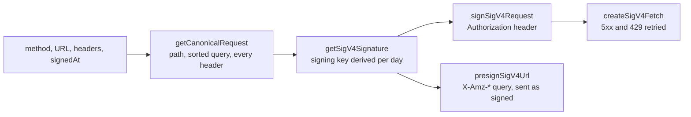

# SigV4 signing

`packages/shared/src/services/sigv4` signs requests to R2's S3 API with AWS Signature Version 4, on Web Crypto alone, so the same code runs in the web Worker, in Node and in a browser. It replaces `aws4fetch` in its three callers:

- the Worker's presigned R2 URLs (`presignStorageUrl` in `packages/db`), since a binding cannot sign a URL;
- the tooling's R2 transport (`createR2Transport` in `scripts`);
- the Phaser file pack's bucket listing (`apps/web/scripts/phaser/filePack`).

Nothing Cloudflare provides signs a request: a browser uploads straight to R2 through a presigned PUT, past the Worker's request body limit, and a script on a developer's machine has no binding at all.

## How a request is signed

The surface is the slice R2 uses:

- **Every header the caller passes is signed**, `Content-Type`, `Content-Length` and `Range` included, so a presigned PUT refuses an upload whose type differs from the one it was signed for. A header the runtime adds later (the user agent, the length of a body) is left out because the caller never passed it.
- **The payload is unsigned** unless the request names its hash in `X-Amz-Content-Sha256`, so a body is sent without being read and hashed first.
- **A presigned URL's query is sent exactly as it was signed.** `URL` would write a space as `+` and leave `*` bare, so the signer writes the canonical query back into the URL.
- **The signing time is an input**, defaulting to the clock, so a caller that knows the server's clock runs ahead can sign at its time.
- **Retries live in the fetch, not the signer.** A 5xx or a 429 is sent again after a wait drawn at random below a ceiling that doubles each time, ten times by default. A streamed body is sent once, since the first attempt spends it.

### Deliberate differences from aws4fetch

| aws4fetch                                                                     | Here                                                             | Why                                                                                    |
| :---------------------------------------------------------------------------- | :--------------------------------------------------------------- | :------------------------------------------------------------------------------------- |
| Guesses the service and region from the host, for dozens of AWS endpoints     | Both are given in the credentials                                | R2 is the one endpoint, signed as `s3` in `auto`                                       |
| A default list of headers left unsigned (`Content-Type`, `Range`, …)          | Every header passed is signed                                    | The list is the source of #39 and #55; the caller decides what it sends                |
| A literal `+` in a path read as a space                                       | Each segment decoded with `decodeURIComponent`, so `+` stays `+` | S3 reads `+` in a path literally                                                       |
| A repeated query name keeps its first pair for S3                             | Every pair is kept, sorted by value                              | The request sends every pair, so every pair is signed                                  |
| The method inferred from whether a body is present                            | The method is the caller's, `GET` when none is given             | An empty body is a body (#54)                                                          |
| An `AwsClient` that takes a `Request`, clones bodies, and caches signing keys | Functions over a URL and headers; no `Request`, no cache         | No caller passes a `Request`; deriving a key is four HMACs beside a network round trip |
| Session tokens, SigV2-era services, `appendSessionToken`                      | None                                                             | R2 tokens carry no session                                                             |

Measured: aws4fetch was 64 KB installed across three packages' manifests; the signer is about 250 lines of our own code, comments included, in `@esposter/shared`, with no dependency.

## Upstream

Every issue and pull request of [mhart/aws4fetch](https://github.com/mhart/aws4fetch) (85: 24 open, 61 closed) has one verdict. The in-scope rows are below; a regression test is named by its issue number. Each defect's Proof names its regression test, which runs against this signer. The table does not record which defects a probe reproduced against aws4fetch 1.0.20 before the rewrite, since that API differs from ours and the test cannot be pointed at it unchanged; the Verdict is the tracker's report, not a probe's result.

| Issue                                               | Verdict             | Proof                                                                                                                |
| :-------------------------------------------------- | :------------------ | :------------------------------------------------------------------------------------------------------------------- |
| [#39](https://github.com/mhart/aws4fetch/issues/39) | In scope — defect   | `#39 signs AWS's example GET with a range to its published signature`; upstream's default leaves `Range` unsigned    |
| [#46](https://github.com/mhart/aws4fetch/issues/46) | In scope — defect   | `#46 #73 signs AWS's example …`: the expiry is a query parameter alone, never a signed header                        |
| [#52](https://github.com/mhart/aws4fetch/issues/52) | In scope — defect   | `#52 #65 sends a request with a streamed body once`; not reproduced on Node 26, kept as the pin                      |
| [#65](https://github.com/mhart/aws4fetch/pull/65)   | In scope — defect   | As #52                                                                                                               |
| [#54](https://github.com/mhart/aws4fetch/issues/54) | In scope — defect   | `#54 sends an empty body with the method given`; upstream infers `GET` from an empty body                            |
| [#81](https://github.com/mhart/aws4fetch/pull/81)   | In scope — defect   | As #54                                                                                                               |
| [#55](https://github.com/mhart/aws4fetch/issues/55) | In scope — defect   | `#55 #74 signs every header given`; upstream drops `Content-Length` and `Content-Type`                               |
| [#80](https://github.com/mhart/aws4fetch/issues/80) | In scope — defect   | No `Request` is taken, so no body is read off one: the fetch passes the caller's body unchanged (`#54 …`)            |
| [#83](https://github.com/mhart/aws4fetch/issues/83) | In scope — defect   | `#83 #85 sends the query as it was signed`; upstream writes a space as `+`                                           |
| [#85](https://github.com/mhart/aws4fetch/pull/85)   | In scope — defect   | As #83                                                                                                               |
| [#36](https://github.com/mhart/aws4fetch/issues/36) | In scope — feature  | `#36 leaves the payload unsigned when the request names no hash`                                                     |
| [#50](https://github.com/mhart/aws4fetch/pull/50)   | In scope — feature  | As #36                                                                                                               |
| [#73](https://github.com/mhart/aws4fetch/issues/73) | In scope — feature  | `signedAt`, exercised by both AWS examples                                                                           |
| [#74](https://github.com/mhart/aws4fetch/issues/74) | In scope — feature  | `#55 #74 signs every header given`                                                                                   |
| [#5](https://github.com/mhart/aws4fetch/pull/5)     | Feature — not built | It adds `Range` to the unsigned list, which #39 shows is wrong for S3                                                |
| [#69](https://github.com/mhart/aws4fetch/issues/69) | Feature — not built | A network error is thrown, not retried: whether a request is safe to repeat after it may have landed is the caller's |
| [#84](https://github.com/mhart/aws4fetch/issues/84) | Feature — not built | A 408 is outside the 5xx and 429 policy, which no caller has met                                                     |

Two defects the tracker does not hold, found in the audit's probes and fixed here: a literal `+` in an S3 path (`keeps a literal plus in an S3 path as a plus`), and a repeated query name (`keeps every pair of a repeated query name`).

The other 68 items, by class (10 + 7 + 25 + 43 = 85):

- **Out of scope (25)** — other services and hosts (#12, #13, #30, #45, #48, #53, #59, #76, #79, #82), runtimes we do not run on or that now ship `fetch` and Web Crypto (#3, #22, #47, #61, #70), the upstream's own tooling and dependency bumps (#9, #21, #24, #37, #49, #71, #75), other services' URI encoding (#26), globals injection into the client (#43), and headers a proxy rewrites in transit (#77), whose constraint is that only headers sent unchanged are signed.
- **False positive (43)** — fixed in an upstream release (#6, #7, #8, #16, #17, #18, #19, #29, #35, #41, #42, #44, #57, #58, #60, #62), duplicates (#32 of #15, #56 of #57), usage questions (#1, #2, #4, #14, #15, #20, #23, #25, #27, #28, #31, #33, #34, #38, #40, #51, #63, #64, #66, #67, #68, #72, #78) and documentation gaps (#10, #11).

## Notes

- A request must send every header it was signed with, with the same value. A proxy that rewrites one (a compression header, say) breaks the signature, which is why nothing is signed that the caller did not pass.
- R2 and S3 refuse a presigned URL that lives past seven days, so `presignSigV4Url` refuses one too.

## Key files

| File                                                        | Role                                           |
| :---------------------------------------------------------- | :--------------------------------------------- |
| `packages/shared/src/services/sigv4/getCanonicalRequest.ts` | The canonical path, query and headers          |
| `packages/shared/src/services/sigv4/getSigV4Signature.ts`   | The signing key's derivation and the signature |
| `packages/shared/src/services/sigv4/signSigV4Request.ts`    | The `Authorization` header                     |
| `packages/shared/src/services/sigv4/presignSigV4Url.ts`     | The presigned URL, its query written as signed |
| `packages/shared/src/services/sigv4/createSigV4Fetch.ts`    | The signed fetch and its retries               |
| `packages/db/src/services/storage/presignStorageUrl.ts`     | The Worker's presigned R2 URLs                 |
| `scripts/src/services/cloudflare/createR2Transport.ts`      | The tooling's R2 transport                     |

## Sources

- The upstream repository, [mhart/aws4fetch](https://github.com/mhart/aws4fetch), and its issue tracker, read whole before the rewrite.
- [Signature Version 4 for API requests](https://docs.aws.amazon.com/IAM/latest/UserGuide/reference_sigv.html), the canonical request and the signing key's derivation.
- [Authenticating Requests: Using Query Parameters](https://docs.aws.amazon.com/AmazonS3/latest/API/sigv4-query-string-auth.html) and [Using the Authorization Header](https://docs.aws.amazon.com/AmazonS3/latest/API/sig-v4-header-based-auth.html), whose examples are the suite's two published signatures.
- [R2 presigned URLs](https://developers.cloudflare.com/r2/api/s3/presigned-urls/), the seven-day limit and the `auto` region.
