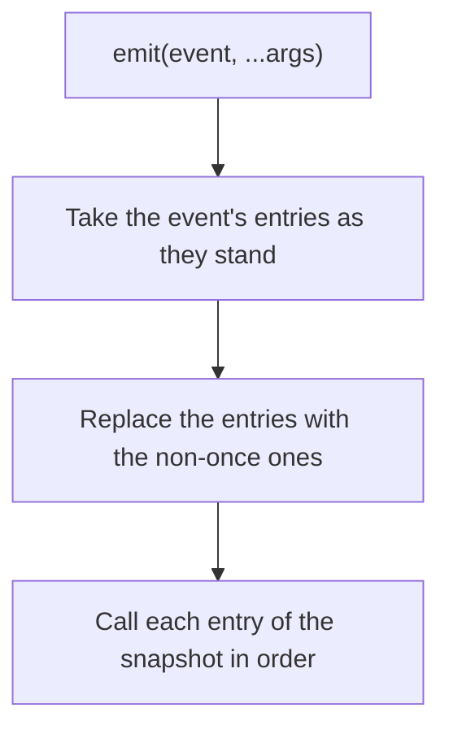

# Typed event emitter

`TypedEventEmitter` in `packages/shared/src/models/eventEmitter/` is the emitter behind the app's game event bus. It takes an event map, an interface of event names to listener signatures, and types every `on`, `once`, `off` and `emit` against it: the event name is one of the map's keys, and the listener or the arguments are the map's own for that key. The app's bus is `new TypedEventEmitter<PhaserEvents>()` in `apps/web/app/services/phaser/phaserEventEmitter.ts`.

It replaced `eventemitter3`, which the app used for the same bus, and it is the second absorption of a utility into `@esposter/shared`. Its verdicts are in the [upstream table](#upstream) below, each with the test or type test that proves it.

## Surface

- `on(event, listener)` and `once(event, listener)` register a listener; a non-function listener throws `InvalidOperationError`.
- `off(event, listener)` removes every registration of that listener on the event.
- `emit(event, ...args)` calls each listener with the arguments and returns whether there was one to call.
- `removeAllListeners(event?)` removes one event's listeners, or every event's when no event is given.

The event name, the listener and the arguments are checked against the map at compile time. The map's listeners are typed as function types, so a parameter keeps its name in the editor.

## How an emit runs

Each event's listeners are kept as an array of entries, and an add or a remove replaces the array rather than changing it. An emit therefore works on the array it found when it started:

A listener removed during the emit still runs for that emit, and one added during it runs from the next emit on. A once listener leaves the registry before any listener runs, so a listener that emits the same event does not call it twice. This is the order Node's `EventEmitter` documents, and the one the app's scene listeners were written against.

## Key Files

| Path                                                            | Role                                                           |
| --------------------------------------------------------------- | -------------------------------------------------------------- |
| `packages/shared/src/models/eventEmitter/TypedEventEmitter.ts`  | The emitter: `on`, `once`, `off`, `emit`, `removeAllListeners` |
| `packages/shared/src/models/eventEmitter/EventListenerMap.ts`   | The constraint an event map satisfies: each key a listener     |
| `packages/shared/src/models/eventEmitter/EventListenerEntry.ts` | One registered listener and whether it is a once listener      |
| `apps/web/app/services/phaser/phaserEventEmitter.ts`            | The app's bus, typed by `PhaserEvents`                         |

## Upstream

Every `eventemitter3` issue on `primus/eventemitter3`, read with its comments, and the pull request that matters, with its verdict, graded by the [triage](../../architecture/dependency-admission/design.md). The type test is `TypedEventEmitter.test-d.ts`. Every issue is named once in the table; the upstream's dependency-update reports are one row because each concerns a devDependency the replacement does not inherit.

| Upstream                                                                                                                                                                                                                                                                                                                                                                                                                                                                                                                                                                                                                                                                                                                                                                                                                                                                                                                                                                                                                                                                                                                                                                                                                                                                                                                                                                                                                                                                                                                                                                                                                                                                                                                                                                                                                                                                                                                                                                                                                                                                                                                                                                                                                                                                                                                                                                                                                                                                                                                                     | Verdict                                            | Proof                                                                                                                                                                                                                                                                |
| -------------------------------------------------------------------------------------------------------------------------------------------------------------------------------------------------------------------------------------------------------------------------------------------------------------------------------------------------------------------------------------------------------------------------------------------------------------------------------------------------------------------------------------------------------------------------------------------------------------------------------------------------------------------------------------------------------------------------------------------------------------------------------------------------------------------------------------------------------------------------------------------------------------------------------------------------------------------------------------------------------------------------------------------------------------------------------------------------------------------------------------------------------------------------------------------------------------------------------------------------------------------------------------------------------------------------------------------------------------------------------------------------------------------------------------------------------------------------------------------------------------------------------------------------------------------------------------------------------------------------------------------------------------------------------------------------------------------------------------------------------------------------------------------------------------------------------------------------------------------------------------------------------------------------------------------------------------------------------------------------------------------------------------------------------------------------------------------------------------------------------------------------------------------------------------------------------------------------------------------------------------------------------------------------------------------------------------------------------------------------------------------------------------------------------------------------------------------------------------------------------------------------------------------- | -------------------------------------------------- | -------------------------------------------------------------------------------------------------------------------------------------------------------------------------------------------------------------------------------------------------------------------- |
| [#285](https://github.com/primus/eventemitter3/pull/285) (pull request, open)                                                                                                                                                                                                                                                                                                                                                                                                                                                                                                                                                                                                                                                                                                                                                                                                                                                                                                                                                                                                                                                                                                                                                                                                                                                                                                                                                                                                                                                                                                                                                                                                                                                                                                                                                                                                                                                                                                                                                                                                                                                                                                                                                                                                                                                                                                                                                                                                                                                                | In scope — defect                                  | Regression test "removeAllListeners on the empty event name leaves other events' listeners" in `TypedEventEmitter.test.ts`. It fails on `eventemitter3` 5.0.4, where `removeAllListeners("")` clears every event; the emitter checks the argument for `undefined`    |
| [#78](https://github.com/primus/eventemitter3/issues/78)                                                                                                                                                                                                                                                                                                                                                                                                                                                                                                                                                                                                                                                                                                                                                                                                                                                                                                                                                                                                                                                                                                                                                                                                                                                                                                                                                                                                                                                                                                                                                                                                                                                                                                                                                                                                                                                                                                                                                                                                                                                                                                                                                                                                                                                                                                                                                                                                                                                                                     | In scope — defect                                  | The listener is typed by the map, and `on` throws `InvalidOperationError` for a non-function ("on rejects a listener that is not a function"); upstream 5.0.4 throws too, so the test pins a guard both share                                                        |
| [#222](https://github.com/primus/eventemitter3/issues/222), [#218](https://github.com/primus/eventemitter3/issues/218)                                                                                                                                                                                                                                                                                                                                                                                                                                                                                                                                                                                                                                                                                                                                                                                                                                                                                                                                                                                                                                                                                                                                                                                                                                                                                                                                                                                                                                                                                                                                                                                                                                                                                                                                                                                                                                                                                                                                                                                                                                                                                                                                                                                                                                                                                                                                                                                                                       | In scope — defect                                  | Type test "a generic wrapper around emit keeps the event's arguments" in `TypedEventEmitter.test-d.ts`: `Parameters` of the map's own listener, so a wrapper over `emit` keeps every event's arguments                                                               |
| [#276](https://github.com/primus/eventemitter3/issues/276), [#243](https://github.com/primus/eventemitter3/issues/243), [#104](https://github.com/primus/eventemitter3/issues/104)                                                                                                                                                                                                                                                                                                                                                                                                                                                                                                                                                                                                                                                                                                                                                                                                                                                                                                                                                                                                                                                                                                                                                                                                                                                                                                                                                                                                                                                                                                                                                                                                                                                                                                                                                                                                                                                                                                                                                                                                                                                                                                                                                                                                                                                                                                                                                           | In scope — defect                                  | Type test "a subclass inherits the event map's types" in `TypedEventEmitter.test-d.ts`: a class extending the emitter with a concrete map is typed by it, with no duplicate declaration                                                                              |
| [#271](https://github.com/primus/eventemitter3/issues/271), [#241](https://github.com/primus/eventemitter3/issues/241), [#217](https://github.com/primus/eventemitter3/issues/217), [#67](https://github.com/primus/eventemitter3/issues/67)                                                                                                                                                                                                                                                                                                                                                                                                                                                                                                                                                                                                                                                                                                                                                                                                                                                                                                                                                                                                                                                                                                                                                                                                                                                                                                                                                                                                                                                                                                                                                                                                                                                                                                                                                                                                                                                                                                                                                                                                                                                                                                                                                                                                                                                                                                 | In scope — feature                                 | Type test "on types the listener by the event", and "emit takes the arguments of the event's own listener", whose `parameter(0)` check lists the event names the map offers for completion                                                                           |
| [#183](https://github.com/primus/eventemitter3/issues/183)                                                                                                                                                                                                                                                                                                                                                                                                                                                                                                                                                                                                                                                                                                                                                                                                                                                                                                                                                                                                                                                                                                                                                                                                                                                                                                                                                                                                                                                                                                                                                                                                                                                                                                                                                                                                                                                                                                                                                                                                                                                                                                                                                                                                                                                                                                                                                                                                                                                                                   | In scope — feature                                 | "removeAllListeners without an event removes every event's listeners" in `TypedEventEmitter.test.ts`                                                                                                                                                                 |
| [#57](https://github.com/primus/eventemitter3/issues/57)                                                                                                                                                                                                                                                                                                                                                                                                                                                                                                                                                                                                                                                                                                                                                                                                                                                                                                                                                                                                                                                                                                                                                                                                                                                                                                                                                                                                                                                                                                                                                                                                                                                                                                                                                                                                                                                                                                                                                                                                                                                                                                                                                                                                                                                                                                                                                                                                                                                                                     | False positive                                     | The listener is registered by reference and called with the arguments the event declares; a subclass in ES class syntax extends it, as the subclass test-d shows                                                                                                     |
| [#250](https://github.com/primus/eventemitter3/issues/250), [#249](https://github.com/primus/eventemitter3/issues/249), [#247](https://github.com/primus/eventemitter3/issues/247), [#240](https://github.com/primus/eventemitter3/issues/240), [#236](https://github.com/primus/eventemitter3/issues/236), [#210](https://github.com/primus/eventemitter3/issues/210), [#180](https://github.com/primus/eventemitter3/issues/180), [#70](https://github.com/primus/eventemitter3/issues/70), [#61](https://github.com/primus/eventemitter3/issues/61), [#42](https://github.com/primus/eventemitter3/issues/42), [#19](https://github.com/primus/eventemitter3/issues/19)                                                                                                                                                                                                                                                                                                                                                                                                                                                                                                                                                                                                                                                                                                                                                                                                                                                                                                                                                                                                                                                                                                                                                                                                                                                                                                                                                                                                                                                                                                                                                                                                                                                                                                                                                                                                                                                                   | False positive                                     | A question, a support request or a closed report with no defect: the answering comment is the proof, and the behaviour it describes is one of the tests below                                                                                                        |
| [#275](https://github.com/primus/eventemitter3/issues/275)                                                                                                                                                                                                                                                                                                                                                                                                                                                                                                                                                                                                                                                                                                                                                                                                                                                                                                                                                                                                                                                                                                                                                                                                                                                                                                                                                                                                                                                                                                                                                                                                                                                                                                                                                                                                                                                                                                                                                                                                                                                                                                                                                                                                                                                                                                                                                                                                                                                                                   | False positive                                     | `sideEffects` is already `false` in `packages/shared/package.json`, so the bundler already drops an unused export                                                                                                                                                    |
| [#262](https://github.com/primus/eventemitter3/issues/262)                                                                                                                                                                                                                                                                                                                                                                                                                                                                                                                                                                                                                                                                                                                                                                                                                                                                                                                                                                                                                                                                                                                                                                                                                                                                                                                                                                                                                                                                                                                                                                                                                                                                                                                                                                                                                                                                                                                                                                                                                                                                                                                                                                                                                                                                                                                                                                                                                                                                                   | False positive                                     | "a listener removed during an emit still runs for that emit": emit copies the entries before any listener runs, as Node's `EventEmitter` does; the issue's expected output is the behaviour Node documents not to have                                               |
| [#58](https://github.com/primus/eventemitter3/issues/58), [#44](https://github.com/primus/eventemitter3/issues/44), [#24](https://github.com/primus/eventemitter3/issues/24), [#5](https://github.com/primus/eventemitter3/issues/5), [#1](https://github.com/primus/eventemitter3/issues/1)                                                                                                                                                                                                                                                                                                                                                                                                                                                                                                                                                                                                                                                                                                                                                                                                                                                                                                                                                                                                                                                                                                                                                                                                                                                                                                                                                                                                                                                                                                                                                                                                                                                                                                                                                                                                                                                                                                                                                                                                                                                                                                                                                                                                                                                 | Out of scope — owner: the emitter's caller         | No caller of the bus passes a context; `#58`'s reply is that the app binds its own function, and the in-app listeners do so already                                                                                                                                  |
| [#268](https://github.com/primus/eventemitter3/issues/268), [#203](https://github.com/primus/eventemitter3/issues/203), [#185](https://github.com/primus/eventemitter3/issues/185), [#157](https://github.com/primus/eventemitter3/issues/157), [#85](https://github.com/primus/eventemitter3/issues/85), [#50](https://github.com/primus/eventemitter3/issues/50), [#26](https://github.com/primus/eventemitter3/issues/26), [#4](https://github.com/primus/eventemitter3/issues/4)                                                                                                                                                                                                                                                                                                                                                                                                                                                                                                                                                                                                                                                                                                                                                                                                                                                                                                                                                                                                                                                                                                                                                                                                                                                                                                                                                                                                                                                                                                                                                                                                                                                                                                                                                                                                                                                                                                                                                                                                                                                         | Out of scope — no caller                           | The app's bus has `on`, `once`, `off`, `emit` and `removeAllListeners`; `prependListener`, wildcards, `listeners`, `listenerCount`, "existEvent", "removeListenersByContext", a promise `once` and an async iterator are not called anywhere                         |
| [#269](https://github.com/primus/eventemitter3/issues/269), [#207](https://github.com/primus/eventemitter3/issues/207), [#197](https://github.com/primus/eventemitter3/issues/197), [#117](https://github.com/primus/eventemitter3/issues/117), [#114](https://github.com/primus/eventemitter3/issues/114), [#101](https://github.com/primus/eventemitter3/issues/101)                                                                                                                                                                                                                                                                                                                                                                                                                                                                                                                                                                                                                                                                                                                                                                                                                                                                                                                                                                                                                                                                                                                                                                                                                                                                                                                                                                                                                                                                                                                                                                                                                                                                                                                                                                                                                                                                                                                                                                                                                                                                                                                                                                       | Out of scope — no caller                           | A feature the bus does not need: an `AbortController` option, a strict-mode warning on `off`, a `once` that auto-removes on a timer, a stop-propagation return value, and a sync-to-async dispatch change that would reorder the one-shot chains in `GainExperience` |
| [#267](https://github.com/primus/eventemitter3/issues/267), [#63](https://github.com/primus/eventemitter3/issues/63), [#6](https://github.com/primus/eventemitter3/issues/6)                                                                                                                                                                                                                                                                                                                                                                                                                                                                                                                                                                                                                                                                                                                                                                                                                                                                                                                                                                                                                                                                                                                                                                                                                                                                                                                                                                                                                                                                                                                                                                                                                                                                                                                                                                                                                                                                                                                                                                                                                                                                                                                                                                                                                                                                                                                                                                 | Out of scope — deliberate divergence               | "off removes every registration of the listener" in `TypedEventEmitter.test.ts`: `off` takes out every registration, as upstream's `removeListener` does; Node removes one, and no caller registers a listener twice                                                 |
| [#214](https://github.com/primus/eventemitter3/issues/214), [#108](https://github.com/primus/eventemitter3/issues/108)                                                                                                                                                                                                                                                                                                                                                                                                                                                                                                                                                                                                                                                                                                                                                                                                                                                                                                                                                                                                                                                                                                                                                                                                                                                                                                                                                                                                                                                                                                                                                                                                                                                                                                                                                                                                                                                                                                                                                                                                                                                                                                                                                                                                                                                                                                                                                                                                                       | Out of scope — keys and built-ins are the caller's | Listeners are held in a `Map` and never sniffed for a `fn` property, so an `Array.prototype.fn` a caller adds cannot change the count; the upstream answer (#214) is that editing built-ins is the caller's                                                          |
| [#281](https://github.com/primus/eventemitter3/issues/281), [#277](https://github.com/primus/eventemitter3/issues/277), [#265](https://github.com/primus/eventemitter3/issues/265), [#261](https://github.com/primus/eventemitter3/issues/261), [#254](https://github.com/primus/eventemitter3/issues/254), [#253](https://github.com/primus/eventemitter3/issues/253), [#251](https://github.com/primus/eventemitter3/issues/251), [#248](https://github.com/primus/eventemitter3/issues/248), [#245](https://github.com/primus/eventemitter3/issues/245), [#235](https://github.com/primus/eventemitter3/issues/235), [#205](https://github.com/primus/eventemitter3/issues/205), [#182](https://github.com/primus/eventemitter3/issues/182), [#110](https://github.com/primus/eventemitter3/issues/110), [#95](https://github.com/primus/eventemitter3/issues/95), [#86](https://github.com/primus/eventemitter3/issues/86), [#81](https://github.com/primus/eventemitter3/issues/81), [#80](https://github.com/primus/eventemitter3/issues/80), [#73](https://github.com/primus/eventemitter3/issues/73), [#69](https://github.com/primus/eventemitter3/issues/69), [#49](https://github.com/primus/eventemitter3/issues/49), [#47](https://github.com/primus/eventemitter3/issues/47), [#38](https://github.com/primus/eventemitter3/issues/38), [#36](https://github.com/primus/eventemitter3/issues/36), [#30](https://github.com/primus/eventemitter3/issues/30), [#29](https://github.com/primus/eventemitter3/issues/29), [#23](https://github.com/primus/eventemitter3/issues/23), [#22](https://github.com/primus/eventemitter3/issues/22), [#20](https://github.com/primus/eventemitter3/issues/20), [#15](https://github.com/primus/eventemitter3/issues/15)                                                                                                                                                                                                                                                                                                                                                                                                                                                                                                                                                                                                                                                                                                                                                                   | Out of scope — packaging                           | The replacement is one ESM module in `@esposter/shared`'s build; its entry, its declaration files and its CDN bundle are the build's, checked by `publint` and `attw` in `pnpm build`                                                                                |
| [#263](https://github.com/primus/eventemitter3/issues/263), [#259](https://github.com/primus/eventemitter3/issues/259), [#257](https://github.com/primus/eventemitter3/issues/257), [#255](https://github.com/primus/eventemitter3/issues/255), [#242](https://github.com/primus/eventemitter3/issues/242), [#204](https://github.com/primus/eventemitter3/issues/204), [#109](https://github.com/primus/eventemitter3/issues/109), [#68](https://github.com/primus/eventemitter3/issues/68)                                                                                                                                                                                                                                                                                                                                                                                                                                                                                                                                                                                                                                                                                                                                                                                                                                                                                                                                                                                                                                                                                                                                                                                                                                                                                                                                                                                                                                                                                                                                                                                                                                                                                                                                                                                                                                                                                                                                                                                                                                                 | Out of scope — not a request of ours               | A benchmark, an install on one chip, a performance tracking issue, a docs example or a discussions tab: the bench gate is `bench.md` files in this repo, and the rewrite is the performance change                                                                   |
| [#225](https://github.com/primus/eventemitter3/issues/225), [#59](https://github.com/primus/eventemitter3/issues/59)                                                                                                                                                                                                                                                                                                                                                                                                                                                                                                                                                                                                                                                                                                                                                                                                                                                                                                                                                                                                                                                                                                                                                                                                                                                                                                                                                                                                                                                                                                                                                                                                                                                                                                                                                                                                                                                                                                                                                                                                                                                                                                                                                                                                                                                                                                                                                                                                                         | Out of scope — superseded                          | A TypeScript 3.9 release candidate, a prototype-style subclass and CoffeeScript, each gone from the toolchain or the app; the type test covers the class form that remains                                                                                           |
| [#270](https://github.com/primus/eventemitter3/issues/270)                                                                                                                                                                                                                                                                                                                                                                                                                                                                                                                                                                                                                                                                                                                                                                                                                                                                                                                                                                                                                                                                                                                                                                                                                                                                                                                                                                                                                                                                                                                                                                                                                                                                                                                                                                                                                                                                                                                                                                                                                                                                                                                                                                                                                                                                                                                                                                                                                                                                                   | Out of scope — generic subclass                    | TypeScript cannot resolve `Z["test"] & (() => void)` for an unresolved generic `Z`, and the same error appears for any emitter, not this one; a concrete map is typed (see the subclass test-d)                                                                      |
| [#229](https://github.com/primus/eventemitter3/issues/229), [#227](https://github.com/primus/eventemitter3/issues/227), [#220](https://github.com/primus/eventemitter3/issues/220), [#213](https://github.com/primus/eventemitter3/issues/213), [#206](https://github.com/primus/eventemitter3/issues/206), [#192](https://github.com/primus/eventemitter3/issues/192), [#179](https://github.com/primus/eventemitter3/issues/179), [#173](https://github.com/primus/eventemitter3/issues/173), [#170](https://github.com/primus/eventemitter3/issues/170), [#169](https://github.com/primus/eventemitter3/issues/169), [#166](https://github.com/primus/eventemitter3/issues/166), [#164](https://github.com/primus/eventemitter3/issues/164), [#162](https://github.com/primus/eventemitter3/issues/162), [#160](https://github.com/primus/eventemitter3/issues/160), [#158](https://github.com/primus/eventemitter3/issues/158), [#156](https://github.com/primus/eventemitter3/issues/156), [#155](https://github.com/primus/eventemitter3/issues/155), [#154](https://github.com/primus/eventemitter3/issues/154), [#153](https://github.com/primus/eventemitter3/issues/153), [#149](https://github.com/primus/eventemitter3/issues/149), [#148](https://github.com/primus/eventemitter3/issues/148), [#147](https://github.com/primus/eventemitter3/issues/147), [#146](https://github.com/primus/eventemitter3/issues/146), [#145](https://github.com/primus/eventemitter3/issues/145), [#143](https://github.com/primus/eventemitter3/issues/143), [#141](https://github.com/primus/eventemitter3/issues/141), [#140](https://github.com/primus/eventemitter3/issues/140), [#139](https://github.com/primus/eventemitter3/issues/139), [#137](https://github.com/primus/eventemitter3/issues/137), [#131](https://github.com/primus/eventemitter3/issues/131), [#126](https://github.com/primus/eventemitter3/issues/126), [#122](https://github.com/primus/eventemitter3/issues/122), [#121](https://github.com/primus/eventemitter3/issues/121), [#119](https://github.com/primus/eventemitter3/issues/119), [#99](https://github.com/primus/eventemitter3/issues/99), [#98](https://github.com/primus/eventemitter3/issues/98), [#93](https://github.com/primus/eventemitter3/issues/93), [#92](https://github.com/primus/eventemitter3/issues/92), [#88](https://github.com/primus/eventemitter3/issues/88), [#83](https://github.com/primus/eventemitter3/issues/83), [#76](https://github.com/primus/eventemitter3/issues/76) | Out of scope — dependency bot report               | A dependency-update report for a devDependency of the upstream (uglify-js, mocha, nyc, webpack, browserify, pre-commit, sauce-browsers); the replacement's tooling is ours and bumped by Renovate                                                                    |
| [#273](https://github.com/primus/eventemitter3/issues/273), [#195](https://github.com/primus/eventemitter3/issues/195), [#43](https://github.com/primus/eventemitter3/issues/43), [#18](https://github.com/primus/eventemitter3/issues/18)                                                                                                                                                                                                                                                                                                                                                                                                                                                                                                                                                                                                                                                                                                                                                                                                                                                                                                                                                                                                                                                                                                                                                                                                                                                                                                                                                                                                                                                                                                                                                                                                                                                                                                                                                                                                                                                                                                                                                                                                                                                                                                                                                                                                                                                                                                   | Out of scope — the caller's own code               | The behaviour belongs to the code that wraps the emitter: a curried or Flux dispatch, a React state wrapper, an error from a listener whose window closed. The emitter's surface is `on`, `once`, `off`, `emit` and `removeAllListeners`                             |
| [#239](https://github.com/primus/eventemitter3/issues/239)                                                                                                                                                                                                                                                                                                                                                                                                                                                                                                                                                                                                                                                                                                                                                                                                                                                                                                                                                                                                                                                                                                                                                                                                                                                                                                                                                                                                                                                                                                                                                                                                                                                                                                                                                                                                                                                                                                                                                                                                                                                                                                                                                                                                                                                                                                                                                                                                                                                                                   | Out of scope — the emitter's sync contract         | Listeners run synchronously in registration order, the order `GainExperience` and the scene listeners depend on; an async dispatch is a different emitter                                                                                                            |

## Notes

The upstream's behaviour that the emitter keeps on purpose is `off` removing every registration, a listener removed during an emit still running, and a listener's `this` not being bound; each is a row above and a test in `TypedEventEmitter.test.ts`. The package's bundle is larger by the emitter's own code, recorded in `packages/shared/src/index.test.ts`.
