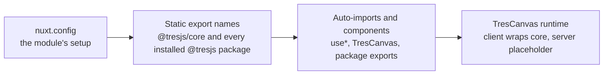

# tresjs-nuxt

`packages/tresjs-nuxt` (npm `tresjs-nuxt`) replaces `@tresjs/nuxt`, the Nuxt module the app used to register by package name. It joins the renderer and Nuxt, and nothing else: the engine stays `@tresjs/core`, and the module is the connection the app used to take from upstream.

## How it works

The module runs twice, at two different times. At configuration it reads the names of what is installed; at build it hands Nuxt the imports and components those names resolve to.

- **Export names are read from the source, never imported.** Importing `@tresjs/core` to list its exports would load the renderer and `three` into every build of the app. The module reads each entry file's export list with `mlly` instead.
- **Every installed `@tresjs/*` package registers.** The app's manifest and the one above it are read, the `@tresjs/core` entry is skipped, and each remaining package's exports register: lowercase names as auto-imports, capitalised names as components. That is how `OrbitControls` reaches a template without an import.
- **The runtime is plain TypeScript.** `TresCanvas` is a render function, not a single-file component, so the package builds without a template compiler and the server half renders no WebGL.
- **`three` is deduplicated** in Vite, so the renderer and the scene share one copy.
- **Custom elements follow the renderer's rule.** `tres-*` tags and `Tres*` components compile as custom elements, except the core's own components, which Vue resolves as components.

## Options

| Option    | Default | Role                                                                                                                              |
| :-------- | :------ | :-------------------------------------------------------------------------------------------------------------------------------- |
| `glsl`    | `false` | Adds `vite-plugin-glsl` so shader files import as strings. The plugin is an optional peer, loaded only when this is on.           |
| `modules` | `[]`    | Extra packages whose exports register beside the installed `@tresjs/*` ones, for a package the app does not list as a dependency. |

The `devtools` option of `@tresjs/nuxt` is gone. It added a TresJS tab to the Nuxt devtools built on Nuxt UI, which pulled that library, its font package and the esbuild override that package needed into the app's install. The module no longer carries any of them.

## Upstream

Every issue in the upstream tracker, open and closed, read with its comments. There are no open issues. A verdict marked unverified is one whose behaviour the replacement keeps but has not reproduced on the version the app runs; each such row names the check that would settle it.

| Issue | Symptom                                                   | Verdict                                                                            | Proof                                                                      |
| :---- | :-------------------------------------------------------- | :--------------------------------------------------------------------------------- | :------------------------------------------------------------------------- |
| #5    | `postprocessing` fails as a CommonJS module at startup    | Out of scope — `postprocessing`'s CommonJS export, upstream of the module          | Owner: `postprocessing`                                                    |
| #6    | Importing from module entry points is not allowed         | Unverified — no reproduction in the thread                                         | Needs a reproduction against the app                                       |
| #8    | `Cannot read properties of undefined (reading 'sys')`     | Out of scope — the template compiler needs `typescript` installed                  | Owner: the consuming app's dependencies                                    |
| #21   | Unresolvable type reference in the runtime component      | In scope — defect, removed by construction: the runtime is plain TypeScript        | No template compiled for the runtime                                       |
| #24   | `TresCanvas` breaks Vue devtools                          | Out of scope — the renderer's devtools bridge                                      | Owner: `@tresjs/core`                                                      |
| #33   | `useNuxtApp()` unavailable inside `TresCanvas`            | Unverified — the wrapper forwards attributes and slots to the renderer unchanged   | Forwarding tested in `TresCanvas.client.test.ts`; `useNuxtApp()` unchecked |
| #41   | Blank canvas navigating between pages with a `TresCanvas` | In scope — defect, unverified on the app's version                                 | Needs a navigation reproduction                                            |
| #45   | `onLoop` and animations fail after a build                | Out of scope — the renderer's render loop                                          | Owner: `@tresjs/core`                                                      |
| #46   | Multiple instances of three, `OrbitControls` broken       | In scope — defect, kept: `three` is deduplicated in Vite                           | Unverified on the app's version                                            |
| #48   | Canvas height grows without limit                         | Out of scope — layout, owned by the page that places the canvas                    | Owner: the consuming app                                                   |
| #49   | `OrbitControls` reports an unknown camera type            | In scope — defect, kept: `three` is deduplicated in Vite                           | Unverified on the app's version                                            |
| #52   | `Cannot find package 'tweakpane'`                         | Out of scope — a peer of `@tresjs/cientos`                                         | Owner: `@tresjs/cientos`                                                   |
| #65   | Feature request: `vite-plugin-glsl` support               | In scope — feature: the `glsl` option                                              | Option in the module's `ModuleOptions`                                     |
| #69   | `Cannot find module 'vite-plugin-glsl'` after an upgrade  | In scope — defect, removed by construction: loaded only when `glsl` is on          | Optional peer, loaded by dynamic import                                    |
| #76   | `Nuxt module should be a function`                        | Out of scope — a package-manager layout, not the module                            | Owner: the consuming app's install                                         |
| #79   | `TresCanvas` blank in dynamic or nested components        | Out of scope — the app's own import                                                | Owner: the consuming app                                                   |
| #83   | Missing template or render function after a Nuxt minor    | In scope — defect, removed by construction: the runtime has no template            | No template compiled for the runtime                                       |
| #97   | `onLoop` not called in `nuxt generate`                    | Fixed upstream — the renderer's `useLoop`                                          | Owner: `@tresjs/core`                                                      |
| #105  | Update the module to TresJS v4                            | False positive — the module tracks the current renderer                            | Dependency on the current `@tresjs/core`                                   |
| #156  | `OrbitControls` unresolved in the playground              | Out of scope — the package must be installed; the module registers what is present | Owner: the consuming app's install                                         |
| #168  | v5 install fails while the core's build script runs       | Fixed upstream — the core's packaging                                              | Owner: `@tresjs/core`                                                      |
| #174  | Type errors on component types                            | Fixed upstream — the types ship from the module's own declarations                 | Unverified on the app's version                                            |

## Sources

- [TresJS](https://github.com/Tresjs/tres) — the renderer, whose exports and custom-element rule the module restates.
- [tresjs/nuxt](https://github.com/Tresjs/nuxt) — the upstream module this replaces, and the tracker the table above reads.
- [Nuxt module authoring](https://nuxt.com/docs/4.x/guide/going-further/modules) — the kit calls the module makes: `addImports`, `addComponent`, `addVitePlugin`, `resolvePath`.

## Key files

| File                                 | Role                                                                                       |
| :----------------------------------- | :----------------------------------------------------------------------------------------- |
| `packages/tresjs-nuxt/src/module.ts` | The module: the imports, the components, the Vite settings and the optional `glsl` plugin. |
| `packages/tresjs-nuxt/src/services/` | The export reader, the installed-package scan and the custom-element predicate.            |
| `packages/tresjs-nuxt/src/runtime/`  | `TresCanvas`, client and server.                                                           |
| `apps/web/configuration/modules.ts`  | Registers the module by its source path.                                                   |
